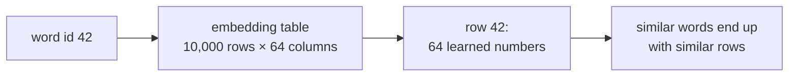

<!-- Written by `npm run lessons` from the lesson data in src/data. Edit the lesson there, not this page. -->

# Embeddings: representing things as vectors

**ML Foundations · Unit 3: Deep learning foundations · Lesson 14 of 16**

> **In one line.** An embedding gives each item, such as a word, a token, a user or a product, a learned vector of numbers, stored as one row of a table. Similar items end up with vectors that are close together.

[Open this lesson on the site](https://learn.hamropedia.com/foundations/embeddings-representing-things-as-vectors/) for its animation, the practice game and tap-to-explain words.

## The problem it solves

Networks need numbers, but words and ids are just labels. One-hot vectors are huge, sparse and treat every pair of items as equally different. Embeddings give each item a small dense vector that training shapes to be useful, so "cat" and "dog" end up close. They are the input layer of every language model and the basis of semantic search and recommendations.

## The idea

An embedding is a learned vector for each item: a word, a user, a product. Similar items end up with similar vectors. Technically, it is a lookup table with one row per item.

## How it works, step by step

1. Create a table E with one row per item: vocabulary size × embedding size, for example 50,000 × 768. Start it random.
2. To embed item id i, take row i: E[i]. It is a lookup, the same as multiplying a one-hot vector by E, but much faster.
3. Feed the vectors into the rest of the network.
4. During training, the gradient flows back into only the rows that were used, and nudges them to be more useful for the task.
5. Items used in similar contexts get similar gradients, so their vectors drift together.
6. Measure similarity between items with cosine similarity of their vectors.
7. Directions can carry meaning: in word2vec, king − man + woman lands near queen.

## Picture it



*An embedding is a lookup: each id has its own row of learned numbers.*

## Analogy

A city map where similar shops end up in the same neighbourhood, so distance means similarity.

**Where the analogy breaks.** A map has 2 dimensions with names like 'north'. Embeddings have hundreds of dimensions, and they rarely have simple names.

## Worked example

10,000 words with dimension 64 gives a 10,000 × 64 matrix. Word id 42 is row 42. A one-hot vector times the matrix gives the same row, but a lookup is much faster.

```python
E = np.random.randn(10_000, 64) * 0.01
vecs = E[token_ids]    # shape (len(token_ids), 64)
```

## Must know

- An embedding layer is a learnable lookup table: nn.Embedding(num_items, dim).
- Lookup = one-hot × E, without building the one-hot.
- Only the rows used in a batch get gradients.
- Similar items → nearby vectors; compare them with cosine similarity.
- A single dimension of an embedding rarely has a human-readable meaning: the meaning lies in directions and distances.
- Pre-trained embeddings (from language models) power semantic search and RAG (Unit 5).

## Common mistakes

- An id bigger than the table size: an index error.
- An embedding size so small it can't separate items, or so large it overfits small data.
- Comparing embeddings from two different models as if they shared a space.

> **Not true:** Embeddings from two different models can be compared directly, vector against vector.  
> **In fact:** Each model learns its own space, with its own directions. Vectors can only be compared inside the model that produced them.

> **Not true:** A bigger embedding size is always better.  
> **In fact:** Too small and the vectors can't tell items apart; too large and they overfit small data and waste memory. Choose the size to fit the data.

## Practise

Try each one yourself first: on paper, in code or out loud. Then open the answer and compare.

### 1. Derive

Show that a one-hot vector times an embedding matrix E returns one row of E. Which rows of E get a gradient from one example?

<details>
<summary>Show one good answer</summary>

A one-hot vector for token i has a 1 in position i and 0 everywhere else. Multiplying it by E (a V × d matrix):  
(one-hot · E)ⱼ = Σₖ onehotₖ · Eₖⱼ = Eᵢⱼ  
because every term is 0 except k = i. So the result is exactly row i of E. That is why frameworks skip the multiplication and just look the row up.

Gradient: the output is row i, so the loss depends only on row i of E (for this token). ∂L/∂E is a matrix that is 0 everywhere except row i, which gets ∂L/∂(output). In matrix form, ∂L/∂E = onehotᵀ · ∂L/∂(output), which puts the gradient into row i only.

From one example, only the rows of the tokens that appear in it get a gradient. Rare tokens therefore get few updates, which is why their embeddings are learned less well.

```python
import torch
E = torch.randn(5, 3, requires_grad=True)
one_hot = torch.tensor([0., 0., 1., 0., 0.])
out = one_hot @ E
print(torch.equal(out, E[2]))           # True: row 2
out.sum().backward()
print(E.grad)                           # only row 2 is non-zero
```

</details>

### 2. Build

Train makemore-style character embeddings with 2 dimensions and plot them. Which characters end up close together?

<details>
<summary>Show one good answer</summary>

The makemore MLP: take the previous 3 characters, look up a 2-number embedding for each, join them into 6 numbers, pass them through a hidden layer of 100 units, and predict the next character. Train on the 32,000 names, then plot each character at its 2-D embedding.

The vowels a, e, i, o, u (and often y) usually end up close together, because they play similar roles: they appear in similar positions and are followed by similar letters. "." (start or end of a name) sits apart, and rare letters such as q, x and z drift towards the edges. Nobody told the model what a vowel is; it found the similarity because similar characters help predict the next one in similar ways.

```python
import urllib.request
import torch
import torch.nn.functional as F
import matplotlib.pyplot as plt

names = urllib.request.urlopen("https://raw.githubusercontent.com/karpathy/makemore/master/names.txt").read().decode().split()
chars = ["."] + sorted(set("".join(names)))
stoi = {c: i for i, c in enumerate(chars)}
X, Y = [], []
for n in names:
    context = [0, 0, 0]
    for c in n + ".":
        X.append(context); Y.append(stoi[c]); context = context[1:] + [stoi[c]]
X, Y = torch.tensor(X), torch.tensor(Y)

g = torch.Generator().manual_seed(0)
C = torch.randn(27, 2, generator=g, requires_grad=True)            # 2-D embeddings
W1, b1 = (torch.randn(6, 100, generator=g) * 0.4).requires_grad_(), torch.zeros(100, requires_grad=True)
W2, b2 = (torch.randn(100, 27, generator=g) * 0.1).requires_grad_(), torch.zeros(27, requires_grad=True)
params = [C, W1, b1, W2, b2]
for step in range(20_000):
    idx = torch.randint(0, len(X), (64,), generator=g)
    h = torch.tanh(C[X[idx]].view(-1, 6) @ W1 + b1)
    loss = F.cross_entropy(h @ W2 + b2, Y[idx])
    for p in params:
        p.grad = None
    loss.backward()
    for p in params:
        p.data -= (0.1 if step < 15_000 else 0.01) * p.grad
print("loss:", round(loss.item(), 2))

emb = C.detach()
plt.scatter(emb[:, 0], emb[:, 1], s=200, c="lightblue")
for i, ch in enumerate(chars):
    plt.text(emb[i, 0], emb[i, 1], ch, ha="center", va="center")
plt.show()
vowels = [stoi[v] for v in "aeiou"]
print("mean distance between vowels:", round(torch.pdist(emb[vowels]).mean().item(), 2),
      "| between all letters:", round(torch.pdist(emb[1:]).mean().item(), 2))
```

</details>

### 3. Break

Pass a token id bigger than the vocabulary and read the error. Then set the embedding size to 1 and see what happens to the loss.

<details>
<summary>Show one good answer</summary>

A token id of 27 or more in a 27-row table: PyTorch raises "IndexError: index out of range in self". On a GPU the error is often a vague "device-side assert triggered" instead, which is much harder to trace. It usually means the tokeniser and the model disagree about the vocabulary size, for example after adding new special tokens without resizing the embedding.

Embedding size 1: every character must sit on a single line, so characters that should be similar in some ways and different in others can't be placed well. The loss ends noticeably higher than with 2 or 10 dimensions (in the run below, the 1-D model plateaus higher than the 10-D one). Too few dimensions underfit; very many waste memory and can overfit. Real models use hundreds or thousands.

```python
import urllib.request
import torch
import torch.nn as nn
import torch.nn.functional as F

table = nn.Embedding(27, 2)
try:
    table(torch.tensor([27]))
except IndexError as e:
    print(e)

names = urllib.request.urlopen("https://raw.githubusercontent.com/karpathy/makemore/master/names.txt").read().decode().split()
chars = ["."] + sorted(set("".join(names)))
stoi = {c: i for i, c in enumerate(chars)}
X, Y = [], []
for n in names:
    ctx = [0, 0, 0]
    for c in n + ".":
        X.append(ctx); Y.append(stoi[c]); ctx = ctx[1:] + [stoi[c]]
X, Y = torch.tensor(X), torch.tensor(Y)
for dim in [1, 10]:
    torch.manual_seed(0)
    model = nn.Sequential(nn.Embedding(27, dim), nn.Flatten(), nn.Linear(3 * dim, 100), nn.Tanh(), nn.Linear(100, 27))
    opt = torch.optim.Adam(model.parameters(), lr=3e-3)
    for _ in range(5000):
        idx = torch.randint(0, len(X), (128,))
        opt.zero_grad(); F.cross_entropy(model(X[idx]), Y[idx]).backward(); opt.step()
    with torch.no_grad():
        print(f"embedding size {dim}: loss {F.cross_entropy(model(X), Y).item():.3f}")
```

</details>

### 4. Explain

Explain embeddings with the city-map picture.

<details>
<summary>Show one good answer</summary>

Picture a city map where every shop has a location, and similar shops end up in the same neighbourhood: bakeries near bakeries, phone shops near phone shops. On that map, distance means similarity, and even directions can mean something, like "the cheaper end of town".

An embedding gives every word, character, product or user a location on such a map, a list of numbers, learned during training. Things that behave alike end up close together, so the model can treat "cat" and "kitten" similarly without being told. Real maps have two coordinates; embeddings use hundreds, which leaves room for many kinds of similarity at once.

</details>

## Check you understood

Answer in your head first, then open each one.

<details>
<summary>&lt;b>What is an embedding table, concretely?&lt;/b></summary>

A matrix with one learnable row of numbers per item; embedding an item means reading its row.

</details>

<details>
<summary>&lt;b>Why not just use one-hot vectors?&lt;/b></summary>

They are huge and sparse, and every pair of items is equally far apart, so they carry no notion of similarity.

</details>

<details>
<summary>&lt;b>How do you measure how similar two embeddings are?&lt;/b></summary>

Usually cosine similarity: the dot product of the two vectors after scaling each to length 1.

</details>

<details>
<summary>&lt;b>How many parameters does nn.Embedding(10000, 64) have?&lt;/b></summary>

10,000 × 64 = 640,000.

</details>

## Go further (optional)

The lesson above is enough on its own. These free extras give a second explanation.

- READ · [The Illustrated Word2vec](https://jalammar.github.io/illustrated-word2vec/) · Jay Alammar · illustrated  
  **Worth it:** Colourful pictures of words turning into vectors and those vectors being trained. The clearest picture of what embeddings are and why they work.
- PLAY · [Embedding Projector](https://projector.tensorflow.org/) · TensorFlow · explore real embeddings in 3-D
- WATCH · [Building makemore Part 2: MLP (the embedding table)](https://karpathy.ai/zero-to-hero.html) · Andrej Karpathy
- WATCH · [Word Embedding and Word2Vec, Clearly Explained](https://www.youtube.com/results?search_query=StatQuest+Word+Embedding+and+Word2Vec%2C+Clearly+Explained) · StatQuest (Josh Starmer)

---

[← RNNs, and why long sequences are hard](rnns-and-why-long-sequences-are-hard.md) · [All lessons](../../README.md) · [Debugging training: overfit one batch, read loss curves →](debugging-training-overfit-one-batch-read-loss-curves.md)
