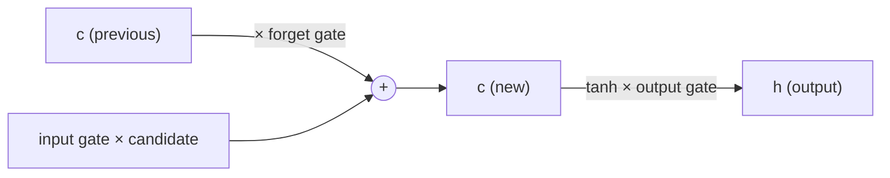

<!-- Written by `npm run lessons` from the lesson data in src/data. Edit the lesson there, not this page. -->

# LSTMs and GRUs: gates for long memory

**ML Foundations · Unit 3: Deep learning foundations · Lesson 16 of 16**

> **In one line.** An LSTM is a recurrent cell with a separate memory line, the cell state, and three learned gates that decide what to erase, what to write and what to reveal. A GRU does the same job with two gates.

[Open this lesson on the site](https://learn.hamropedia.com/foundations/lstms-and-grus-gates-for-long-memory/) for its animation, the practice game and tap-to-explain words.

## The problem it solves

Plain RNNs forget quickly, because the gradient is multiplied by the same factor at every step back in time. LSTMs add a memory path that is updated by adding rather than by repeated multiplication, so information and gradients can survive for hundreds of steps. They powered speech recognition and translation before transformers, and the gating idea lives on in many models.

## The idea

An LSTM adds a separate memory line, the cell state, plus three gates that decide what to forget, what to write and what to output. Because the cell state is updated by adding rather than by repeated multiplying, gradients survive over long sequences. A GRU is a simpler version with two gates.

## How it works, step by step

1. Inputs at each step: the previous hidden state h, the previous cell state c, and the new input x.
2. Forget gate f = σ(W_f·[h, x] + b_f): a number from 0 to 1 per memory slot, saying how much of the old memory to keep.
3. Input gate i = σ(…) and candidate g = tanh(…): what new content to write, and how much of it.
4. Update the memory by adding: c = f·c_prev + i·g. For c_prev = 0.8, f = 0.9, i = 0.5 and g = 0.6: c = 0.72 + 0.30 = 1.02.
5. Output gate o = σ(…) chooses what to reveal: h = o·tanh(c) = 0.7 × tanh(1.02) ≈ 0.54.
6. Backwards, the path from c_prev to c is multiplied only by f, so when f is near 1 the gradient flows back almost unchanged.
7. A GRU merges the forget and input gates into one update gate and has no separate cell state: fewer parameters, often similar results.

## Picture it



*The memory line c is updated by adding, not multiplying, which is why information and gradients survive long sequences.*

## Analogy

A notebook with a pencil and an eraser. Instead of rewriting the whole sticky note on every page, you erase a few lines (forget gate), write a few new ones (input gate), and read out what you need (output gate).

**Where the analogy breaks.** You decide what to erase on purpose. The gates are learned numbers between 0 and 1, so the network 'half-erases' things. And it still struggles with very long texts that transformers handle easily.

## Worked example

One step, starting from c_prev = 0.8. The forget gate f = 0.9 keeps 0.72. The input gate i = 0.5 lets in half of the new candidate g = 0.6, adding 0.30. The new cell state is c = 0.72 + 0.30 = 1.02. The output gate o = 0.7 then reveals h = 0.7 × tanh(1.02) ≈ 0.54.

```python
z = np.concatenate([h_prev, x])
f = sigmoid(Wf @ z + bf)          # forget gate
i = sigmoid(Wi @ z + bi)          # input gate
g = np.tanh(Wg @ z + bg)          # candidate memory
o = sigmoid(Wo @ z + bo)          # output gate
c = f * c_prev + i * g            # add, don't multiply: gradients survive
h = o * np.tanh(c)
```

## Must know

- Cell state = long-term memory, changed by addition.
- Gates are sigmoids (0 to 1): they mix rather than make hard decisions.
- Forget-gate bias is often started at about +1, so the cell remembers by default.
- An LSTM has 4 weight blocks (f, i, g, o), so 4 times the parameters of a plain RNN of the same size.
- Still sequential: no parallelism over time, which is why transformers replaced it for long text.

## Common mistakes

- Thinking LSTMs remember forever. They are better, not perfect.
- Mixing up which gates use sigmoid (f, i, o) and which uses tanh (g).
- Mismatching the gate order when copying weights between implementations.

> **Not true:** An LSTM carries information across thousands of steps without losing it.  
> **In fact:** Its gates leak a little at every step, so very old information still fades. An LSTM remembers far longer than a plain RNN, not for ever.

> **Not true:** The four parts of an LSTM (f, i, g and o) each use a sigmoid.  
> **In fact:** The three gates f, i and o use a sigmoid, which gives values from 0 to 1. The candidate g uses tanh, which gives values from −1 to 1.

## Practise

Try each one yourself first: on paper, in code or out loud. Then open the answer and compare.

### 1. Derive

Write the four LSTM gate equations from memory. Then show that the direct path from c_{t−1} to c_t is multiplied only by the forget gate f_t.

<details>
<summary>Show one good answer</summary>

With [h, x] meaning hₜ₋₁ and xₜ joined into one vector, σ the sigmoid and ⊙ elementwise multiplication:

Forget gate: fₜ = σ(W_f·[h, x] + b_f): how much of the old memory to keep.  
Input gate: iₜ = σ(W_i·[h, x] + b_i): how much new information to write.  
Candidate: gₜ = tanh(W_g·[h, x] + b_g): the new information itself.  
Output gate: oₜ = σ(W_o·[h, x] + b_o): how much of the memory to show.

Then:  
cₜ = fₜ ⊙ cₜ₋₁ + iₜ ⊙ gₜ  
hₜ = oₜ ⊙ tanh(cₜ)

The direct path: in the first update, cₜ₋₁ appears only in fₜ ⊙ cₜ₋₁. So ∂cₜ/∂cₜ₋₁ along that path is just fₜ, elementwise: no weight matrix and no squashing function. If the network keeps fₜ close to 1, the memory and its gradient pass from step to step almost unchanged, over hundreds of steps. That is the difference from a plain RNN, where every step multiplies by W and a tanh derivative.

</details>

### 2. Build

Implement an LSTM cell in NumPy. Check it against torch.nn.LSTMCell with the same weights (copy them in PyTorch's gate order). Then train an LSTM on your RNN's long-gap task.

<details>
<summary>Show one good answer</summary>

The NumPy cell computes all four gates from one matrix product, splits the result into four parts, and applies the equations above. PyTorch's LSTMCell stores its weights as weight_ih (input) and weight_hh (hidden), with the four gates stacked in the order input, forget, candidate, output, and two bias vectors. Copy those into the NumPy cell and the outputs match to about 1e-7.

On the long-gap task, the repeatable measurement is how much gradient reaches the first symbol at the start of training. For the plain RNN it is about 2e-16 at a gap of 50 and exactly 0 at 100. For an LSTM whose forget gate starts open (forget-gate bias +3, so f ≈ 0.95), it doesn't shrink at all: from about 3e-3 at a gap of 10 to about 1e-1 at a gap of 200. That is the memory highway from the derive step, working.

In the training run below (seed 0, gap 50), that LSTM solves the task and the RNN stays at 50%. Be aware that on a toy task this small, whether a model happens to find the solution in 1,500 steps also depends on luck, so try several seeds before drawing conclusions from accuracy alone.

```python
import numpy as np
import torch
import torch.nn as nn
import torch.nn.functional as F

sigmoid = lambda z: 1 / (1 + np.exp(-z))

def lstm_cell(x, h, c, W_ih, W_hh, b_ih, b_hh):
    z = x @ W_ih.T + h @ W_hh.T + b_ih + b_hh
    i, f, g, o = np.split(z, 4, axis=1)                 # PyTorch's gate order
    c = sigmoid(f) * c + sigmoid(i) * np.tanh(g)
    h = sigmoid(o) * np.tanh(c)
    return h, c

torch.manual_seed(0)
cell = nn.LSTMCell(5, 8)
x, h, c = torch.randn(3, 5), torch.randn(3, 8), torch.randn(3, 8)
h_t, c_t = cell(x, (h, c))
w = [p.detach().numpy() for p in (cell.weight_ih, cell.weight_hh, cell.bias_ih, cell.bias_hh)]
h_np, c_np = lstm_cell(x.numpy(), h.numpy(), c.numpy(), *w)
print(np.abs(h_np - h_t.detach().numpy()).max(), np.abs(c_np - c_t.detach().numpy()).max())

def batch(gap, n=64):
    first = torch.randint(0, 2, (n,))
    return torch.cat([first[:, None], torch.randint(2, 6, (n, gap))], dim=1), first

class Net(nn.Module):
    def __init__(self, kind, forget_bias=None):
        super().__init__()
        self.embed, self.out = nn.Embedding(6, 16), nn.Linear(64, 2)
        self.rnn = (nn.LSTM if kind == "LSTM" else nn.RNN)(16, 64, batch_first=True)
        if forget_bias is not None:
            with torch.no_grad():
                for name, b in self.rnn.named_parameters():
                    if "bias" in name:
                        b.zero_(); b[64:128] = forget_bias / 2     # forget gate; two biases add up
    def forward(self, x):
        return self.out(self.rnn(self.embed(x))[0][:, -1])

for kind, fb in [("RNN", None), ("LSTM", 3.0)]:
    row = []
    for gap in [10, 50, 100, 200]:
        torch.manual_seed(0)
        model, (xb, yb) = Net(kind, fb), batch(gap)
        e = model.embed(xb); e.retain_grad()
        F.cross_entropy(model.out(model.rnn(e)[0][:, -1]), yb).backward()
        row.append(f"{e.grad[:, 0].norm().item():.0e}")
    print(f"{kind}: gradient at the first symbol, gaps 10/50/100/200: {row}")

for kind, fb in [("RNN", None), ("LSTM", 3.0)]:
    torch.manual_seed(0)
    model = Net(kind, fb); opt = torch.optim.Adam(model.parameters(), lr=1e-2)
    for _ in range(1500):
        xb, yb = batch(50)
        opt.zero_grad(); F.cross_entropy(model(xb), yb).backward()
        torch.nn.utils.clip_grad_norm_(model.parameters(), 1.0); opt.step()
    xb, yb = batch(50, 1000)
    with torch.no_grad():
        print(f"{kind}, gap 50: accuracy {(model(xb).argmax(1) == yb).float().mean().item():.0%}")
```

</details>

### 3. Break

Set the forget-gate bias to −5, so the gate starts almost closed. What happens to long-range memory? Then try +1, a common trick.

<details>
<summary>Show one good answer</summary>

Forget-gate bias −5: at the start, fₜ = σ(−5) ≈ 0.007, so each step keeps less than 1% of the old memory. The cell wipes itself clean at every step, so the first symbol is forgotten almost immediately, and its gradient is multiplied by about 0.007 per step on the way back. In the run below, the gradient reaching the first symbol is about 1e-11 even for a gap of 10, and exactly 0 from a gap of 50: worse than a plain RNN. The LSTM behaves like a network with no memory at all.

Forget-gate bias +1: fₜ starts around σ(1) ≈ 0.73. Now the gradient at a gap of 10 is about 3e-4, tens of millions of times more than with −5, and it still reaches a gap of 50 (about 4e-7). Memory survives from the very start, and the network can learn to open the gate further. That is why initialising the forget-gate bias to 1 is a common trick; some libraries do it by default. Pushing it to +3 (f ≈ 0.95) keeps the gradient strong, about 1e-3, even over 100 steps.

The lesson: initialisation decides whether the gradient highway is open at the start of training.

```python
import torch
import torch.nn as nn
import torch.nn.functional as F

def batch(gap, n=64):
    first = torch.randint(0, 2, (n,))
    return torch.cat([first[:, None], torch.randint(2, 6, (n, gap))], dim=1), first

for forget_bias in [-5.0, 1.0, 3.0]:
    row = []
    for gap in [10, 50, 100]:
        torch.manual_seed(0)
        embed, lstm, out = nn.Embedding(6, 16), nn.LSTM(16, 64, batch_first=True), nn.Linear(64, 2)
        with torch.no_grad():
            for name, b in lstm.named_parameters():
                if "bias" in name:
                    b.zero_(); b[64:128] = forget_bias / 2       # forget gate: 2nd quarter, two biases
        xb, yb = batch(gap)
        e = embed(xb); e.retain_grad()
        F.cross_entropy(out(lstm(e)[0][:, -1]), yb).backward()
        row.append(f"{e.grad[:, 0].norm().item():.0e}")
    print(f"forget bias {forget_bias:+}: gradient at the first symbol, gaps 10/50/100: {row}")
```

</details>

### 4. Explain

Explain the LSTM gates with the notebook-and-eraser picture.

<details>
<summary>Show one good answer</summary>

The plain RNN rewrites its whole sticky note on every page. The LSTM keeps a notebook instead, with a pencil and an eraser. On each page it decides three things: which lines to erase (the forget gate), which new lines to write in (the input gate), and which lines to read out right now (the output gate).

Because most lines are simply left alone, something written on page 1 can still be there on page 200, unchanged, until the model decides to erase it. And because "leaving a line alone" is just multiplying by a forget gate close to 1, the learning signal can travel back along the same path just as easily. That is why LSTMs remember much longer than plain RNNs.

</details>

## Check you understood

Answer in your head first, then open each one.

<details>
<summary>&lt;b>What does the forget gate do?&lt;/b></summary>

For each memory slot, it outputs a number from 0 to 1 that says how much of the previous cell state to keep.

</details>

<details>
<summary>&lt;b>Why do gradients survive better in an LSTM than in a plain RNN?&lt;/b></summary>

The cell state is updated by adding, and the direct path from c_prev to c is only multiplied by the forget gate, which can stay near 1.

</details>

<details>
<summary>&lt;b>How does a GRU differ from an LSTM?&lt;/b></summary>

It has two gates instead of three and no separate cell state, so it is smaller and simpler.

</details>

<details>
<summary>&lt;b>c_prev = 1, f = 0.5, i = 1, g = 0.2. What is c?&lt;/b></summary>

0.5 × 1 + 1 × 0.2 = 0.7.

</details>

## Go further (optional)

The lesson above is enough on its own. These free extras give a second explanation.

- READ · [Understanding LSTM Networks](https://colah.github.io/posts/2015-08-Understanding-LSTMs/) · Chris Olah · illustrated  
  **Worth it:** The diagrams everyone else copies: the cell state as a conveyor belt with gates along it. After this the four equations read like a picture.
- WATCH · [Long Short-Term Memory (LSTM), Clearly Explained](https://www.youtube.com/results?search_query=StatQuest+Long+Short-Term+Memory+%28LSTM%29%2C+Clearly+Explained) · StatQuest (Josh Starmer)
- READ · [Dive into Deep Learning, Ch 10 (LSTM and GRU)](https://d2l.ai/) · d2l.ai · free

---

[← Debugging training: overfit one batch, read loss curves](debugging-training-overfit-one-batch-read-loss-curves.md) · [All lessons](../../README.md) · [Tokenisation and byte-pair encoding (BPE) →](../unit-4-llms/tokenisation-and-byte-pair-encoding-bpe.md)
