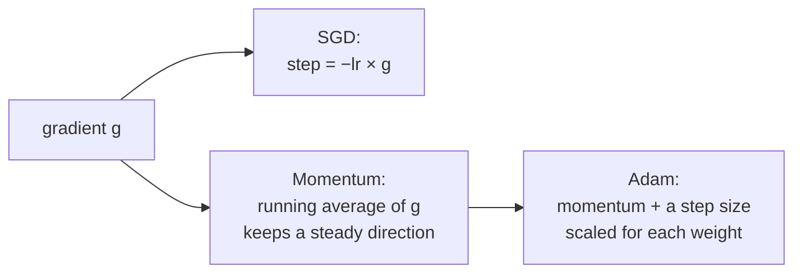

<!-- Written by `npm run lessons` from the lesson data in src/data. Edit the lesson there, not this page. -->

# Optimisers: SGD, momentum, Adam; learning-rate schedules

**ML Foundations · Unit 3: Deep learning foundations · Lesson 6 of 16**

> **In one line.** An optimiser turns gradients into weight updates. SGD steps straight down the gradient, momentum adds velocity, and Adam also adapts the step size for every weight. A learning-rate schedule changes the step size during training.

[Open this lesson on the site](https://learn.hamropedia.com/foundations/optimisers-sgd-momentum-adam-learning-rate-schedules/) for its animation, the practice game and tap-to-explain words.

## The problem it solves

Real loss surfaces have long narrow valleys, flat plateaus and noisy gradients from small batches. Plain SGD zig-zags across steep valleys and crawls along flat ones. Better optimisers converge in far fewer steps and are much less fussy about the learning rate, which saves days of compute on large models.

## The idea

SGD steps against the gradient. Momentum keeps a running average of gradients, so you keep moving in a consistent direction. Adam adds a separate step size for each weight, based on how large its gradients usually are. A schedule changes the learning rate over time, for example warm-up then decay.

## How it works, step by step

1. SGD: w ← w − η·g, where g is the gradient on a mini-batch.
2. Momentum: keep a velocity v ← β·v + g (β ≈ 0.9) and step w ← w − η·v. Side-to-side gradients cancel out while consistent ones build up speed.
3. RMSProp: keep a running average of g² and divide each step by its square root, so directions with big gradients take smaller steps.
4. Adam combines both: m ← β₁m + (1 − β₁)g and v ← β₂v + (1 − β₂)g², then w ← w − η·m̂ / (√v̂ + ε), with β₁ = 0.9 and β₂ = 0.999.
5. Bias correction: m and v start at 0, so early on they are too small. Dividing by (1 − βᵗ) fixes this in the first steps.
6. AdamW applies weight decay directly to the weights instead of through the gradient. It is the standard for transformers.
7. Schedules: warm up from a tiny learning rate over the first steps, then decay it (cosine or linear) so training settles into a good minimum.

## Picture it



*Each optimiser builds on the last: plain steps, then steps with momentum, then momentum with a personal step size for every weight.*

## Analogy

SGD is a hiker who only looks at the ground under their feet. Momentum is a ball rolling downhill: it builds speed and rolls over small bumps. Adam is a ball that is careful in steep, bumpy directions and bolder in flat ones.

**Where the analogy breaks.** A ball has one mass. Adam gives every single weight its own effective step size, so it is really millions of different balls.

## Worked example

In a long, narrow valley, SGD with learning rate 0.09 bounces from wall to wall, because 0.09 is just under the value where it would blow up across the steep direction. Momentum averages those bounces away and speeds along the valley floor. Adam scales each direction by its typical gradient size, so its path is straighter from the start.

```python
# one Adam step for gradient g, at step t
m = b1 * m + (1 - b1) * g
v = b2 * v + (1 - b2) * g**2
m_hat, v_hat = m / (1 - b1**t), v / (1 - b2**t)
w -= lr * m_hat / (np.sqrt(v_hat) + eps)
```

## Must know

- SGD: simple, and with momentum and a good schedule still excellent for vision models.
- Momentum smooths noisy gradients and speeds up travel along valleys.
- Adam gives each parameter its own effective step size; it is robust to the learning rate.
- Typical starting learning rates: SGD ≈ 0.1, Adam ≈ 0.001 (3e-4 is a famous default).
- Warm-up prevents huge early steps while the weights and Adam's averages are still unreliable.
- Adam stores two extra numbers per weight, which matters for memory in large models (Unit 6).

## Common mistakes

- Using Adam's learning rate with SGD, or the other way round.
- Leaving out warm-up for transformers, which often makes early training diverge.
- Adding L2 to the loss with Adam and calling it weight decay. Use AdamW.
- Comparing optimisers without tuning each one's learning rate.

> **Not true:** A learning rate that works for Adam works just as well for plain SGD.  
> **In fact:** Adam rescales every step, so its usual rates (around 0.001) are far smaller than SGD's (around 0.1). Tune the learning rate separately for each optimiser.

> **Not true:** With Adam, adding an L2 term to the loss is exactly the same as weight decay.  
> **In fact:** Adam rescales every gradient, the L2 part included, so the weights are not shrunk evenly. AdamW shrinks the weights in a separate step, which is the correct weight decay.

## Practise

Try each one yourself first: on paper, in code or out loud. Then open the answer and compare.

### 1. Derive

Write the update rules for SGD, momentum, RMSProp and Adam from memory. Explain why Adam needs bias correction.

<details>
<summary>Show one good answer</summary>

g is the gradient, η the learning rate.

SGD: w ← w − η·g

Momentum: v ← β·v + g, then w ← w − η·v (β ≈ 0.9). v is a running sum of recent gradients: speed that builds up.

RMSProp: s ← ρ·s + (1 − ρ)·g², then w ← w − η·g / (√s + ε). Each weight's step is divided by its typical gradient size.

Adam: both ideas together.  
m ← β₁·m + (1 − β₁)·g (β₁ = 0.9)  
v ← β₂·v + (1 − β₂)·g² (β₂ = 0.999)  
m̂ = m / (1 − β₁ᵗ), v̂ = v / (1 − β₂ᵗ)  
w ← w − η·m̂ / (√v̂ + ε)

Why bias correction: m and v start at 0, so early on they are averages of a few gradients and a lot of that starting 0. After step 1, m = 0.1·g and v = 0.001·g², far too small. Dividing by (1 − βᵗ) scales them back up to proper averages. Without it, m/√v would be 0.1/√0.001 ≈ 3.2 times too big at step 1, so the first few hundred steps would be wrongly sized. As t grows, βᵗ → 0 and the correction fades away.

</details>

### 2. Build

Implement all four and race them on the same problem, such as the Rosenbrock function or MNIST. Plot the loss curves together.

<details>
<summary>Show one good answer</summary>

Race all four on the Rosenbrock function, f(x, y) = (1 − x)² + 100(y − x²)², a long, curved, narrow valley with its minimum at (1, 1). Start at (−1.5, 2) and take 3,000 steps, each optimiser with a learning rate that suits it.

Plain SGD has to use a tiny learning rate (any larger and it bounces off the steep walls and blows up), so after 3,000 steps it has barely moved: loss about 5. Momentum, with the same learning rate, builds up speed along the valley floor and gets to a loss of about 0.05. RMSProp scales each direction by its typical gradient, so it copes with the steep walls, and gets to about 0.2. Adam combines both ideas and lands on the minimum (1, 1) almost exactly. Plot all four loss curves on one log-scale axis to compare.

```python
import numpy as np
import matplotlib.pyplot as plt

f = lambda p: (1 - p[0]) ** 2 + 100 * (p[1] - p[0] ** 2) ** 2
grad = lambda p: np.array([-2 * (1 - p[0]) - 400 * p[0] * (p[1] - p[0] ** 2), 200 * (p[1] - p[0] ** 2)])

def run(kind, lr, steps=3000):
    p, m, v, losses = np.array([-1.5, 2.0]), np.zeros(2), np.zeros(2), []
    for t in range(1, steps + 1):
        g = grad(p)
        if kind == "SGD":
            p = p - lr * g
        elif kind == "momentum":
            m = 0.9 * m + g; p = p - lr * m
        elif kind == "RMSProp":
            v = 0.99 * v + 0.01 * g**2; p = p - lr * g / (np.sqrt(v) + 1e-8)
        else:
            m = 0.9 * m + 0.1 * g; v = 0.999 * v + 0.001 * g**2
            p = p - lr * (m / (1 - 0.9**t)) / (np.sqrt(v / (1 - 0.999**t)) + 1e-8)
        losses.append(f(p))
    return p, losses

for kind, lr in [("SGD", 1e-4), ("momentum", 1e-4), ("RMSProp", 1e-3), ("Adam", 2e-2)]:
    p, losses = run(kind, lr)
    print(f"{kind:9s} ends at {p.round(3)}, loss {losses[-1]:.2e}")
    plt.plot(losses, label=kind)
plt.yscale("log"); plt.xlabel("step"); plt.ylabel("f"); plt.legend(); plt.show()
```

</details>

### 3. Break

Run Adam with a learning rate 100 times too big, and SGD with one 100 times too small. Then remove Adam's bias correction and watch the first 10 steps.

<details>
<summary>Show one good answer</summary>

Adam with a learning rate 100 times too big (2.0 instead of 0.02 here): Adam's step size per weight is roughly the learning rate, whatever the gradient, so every step can jump by up to about 2 units. The minimum sits at the bottom of a very narrow valley, and steps that size can't settle into it: after 3,000 steps it is still at about (0.7, 0.49), a loss of about 0.09, while a learning rate of 0.02 lands on (1, 1) almost exactly.

SGD with a learning rate 100 times too small (1e-6): every step is tiny, so after 3,000 steps it has barely moved from the start. The loss curve is almost flat: no explosion, just no progress. Both are learning-rate failures, but they look completely different on a loss curve.

No bias correction: the first steps come out several times too large. On this problem the corrected first step moves each coordinate by exactly the learning rate (0.02), while the uncorrected one moves it by about 0.063, 3.2 times as far, and most of the next few steps are also 2 to 4 times too big. That can be enough to throw a sensitive model off at the start, which is one reason warm-up schedules exist.

```python
import numpy as np

f = lambda p: (1 - p[0]) ** 2 + 100 * (p[1] - p[0] ** 2) ** 2
grad = lambda p: np.array([-2 * (1 - p[0]) - 400 * p[0] * (p[1] - p[0] ** 2), 200 * (p[1] - p[0] ** 2)])

def adam(lr, correct=True, steps=3000):
    p, m, v, sizes = np.array([-1.5, 2.0]), np.zeros(2), np.zeros(2), []
    for t in range(1, steps + 1):
        g = grad(p)
        m, v = 0.9 * m + 0.1 * g, 0.999 * v + 0.001 * g**2
        mh, vh = (m / (1 - 0.9**t), v / (1 - 0.999**t)) if correct else (m, v)
        step = lr * mh / (np.sqrt(vh) + 1e-8)
        sizes.append(np.abs(step).max()); p = p - step
    return p, sizes

print("Adam lr 2.0 ends at", adam(2.0)[0].round(2))
p = np.array([-1.5, 2.0])
for _ in range(3000):
    p = p - 1e-6 * grad(p)
print("SGD lr 1e-6 ends at", p.round(3), "(started at [-1.5, 2.0])")
print("first steps, corrected:  ", np.round(adam(0.02)[1][:5], 3))
print("first steps, uncorrected:", np.round(adam(0.02, correct=False)[1][:5], 3))
```

</details>

### 4. Explain

Explain momentum and Adam with the rolling-ball picture.

<details>
<summary>Show one good answer</summary>

Plain SGD is a hiker who only looks at the ground under their feet: every step goes straight downhill from where they stand, so in a narrow valley they zig-zag from wall to wall.

Momentum is a ball rolling downhill. It keeps its speed from step to step, so the zig-zags cancel out and it rolls fast along the valley floor, even over small bumps.

Adam is a careful ball: it also keeps momentum, but it watches how rough each direction is. Where the ground is steep and bumpy, it takes small steps; where it is flat and smooth, it takes bigger ones. So one learning rate works well for every direction at once.

</details>

## Check you understood

Answer in your head first, then open each one.

<details>
<summary>&lt;b>What problem does momentum solve?&lt;/b></summary>

Zig-zagging in narrow valleys and noise from small batches: the velocity cancels side-to-side swings and builds speed in consistent directions.

</details>

<details>
<summary>&lt;b>What extra does Adam keep for each weight?&lt;/b></summary>

A running average of its gradients (m) and of its squared gradients (v).

</details>

<details>
<summary>&lt;b>Why warm up the learning rate?&lt;/b></summary>

At the start the weights are random and Adam's statistics are unreliable, so big steps can wreck training. Warm-up starts small and ramps up.

</details>

<details>
<summary>&lt;b>How does AdamW differ from Adam with L2 regularisation?&lt;/b></summary>

AdamW shrinks the weights directly, separately from the adaptive gradient step, which works better in practice.

</details>

## Go further (optional)

The lesson above is enough on its own. These free extras give a second explanation.

- PLAY · [Why Momentum Really Works](https://distill.pub/2017/momentum/) · Gabriel Goh · Distill · interactive  
  **Worth it:** Drag the step-size and momentum sliders and watch the path change on a real loss surface. You will feel why momentum helps, and when it overshoots.
- PLAY · [Parameter optimization in neural networks](https://www.deeplearning.ai/ai-notes/optimization/) · deeplearning.ai · interactive
- READ · [An overview of gradient descent optimization algorithms](https://www.ruder.io/optimizing-gradient-descent/) · Sebastian Ruder
- READ · [Understanding Deep Learning, Ch 6 (SGD, momentum, Adam)](https://udlbook.github.io/udlbook/) · Simon Prince · free

---

[← Softmax and cross-entropy loss](softmax-and-cross-entropy-loss.md) · [All lessons](../../README.md) · [Weight initialisation; vanishing and exploding gradients →](weight-initialisation-vanishing-and-exploding-gradients.md)
