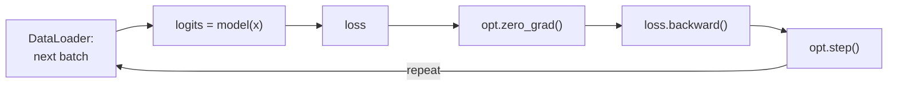

<!-- Written by `npm run lessons` from the lesson data in src/data. Edit the lesson there, not this page. -->

# PyTorch: nn.Module, DataLoader and the training loop

**ML Foundations · Unit 3: Deep learning foundations · Lesson 10 of 16**

> **In one line.** In PyTorch, an nn.Module holds the layers and weights, a DataLoader serves shuffled mini-batches, and the training loop repeats the same few steps: forward, loss, zero_grad, backward, step.

[Open this lesson on the site](https://learn.hamropedia.com/foundations/pytorch-nn-module-dataloader-and-the-training-loop/) for its animation, the practice game and tap-to-explain words.

## The problem it solves

Every deep-learning project, from MNIST to fine-tuning an LLM, uses this same skeleton. Getting its details wrong — no zero_grad, no eval mode, the wrong device — causes silent bugs that waste days. Knowing the loop cold lets you read any training script and write your own quickly.

## The idea

nn.Module holds your layers and weights. DataLoader serves shuffled mini-batches. The training loop is almost always the same five steps.

## How it works, step by step

1. Define the model as a class that inherits nn.Module: create the layers in __init__ and use them in forward. Its parameters are registered automatically.
2. Wrap your data in a Dataset (how to get item i) and a DataLoader (batch size, shuffling, worker processes).
3. Create an optimiser over model.parameters(), for example torch.optim.AdamW(model.parameters(), lr=3e-4).
4. For each batch: out = model(xb), then loss = loss_fn(out, yb).
5. opt.zero_grad() clears old gradients, loss.backward() computes new ones, and opt.step() updates the weights.
6. Validation: call model.eval() and use with torch.no_grad(): to measure without dropout or gradient tracking. Then call model.train() again.
7. Move the model and every batch to the same device: model.to(device), xb.to(device).

## Picture it



*The five-step loop at the heart of every PyTorch training script.*

## Analogy

A kitchen routine: get ingredients (a batch), cook (forward), taste (loss), adjust the recipe (backward and step), and clean the pan (zero_grad).

**Where the analogy breaks.** If you forget to clean the pan, flavours mix. If you forget zero_grad(), gradients from old batches add up.

## Worked example

A minimal setup: model = nn.Sequential(nn.Linear(784, 128), nn.ReLU(), nn.Linear(128, 10)), loader = DataLoader(train_ds, batch_size=64, shuffle=True), opt = torch.optim.AdamW(model.parameters(), lr=1e-3). One epoch runs the five-line loop once for each of the batches.

```python
for xb, yb in loader:
    logits = model(xb)
    loss = F.cross_entropy(logits, yb)
    opt.zero_grad()
    loss.backward()
    opt.step()
```

## Must know

- The five lines: forward, loss, zero_grad, backward, step.
- model.train() and model.eval() switch dropout and batch norm behaviour.
- torch.no_grad() for evaluation: no graph, less memory.
- Shuffle the training loader, not the validation loader.
- Log the training and validation loss every epoch, and save checkpoints (the model and optimiser state).
- Set random seeds to make runs reproducible.

## Common mistakes

- Forgetting opt.zero_grad(), so the gradients of earlier steps pile up on top of the new ones.
- Forgetting model.eval() before validation, so dropout and batch norm still behave as they do in training.
- Calling softmax before F.cross_entropy, which already applies it: the loss is then computed on the wrong numbers.
- Model on the GPU, data on the CPU (or the other way round): a device-mismatch error.
- Accumulating loss in a Python number without .item(), which keeps every graph alive and leaks memory.

> **Not true:** A model on the GPU can read a batch that is still on the CPU; it just runs more slowly.  
> **In fact:** PyTorch raises a device-mismatch error: a model and its inputs must be on the same device. Move each batch with .to(device).

> **Not true:** Adding up loss tensors over an epoch, without .item(), costs nothing extra.  
> **In fact:** Each loss tensor keeps its whole graph alive, so memory grows all epoch. Add loss.item(), a plain number, instead.

## Practise

Try each one yourself first: on paper, in code or out loud. Then open the answer and compare.

### 1. Derive

Write the five-line training loop from memory, and say what each line does.

<details>
<summary>Show one good answer</summary>

for xb, yb in loader:                 # 1. take the next batch  
    opt.zero_grad()                   # 2. clear the old gradients  
    loss = loss_fn(model(xb), yb)     # 3. forward pass and loss  
    loss.backward()                   # 4. compute new gradients  
    opt.step()                        # 5. update the weights

Why each line:  
1. The DataLoader hands out shuffled mini-batches.  
2. PyTorch adds gradients into .grad, so without clearing them each step's gradient would include every previous step's.  
3. Run the model and measure how wrong it is.  
4. Autograd fills .grad for every parameter.  
5. The optimiser uses those gradients to change the weights.

Around it: model.train() before the loop, and for validation model.eval() with torch.no_grad().

</details>

### 2. Build

Train an MLP on MNIST with nn.Module and a DataLoader, and add a validation loop that uses model.eval() and torch.no_grad().

<details>
<summary>Show one good answer</summary>

nn.Module defines the model's layers in __init__ and the computation in forward. The DataLoader shuffles and batches the training set. After each epoch, the validation loop switches to model.eval() (so dropout and batch norm behave as at test time) and wraps everything in torch.no_grad() (no gradients needed, so it is faster and uses less memory), then switches back with model.train().

Three epochs reach about 97% validation accuracy.

```python
import torch
import torch.nn as nn
from torch.utils.data import DataLoader, TensorDataset
from torchvision import datasets

class MLP(nn.Module):
    def __init__(self):
        super().__init__()
        self.net = nn.Sequential(nn.Linear(784, 256), nn.ReLU(), nn.Dropout(0.2), nn.Linear(256, 10))
    def forward(self, x):
        return self.net(x.flatten(1))

mnist = datasets.MNIST("data", train=True, download=True)
X, y = mnist.data.float() / 255.0, mnist.targets
train = DataLoader(TensorDataset(X[:50_000], y[:50_000]), batch_size=128, shuffle=True)
val = DataLoader(TensorDataset(X[50_000:], y[50_000:]), batch_size=1000)

torch.manual_seed(0)
model, loss_fn = MLP(), nn.CrossEntropyLoss()
opt = torch.optim.AdamW(model.parameters(), lr=1e-3)
for epoch in range(3):
    model.train()
    for xb, yb in train:
        opt.zero_grad()
        loss = loss_fn(model(xb), yb)
        loss.backward()
        opt.step()
    model.eval()
    correct = 0
    with torch.no_grad():
        for xb, yb in val:
            correct += (model(xb).argmax(1) == yb).sum().item()
    print(f"epoch {epoch + 1}: validation accuracy {correct / 10_000:.1%}")
```

</details>

### 3. Break

Remove opt.zero_grad() and train. Watch the loss. Then forget model.eval() on a model with dropout and compare validation scores.

<details>
<summary>Show one good answer</summary>

No opt.zero_grad(): gradients pile up. Step 500's gradient is really the sum of all 500 gradients so far, so the steps keep getting bigger and point in stale directions. At first it can even look fine, because the pile acts like a big push downhill. But soon the steps are far too big: in the run below the loss climbs back to about 2.3 (pure guessing) with spikes above 10, while the correct loop keeps falling to about 0.4. (Adam partly hides it because it divides by the gradient size, but the updates are still wrong.)

No model.eval() with dropout: validation runs with half the units randomly switched off (here dropout is 0.5), so the score is lower than the model really deserves and changes each time you evaluate. You might pick the wrong checkpoint, or think a good model is bad.

```python
import torch
import torch.nn as nn
from torchvision import datasets

mnist = datasets.MNIST("data", train=True, download=True)
X, y = mnist.data.reshape(-1, 784).float() / 255.0, mnist.targets
for zero_grad in [True, False]:
    torch.manual_seed(0)
    model = nn.Sequential(nn.Linear(784, 128), nn.ReLU(), nn.Linear(128, 10))
    opt = torch.optim.SGD(model.parameters(), lr=0.05)
    losses = []
    for idx in torch.randperm(60_000).split(64)[:900]:
        if zero_grad:
            opt.zero_grad()
        loss = nn.functional.cross_entropy(model(X[idx]), y[idx])
        loss.backward(); opt.step(); losses.append(loss.item())
    print(f"zero_grad {zero_grad}: loss at steps 10, 200, 500, 900 = "
          f"{[round(losses[i], 2) for i in (9, 199, 499, 899)]}, worst after step 100: {max(losses[100:]):.1f}")

torch.manual_seed(0)
model = nn.Sequential(nn.Linear(784, 256), nn.ReLU(), nn.Dropout(0.5), nn.Linear(256, 10))
opt = torch.optim.Adam(model.parameters(), lr=1e-3)
for idx in torch.randperm(20_000).split(64):
    opt.zero_grad(); nn.functional.cross_entropy(model(X[idx]), y[idx]).backward(); opt.step()
with torch.no_grad():
    model.eval(); right = (model(X[50_000:]).argmax(1) == y[50_000:]).float().mean().item()
    model.train(); wrong = (model(X[50_000:]).argmax(1) == y[50_000:]).float().mean().item()
print(f"validation with eval(): {right:.2%}, forgetting eval(): {wrong:.2%}")
```

</details>

### 4. Explain

Explain the training loop with the kitchen-routine picture.

<details>
<summary>Show one good answer</summary>

It is a kitchen routine, repeated for every batch. Get the ingredients: the DataLoader hands you the next batch. Clean the pan: zero_grad clears the last round's gradients so they don't mix in. Cook: the forward pass runs the model. Taste: the loss says how far off the dish is. Work out what to change: backward computes the gradients. Adjust the recipe: the optimiser's step changes the weights.

Then do it again with the next batch. Once you have been through every batch, that is one epoch. And when you serve the food (validation), you switch to "serving mode", model.eval(), and stop taking notes, torch.no_grad().

</details>

## Check you understood

Answer in your head first, then open each one.

<details>
<summary>&lt;b>List the five steps of a training iteration.&lt;/b></summary>

Forward pass, compute loss, zero_grad, backward, optimiser step.

</details>

<details>
<summary>&lt;b>What do model.eval() and torch.no_grad() each do?&lt;/b></summary>

model.eval() switches layers like dropout and batch norm to inference behaviour; no_grad() stops autograd recording the graph.

</details>

<details>
<summary>&lt;b>Why shuffle the training data each epoch?&lt;/b></summary>

So batches are random mixes: the gradient estimates are fair, and the model can't learn the order.

</details>

<details>
<summary>&lt;b>What happens if you forget zero_grad()?&lt;/b></summary>

Gradients from previous batches keep adding up, so the updates are wrong and usually far too large.

</details>

## Go further (optional)

The lesson above is enough on its own. These free extras give a second explanation.

- READ · [Learn the Basics](https://docs.pytorch.org/tutorials/beginner/basics/intro.html) · PyTorch tutorials  
  **Worth it:** The official walk-through of exactly this loop, with tensors, datasets, models, autograd and saving, in runnable steps. The reference you will come back to.
- WATCH · [Building makemore Part 2: MLP](https://karpathy.ai/zero-to-hero.html) · Andrej Karpathy
- READ · [Dive into Deep Learning, Ch 6 (builders' guide)](https://d2l.ai/) · d2l.ai · free

---

[← Regularisation: dropout, weight decay, augmentation, early stopping](regularisation-dropout-weight-decay-augmentation-early-stopping.md) · [All lessons](../../README.md) · [Convolutional networks: convolution, pooling, receptive field →](convolutional-networks-convolution-pooling-receptive-field.md)
