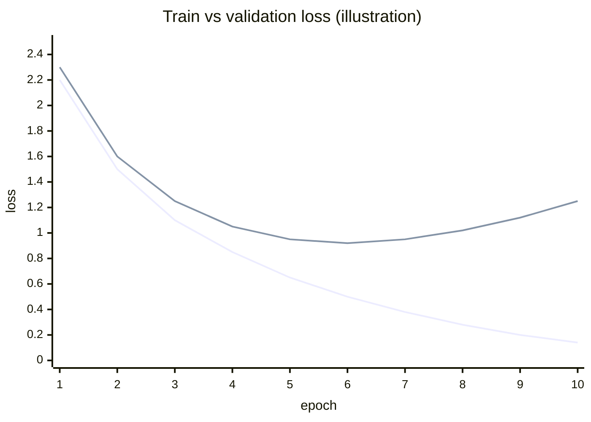

<!-- Written by `npm run lessons` from the lesson data in src/data. Edit the lesson there, not this page. -->

# Regularisation: dropout, weight decay, augmentation, early stopping

**ML Foundations · Unit 3: Deep learning foundations · Lesson 9 of 16**

> **In one line.** Regularisation in deep learning is any trick that stops a network memorising its training data: dropout, weight decay, data augmentation and early stopping are the main ones.

[Open this lesson on the site](https://learn.hamropedia.com/foundations/regularisation-dropout-weight-decay-augmentation-early-stopping/) for its animation, the practice game and tap-to-explain words.

## The problem it solves

Neural networks have so many parameters that they can memorise their training set exactly, even with random labels, and then fail on new data. Regularisation makes memorising harder or less attractive, so the network learns patterns that generalise. On small datasets it is often the difference between a useful model and a useless one.

## The idea

Tricks to stop a network memorising. Dropout turns off random neurons during training. Weight decay shrinks weights. Data augmentation makes 'new' data, such as flipped or cropped images. Early stopping stops when the validation loss starts to rise.

## How it works, step by step

1. Dropout: during training, zero each hidden activation with probability p (often 0.1 to 0.5) and scale the survivors by 1/(1 − p). Every step trains a different thinned network, so no neuron can rely on a particular partner.
2. At evaluation, dropout is switched off (model.eval()), and thanks to the scaling no change is needed.
3. Weight decay: shrink every weight a little each step (AdamW's weight_decay), pulling towards simpler functions.
4. Data augmentation: create new, label-preserving versions of each example — flips, crops, small rotations, colour changes for images; noise or masking for audio and text.
5. Early stopping: track validation loss during training and keep the checkpoint where it was lowest.
6. Other levers: a smaller model, more real data, label smoothing.

## Picture it



*Training loss keeps falling, but validation loss turns up after about epoch 6 — that's overfitting. Early stopping saves the model at the lowest validation point.*

## Analogy

Dropout is a football team that trains with random players missing, so nobody relies on one star.

**Where the analogy breaks.** Missing players happens only in training. At test time all neurons are used, so the output size must match. 'Inverted dropout' fixes this by scaling during training.

## Worked example

With dropout p = 0.5 and four hidden activations [2, 4, 6, 8], one training step might keep [2, _, 6, _] and scale them by 2, giving [4, 0, 12, 0]. On average each activation keeps its value. At test time all four pass through unchanged.

```python
mask = (np.random.rand(*h.shape) > p) / (1 - p)   # inverted dropout, drop rate p
h = h * mask                                      # training only
```

## Must know

- Dropout is only active in training mode; the 1/(1 − p) scaling keeps the expected activation the same.
- Augmentations must keep the label correct: flipping a "6" makes a "9".
- Weight decay = L2 regularisation for neural networks; use AdamW.
- Early stopping needs a validation set and saved checkpoints.
- More data is the most reliable regulariser of all.
- Large pre-trained transformers often use little or no dropout; small models on small data need more.

## Common mistakes

- Leaving dropout on at evaluation time (forgetting model.eval()).
- Augmenting the validation or test sets.
- Augmentations that change the meaning: flipping text, rotating digits too far.
- Stopping on training loss instead of validation loss.

> **Not true:** Validation set: augment it too, for a fairer estimate of the model.  
> **In fact:** Validation and test data should look like the real inputs. Augment the training set only, or the score no longer measures real performance.

> **Not true:** Dropout at evaluation time: leave it switched on.  
> **In fact:** Dropout is for training only. At evaluation every neuron is kept: call model.eval(), or the predictions are noisy and worse.

## Practise

Try each one yourself first: on paper, in code or out loud. Then open the answer and compare.

### 1. Derive

With dropout rate 0.5, why must you divide the kept activations by 0.5 during training? Show what happens to the expected value.

<details>
<summary>Show one good answer</summary>

Dropout with rate 0.5 keeps each activation with probability 0.5 and sets it to 0 otherwise.

Without rescaling, the expected value of a kept-or-dropped activation a is 0.5·a + 0.5·0 = 0.5a. So during training, the next layer sees inputs that are half as big on average as at test time, when nothing is dropped. The network would be trained for one scale and used at another.

Dividing the kept values by 0.5 (the keep probability) fixes this: E = 0.5·(a / 0.5) + 0.5·0 = a. The expected value during training now matches test time, so at test time you can simply switch dropout off with no other change. This is "inverted dropout", what PyTorch does.

</details>

### 2. Build

Train an overfitting MLP on a small part of MNIST. Add dropout, then weight decay, then augmentation, then early stopping, and record validation accuracy after each.

<details>
<summary>Show one good answer</summary>

Train a large MLP (784 → 512 → 512 → 10) on only 1,000 MNIST images, so it overfits: training accuracy hits 100% while validation accuracy stalls. Then add one regulariser at a time and keep the ones before it.

Typical results on this run: the plain model is a little under 90% on validation; dropout and weight decay each add under a point; augmentation (small random shifts of each image, so the model never sees the exact same image twice) helps most; early stopping keeps the best epoch instead of the last. Exact numbers vary from run to run by a point, so the trend matters more than any single value.

```python
import torch
import torch.nn as nn
from torchvision import datasets

mnist = datasets.MNIST("data", train=True, download=True)
X = mnist.data.float().unsqueeze(1) / 255.0
y = mnist.targets
Xtr, ytr, Xva, yva = X[:1000], y[:1000], X[50_000:55_000], y[50_000:55_000]

def shift(images):                                  # augmentation: random shifts of up to 2 pixels
    dx, dy = torch.randint(-2, 3, (2,)).tolist()
    return torch.roll(images, shifts=(dy, dx), dims=(2, 3))

def run(dropout=0.0, weight_decay=0.0, augment=False, early_stop=False, epochs=60):
    torch.manual_seed(0)
    model = nn.Sequential(nn.Flatten(), nn.Linear(784, 512), nn.ReLU(), nn.Dropout(dropout),
                          nn.Linear(512, 512), nn.ReLU(), nn.Dropout(dropout), nn.Linear(512, 10))
    opt = torch.optim.AdamW(model.parameters(), lr=1e-3, weight_decay=weight_decay)
    history = []
    for _ in range(epochs):
        model.train()
        for idx in torch.randperm(1000).split(64):
            xb = shift(Xtr[idx]) if augment else Xtr[idx]
            opt.zero_grad(); nn.functional.cross_entropy(model(xb), ytr[idx]).backward(); opt.step()
        model.eval()
        with torch.no_grad():
            history.append((model(Xva).argmax(1) == yva).float().mean().item())
    return max(history) if early_stop else history[-1]

print(f"plain:          {run():.1%}")
print(f"+ dropout:      {run(dropout=0.5):.1%}")
print(f"+ weight decay: {run(dropout=0.5, weight_decay=0.1):.1%}")
print(f"+ augmentation: {run(dropout=0.5, weight_decay=0.1, augment=True):.1%}")
print(f"+ early stop:   {run(dropout=0.5, weight_decay=0.1, augment=True, early_stop=True):.1%}")
```

</details>

### 3. Break

Leave dropout switched on at test time. What happens to the predictions and to accuracy? Why?

<details>
<summary>Show one good answer</summary>

With dropout left on at test time, every prediction drops a random half of the units. Run the same image twice and you can get two different answers, and accuracy falls, because each prediction comes from a crippled, random sub-network instead of the full one. In the run below, the same trained model scores about 1.5 points lower with dropout on (about 90.6% against 92.3%), and the score changes every time you evaluate.

The fix: call model.eval() before evaluating or serving, and model.train() before training again. (Turning dropout on deliberately at test time and averaging many predictions, "Monte Carlo dropout", is a real technique for estimating uncertainty, but it is a choice, not an accident.)

```python
import torch
import torch.nn as nn
from torchvision import datasets

mnist = datasets.MNIST("data", train=True, download=True)
X, y = mnist.data.reshape(-1, 784).float() / 255.0, mnist.targets
torch.manual_seed(0)
model = nn.Sequential(nn.Linear(784, 256), nn.ReLU(), nn.Dropout(0.5), nn.Linear(256, 10))
opt = torch.optim.Adam(model.parameters(), lr=1e-3)
for idx in torch.randperm(20_000).split(64):
    opt.zero_grad(); nn.functional.cross_entropy(model(X[idx]), y[idx]).backward(); opt.step()

Xva, yva = X[50_000:], y[50_000:]
with torch.no_grad():
    model.eval()
    print("eval mode:", round((model(Xva).argmax(1) == yva).float().mean().item(), 4))
    model.train()                                   # the mistake
    for _ in range(3):
        print("dropout on:", round((model(Xva).argmax(1) == yva).float().mean().item(), 4))
```

</details>

### 4. Explain

Explain dropout with the football-team picture.

<details>
<summary>Show one good answer</summary>

A football team that trains with random players missing in every session. Nobody can rely on one star striker to score every goal, because the striker might not be there. So every player learns to be useful, and the team learns several ways to win. On match day, the whole team plays, and it is stronger and more flexible for it.

Dropout does the same to a network: during training it switches off a random set of neurons at each step, so no single neuron can carry the answer on its own, and the network can't memorise the training set through a few fragile pathways. At test time every neuron is switched on.

</details>

## Check you understood

Answer in your head first, then open each one.

<details>
<summary>&lt;b>With dropout p = 0.2, what is a kept activation multiplied by during training?&lt;/b></summary>

1 / (1 − 0.2) = 1.25, so the expected value stays the same.

</details>

<details>
<summary>&lt;b>Why does dropout reduce overfitting?&lt;/b></summary>

No neuron can rely on any particular other neuron being present, so the network learns redundant, more general features. It is like averaging many thinned networks.

</details>

<details>
<summary>&lt;b>Give two augmentations for photos of cats and one that would be wrong for handwritten digits.&lt;/b></summary>

Flips and random crops (or colour jitter) for cats. A horizontal flip or a large rotation is wrong for digits: it can turn one digit into another.

</details>

<details>
<summary>&lt;b>How does early stopping work?&lt;/b></summary>

Watch validation loss during training and keep the model from the epoch where it was lowest, even if training continues.

</details>

## Go further (optional)

The lesson above is enough on its own. These free extras give a second explanation.

- READ · [Understanding Deep Learning, Ch 9 (regularisation)](https://udlbook.github.io/udlbook/) · Simon Prince · free
- READ · [CS231n: Neural Networks Part 2 (regularisation and dropout)](https://cs231n.github.io/neural-networks-2/) · Stanford

---

[← Batch norm and layer norm](batch-norm-and-layer-norm.md) · [All lessons](../../README.md) · [PyTorch: nn.Module, DataLoader and the training loop →](pytorch-nn-module-dataloader-and-the-training-loop.md)
