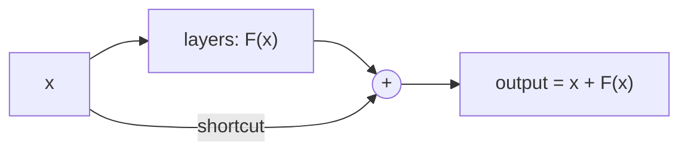

<!-- Written by `npm run lessons` from the lesson data in src/data. Edit the lesson there, not this page. -->

# Residual connections (ResNet)

**ML Foundations · Unit 3: Deep learning foundations · Lesson 12 of 16**

> **In one line.** A residual connection adds a block's input to its output. The block then only has to learn a change, and gradients get a direct path back through the network.

[Open this lesson on the site](https://learn.hamropedia.com/foundations/residual-connections-resnet/) for its animation, the practice game and tap-to-explain words.

## The problem it solves

Before residuals, making a network deeper often made it worse, even on training data: the signal and gradients degraded through many layers, and optimisation got stuck. Residual connections fixed this so well that every modern deep architecture, including every transformer, uses them. Without them, today's 100-layer models would not train.

## The idea

Instead of learning y = F(x), a residual block learns y = x + F(x). The block only has to learn the change. Gradients flow straight back through the '+ x' shortcut.

## How it works, step by step

1. A normal block computes y = F(x), for example conv → norm → ReLU → conv.
2. A residual block computes y = x + F(x): the input skips around the block and is added back.
3. If the best thing a block can do is nothing, it only has to learn F(x) = 0, which is easy. Adding a block can no longer make things worse.
4. Backwards: dy/dx = 1 + F′(x). The 1 sends the gradient straight through, even when F′(x) is tiny.
5. Chain many blocks and the gradient has a clean "highway" back to the earliest layers.
6. When F changes the shape (more channels, smaller size), the shortcut uses a 1 × 1 convolution or a linear layer so the two can be added.
7. In transformers every sub-layer is wrapped the same way: x = x + Attention(LayerNorm(x)), then x = x + MLP(LayerNorm(x)).

## Picture it



*The shortcut carries x straight past the layers, so the block only has to learn the change F(x), and gradients flow back easily.*

## Analogy

Editing a document with tracked changes, instead of rewriting it from scratch each time.

**Where the analogy breaks.** Tracked changes are optional. In a ResNet the shortcut is always there, and shapes must match before adding (a 1×1 convolution fixes a mismatch).

## Worked example

If a block's own derivative is F′(x) = 0.1, a plain block passes back only 0.1 of the gradient; ten such blocks pass back 0.1¹⁰, almost nothing. A residual block passes back 1 + 0.1 = 1.1, so the gradient stays healthy however deep the network.

```python
class Block(nn.Module):
    def forward(self, x):
        return x + self.f(x)
```

## Must know

- y = x + F(x): learn the change, not the whole mapping.
- Gradient through a block = 1 + F′(x): the identity path keeps gradients alive.
- The shapes of x and F(x) must match before adding.
- Residual stream: in transformers, layers read from and write to one shared running vector.
- ResNet (2015) trained 152-layer networks this way and won ImageNet.

## Common mistakes

- Shape mismatch on the shortcut when the channels change.
- Putting a ReLU after the addition in a way that blocks the identity path.
- Thinking residuals add parameters. The shortcut itself is free.

> **Not true:** A residual connection adds extra weights that the network has to learn.  
> **In fact:** The shortcut is a plain addition with no weights. Only when the shapes differ does it need a small projection, such as a 1 × 1 convolution.

> **Not true:** x and F(x) can be added even when their shapes differ.  
> **In fact:** Addition needs matching shapes. When F changes the number of channels or the size, the shortcut uses a projection, such as a 1 × 1 convolution, to match.

## Practise

Try each one yourself first: on paper, in code or out loud. Then open the answer and compare.

### 1. Derive

Show that the gradient through y = x + F(x) is 1 + F′(x). Explain why that helps a 50-layer network.

<details>
<summary>Show one good answer</summary>

For y = x + F(x), the chain rule gives dy/dx = 1 + F′(x): the 1 comes from the shortcut, F′(x) from the block.

Through a stack of blocks, the gradient is a product. In a plain network it is F′₁ · F′₂ · … · F′₅₀. If each factor is about 0.1, that is 0.1⁵⁰: the gradient vanishes, and the early layers can't learn.

With residual blocks it is (1 + F′₁)(1 + F′₂)…(1 + F′₅₀). Even if every F′ is small, each factor is close to 1, so the product stays close to 1. Expanding the product also shows a term that is exactly 1: a direct path from the loss to the input, with no multiplication at all.

So the gradient always has a highway through the network. Each block only has to learn a small correction to the identity, and a block that isn't helping can simply learn F ≈ 0.

</details>

### 2. Build

Train a 20-layer plain CNN and the same network with residual blocks on CIFAR-10. Plot both training losses.

<details>
<summary>Show one good answer</summary>

Two 20-layer CNNs with 16 channels, identical except that one adds each pair of conv layers' input back to its output (a residual block). Train both with the same settings on 10,000 CIFAR-10 images for 3 epochs and record the training loss.

In this short run the residual network ends with the lower training loss (about 1.63 against 1.72 for the plain one, averaged over the last 20 steps), and its curve falls faster from the start. The gap is modest here, because both networks use batch norm, which already helps a lot at 20 layers. The ResNet paper showed the gap growing with depth: a plain 56-layer network trained worse than a plain 20-layer one, the "degradation" problem, while residual networks kept improving with depth. Plot both curves on one chart, then try more blocks and watch the plain network fall further behind.

```python
import torch
import torch.nn as nn
import torch.nn.functional as F
import matplotlib.pyplot as plt
from torchvision import datasets

class Block(nn.Module):
    def __init__(self, residual):
        super().__init__()
        self.residual = residual
        self.c1, self.c2 = nn.Conv2d(16, 16, 3, padding=1), nn.Conv2d(16, 16, 3, padding=1)
        self.b1, self.b2 = nn.BatchNorm2d(16), nn.BatchNorm2d(16)
    def forward(self, x):
        out = self.b2(self.c2(F.relu(self.b1(self.c1(x)))))
        return F.relu(out + x if self.residual else out)

def network(residual):                               # 1 + 9 blocks × 2 + 1 = 20 layers
    return nn.Sequential(nn.Conv2d(3, 16, 3, padding=1), nn.ReLU(),
                         *[Block(residual) for _ in range(9)],
                         nn.AdaptiveAvgPool2d(1), nn.Flatten(), nn.Linear(16, 10))

cifar = datasets.CIFAR10("data", train=True, download=True)
X = torch.tensor(cifar.data[:10_000]).permute(0, 3, 1, 2).float() / 255.0
y = torch.tensor(cifar.targets[:10_000])
for residual in [False, True]:
    torch.manual_seed(0)
    model = network(residual)
    opt = torch.optim.SGD(model.parameters(), lr=0.05, momentum=0.9)
    losses = []
    for epoch in range(3):
        for idx in torch.randperm(10_000).split(128):
            opt.zero_grad()
            loss = F.cross_entropy(model(X[idx]), y[idx]); loss.backward(); opt.step()
            losses.append(loss.item())
    name = "residual" if residual else "plain"
    print(f"{name}: average loss over the last 20 steps {sum(losses[-20:]) / 20:.3f}")
    plt.plot(losses, label=name)
plt.xlabel("step"); plt.ylabel("training loss"); plt.legend(); plt.show()
```

</details>

### 3. Break

Make a residual block that changes the number of channels, with no projection. Read the shape error, then fix it with a 1 × 1 convolution.

<details>
<summary>Show one good answer</summary>

If the block's convolutions change 16 channels into 32, then x has shape (batch, 16, H, W) and F(x) has (batch, 32, H, W), and you can't add them: "The size of tensor a (32) must match the size of tensor b (16) at non-singleton dimension 1".

The fix is a projection shortcut: pass x through a 1 × 1 convolution from 16 to 32 channels (often with batch norm) before adding. A 1 × 1 convolution mixes channels at each pixel without looking at neighbours, so it changes the channel count while keeping the shortcut cheap. If the block also halves the height and width with stride 2, give the 1 × 1 convolution stride 2 as well.

```python
import torch
import torch.nn as nn

x = torch.randn(8, 16, 32, 32)
F_x = nn.Conv2d(16, 32, 3, padding=1)(x)
try:
    F_x + x
except RuntimeError as e:
    print(e)
shortcut = nn.Conv2d(16, 32, kernel_size=1)          # the projection
print((F_x + shortcut(x)).shape)                       # torch.Size([8, 32, 32, 32])
```

</details>

### 4. Explain

Explain residual connections with the tracked-changes picture.

<details>
<summary>Show one good answer</summary>

Editing a document with tracked changes, instead of rewriting it from scratch each time. Each editor receives the document and only marks small changes; everything they leave alone passes straight through unchanged. Even after 50 editors, the original text is still there underneath, and an editor with nothing useful to add can simply change nothing.

A residual block works the same way: its output is its input plus a learned change, y = x + F(x). Without the shortcut, every layer must rewrite the whole document, and after many layers both the content and the feedback from the end get lost. With it, information and gradients flow straight through, which is what lets networks with 50 or 100+ layers train.

</details>

## Check you understood

Answer in your head first, then open each one.

<details>
<summary>&lt;b>Why does y = x + F(x) help gradients?&lt;/b></summary>

Its derivative is 1 + F′(x), so the gradient always has a direct path of 1, even if F′(x) is tiny.

</details>

<details>
<summary>&lt;b>What must be true of x and F(x) to add them?&lt;/b></summary>

They must have the same shape; otherwise the shortcut needs a projection, like a 1 × 1 convolution.

</details>

<details>
<summary>&lt;b>Why does a residual block find "do nothing" easy?&lt;/b></summary>

It only needs F(x) = 0, which small weights already give, instead of learning an exact identity mapping.

</details>

<details>
<summary>&lt;b>Where do residual connections appear in a transformer?&lt;/b></summary>

Around every attention sub-layer and every MLP sub-layer.

</details>

## Go further (optional)

The lesson above is enough on its own. These free extras give a second explanation.

- READ · [Understanding Deep Learning, Ch 11 (residual networks)](https://udlbook.github.io/udlbook/) · Simon Prince · free
- PAPER · [Deep Residual Learning for Image Recognition (2015)](https://arxiv.org/abs/1512.03385) · He et al. · arXiv

---

[← Convolutional networks: convolution, pooling, receptive field](convolutional-networks-convolution-pooling-receptive-field.md) · [All lessons](../../README.md) · [RNNs, and why long sequences are hard →](rnns-and-why-long-sequences-are-hard.md)
