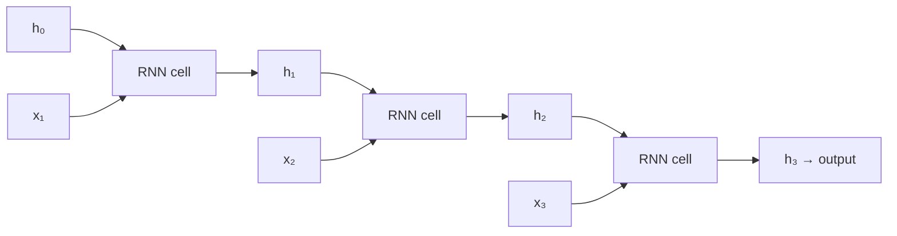

<!-- Written by `npm run lessons` from the lesson data in src/data. Edit the lesson there, not this page. -->

# RNNs, and why long sequences are hard

**ML Foundations · Unit 3: Deep learning foundations · Lesson 13 of 16**

> **In one line.** A recurrent neural network (RNN) reads a sequence one step at a time. It keeps a hidden state as its memory, updates it at every step, and uses the same weights each time.

[Open this lesson on the site](https://learn.hamropedia.com/foundations/rnns-and-why-long-sequences-are-hard/) for its animation, the practice game and tap-to-explain words.

## The problem it solves

Text, audio and time series come in order, with any length. A fixed-size MLP can't handle that, and it can't share what it learns across positions. RNNs were the first neural answer to sequences, and understanding their limits — fading memory and vanishing gradients through time — explains why LSTMs and then transformers took over.

## The idea

An RNN reads a sequence one step at a time and keeps a hidden state as memory: hₜ = tanh(W hₜ₋₁ + U xₜ). The same weights are used at every step.

## How it works, step by step

1. Start with a hidden state h₀ = 0.
2. At each step t, combine the previous memory and the new input: hₜ = tanh(W·hₜ₋₁ + U·xₜ + b).
3. The same W, U and b are used at every step, so the model handles any length with a fixed number of weights.
4. To predict, read an output from each hₜ (the next character, say), or only from the last one (a sentiment score).
5. Training unrolls the network through time and runs backprop through every step: backpropagation through time.
6. The gradient reaching step 1 has been multiplied by W (and tanh's slope) once per step. Over 100 steps, a factor of 0.9 becomes 0.9¹⁰⁰ ≈ 0.00003: it vanishes. A factor above 1 explodes instead.
7. So plain RNNs struggle to connect events far apart. Gradient clipping tames explosions; LSTMs (later in this unit) tame vanishing.

## Picture it



*The same cell is used at every step, passing its memory h forward. Information from x₁ must survive every step to reach the end.*

## Analogy

Reading a book with one sticky note. After each page, you rewrite the note.

**Where the analogy breaks.** One small note cannot hold a whole book. Early information gets overwritten, and gradients shrink over many steps. Transformers, which look at every page at once, replaced RNNs for this reason.

## Worked example

Backprop through 100 steps multiplies by W about 100 times. If the biggest factor is 0.9, then 0.9¹⁰⁰ ≈ 0.00003.

```python
h = np.zeros(hidden)
for x_t in sequence:
    h = np.tanh(W @ h + U @ x_t + b)
```

## Must know

- Hidden state = a fixed-size summary of everything read so far.
- Weights are shared across time steps.
- Backpropagation through time = ordinary backprop on the unrolled network.
- Long-range dependencies are hard: vanishing and exploding gradients.
- Processing is sequential, so it can't be parallelised across time. Transformers fixed that too.
- Still useful for small, streaming, on-device models; newer state-space models revive the idea.

## Common mistakes

- Expecting a plain RNN to remember things from hundreds of steps back.
- Not clipping gradients, then getting NaN.
- Forgetting to reset or detach the hidden state between unrelated sequences.

> **Not true:** A plain RNN easily remembers a word it read hundreds of steps earlier.  
> **In fact:** Its gradient is multiplied by nearly the same factor at every step, so it vanishes or explodes over long distances. LSTMs and attention were invented for that.

> **Not true:** Hidden state: carry it over from one unrelated sequence to the next.  
> **In fact:** The hidden state is a summary of what was just read. Reset it (or detach it) between unrelated sequences, or one text leaks into the next.

## Practise

Try each one yourself first: on paper, in code or out loud. Then open the answer and compare.

### 1. Derive

Unroll an RNN for 3 steps on paper. Show where W appears in the gradient of the last output with respect to h₀.

<details>
<summary>Show one good answer</summary>

An RNN updates its hidden state with the same weights at every step: hₜ = tanh(W·hₜ₋₁ + U·xₜ).

Unrolled for 3 steps:  
h₁ = tanh(W·h₀ + U·x₁)  
h₂ = tanh(W·h₁ + U·x₂)  
h₃ = tanh(W·h₂ + U·x₃), and the output is y = V·h₃.

Gradient of the last output with respect to h₀, by the chain rule through every step:  
∂h₃/∂h₀ = (∂h₃/∂h₂)(∂h₂/∂h₁)(∂h₁/∂h₀) = D₃W · D₂W · D₁W,  
where each Dₜ = diag(1 − hₜ²) is the tanh derivative at that step.

W appears once per step: three times here, T times for a sequence of length T. Repeated multiplication by the same matrix shrinks or grows like a power: if W's largest stretching factor is below 1 (and tanh′ ≤ 1 makes it smaller still), the gradient from far back vanishes, like 0.9¹⁰⁰ ≈ 0.00003; if it is above 1, it can explode.

</details>

### 2. Build

Write a character-level RNN and train it to generate names.

<details>
<summary>Show one good answer</summary>

Download the list of 32,000 names used in Andrej Karpathy's makemore. Each name becomes a training sequence with "." marking the start and end. The RNN reads one character at a time (an embedding, then nn.RNN), and is trained to predict the next character at every position.

After a few thousand steps the loss falls from ln 27 ≈ 3.3 (random guessing among 26 letters plus ".") to about 2.1, and sampling one character at a time from its predictions produces new, name-like words: mostly pronounceable, a few real names, some odd ones.

```python
import urllib.request
import torch
import torch.nn as nn
import torch.nn.functional as F

url = "https://raw.githubusercontent.com/karpathy/makemore/master/names.txt"
names = urllib.request.urlopen(url).read().decode().split()
chars = ["."] + sorted(set("".join(names)))
stoi = {c: i for i, c in enumerate(chars)}

class CharRNN(nn.Module):
    def __init__(self, vocab, hidden=128):
        super().__init__()
        self.embed, self.rnn, self.out = nn.Embedding(vocab, 32), nn.RNN(32, hidden, batch_first=True), nn.Linear(hidden, vocab)
    def forward(self, x, h=None):
        y, h = self.rnn(self.embed(x), h)
        return self.out(y), h

torch.manual_seed(0)
model = CharRNN(len(chars))
opt = torch.optim.Adam(model.parameters(), lr=3e-3)
for step in range(3000):
    batch = [names[i] for i in torch.randint(len(names), (64,))]
    seqs = [[0] + [stoi[c] for c in n] + [0] for n in batch]
    L = max(map(len, seqs))
    x = torch.tensor([s[:-1] + [0] * (L - len(s)) for s in seqs])
    y = torch.tensor([s[1:] + [-1] * (L - len(s)) for s in seqs])   # -1: padding, ignored
    logits, _ = model(x)
    loss = F.cross_entropy(logits.reshape(-1, len(chars)), y.reshape(-1), ignore_index=-1)
    opt.zero_grad(); loss.backward(); opt.step()
print("loss:", round(loss.item(), 2))

for _ in range(8):
    x, h, out = torch.tensor([[0]]), None, ""
    while True:
        logits, h = model(x, h)
        nxt = torch.multinomial(F.softmax(logits[0, -1], -1), 1).item()
        if nxt == 0 or len(out) > 15:
            break
        out += chars[nxt]; x = torch.tensor([[nxt]])
    print(out)
```

</details>

### 3. Break

Train it on sequences where the answer depends on a character far back. Measure accuracy as the gap grows, then try gradient clipping.

<details>
<summary>Show one good answer</summary>

Task: the first symbol of each sequence is A or B, followed by a gap of random filler symbols, and at the end the model must say which one came first. Train a fresh RNN for each gap length, with three different random seeds.

In the run below, a gap of 20 is solved by every seed, but at 50 and at 100 none of the three seeds solve it: they sit at 50%, a coin flip. (With other seeds or settings a gap of 50 is sometimes solved by luck; 100 almost never.) The cause shows up before any training: measure how much gradient reaches the first symbol. It is about 3e-5 for a gap of 10, about 3e-15 for 50, and exactly 0 (it underflows) for 100. The signal from the first symbol has to survive being multiplied by W and the tanh slope at every step on the way back, and it vanishes, so the model gets no hint that the first symbol matters.

Gradient clipping (torch.nn.utils.clip_grad_norm_) caps the size of the gradient. It stops the opposite problem, an occasional exploding gradient that wrecks training, but it can't make a vanished gradient bigger, so it doesn't rescue the long gaps. The real fix is a better memory path: an LSTM or GRU, or attention.

```python
import torch
import torch.nn as nn
import torch.nn.functional as F

def batch(gap, n=64):
    first = torch.randint(0, 2, (n,))                       # A = 0 or B = 1
    filler = torch.randint(2, 6, (n, gap))                   # symbols 2–5: noise
    return torch.cat([first[:, None], filler], dim=1), first

class Net(nn.Module):
    def __init__(self):
        super().__init__()
        self.embed, self.rnn, self.out = nn.Embedding(6, 16), nn.RNN(16, 64, batch_first=True), nn.Linear(64, 2)
    def forward(self, x):
        return self.out(self.rnn(self.embed(x))[0][:, -1])

for gap in [10, 50, 100]:                                    # gradient reaching the first symbol
    torch.manual_seed(0)
    model, (x, y) = Net(), batch(gap)
    e = model.embed(x); e.retain_grad()
    F.cross_entropy(model.out(model.rnn(e)[0][:, -1]), y).backward()
    print(f"gap {gap}: gradient at the first symbol {e.grad[:, 0].norm().item():.1e}")

for clip in [False, True]:
    for gap in [20, 50, 100]:
        accs = []
        for seed in range(3):
            torch.manual_seed(seed)
            model = Net(); opt = torch.optim.Adam(model.parameters(), lr=3e-3)
            for _ in range(1000):
                x, y = batch(gap)
                opt.zero_grad(); F.cross_entropy(model(x), y).backward()
                if clip:
                    torch.nn.utils.clip_grad_norm_(model.parameters(), 1.0)
                opt.step()
            x, y = batch(gap, 1000)
            with torch.no_grad():
                accs.append(round((model(x).argmax(1) == y).float().mean().item(), 2))
        print(f"clip {clip}, gap {gap}: accuracy for 3 seeds {accs}")
```

</details>

### 4. Explain

Explain the RNN's memory with the sticky-note picture, and why it fails on long books.

<details>
<summary>Show one good answer</summary>

Reading a book with only one sticky note for your memory. After each page, you rewrite the note to sum up everything so far, using the old note and the new page. That note is the RNN's hidden state, and rewriting it with the same rule every page is the shared weights.

It works for short stories. But in a long book, every rewrite squeezes the old content a bit more to make room, so a detail from chapter 1 is smudged out long before the last chapter, which is exactly when you need it. And when the model learns, the "feedback" about chapter 1 has to travel back through every rewrite, fading each time. That is why plain RNNs fail on long sequences.

</details>

## Check you understood

Answer in your head first, then open each one.

<details>
<summary>&lt;b>What does the hidden state hold?&lt;/b></summary>

A fixed-size summary of the sequence read so far: the network's memory.

</details>

<details>
<summary>&lt;b>Why can an RNN process any sequence length with fixed weights?&lt;/b></summary>

It applies the same W and U at every step.

</details>

<details>
<summary>&lt;b>Why do gradients vanish over long sequences?&lt;/b></summary>

They are multiplied by roughly the same factor at every step back in time; if it is below 1, the product shrinks towards 0.

</details>

<details>
<summary>&lt;b>What is gradient clipping for?&lt;/b></summary>

It caps the gradient's size so an exploding gradient can't make the weights huge in one step.

</details>

## Go further (optional)

The lesson above is enough on its own. These free extras give a second explanation.

- READ · [The Unreasonable Effectiveness of Recurrent Neural Networks](https://karpathy.github.io/2015/05/21/rnn-effectiveness/) · Andrej Karpathy  
  **Worth it:** A character RNN learns to write fake Shakespeare, Wikipedia and C code, with pictures of what single neurons track. Shows what these models can (and can't) do.
- WATCH · [Recurrent Neural Networks (RNNs), Clearly Explained](https://www.youtube.com/results?search_query=StatQuest+Recurrent+Neural+Networks+%28RNNs%29%2C+Clearly+Explained) · StatQuest (Josh Starmer)
- READ · [Dive into Deep Learning, Ch 9 (recurrent neural networks)](https://d2l.ai/) · d2l.ai · free

---

[← Residual connections (ResNet)](residual-connections-resnet.md) · [All lessons](../../README.md) · [Embeddings: representing things as vectors →](embeddings-representing-things-as-vectors.md)
