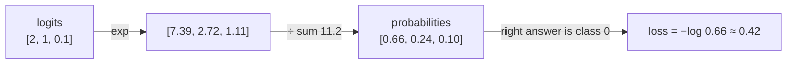

<!-- Written by `npm run lessons` from the lesson data in src/data. Edit the lesson there, not this page. -->

# Softmax and cross-entropy loss

**ML Foundations · Unit 3: Deep learning foundations · Lesson 5 of 16**

> **In one line.** Softmax turns a vector of raw scores (logits) into probabilities that sum to 1. Cross-entropy loss is −log of the probability given to the correct class. Together, their gradient is simply p − y.

[Open this lesson on the site](https://learn.hamropedia.com/foundations/softmax-and-cross-entropy-loss/) for its animation, the practice game and tap-to-explain words.

## The problem it solves

A classifier's last layer outputs arbitrary numbers, but you want probabilities, and a loss that strongly punishes confident wrong answers. Softmax plus cross-entropy is the standard pairing for every multi-class classifier and every language model, which predicts the next token from a softmax over tens of thousands of options.

## The idea

Softmax turns raw scores (logits) into probabilities that sum to 1: exp(zᵢ) / Σ exp(zⱼ). Cross-entropy loss is −log(probability of the correct class). Together, their gradient is simply: probabilities − one-hot label.

## How it works, step by step

1. Start with logits, one per class: z = [2, 1, 0.1].
2. Exponentiate: e^z = [7.39, 2.72, 1.11]. All positive, and the leader pulls further ahead.
3. Divide by the total (11.21): p = [0.66, 0.24, 0.10]. They add up to 1.
4. For stability, subtract the largest logit first. The answer is identical, but exp never overflows.
5. If the true class is the first one, the loss is −log 0.66 ≈ 0.42.
6. The gradient with respect to the logits is p − y = [0.66 − 1, 0.24, 0.10] = [−0.34, 0.24, 0.10]: raise the right score, lower the others in proportion.

## Picture it



*Softmax turns scores into probabilities; cross-entropy then scores how much probability went to the right answer.*

## Analogy

Turning vote counts into vote shares.

**Where the analogy breaks.** Real vote shares are proportional. Softmax is exponential, so a small lead in score becomes a big lead in probability.

## Worked example

Logits [2, 1, 0.1] become about [0.66, 0.24, 0.10]. If the correct class is 0, loss = −log(0.66) ≈ 0.42, and the gradient is [0.66 − 1, 0.24, 0.10] = [−0.34, 0.24, 0.10].

```python
z = z - z.max(axis=1, keepdims=True)                 # for numerical stability
p = np.exp(z) / np.exp(z).sum(axis=1, keepdims=True)
loss = -np.log(p[np.arange(len(y)), y]).mean()
```

## Must know

- Softmax turns scores into probabilities: softmax(z)ᵢ = exp(zᵢ) / Σⱼ exp(zⱼ). Each one is positive, and together they add up to 1.
- Adding the same number to every logit doesn't change the softmax, so subtracting the max is free and safe.
- Loss = −log p(correct class). Its gradient on the logits is p − one_hot(y).
- In PyTorch, F.cross_entropy takes raw logits and applies log-softmax itself. Don't softmax first.
- Scaling logits by 1/T (temperature) makes the distribution sharper (T &lt; 1) or flatter (T > 1). Used in sampling (Unit 4).
- At random initialisation with K classes, the loss starts near ln K.

## Common mistakes

- Applying softmax and then F.cross_entropy, which applies it again.
- Computing exp of large logits without subtracting the max: overflow, inf, NaN.
- Taking log(softmax) in two steps instead of using log-softmax, which loses precision.

> **Not true:** The model should apply softmax to its outputs before passing them to F.cross_entropy.  
> **In fact:** F.cross_entropy applies log-softmax itself, so it expects raw logits. With a softmax in front, it is applied twice and the loss is wrong.

> **Not true:** exp of the logits can be computed directly: large logits cause no trouble.  
> **In fact:** exp of a large logit overflows to inf, and the result becomes NaN. Subtract the largest logit first: the softmax does not change, and nothing overflows.

## Practise

Try each one yourself first: on paper, in code or out loud. Then open the answer and compare.

### 1. Derive

Derive dL/dz for softmax followed by cross-entropy, and show that it equals p − y. No notes.

<details>
<summary>Show one good answer</summary>

Softmax: pᵢ = e^(zᵢ) / Σₖ e^(zₖ). Cross-entropy with a one-hot y: L = −Σᵢ yᵢ log pᵢ.

Step 1, the softmax derivative: ∂pᵢ/∂zⱼ = pᵢ(δᵢⱼ − pⱼ), where δᵢⱼ is 1 if i = j and 0 otherwise. (Raising zⱼ raises pⱼ and lowers every other share.)

Step 2, the chain rule:  
∂L/∂zⱼ = Σᵢ (∂L/∂pᵢ)(∂pᵢ/∂zⱼ) = Σᵢ (−yᵢ/pᵢ) · pᵢ(δᵢⱼ − pⱼ) = −Σᵢ yᵢ(δᵢⱼ − pⱼ) = −yⱼ + pⱼ·Σᵢ yᵢ.

Step 3: the labels add up to 1, so Σᵢ yᵢ = 1, and ∂L/∂zⱼ = pⱼ − yⱼ.

So the gradient is just "predicted probabilities minus the truth". For logits [2, 1, 0.1] and correct class 0: p ≈ [0.66, 0.24, 0.10], gradient ≈ [−0.34, 0.24, 0.10].

</details>

### 2. Build

Implement a numerically stable softmax with cross-entropy, and train softmax regression on MNIST.

<details>
<summary>Show one good answer</summary>

Stable softmax subtracts each row's maximum before exp. For the loss, compute log-probabilities directly with log-sum-exp: log pᵢ = zᵢ − log Σ e^(zₖ), which never takes log of 0.

Softmax regression is just one linear layer, 784 → 10, trained with gradient (p − Y) / n. On MNIST, five passes over the training set with mini-batches of 128 reach about 92% test accuracy, which is the classic number for a linear model. An MLP gets about 98%.

```python
import numpy as np
from torchvision import datasets              # only to download MNIST

train, test = datasets.MNIST("data", train=True, download=True), datasets.MNIST("data", train=False, download=True)
Xtr, ytr = train.data.numpy().reshape(-1, 784) / 255.0, train.targets.numpy()
Xte, yte = test.data.numpy().reshape(-1, 784) / 255.0, test.targets.numpy()

def log_softmax(z):
    z = z - z.max(axis=1, keepdims=True)
    return z - np.log(np.exp(z).sum(axis=1, keepdims=True))

rng = np.random.default_rng(0)
W, b = np.zeros((784, 10)), np.zeros(10)
for epoch in range(5):
    for idx in np.array_split(rng.permutation(len(Xtr)), len(Xtr) // 128):
        logp = log_softmax(Xtr[idx] @ W + b)
        loss = -logp[np.arange(len(idx)), ytr[idx]].mean()
        g = np.exp(logp); g[np.arange(len(idx)), ytr[idx]] -= 1; g /= len(idx)   # p − y
        W -= 0.5 * Xtr[idx].T @ g
        b -= 0.5 * g.sum(axis=0)
    acc = (np.argmax(Xte @ W + b, axis=1) == yte).mean()
    print(f"epoch {epoch + 1}: last batch loss {loss:.3f}, test accuracy {acc:.1%}")
```

</details>

### 3. Break

Compute softmax of [1000, 1000] without subtracting the max. Then compute log(softmax) directly and with log-sum-exp. Where does each version break?

<details>
<summary>Show one good answer</summary>

Softmax of [1000, 1000] without subtracting the max: exp(1000) overflows to inf, and inf / (inf + inf) = nan. The right answer is obviously [0.5, 0.5]. Subtracting the max turns it into softmax of [0, 0], which is exactly [0.5, 0.5].

log(softmax) computed directly breaks the other way. For logits [0, −1000], softmax gives [1, 0] (e⁻¹⁰⁰⁰ underflows to 0), and log(0) = −inf. If the correct class is the second one, the loss becomes inf and the gradients nan. Log-sum-exp computes log p = z − logsumexp(z) = [0, −1000] exactly, with no inf anywhere.

That is why frameworks fuse them: PyTorch's CrossEntropyLoss takes raw logits and does the stable log-softmax inside. Never apply softmax yourself before it.

```python
import numpy as np

z = np.array([1000.0, 1000.0])
with np.errstate(over="ignore", invalid="ignore"):
    print(np.exp(z) / np.exp(z).sum())                    # [nan nan]
print(np.exp(z - z.max()) / np.exp(z - z.max()).sum())     # [0.5 0.5]

z = np.array([0.0, -1000.0])
p = np.exp(z - z.max()) / np.exp(z - z.max()).sum()
with np.errstate(divide="ignore"):
    print(np.log(p))                                       # [  0. -inf]
print(z - (z.max() + np.log(np.exp(z - z.max()).sum())))   # [    0. -1000.]
```

</details>

### 4. Explain

Explain why softmax exaggerates the leader, with the vote-share picture.

<details>
<summary>Show one good answer</summary>

Softmax turns raw scores into shares that add up to 100%, like turning vote counts into vote shares. But it first raises e to the power of each score, and exponentials grow fast. So a small lead in scores becomes a big lead in shares: scores [2, 1, 0.1] give shares of about [66%, 24%, 10%], and scores [4, 2, 0.2] give about [87%, 12%, 1%].

So softmax exaggerates the leader: a candidate ahead by a couple of points of score walks away with most of the vote. That makes the model's top choice clear and gives useful gradients, but it also means models can sound very confident even when the underlying scores are only slightly apart.

</details>

## Check you understood

Answer in your head first, then open each one.

<details>
<summary>&lt;b>Softmax of [1, 1, 1]?&lt;/b></summary>

[1/3, 1/3, 1/3]: equal scores give equal probabilities.

</details>

<details>
<summary>&lt;b>Does adding 100 to every logit change the softmax?&lt;/b></summary>

No. The factor e¹⁰⁰ appears in the top and the bottom and cancels.

</details>

<details>
<summary>&lt;b>What is the gradient of softmax + cross-entropy with respect to the logits?&lt;/b></summary>

p − y: the predicted probabilities minus the one-hot true label.

</details>

<details>
<summary>&lt;b>What loss would you expect at the start of training with 4 classes?&lt;/b></summary>

About ln 4 ≈ 1.39, because random weights give roughly equal probabilities.

</details>

## Go further (optional)

The lesson above is enough on its own. These free extras give a second explanation.

- WATCH · [Neural Networks Part 5: ArgMax and SoftMax](https://www.youtube.com/results?search_query=StatQuest+Neural+Networks+Part+5%3A+ArgMax+and+SoftMax) · StatQuest (Josh Starmer)
- WATCH · [Neural Networks Part 6: Cross Entropy](https://www.youtube.com/results?search_query=StatQuest+Neural+Networks+Part+6%3A+Cross+Entropy) · StatQuest (Josh Starmer)
- READ · [CS231n: Linear classification (the softmax classifier)](https://cs231n.github.io/linear-classify/) · Stanford

---

[← Autograd and computational graphs](autograd-and-computational-graphs.md) · [All lessons](../../README.md) · [Optimisers: SGD, momentum, Adam; learning-rate schedules →](optimisers-sgd-momentum-adam-learning-rate-schedules.md)
