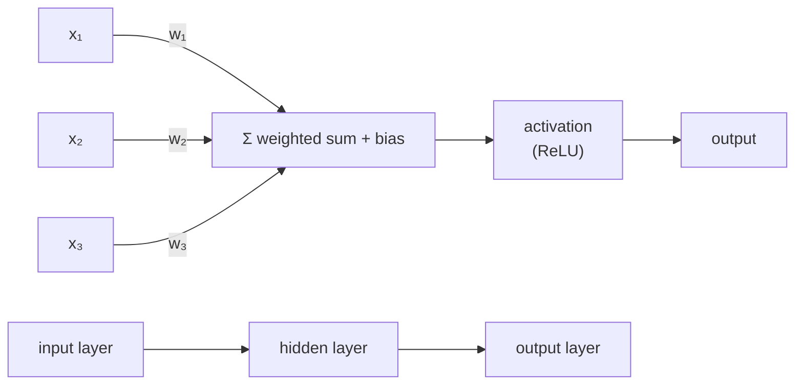

<!-- Written by `npm run lessons` from the lesson data in src/data. Edit the lesson there, not this page. -->

# The neuron and the multi-layer perceptron

**ML Foundations · Unit 3: Deep learning foundations · Lesson 1 of 16**

> **In one line.** A neuron computes a weighted sum of its inputs plus a bias, and passes it through an activation. A multi-layer perceptron (MLP) stacks layers of neurons, each layer feeding the next.

[Open this lesson on the site](https://learn.hamropedia.com/foundations/the-neuron-and-the-multi-layer-perceptron/) for its animation, the practice game and tap-to-explain words.

## The problem it solves

Linear and logistic regression can only draw straight boundaries and fit straight trends. Real patterns — handwriting, speech, prices driven by many interacting factors — are curved and tangled. Stacking many simple neurons in layers lets a model build complicated functions out of simple pieces, and every modern network, transformers included, is built from this unit.

## The idea

A neuron computes a weighted sum of its inputs, adds a bias, and applies an activation: a = f(w·x + b). An MLP stacks layers of neurons, and each layer's output is the next layer's input.

## How it works, step by step

1. One neuron takes inputs x, multiplies each by its weight, adds them up and adds a bias: z = w·x + b. For x = [0.5, −1, 2], w = [0.8, −0.4, 0.6] and b = −0.5, z = 0.4 + 0.4 + 1.2 − 0.5 = 1.5.
2. It applies an activation: ReLU(1.5) = 1.5. That number is the neuron's output.
3. A layer is many neurons reading the same inputs, each with its own weights. In code, a whole layer is one matrix multiply: h = relu(x @ W + b).
4. Shapes: with a batch of inputs X of shape (batch, 3) and W of shape (3, 4), the layer's output has shape (batch, 4): 4 neurons for each example.
5. An MLP feeds each layer's output into the next: input → hidden layers → output layer.
6. The last layer has no ReLU: it gives one raw score per class (or one number for regression).
7. Count the parameters: a layer from n inputs to m neurons has n × m weights and m biases. A 3 → 4 → 2 network has 12 + 4 + 8 + 2 = 26.

## Picture it



*Top: one neuron. Bottom: an MLP stacks layers of them, each layer feeding the next.*

## Analogy

Rows of judges. Each judge (neuron) weighs the evidence in their own way and gives a score. The next row of judges combines those scores.

**Where the analogy breaks.** Real judges can explain their reasoning. Single neurons usually cannot be read so simply.

## Worked example

A 3 → 4 → 2 network: the input has 3 features, one hidden layer has 4 ReLU neurons, and the output has 2 scores. It has 3 × 4 + 4 = 16 parameters in the first layer and 4 × 2 + 2 = 10 in the second: 26 in total.

```python
h = np.maximum(0, X @ W1 + b1)   # layer 1 with ReLU, shape (batch, hidden)
out = h @ W2 + b2                # layer 2, shape (batch, classes)
```

## Must know

- Neuron: a = f(w·x + b). Logistic regression is one neuron with a sigmoid.
- Layer: h = f(x W + b), done for the whole batch with one matrix multiply.
- "Fully connected" (or "dense", or "linear") layer: every input connects to every neuron.
- Parameters per layer = n_in × n_out + n_out.
- The forward pass runs the layers in order; training adjusts every weight with backprop.
- Depth (more layers) lets a network build features out of features.

## Common mistakes

- Forgetting the activation between layers, so the whole network collapses into one linear layer.
- Getting the weight shape backwards: for x @ W, W must be (n_in, n_out).
- Starting every weight at the same value: every neuron in a layer then stays identical forever.
- Putting a ReLU on the final output, which stops the scores going negative.

> **Not true:** A network learns normally when its weights start at one shared value.  
> **In fact:** Every neuron in a layer would then compute the same thing and receive the same update, so they stay identical for ever. Random starting weights break the tie.

> **Not true:** Linear layers stacked with no activation between them: a more powerful network.  
> **In fact:** Without an activation between them, several linear layers collapse into one linear layer. The non-linearity is what makes depth useful.

## Practise

Try each one yourself first: on paper, in code or out loud. Then open the answer and compare.

### 1. Derive

For a 784 → 128 → 10 MLP, count the weights and biases in each layer, and the total.

<details>
<summary>Show one good answer</summary>

A layer from a inputs to b outputs has an a × b weight matrix plus b biases.

Layer 1, 784 → 128: 784 × 128 = 100,352 weights + 128 biases = 100,480 parameters.  
Layer 2, 128 → 10: 128 × 10 = 1,280 weights + 10 biases = 1,290 parameters.

Total: 100,480 + 1,290 = 101,770 parameters.

Notice that almost all of them are in the first layer: wide inputs are expensive. That is one reason CNNs, which share a small filter across the whole image, need far fewer parameters for images.

```python
import torch.nn as nn
model = nn.Sequential(nn.Linear(784, 128), nn.ReLU(), nn.Linear(128, 10))
print(sum(p.numel() for p in model.parameters()))     # 101770
```

</details>

### 2. Build

Write the forward pass of a 2-layer MLP in NumPy for a batch of inputs. Check every shape with assert statements.

<details>
<summary>Show one good answer</summary>

For a batch X of shape (batch, 784): h = relu(X @ W1 + b1) has shape (batch, 128), and the scores are h @ W2 + b2 with shape (batch, 10). The biases broadcast across the batch. Assert every shape: shape bugs are the most common bugs in deep learning code, and they are silent when broadcasting hides them.

```python
import numpy as np

rng = np.random.default_rng(0)
W1, b1 = rng.normal(0, np.sqrt(2 / 784), (784, 128)), np.zeros(128)
W2, b2 = rng.normal(0, np.sqrt(2 / 128), (128, 10)), np.zeros(10)

def forward(X):
    assert X.ndim == 2 and X.shape[1] == 784, X.shape
    h = np.maximum(0, X @ W1 + b1)
    assert h.shape == (X.shape[0], 128), h.shape
    scores = h @ W2 + b2
    assert scores.shape == (X.shape[0], 10), scores.shape
    return scores

print(forward(rng.random((32, 784))).shape)        # (32, 10)
```

</details>

### 3. Break

Set every weight to the same number and train for a few steps. Why do all hidden neurons stay identical?

<details>
<summary>Show one good answer</summary>

If every weight starts at the same number, every hidden neuron computes exactly the same thing. They get the same input, do the same sum, and give the same output. In the backward pass they receive the same gradient, so the update changes them all by the same amount, and they are still identical afterwards. Forever.

So a layer of 128 neurons behaves like one neuron copied 128 times: the network can't learn different features. This is "symmetry", and random initialisation is what breaks it. (Biases can start at 0; the weights must not all be equal.)

```python
import torch
import torch.nn as nn

torch.manual_seed(0)
model = nn.Sequential(nn.Linear(4, 5), nn.Tanh(), nn.Linear(5, 1))
for p in model.parameters():
    nn.init.constant_(p, 0.3)                      # every weight the same
opt = torch.optim.SGD(model.parameters(), lr=0.1)
X, y = torch.randn(64, 4), torch.randn(64, 1)
for _ in range(50):
    opt.zero_grad()
    nn.functional.mse_loss(model(X), y).backward()
    opt.step()
W = model[0].weight
print(torch.allclose(W, W[0].expand_as(W)))         # True: all 5 neurons still identical
```

</details>

### 4. Explain

Explain an MLP with the rows-of-judges picture.

<details>
<summary>Show one good answer</summary>

Think of rows of judges. In the first row, each judge looks at all the evidence (the input numbers), weighs each piece in their own way, adds it up, and gives a score; if the score is below zero they say nothing (that is the ReLU). The next row of judges doesn't see the evidence at all, only the first row's scores, and combines those in their own way. The last row gives the final verdict, such as one score per digit.

Training adjusts how much every judge trusts every piece of what they hear. Because each row builds on the one before, later rows can recognise complicated patterns made out of simpler ones.

</details>

## Check you understood

Answer in your head first, then open each one.

<details>
<summary>&lt;b>What does one neuron compute?&lt;/b></summary>

A weighted sum of its inputs plus a bias, passed through an activation: f(w·x + b).

</details>

<details>
<summary>&lt;b>X has shape (32, 3) and W has shape (3, 4). What shape is X @ W?&lt;/b></summary>

(32, 4): 4 outputs for each of the 32 examples.

</details>

<details>
<summary>&lt;b>How many parameters does a layer from 5 inputs to 3 neurons have?&lt;/b></summary>

5 × 3 = 15 weights plus 3 biases: 18.

</details>

<details>
<summary>&lt;b>Why not use the same starting value for every weight?&lt;/b></summary>

Every neuron in the layer would compute the same thing and get the same gradient, so they would stay identical and the layer would act like one neuron.

</details>

## Go further (optional)

The lesson above is enough on its own. These free extras give a second explanation.

- WATCH · [Neural Networks, Ch 1: But what is a neural network?](https://www.3blue1brown.com/lessons/neural-networks) · 3Blue1Brown  
  **Worth it:** Layers of glowing neurons recognising handwritten digits. The best first picture of what a network is and what its weights do.
- PLAY · [A Neural Network Playground](https://playground.tensorflow.org/) · TensorFlow · runs in the browser
- READ · [Understanding Deep Learning, Ch 3–4 (shallow and deep networks)](https://udlbook.github.io/udlbook/) · Simon Prince · free
- READ · [Neural Networks and Deep Learning, Ch 1](http://neuralnetworksanddeeplearning.com/) · Michael Nielsen · free

---

[← Generalisation: VC dimension and double descent](../unit-2-classical-ml/generalisation-vc-dimension-and-double-descent.md) · [All lessons](../../README.md) · [Activation functions, and why non-linearity matters →](activation-functions-and-why-non-linearity-matters.md)
