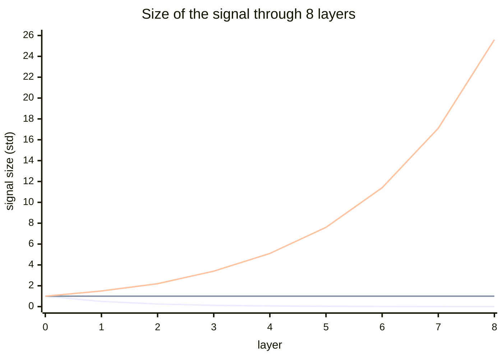

<!-- Written by `npm run lessons` from the lesson data in src/data. Edit the lesson there, not this page. -->

# Weight initialisation; vanishing and exploding gradients

**ML Foundations · Unit 3: Deep learning foundations · Lesson 7 of 16**

> **In one line.** Weight initialisation chooses the random starting weights so that signals and gradients keep roughly the same size from layer to layer, instead of vanishing towards zero or exploding towards infinity.

[Open this lesson on the site](https://learn.hamropedia.com/foundations/weight-initialisation-vanishing-and-exploding-gradients/) for its animation, the practice game and tap-to-explain words.

## The problem it solves

In a deep network the signal is multiplied by a weight matrix at every layer, and the gradient again on the way back. If each layer shrinks it a little, after 50 layers nothing is left; if each grows it a little, it overflows.

Bad initialisation can make a network untrainable before it has seen a single example. Good initialisation, plus normalisation and residual connections, is what makes depth work.

## The idea

If weights start too small, signals shrink layer by layer and gradients vanish. If they start too big, signals grow and explode. Good initialisation keeps the signal size steady: He initialisation for ReLU uses std = √(2 / fan_in).

## How it works, step by step

1. Picture one layer: each output is a sum of fan_in terms, each an input times a random weight.
2. Adding fan_in independent terms multiplies the variance: Var(out) ≈ fan_in × Var(w) × Var(in).
3. To keep the size the same, choose Var(w) = 1 / fan_in. This is Xavier (Glorot) initialisation, for tanh-like activations.
4. ReLU zeroes about half its inputs, halving the variance, so double it: Var(w) = 2 / fan_in, std = √(2 / fan_in). This is He initialisation, for ReLU.
5. Too small (std 0.01 with 48 inputs): each layer shrinks the signal, so activations and gradients vanish.
6. Too big (std 1): each layer multiplies the signal by about √(fan_in/2), so it explodes to inf or NaN.
7. Check it: print the standard deviation of the activations at every layer of a freshly initialised network. It should stay roughly level.

## Picture it



*Weights too small: the signal fades to nothing (vanishing). Too big: it explodes. Good initialisation keeps it steady (the flat line).*

## Analogy

Passing a message down a line of 50 people. Too quiet, and it fades to nothing. Too loud, and it turns into shouting and noise.

**Where the analogy breaks.** People can ask 'sorry, again?'. A network cannot. That is why we also add normalisation layers and residual connections.

## Worked example

Multiply by 0.9 fifty times and you get 0.005. Multiply by 1.1 fifty times and you get 117.

```python
W = np.random.randn(fan_in, fan_out) * np.sqrt(2 / fan_in)   # He initialisation
```

## Must know

- Vanishing: early layers get almost no gradient and barely learn. Exploding: NaN.
- He (ReLU): std = √(2 / fan_in). Xavier (tanh): std = √(1 / fan_in), or √(2 / (fan_in + fan_out)).
- PyTorch's default layer initialisation is already sensible; custom layers need care.
- Biases usually start at 0. Only the weights need random values, to make the neurons differ from each other.
- Normalisation layers and residual connections make networks much less sensitive to initialisation.
- Gradient clipping limits the damage when gradients do explode, especially in RNNs.

## Common mistakes

- Starting every weight at 0, or at the same value: no symmetry breaking.
- Using std = 1 for wide layers.
- Blaming the optimiser when the real problem is initialisation.

> **Not true:** A standard deviation of 1 is a safe choice for the starting weights of a wide layer.  
> **In fact:** With many inputs the sum grows at every layer and the signal explodes. He initialisation uses √(2 / fan_in), which gets smaller as the layer gets wider.

> **Not true:** He initialisation: for tanh. Xavier initialisation: for ReLU.  
> **In fact:** It is the other way round. He, with std = √(2 / fan_in), is for ReLU, which zeroes about half its inputs. Xavier is for tanh.

## Practise

Try each one yourself first: on paper, in code or out loud. Then open the answer and compare.

### 1. Derive

Show that a layer's output variance is roughly fan_in × Var(w) × Var(x), and why ReLU needs an extra factor of 2. Use this to get the He initialisation std.

<details>
<summary>Show one good answer</summary>

One output of a layer is y = Σᵢ wᵢxᵢ, summed over fan_in inputs. Assume the w's and x's are independent and the w's have mean 0.

Var(y) = Σᵢ Var(wᵢxᵢ) = fan_in × Var(w) × E[x²].  
(For independent w and x with E[w] = 0, Var(wx) = Var(w)·E[x²]. If x also has mean 0, E[x²] = Var(x).)

So Var(y) ≈ fan_in × Var(w) × Var(x). To keep the variance the same from layer to layer, we need fan_in × Var(w) = 1.

The ReLU factor of 2: after ReLU, half of the values become 0. For a symmetric pre-activation z, E[relu(z)²] = Var(z)/2. So each ReLU layer halves the signal, and to make up for it we need fan_in × Var(w) / 2 = 1.

He initialisation: Var(w) = 2 / fan_in, so the standard deviation is √(2 / fan_in). For fan_in = 512, std ≈ 0.0625.

</details>

### 2. Build

Build a 20-layer MLP. Plot the standard deviation of the activations at every layer, with tiny, He, and huge initialisation.

<details>
<summary>Show one good answer</summary>

Push a batch of random inputs through 20 layers of width 512 with ReLU, and record the standard deviation of the activations after each layer.

With tiny weights (std 0.01) the signal shrinks by about 6 times per layer (0.01 × √(512/2) = 0.16) and is essentially 0 after a few layers. With huge weights (std 1.0) it grows by about 16 times per layer (1.0 × √256) until it is astronomically large, around 10²⁴ by layer 20. With He initialisation (√(2/512) ≈ 0.0625) it stays at the same level all the way through: a flat line.

```python
import numpy as np
import matplotlib.pyplot as plt

rng = np.random.default_rng(0)
width = 512
for name, std in [("tiny 0.01", 0.01), ("He", np.sqrt(2 / width)), ("huge 1.0", 1.0)]:
    x, stds = rng.normal(size=(256, width)), []
    for _ in range(20):
        x = np.maximum(0, x @ rng.normal(0, std, (width, width)))
        stds.append(x.std())
    print(f"{name:10s} layer 1: {stds[0]:.2e}, layer 20: {stds[-1]:.2e}")
    plt.plot(range(1, 21), stds, marker="o", label=name)
plt.yscale("log"); plt.xlabel("layer"); plt.ylabel("std of activations"); plt.legend(); plt.show()
```

</details>

### 3. Break

Train the 20-layer net with std = 1.0 and with std = 0.01. Describe what happens to the gradients in each case.

<details>
<summary>Show one good answer</summary>

std = 1.0: activations grow by about 16 times per layer, so by layer 20 they are enormous, and so are the gradients on the way back. The first update multiplies weights by numbers in the billions, and the loss becomes inf or nan almost at once: exploding gradients.

std = 0.01: activations shrink to almost 0, and the gradient reaching the first layer is so tiny it rounds to exactly 0. The loss stays at ln 2 ≈ 0.69, guessing, because the network's output is basically 0 whatever the input: vanishing gradients.

With He initialisation, the same 20-layer network trains normally. The fix for both failures is the same: choose the weight scale so the signal keeps its size, and add normalisation layers or residual connections for very deep networks.

```python
import torch
import torch.nn as nn

X, y = torch.randn(256, 64), torch.randint(0, 2, (256,))
for name, std in [("std 1.0", 1.0), ("std 0.01", 0.01), ("He", (2 / 64) ** 0.5)]:
    torch.manual_seed(0)
    layers = []
    for _ in range(20):
        lin = nn.Linear(64, 64); nn.init.normal_(lin.weight, 0, std); nn.init.zeros_(lin.bias)
        layers += [lin, nn.ReLU()]
    model = nn.Sequential(*layers, nn.Linear(64, 2))
    opt = torch.optim.SGD(model.parameters(), lr=0.01)
    first = None
    for step in range(100):
        opt.zero_grad()
        loss = nn.functional.cross_entropy(model(X), y)
        loss.backward()
        if first is None:
            first = model[0].weight.grad.norm().item()
        opt.step()
    print(f"{name:8s}: first-layer gradient {first:.1e}, loss after 100 steps {loss.item():.3g}")
```

</details>

### 4. Explain

Explain vanishing and exploding gradients with the message-down-the-line picture.

<details>
<summary>Show one good answer</summary>

Passing a message down a line of 50 people. If everyone whispers a bit more quietly than they heard it, the message fades to nothing by the end of the line. If everyone says it a bit louder, it turns into shouting and noise.

Gradients travel back through a deep network the same way, multiplied at every layer. If each layer multiplies by a bit less than 1 (0.9 fifty times is 0.005), the gradient vanishes and the early layers stop learning. If each multiplies by a bit more than 1 (1.1 fifty times is 117), it explodes. Good initialisation, normalisation and residual connections make every person pass the message on at the same volume.

</details>

## Check you understood

Answer in your head first, then open each one.

<details>
<summary>&lt;b>What is He initialisation, and when do you use it?&lt;/b></summary>

Normal weights with std = √(2 / fan_in), for layers followed by ReLU.

</details>

<details>
<summary>&lt;b>Why does ReLU need the extra factor of 2?&lt;/b></summary>

It zeroes about half of its inputs, which halves the variance of the signal; doubling the weight variance makes up for it.

</details>

<details>
<summary>&lt;b>Multiply by 0.9 fifty times. Roughly what do you get, and why does it matter?&lt;/b></summary>

About 0.005. A small shrink per layer becomes a vanishing signal over many layers.

</details>

<details>
<summary>&lt;b>Give two fixes for exploding gradients.&lt;/b></summary>

Better initialisation and gradient clipping (also normalisation layers and a lower learning rate).

</details>

## Go further (optional)

The lesson above is enough on its own. These free extras give a second explanation.

- PLAY · [Initializing neural networks](https://www.deeplearning.ai/ai-notes/initialization/) · deeplearning.ai · interactive  
  **Worth it:** Pick an initialisation and watch the activations and gradients shrink, explode or stay healthy layer by layer as the network trains.
- WATCH · [Building makemore Part 3: Activations & Gradients, BatchNorm](https://karpathy.ai/zero-to-hero.html) · Andrej Karpathy
- READ · [Understanding Deep Learning, Ch 7 (gradients and initialisation)](https://udlbook.github.io/udlbook/) · Simon Prince · free
- READ · [CS231n: Neural Networks Part 2 (weight initialisation)](https://cs231n.github.io/neural-networks-2/) · Stanford

---

[← Optimisers: SGD, momentum, Adam; learning-rate schedules](optimisers-sgd-momentum-adam-learning-rate-schedules.md) · [All lessons](../../README.md) · [Batch norm and layer norm →](batch-norm-and-layer-norm.md)
