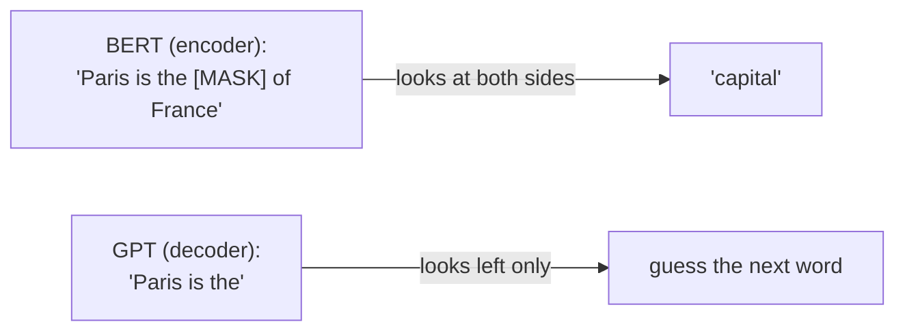

<!-- Written by `npm run lessons` from the lesson data in src/data. Edit the lesson there, not this page. -->

# Encoder models (BERT) vs decoder models (GPT)

**ML Foundations · Unit 4: Transformers and LLMs · Lesson 6 of 14**

> **In one line.** Encoder models, like BERT, let every token look in both directions and learn by filling in masked words, which suits understanding text. Decoder models, like GPT, look only backwards and learn by predicting the next word, which suits writing it.

[Open this lesson on the site](https://learn.hamropedia.com/foundations/encoder-models-bert-vs-decoder-models-gpt/) for its animation, the practice game and tap-to-explain words.

## The problem it solves

Different jobs need different views of the text. Classifying a review or building a search embedding benefits from seeing the whole sentence at once. Writing text one word at a time needs a model that never peeks ahead. Knowing which family a model belongs to tells you what it is good for and how to use it.

## The idea

Encoder models like BERT see the whole sentence in both directions and are trained to fill in masked words. They are good for understanding: classification and search embeddings. Decoder models like GPT see only the past and are trained to predict the next word. They are good for generating text.

## How it works, step by step

1. Both families use the same transformer blocks. The difference is the attention mask and the training goal.
2. Encoder: no causal mask, so each token sees the whole input, left and right.
3. BERT's training: hide about 15% of tokens with [MASK] and predict them from the surrounding words (masked language modelling).
4. Decoder: a causal mask, so each token sees only earlier tokens. Training: predict the next token.
5. Encoder–decoder models (the original transformer, T5) use an encoder to read the input and a decoder that generates while attending to it through cross-attention. Common for translation.
6. Today most large models are decoder-only, and they are also used for classification and embeddings, but encoders remain cheap and strong for search and classification.

## Picture it



*Encoders read the whole sentence to understand it; decoders only see the past, so they can generate text word by word.*

## Analogy

BERT does fill-in-the-blank exercises. GPT writes a story one word at a time.

**Where the analogy breaks.** The line is blurry today. Decoder models are also used for classification and embeddings.

## Worked example

'Paris is the [MASK] of France': BERT predicts 'capital' using words on both sides. Given only 'Paris is the', GPT must guess using the left side alone.

## Must know

- Encoder = bidirectional = understanding (classification, embeddings, named entities).
- Decoder = causal = generation (chat, writing, code).
- Encoder–decoder = read then write (translation, summarisation).
- BERT-style models need fine-tuning or a task head; GPT-style models can often be prompted directly.
- Sentence-embedding models used in search are often encoders.

## Common mistakes

- Trying to generate long text with a BERT-style model.
- Assuming decoders can't do classification: they can, by prompting or with a small head.
- Mixing up masked-language-model "masks" (hidden words) with attention masks (blocked connections).

> **Not true:** A decoder model such as GPT cannot be used for classification.  
> **In fact:** It can: ask for the label in the prompt, or put a small classification head on top. An encoder is simply the more efficient choice for the job.

> **Not true:** Encoder (BERT) = the natural choice for writing long text.  
> **In fact:** BERT is trained to fill in hidden words while seeing both sides, not to continue a text. Writing one word after another is the job of a decoder such as GPT.

## Practise

Try each one yourself first: on paper, in code or out loud. Then open the answer and compare.

### 1. Derive

Draw the attention mask for an encoder and for a decoder with 4 tokens. Which cells are allowed in each?

<details>
<summary>Show one good answer</summary>

Rows are the token that is looking (the query); columns are the tokens it may look at. ✓ = allowed.

Encoder (BERT): every token sees every token, before and after it. All 16 cells allowed.

Decoder (GPT): token i may only see tokens 1 to i. Only the lower triangle, diagonal included: 4 + 3 + 2 + 1 = 10 cells allowed; the 6 cells above the diagonal (the future) are blocked.

That single difference decides what each is good at: the encoder reads in both directions, so it understands a fixed text well; the decoder never sees the future, so it can write text one token at a time.

```text
Encoder (all allowed)         Decoder (causal)
       t1 t2 t3 t4                   t1 t2 t3 t4
  t1    ✓  ✓  ✓  ✓              t1    ✓  .  .  .
  t2    ✓  ✓  ✓  ✓              t2    ✓  ✓  .  .
  t3    ✓  ✓  ✓  ✓              t3    ✓  ✓  ✓  .
  t4    ✓  ✓  ✓  ✓              t4    ✓  ✓  ✓  ✓
```

</details>

### 2. Build

Turn your GPT into a small BERT-style model: remove the causal mask, hide 15% of the tokens, and train it to predict them.

<details>
<summary>Show one good answer</summary>

Three changes to the GPT turn it into a small BERT. Remove the causal mask (causal=False). Add one extra vocabulary entry for a [MASK] token. And change the task: in every training window, hide a random 15% of the characters by replacing them with [MASK], and compute the loss only at those hidden positions, where the model must recover the original character.

(Real BERT also sometimes swaps in a random token or leaves the token unchanged instead of masking, so it can't rely on seeing [MASK]; skipped here for simplicity.)

After 1,500 steps it recovers about a third of the hidden characters on validation text (35% in this run; guessing would get under 2%), using context from both sides. With 15% of characters hidden, several gaps often sit close together, which makes it harder than it sounds; longer training raises it further.

```python
import torch
import torch.nn.functional as F
from gpt import GPT, Config, get_batch, vocab_size

MASK = vocab_size                                          # one extra token id

def masked_batch(split):
    x, _ = get_batch(split)
    hidden = torch.rand(x.shape) < 0.15
    inputs = x.masked_fill(hidden, MASK)
    targets = x.masked_fill(~hidden, -100)                 # -100: ignored by the loss
    return inputs, targets

torch.manual_seed(0)
bert = GPT(Config(causal=False, vocab=vocab_size + 1))
opt = torch.optim.AdamW(bert.parameters(), lr=1e-3)
for step in range(1500):
    inputs, targets = masked_batch("train")
    logits, _ = bert(inputs)
    loss = F.cross_entropy(logits.reshape(-1, logits.size(-1)), targets.reshape(-1), ignore_index=-100)
    opt.zero_grad(); loss.backward(); opt.step()

bert.eval()
with torch.no_grad():
    inputs, targets = masked_batch("val")
    pred = bert(inputs)[0].argmax(-1)
    hidden = targets != -100
    print(f"recovered {(pred[hidden] == targets[hidden]).float().mean().item():.0%} of hidden characters")
torch.save(bert.state_dict(), "bert.pt")
```

</details>

### 3. Break

Try to generate text with the BERT-style model, one token at a time. Why does it work badly?

<details>
<summary>Show one good answer</summary>

To generate with it, put a [MASK] at the end, predict what it is, keep that character, add a new [MASK], and repeat. The result is poor: short runs of plausible letters that soon fall into repetition or nonsense, much worse than the GPT of the same size.

Why: it was trained on a different task. It always had real text on both sides of a gap, and only 15% of positions were hidden. Here the gap is always at the very end, with nothing to its right, which it never practised, and every character it guesses becomes context for the next guess, so its mistakes pile up. It also never learned a proper probability for "what comes next given only the past", which is exactly what generation needs. Encoders are built to understand a whole text at once (classification, search, tagging); decoders are built to write.

```python
import torch
from gpt import GPT, Config, vocab_size, encode, decode

MASK = vocab_size
bert = GPT(Config(causal=False, vocab=vocab_size + 1))
bert.load_state_dict(torch.load("bert.pt"))       # saved by the Build answer above
bert.eval()
torch.manual_seed(0)
ids = encode("ROMEO:\n")
with torch.no_grad():
    for _ in range(120):
        window = (ids + [MASK])[-64:]
        logits = bert(torch.tensor([window]))[0][0, -1, :vocab_size]
        ids.append(torch.multinomial(torch.softmax(logits, -1), 1).item())
print(decode(ids))
```

</details>

### 4. Explain

Explain encoders and decoders with the fill-in-the-blank and story-writing pictures.

<details>
<summary>Show one good answer</summary>

BERT, an encoder, does fill-in-the-blank exercises. It reads a whole sentence with some words blanked out, "Paris is the ___ of France", and uses the words on both sides to fill each gap. That makes it very good at understanding text that already exists: classifying it, searching it, finding the names in it.

GPT, a decoder, writes a story one word at a time. It can only look back at what it has written so far, never ahead, and predicts the next word, again and again. That makes it a writer. Because it never sees the future during training, it can keep going at generation time, which a fill-in-the-blank model can't do well.

</details>

## Check you understood

Answer in your head first, then open each one.

<details>
<summary>&lt;b>What is BERT trained to do?&lt;/b></summary>

Predict randomly hidden (masked) tokens using the words on both sides.

</details>

<details>
<summary>&lt;b>Why is a decoder better at generating text?&lt;/b></summary>

It is trained exactly for left-to-right prediction with a causal mask, which matches how text is generated one token at a time.

</details>

<details>
<summary>&lt;b>Give one task that suits an encoder.&lt;/b></summary>

Sentiment classification or making embeddings for semantic search.

</details>

<details>
<summary>&lt;b>What does an encoder–decoder model add?&lt;/b></summary>

Cross-attention: the decoder generates the output while attending to the encoder's reading of the input.

</details>

## Go further (optional)

The lesson above is enough on its own. These free extras give a second explanation.

- READ · [The Illustrated BERT, ELMo, and co.](https://jalammar.github.io/illustrated-bert/) · Jay Alammar
- WATCH · [Decoder-Only Transformers, ChatGPT's specific Transformer, Clearly Explained](https://www.youtube.com/results?search_query=StatQuest+Decoder-Only+Transformers%2C+ChatGPT%27s+specific+Transformer%2C+Clearly+Explained) · StatQuest (Josh Starmer)
- PAPER · [BERT (2018)](https://arxiv.org/abs/1810.04805) · Devlin et al. · arXiv

---

[← GPT-style models and next-token prediction](gpt-style-models-and-next-token-prediction.md) · [All lessons](../../README.md) · [Vision transformers and CLIP →](vision-transformers-and-clip.md)
