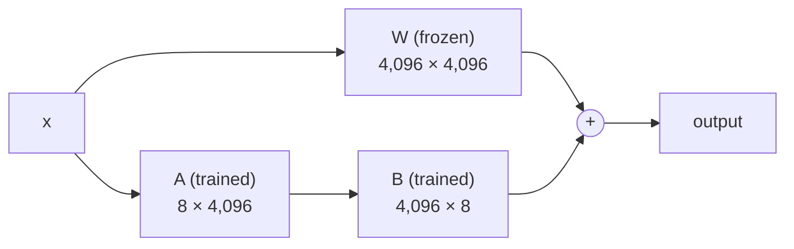

<!-- Written by `npm run lessons` from the lesson data in src/data. Edit the lesson there, not this page. -->

# Fine-tuning and LoRA

**ML Foundations · Unit 4: Transformers and LLMs · Lesson 12 of 14**

> **In one line.** Fine-tuning continues training a pretrained model on your own data. LoRA does it cheaply: it freezes the original weights W and trains a small low-rank update, so the layer uses W + B·A.

[Open this lesson on the site](https://learn.hamropedia.com/foundations/fine-tuning-and-lora/) for its animation, the practice game and tap-to-explain words.

## The problem it solves

Pretrained models are general; you often need a specific style, format or domain. Full fine-tuning updates billions of weights, needs optimiser memory for all of them, and produces a whole new model copy per task. LoRA trains well under 1% of the parameters, fits on a single GPU, and produces small adapters you can swap in and out of one base model.

## The idea

Fine-tuning continues training a pretrained model on your own data. Full fine-tuning updates every weight. LoRA freezes the original weights W and learns a small update BA of low rank r (for example 8): W′ = W + BA.

## How it works, step by step

1. Pick the weight matrices to adapt, usually the attention projections (and often the MLP).
2. Freeze W. Add two small matrices: B (d_out × r) and A (r × d_in), with rank r such as 8 or 16.
3. Start B at zero, so B·A = 0 and the model begins exactly as the pretrained one.
4. The layer computes y = x·Wᵀ + x·(B·A)ᵀ, usually scaled by α/r.
5. Train only A and B. For a 4,096 × 4,096 matrix with r = 8, that is 65,536 weights instead of 16.8 million: about 0.4%.
6. Afterwards, keep the adapter separate (tiny files, swappable), or merge it: W′ = W + B·A, with no extra cost when running.
7. QLoRA goes further: the frozen base model is stored in 4-bit, so even large models can be fine-tuned on one GPU.

## Picture it



*LoRA leaves the big weight W untouched and trains two thin matrices beside it — about 0.4% as many numbers.*

## Analogy

Instead of rewriting a whole textbook, you add a few sticky notes with corrections.

**Where the analogy breaks.** Sticky notes can be removed, and so can LoRA adapters, so one base model can serve many tasks. But a small rank cannot teach big new skills.

## Worked example

A 4,096 × 4,096 layer has 16.8 million weights. LoRA with r = 8 trains B (4,096 × 8) and A (8 × 4,096): 65,536 weights, about 0.4%.

```python
W.requires_grad = False                        # W has shape (d_out, d_in)
A = (torch.randn(r, d_in) * 0.01).requires_grad_()
B = torch.zeros(d_out, r, requires_grad=True)   # B = 0: start with no change
y = x @ W.T + x @ (B @ A).T
```

## Must know

- Full fine-tuning: every weight, most flexible, most expensive.
- LoRA: frozen W plus a trainable low-rank B·A.
- Trainable LoRA parameters per matrix = r × (d_in + d_out).
- B = 0 at the start means no change at step 0.
- Adapters can be merged into W for free inference, or swapped per task.
- Fine-tuning teaches style and format well; it is a poor way to add lots of new facts (use RAG, Unit 5).

## Common mistakes

- Starting both A and B random, so the model is damaged at step 0.
- Choosing a rank far too small for a big change in behaviour, or far too big for a small dataset.
- Fine-tuning to inject facts that change often.
- Forgetting the original chat template, so the tuned model loses its formatting.

> **Not true:** Facts that change each week: add them by fine-tuning.  
> **In fact:** Retraining for each change is slow and costly, and the old facts stay in the weights. Facts that change belong in retrieval (RAG), not in fine-tuning.

> **Not true:** LoRA rank: r = 1 covers a big change in behaviour as well as a small one.  
> **In fact:** The rank limits how much the update can express. A big change in behaviour needs a higher rank; a small dataset needs a lower one, or it overfits.

## Practise

Try each one yourself first: on paper, in code or out loud. Then open the answer and compare.

### 1. Derive

For a 1,024 × 1,024 layer, count the trainable weights with full fine-tuning, and with LoRA at r = 4, 8 and 64.

<details>
<summary>Show one good answer</summary>

A 1,024 × 1,024 layer has 1,048,576 weights. Full fine-tuning trains all of them.

LoRA trains B (1,024 × r) and A (r × 1,024), so 2 × 1,024 × r weights:  
r = 4: 8,192 weights, 0.78% of the layer  
r = 8: 16,384 weights, 1.56%  
r = 64: 131,072 weights, 12.5%

The update B·A can only change the layer in r independent directions. Small r is very cheap but limited; larger r can express bigger changes. Most fine-tunes work well with r between 8 and 64.

</details>

### 2. Build

Add LoRA adapters to the attention layers of your GPT. Fine-tune it on a new text style and compare with full fine-tuning.

<details>
<summary>Show one good answer</summary>

A LoRA layer wraps an existing nn.Linear: the original weight is frozen, and the output adds (alpha / r) · x·Aᵀ·Bᵀ, with A starting small and random and B starting at 0, so at step 0 the model is exactly the original. Wrap the attention projections (qkv and proj) of every block and train only A and B.

Experiment: pretrain the Shakespeare GPT, then fine-tune it to a very different style, a list of first names, one per line. LoRA with r = 8 trains about 3% of the parameters and learns the new style: its samples already look like names. Full fine-tuning gets a clearly lower loss in the same number of steps (about 1.61 against 2.07 here), because it can change everything, including the MLPs and embeddings, which matters for a change this big, from Shakespeare's verse to bare first names. For smaller shifts in style, the gap is usually much smaller. LoRA's adapter is a tiny file, and the original model stays untouched, so you could keep one adapter per style.

```python
import math
import urllib.request
import torch
import torch.nn as nn
from gpt import GPT, Config, train, encode, decode

class LoRALinear(nn.Module):
    def __init__(self, base, r=8, alpha=16, init_b_zero=True):
        super().__init__()
        self.base, self.scale = base, alpha / r
        for p in self.base.parameters():
            p.requires_grad = False
        self.A = nn.Parameter(torch.randn(r, base.in_features) / math.sqrt(base.in_features))
        self.B = nn.Parameter(torch.zeros(base.out_features, r) if init_b_zero else torch.randn(base.out_features, r) * 0.1)
    def forward(self, x):
        return self.base(x) + self.scale * (x @ self.A.T @ self.B.T)

def add_lora(model, r=8, init_b_zero=True):
    for p in model.parameters():
        p.requires_grad = False
    for block in model.blocks:
        block.attn.qkv = LoRALinear(block.attn.qkv, r, init_b_zero=init_b_zero)
        block.attn.proj = LoRALinear(block.attn.proj, r, init_b_zero=init_b_zero)
    return model

names = urllib.request.urlopen("https://raw.githubusercontent.com/karpathy/makemore/master/names.txt").read().decode()
names = torch.tensor(encode(names))                        # lowercase letters and newlines: all in the vocabulary
tr, va = names[:200_000], names[200_000:]

def batch(d):
    ix = torch.randint(len(d) - 65, (32,))
    return torch.stack([d[i:i + 64] for i in ix]), torch.stack([d[i + 1:i + 65] for i in ix])

def finetune(model, steps=500):
    opt = torch.optim.AdamW([p for p in model.parameters() if p.requires_grad], lr=1e-3)
    for _ in range(steps):
        loss = model(*batch(tr))[1]
        opt.zero_grad(); loss.backward(); opt.step()
    model.eval()
    with torch.no_grad():
        return sum(model(*batch(va))[1].item() for _ in range(20)) / 20

if __name__ == "__main__":
    torch.manual_seed(0)
    base = train(GPT(), steps=1500, log_every=0)
    torch.save(base.state_dict(), "base.pt")
    for name, make in [("LoRA r=8", lambda m: add_lora(m, 8)), ("full fine-tune", lambda m: m)]:
        torch.manual_seed(0)
        model = GPT(); model.load_state_dict(torch.load("base.pt")); model = make(model)
        trainable = sum(p.numel() for p in model.parameters() if p.requires_grad)
        loss = finetune(model)
        torch.manual_seed(1)
        sample = decode(model.generate(torch.tensor([encode("\n")]), 60)[0].tolist()).split()
        print(f"{name}: {trainable:,} trainable parameters, names val loss {loss:.3f}, sample {sample[:6]}")
```

</details>

### 3. Break

Start both A and B random instead of B = 0. What happens at step 0? Then try r = 1 on a task that needs a big change.

<details>
<summary>Show one good answer</summary>

If both A and B start random, B·A is not zero, so the moment you attach the adapters the model is no longer the pretrained model: random changes have been added to every attention layer. At step 0 the loss jumps up (in the run below, from about 1.76 on Shakespeare to about 2.05), and the first part of fine-tuning is spent undoing damage. Starting B at zero is what makes LoRA begin exactly at the pretrained model and move away only as far as the data asks.

r = 1 on a task that needs a big change (Shakespeare to a list of names): the update can only move each layer along a single direction, so it learns the new style more slowly and ends at a higher loss than r = 8. Low rank is a strong restriction: it works when the change is small, like adjusting tone, and struggles when the model must learn a lot that is new.

```python
import torch
from gpt import GPT, get_batch
# add_lora, finetune and base.pt come from the Build answer above: save it as lora.py and run it first
from lora import add_lora, finetune

def shakespeare_loss(model):
    model.eval()
    with torch.no_grad():
        return sum(model(*get_batch("val"))[1].item() for _ in range(20)) / 20

for init_b_zero in [True, False]:
    torch.manual_seed(0)
    model = GPT(); model.load_state_dict(torch.load("base.pt"))
    add_lora(model, r=8, init_b_zero=init_b_zero)
    print(f"B starts at zero = {init_b_zero}: Shakespeare loss at step 0 = {shakespeare_loss(model):.3f}")

for r in [1, 8]:
    torch.manual_seed(0)
    model = GPT(); model.load_state_dict(torch.load("base.pt"))
    print(f"r = {r}: names val loss after fine-tuning {finetune(add_lora(model, r)):.3f}")
```

</details>

### 4. Explain

Explain LoRA with the sticky-notes-on-a-textbook picture.

<details>
<summary>Show one good answer</summary>

Instead of rewriting a whole textbook for a new course, you add a few sticky notes with corrections and extra tips next to the pages that need them. The textbook stays exactly as it was, the notes are cheap to write and easy to carry around, and you can keep a different set of notes for each class.

LoRA does this for a model: the huge pretrained weight matrices stay frozen (the textbook), and you train two small matrices per layer whose product is added on top (the sticky notes). Training needs far less memory, the result is a small file, and the base model can be shared by many adapters.

</details>

## Check you understood

Answer in your head first, then open each one.

<details>
<summary>&lt;b>Why does LoRA start B at zero?&lt;/b></summary>

So B·A = 0 and the model initially behaves exactly like the pretrained one; training then moves it gradually.

</details>

<details>
<summary>&lt;b>How many trainable parameters does LoRA add to a d_out × d_in matrix at rank r?&lt;/b></summary>

r × (d_in + d_out): B has d_out × r and A has r × d_in.

</details>

<details>
<summary>&lt;b>What is the advantage of keeping LoRA adapters separate?&lt;/b></summary>

One base model can serve many tasks by swapping small adapter files.

</details>

<details>
<summary>&lt;b>What does QLoRA add?&lt;/b></summary>

It keeps the frozen base model in 4-bit precision, cutting memory so large models can be fine-tuned on modest hardware.

</details>

## Go further (optional)

The lesson above is enough on its own. These free extras give a second explanation.

- CODE · [Build a Large Language Model (From Scratch), Appendix E (LoRA)](https://github.com/rasbt/LLMs-from-scratch) · Sebastian Raschka · code free
- WATCH · [LoRA explained, with code](https://www.youtube.com/results?search_query=Umar+Jamil+LoRA+explained) · Umar Jamil
- PAPER · [LoRA: Low-Rank Adaptation of Large Language Models (2021)](https://arxiv.org/abs/2106.09685) · Hu et al. · arXiv

---

[← Mixture of experts](mixture-of-experts.md) · [All lessons](../../README.md) · [Instruction tuning and preference tuning (RLHF, DPO) →](instruction-tuning-and-preference-tuning-rlhf-dpo.md)
