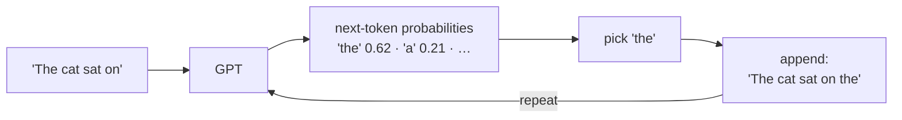

<!-- Written by `npm run lessons` from the lesson data in src/data. Edit the lesson there, not this page. -->

# GPT-style models and next-token prediction

**ML Foundations · Unit 4: Transformers and LLMs · Lesson 5 of 14**

> **In one line.** A GPT is a stack of transformer blocks with a causal mask, trained to predict the next token; it generates text by predicting a token, appending it and repeating.

[Open this lesson on the site](https://learn.hamropedia.com/foundations/gpt-style-models-and-next-token-prediction/) for its animation, the practice game and tap-to-explain words.

## The problem it solves

Next-token prediction needs no labels: any text is its own training data, so models can learn from trillions of tokens. And one simple loop — predict, append, repeat — turns that single skill into writing, answering, summarising and coding. Every chat assistant is built on this.

## The idea

A GPT reads tokens left to right and predicts the next token. A causal mask stops each position from seeing the future. Generation means: predict, append, repeat.

## How it works, step by step

1. Tokenise the text and look up embeddings plus positions.
2. Run the transformer blocks with a causal mask: position t can attend only to positions up to t.
3. At every position, a final linear layer gives logits over the whole vocabulary: the model's guess for the next token.
4. Training: the targets are the inputs shifted left by one. "The cat sat on the" trains the predictions cat, sat, on, the — every position at once.
5. The loss is cross-entropy between each position's predicted distribution and the true next token, averaged over all positions.
6. Generation: feed in the prompt, take the distribution at the last position, choose a token (greedy or sampled), append it, and repeat until a stop token or a length limit.

## Picture it



*Generation is a loop: predict the next token, add it to the text, and predict again.*

## Analogy

The next-word suggestion on your phone keyboard, but trained on a huge amount of text and far deeper.

**Where the analogy breaks.** A phone keyboard looks at a few words. A GPT looks at thousands of tokens of context at once.

## Worked example

For 'The cat sat on the', the input [The, cat, sat, on] is trained to predict [cat, sat, on, the]: the same sequence, shifted by one.

```python
mask = np.triu(np.ones((T, T)), k=1).astype(bool)
scores[mask] = -np.inf    # no looking ahead
```

## Must know

- Self-supervised: the text supplies its own labels.
- The causal mask makes training efficient (all positions in parallel) and honest (no peeking at the future).
- Generation is sequential: one forward step per new token.
- The context window is the maximum number of tokens the model can look at.
- The output at each step is a probability distribution; how you choose from it is decoding (next topics).
- Chat assistants are GPTs plus instruction and preference tuning (later in this unit).

## Common mistakes

- Training without the causal mask: the loss looks great because the model copies the answer, but generation fails.
- Off-by-one errors when shifting inputs and targets.
- Expecting the model to know facts that weren't in its training text, or after its cut-off date.

> **Not true:** A language model knows about events that happened after its training text was collected.  
> **In fact:** It learned only from its training text. Anything newer has to be given to it, in the prompt or through retrieval.

> **Not true:** Training without the causal mask: a better model, because the loss is much lower.  
> **In fact:** The loss is low only because the model can see the answer and copy it. When it generates, there is no future to copy from, so it fails.

## Practise

Try each one yourself first: on paper, in code or out loud. Then open the answer and compare.

### 1. Derive

For 'I love deep learning', write the input tokens and the target tokens the model trains on.

<details>
<summary>Show one good answer</summary>

With word tokens, plus start and end markers: &lt;s> I love deep learning &lt;/s>.

Input: &lt;s>, I, love, deep, learning  
Target: I, love, deep, learning, &lt;/s>

The target is the input shifted by one place. At each position the model must predict the next token, using only the tokens up to that position:  
&lt;s> → I  
&lt;s> I → love  
&lt;s> I love → deep  
&lt;s> I love deep → learning  
&lt;s> I love deep learning → &lt;/s>

One sequence gives five training examples at once, all computed in a single forward pass. The causal mask is what makes this honest: position 2 can't see "deep" while predicting it.

</details>

### 2. Build

Train a small GPT on a text dataset such as Shakespeare. Write a generate() function that samples one token at a time.

<details>
<summary>Show one good answer</summary>

This is gpt.py, the small GPT the other answers import. It downloads Tiny Shakespeare (about 1 MB), uses each character as a token (65 of them), and stacks 4 pre-norm transformer blocks of width 128 with 4 heads and a context of 64 characters: about 0.8 million parameters. Training samples random 64-character windows; the targets are the same windows shifted by one.

generate() feeds the context in, takes the probabilities for the next character, samples one, appends it, and repeats, cropping the context to the last 64 characters.

After 2,000 steps (about a minute on a laptop CPU) the validation loss falls from 4.3 to about 1.7, and the samples look like Shakespeare from a distance: character names in capitals followed by a colon, line breaks, mostly real English words, and nonsense on closer reading.

```python
# gpt.py: a small character-level GPT, trained on Tiny Shakespeare (about 1 MB of text).
# Later answers import from this file, so keep it next to them.
import os
import urllib.request
from dataclasses import dataclass

import torch
import torch.nn as nn
import torch.nn.functional as F

URL = "https://raw.githubusercontent.com/karpathy/char-rnn/master/data/tinyshakespeare/input.txt"
PATH = "data/shakespeare.txt"
if not os.path.exists(PATH):
    os.makedirs("data", exist_ok=True)
    urllib.request.urlretrieve(URL, PATH)
text = open(PATH, encoding="utf-8").read()
chars = sorted(set(text))
vocab_size = len(chars)                                   # 65 characters
stoi = {c: i for i, c in enumerate(chars)}
encode = lambda s: [stoi[c] for c in s]
decode = lambda ids: "".join(chars[i] for i in ids)
data = torch.tensor(encode(text))
split = int(0.9 * len(data))
train_data, val_data = data[:split], data[split:]


@dataclass
class Config:
    block_size: int = 64          # how many characters the model sees at once
    n_embd: int = 128
    n_head: int = 4
    n_layer: int = 4
    dropout: float = 0.1
    vocab: int = vocab_size
    positions: bool = True        # add learned position embeddings
    causal: bool = True           # each position may only look at earlier ones
    residual: bool = True
    prenorm: bool = True          # LayerNorm before each sub-layer (False: after the addition)


def get_batch(split, block_size=64, batch_size=32, source=None):
    d = source if source is not None else (train_data if split == "train" else val_data)
    ix = torch.randint(len(d) - block_size - 1, (batch_size,))
    x = torch.stack([d[i:i + block_size] for i in ix])
    y = torch.stack([d[i + 1:i + block_size + 1] for i in ix])  # the same text, shifted by one
    return x, y


class Attention(nn.Module):
    def __init__(self, c):
        super().__init__()
        self.c = c
        self.qkv = nn.Linear(c.n_embd, 3 * c.n_embd)
        self.proj = nn.Linear(c.n_embd, c.n_embd)

    def forward(self, x):
        B, T, C = x.shape
        q, k, v = self.qkv(x).split(C, dim=2)
        q, k, v = [t.view(B, T, self.c.n_head, C // self.c.n_head).transpose(1, 2) for t in (q, k, v)]
        y = F.scaled_dot_product_attention(q, k, v, is_causal=self.c.causal,
                                           dropout_p=self.c.dropout if self.training else 0.0)
        return self.proj(y.transpose(1, 2).reshape(B, T, C))


class Block(nn.Module):
    def __init__(self, c):
        super().__init__()
        self.c = c
        self.ln1, self.ln2 = nn.LayerNorm(c.n_embd), nn.LayerNorm(c.n_embd)
        self.attn = Attention(c)
        self.mlp = nn.Sequential(nn.Linear(c.n_embd, 4 * c.n_embd), nn.GELU(),
                                 nn.Linear(4 * c.n_embd, c.n_embd), nn.Dropout(c.dropout))

    def forward(self, x):
        for norm, layer in ((self.ln1, self.attn), (self.ln2, self.mlp)):
            if self.c.prenorm:
                x = x + layer(norm(x)) if self.c.residual else layer(norm(x))
            else:
                x = norm(x + layer(x)) if self.c.residual else norm(layer(x))
        return x


class GPT(nn.Module):
    def __init__(self, c=Config()):
        super().__init__()
        self.c = c
        self.tok = nn.Embedding(c.vocab, c.n_embd)
        self.pos = nn.Embedding(c.block_size, c.n_embd)
        self.blocks = nn.Sequential(*[Block(c) for _ in range(c.n_layer)])
        self.ln = nn.LayerNorm(c.n_embd)
        self.head = nn.Linear(c.n_embd, c.vocab)

    def forward(self, idx, targets=None):
        x = self.tok(idx)
        if self.c.positions:
            x = x + self.pos(torch.arange(idx.shape[1]))
        logits = self.head(self.ln(self.blocks(x)))
        loss = None if targets is None else F.cross_entropy(logits.reshape(-1, logits.size(-1)), targets.reshape(-1))
        return logits, loss

    @torch.no_grad()
    def generate(self, idx, max_new_tokens, temperature=1.0):
        self.eval()
        for _ in range(max_new_tokens):
            logits, _ = self(idx[:, -self.c.block_size:])              # crop to the context window
            probs = F.softmax(logits[:, -1] / temperature, dim=-1)
            idx = torch.cat([idx, torch.multinomial(probs, 1)], dim=1)  # sample one token, append
        return idx


@torch.no_grad()
def estimate_loss(model, split="val", iters=20):
    model.eval()
    losses = [model(*get_batch(split, model.c.block_size))[1].item() for _ in range(iters)]
    model.train()
    return sum(losses) / len(losses)


def train(model, steps=2000, lr=1e-3, log_every=500):
    opt = torch.optim.AdamW(model.parameters(), lr=lr)
    model.train()
    for step in range(steps + 1):
        if log_every and step % log_every == 0:
            print(f"step {step}: train {estimate_loss(model, 'train'):.3f}, val {estimate_loss(model):.3f}")
        x, y = get_batch("train", model.c.block_size)
        _, loss = model(x, y)
        opt.zero_grad()
        loss.backward()
        opt.step()
    return model


if __name__ == "__main__":
    torch.manual_seed(0)
    model = train(GPT())
    print(sum(p.numel() for p in model.parameters()), "parameters")
    start = torch.tensor([encode("\n")])
    print(decode(model.generate(start, 400)[0].tolist()))
```

</details>

### 3. Break

Remove the causal mask during training. The training loss drops fast. Why is the model useless when you generate?

<details>
<summary>Show one good answer</summary>

Without the causal mask, every position can see the whole window during training, including the very character it is supposed to predict, which sits right next to it. So the model learns to copy: the training loss plunges far below the honest model's (in the run below to about 0.04, against about 1.77), which looks like a fantastic result.

At generation time there is no future to copy. The model is asked about a position whose next character doesn't exist yet, a situation it never had to handle in training, so its predictions are meaningless. In the run below it produced nothing but blank lines: 150 newline characters in a row. (Other runs give random letters instead; either way, no text.) The lesson: a too-good training loss is a warning sign. The mask is what makes next-token prediction a real task, and training must match how the model is used.

```python
import torch
from gpt import GPT, Config, train, estimate_loss, decode, encode

for causal in [True, False]:
    torch.manual_seed(0)
    model = train(GPT(Config(causal=causal)), steps=800, log_every=0)
    torch.manual_seed(1)
    sample = decode(model.generate(torch.tensor([encode("\n")]), 150)[0].tolist())
    print(f"causal={causal}: training loss {estimate_loss(model, 'train'):.3f}\n{sample}\n")
```

</details>

### 4. Explain

Explain next-token prediction with the phone-keyboard picture, and where the picture breaks.

<details>
<summary>Show one good answer</summary>

Your phone keyboard suggests the next word as you type: after "see you", it offers "soon" or "tomorrow". A GPT is that idea, trained on a huge amount of text and far deeper. Given everything so far, it gives a probability to every possible next token, picks one, adds it to the text, and repeats. Long, sensible answers come out of doing that one small step thousands of times.

Where the picture breaks: your keyboard looks only at the last word or two and has learned your habits. A GPT reads the whole conversation so far, thousands of tokens, and the pressure of predicting text well over trillions of words forces it to learn grammar, facts and some reasoning along the way. Still, it has no separate fact-checking step: it predicts what text is likely, which is why it can sound sure and be wrong.

</details>

## Check you understood

Answer in your head first, then open each one.

<details>
<summary>&lt;b>What are the targets when training a GPT on a sequence?&lt;/b></summary>

The same tokens shifted left by one: each position must predict the token that follows it.

</details>

<details>
<summary>&lt;b>Why can a GPT train on all positions of a sequence at once?&lt;/b></summary>

The causal mask stops each position from seeing later tokens, so every position is a separate, fair prediction problem in the same forward pass.

</details>

<details>
<summary>&lt;b>Why is generation slower than training per token?&lt;/b></summary>

Each new token depends on the previous one, so tokens must be produced one at a time.

</details>

<details>
<summary>&lt;b>What does "self-supervised" mean here?&lt;/b></summary>

The labels come from the data itself — the next token — so no human labelling is needed.

</details>

## Go further (optional)

The lesson above is enough on its own. These free extras give a second explanation.

- WATCH · [Transformers, the tech behind LLMs (But what is a GPT?)](https://www.3blue1brown.com/lessons/gpt) · 3Blue1Brown  
  **Worth it:** A visual tour of a GPT from tokens to probabilities, with the shapes of every step drawn out. The best single overview of how these models work.
- PLAY · [LLM Visualization](https://bbycroft.net/llm) · Brendan Bycroft · a 3-D walk through a GPT
- READ · [The Illustrated GPT-2](https://jalammar.github.io/illustrated-gpt2/) · Jay Alammar
- CODE · [Build a Large Language Model (From Scratch), Ch 5 (pretraining on unlabelled data)](https://github.com/rasbt/LLMs-from-scratch) · Sebastian Raschka · code free

---

[← Multi-head attention and the transformer block](multi-head-attention-and-the-transformer-block.md) · [All lessons](../../README.md) · [Encoder models (BERT) vs decoder models (GPT) →](encoder-models-bert-vs-decoder-models-gpt.md)
