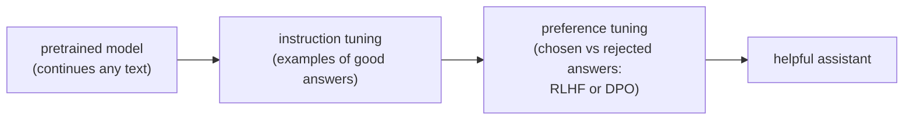

<!-- Written by `npm run lessons` from the lesson data in src/data. Edit the lesson there, not this page. -->

# Instruction tuning and preference tuning (RLHF, DPO)

**ML Foundations · Unit 4: Transformers and LLMs · Lesson 13 of 14**

> **In one line.** Instruction tuning trains a pretrained model on example conversations so it follows requests, and preference tuning (RLHF or DPO) then trains it on pairs of answers so it prefers the better one.

[Open this lesson on the site](https://learn.hamropedia.com/foundations/instruction-tuning-and-preference-tuning-rlhf-dpo/) for its animation, the practice game and tap-to-explain words.

## The problem it solves

A pretrained model is a brilliant autocomplete, not an assistant: ask it a question and it may continue with more questions. Instruction tuning teaches the format and habit of helpful answering; preference tuning sharpens qualities that are easy to judge but hard to demonstrate, like helpfulness, honesty and harmlessness. This is the step that turned GPT-3 into ChatGPT.

## The idea

A pretrained model only continues text. Instruction tuning (supervised fine-tuning) trains it on examples of good question-and-answer pairs. Preference tuning trains it on pairs of answers where people marked the better one. RLHF uses a reward model and reinforcement learning. DPO learns from the pairs directly.

## How it works, step by step

1. Supervised fine-tuning (SFT): train on thousands of (prompt, ideal answer) conversations, written in a chat template, with the loss computed only on the answer tokens.
2. Collect preferences: for one prompt, sample two answers and have people (or a strong model) mark the better one: (prompt, chosen, rejected).
3. RLHF, step 1: train a reward model to give the chosen answer a higher score than the rejected one.
4. RLHF, step 2: use reinforcement learning (often PPO) to make the model produce high-reward answers. A KL penalty keeps it close to the SFT model, so it doesn't game the reward.
5. DPO skips both the reward model and RL: a classification-style loss directly makes the chosen answer more likely than the rejected one, relative to a frozen reference model.
6. Evaluate carefully: preference tuning can teach shortcuts, such as longer or more flattering answers winning.

## Picture it



*Three stages: read everything, learn from worked examples, then learn which of two answers people prefer.*

## Analogy

Pretraining is reading everything. Instruction tuning is an internship with worked examples. Preference tuning is a manager saying 'this version is better than that one'.

**Where the analogy breaks.** A manager explains why. Preference data only says which answer won, so models can learn shortcuts, such as 'longer answers win'.

## Worked example

Prompt: 'Explain gravity'. Answer A is clear and correct. Answer B rambles. The training example is (prompt, chosen = A, rejected = B).

## Must know

- Pretraining → knowledge; SFT → format and instruction following; preference tuning → quality and safety.
- RLHF = reward model + RL (PPO) + KL penalty.
- DPO = learn directly from preference pairs; simpler and more stable.
- Reward hacking: the model learns what the reward likes, not what people want.
- Chat templates (special tokens marking roles) must match between training and use.

## Common mistakes

- Computing the SFT loss on the prompt tokens as well as the answers.
- Preference data with hidden biases, such as "longer is always better".
- Dropping the KL penalty, so the model drifts into strange, reward-gaming text.

> **Not true:** SFT loss: computed on the prompt tokens as well as on the answer.  
> **In fact:** The model should learn to write answers, not to predict what users will ask. The loss is taken on the answer tokens only.

> **Not true:** KL penalty in RLHF: an optional extra that can be dropped.  
> **In fact:** The KL penalty keeps the model close to the SFT model. Without it, the model drifts into strange text that pleases the reward model but not people.

## Practise

Try each one yourself first: on paper, in code or out loud. Then open the answer and compare.

### 1. Derive

Write 3 instruction-tuning examples and 2 preference pairs (chosen and rejected) for a cooking assistant.

<details>
<summary>Show one good answer</summary>

Instruction-tuning examples (prompt, ideal answer), for a cooking assistant:

1. User: "How long should I boil an egg for a runny yolk?" Assistant: "About 6 minutes from when you lower it into boiling water. Then move it to cold water for a minute so it stops cooking and peels easily."  
2. User: "I have chicken, rice and spinach. Suggest a quick dinner." Assistant: "Make a one-pan chicken and spinach rice: brown bite-sized chicken pieces, add rice, stock and garlic, simmer for 15 minutes, then stir in the spinach until it wilts. Season with lemon and pepper."  
3. User: "Can I swap butter for oil in a cake?" Assistant: "Yes. Use about three-quarters as much oil as butter, for example 75 g of oil for 100 g of butter. The cake will be moister but a little less rich in flavour."

Preference pairs (prompt, chosen, rejected):

1. Prompt: "Is it safe to eat chicken that is a bit pink?" Chosen: "Not reliably. Colour isn't a safe test; check that the thickest part reaches 74°C with a thermometer." Rejected: "Yes, a little pink is fine, just eat it."  
2. Prompt: "Give me a quick pasta sauce." Chosen: a short, clear recipe with amounts and steps. Rejected: a long story about the history of tomatoes before a vague recipe.

The instruction examples teach the format and the job; the pairs teach which of two plausible answers is better, here safer and more to the point.

</details>

### 2. Build

Fine-tune your small model on a few hundred instruction examples with a chat template. Compare its answers before and after.

<details>
<summary>Show one good answer</summary>

A character model can't learn real conversation in a few minutes, so use simple tasks it can learn, in a chat template: "Q: reverse king\nA: gnik\n\n", plus "upper" (make it capitals) and "first" (the first letter). Make a few hundred examples from Shakespeare's words and fine-tune the pretrained Shakespeare GPT on them.

Before fine-tuning, given "Q: reverse king\nA:", the model just continues with Shakespeare-like text: it has no idea that a question expects an answer. After a few hundred steps it answers in the template's format, stops at the blank line, and gets most of the held-out words right (reversing is the hardest). That is instruction tuning in miniature: same model, same knowledge, now trained to respond to a request in a fixed format.

```python
import random
import re
import torch
from gpt import GPT, train, encode, decode, text

words = sorted({w for w in re.findall(r"[a-z]{3,7}", text)})
random.seed(0); random.shuffle(words)
train_words, test_words = words[:600], words[600:650]
tasks = {"reverse": lambda w: w[::-1], "upper": lambda w: w.upper(), "first": lambda w: w[0]}
example = lambda task, w: f"Q: {task} {w}\nA: {tasks[task](w)}\n\n"
corpus = torch.tensor(encode("".join(example(t, w) for w in train_words for t in tasks) * 3))

@torch.no_grad()
def ask(model, task, word):
    out = decode(model.generate(torch.tensor([encode(f"Q: {task} {word}\nA:")]), 12, temperature=0.01)[0].tolist())
    return out.split("A:")[1].split("\n")[0].strip()

torch.manual_seed(0)
model = train(GPT(), steps=1500, log_every=0)
print("before:", [ask(model, t, "king") for t in tasks])
opt = torch.optim.AdamW(model.parameters(), lr=1e-3)
model.train()
for _ in range(600):
    ix = torch.randint(len(corpus) - 65, (32,))
    x, y = torch.stack([corpus[i:i + 64] for i in ix]), torch.stack([corpus[i + 1:i + 65] for i in ix])
    loss = model(x, y)[1]
    opt.zero_grad(); loss.backward(); opt.step()
print("after:", [ask(model, t, "king") for t in tasks])
for t in tasks:
    right = sum(ask(model, t, w) == tasks[t](w) for w in test_words)
    print(f"{t}: {right}/{len(test_words)} held-out words right")
```

</details>

### 3. Break

Imagine a preference dataset where the chosen answer is always the longer one. What shortcut will the model learn? How would you check for it?

<details>
<summary>Show one good answer</summary>

The shortcut: "longer is better". If the chosen answer is always the longer one, the easiest way to win the preference is simply to write more, with more caveats, more bullet points and more repetition, whether or not the extra text helps. The model learns length, not quality. This really happens: preference-tuned models are known to drift towards verbosity, and judges (human or LLM) often favour longer answers.

How to check for it:  
• Look at the data first: compare the lengths of chosen and rejected answers. If chosen is longer in, say, 95% of pairs, the signal is mostly length.  
• Measure after training: plot answer length before and after tuning on the same prompts, and check how much of the "win rate" against the old model is explained by length (compare wins only among answers of similar length, a length-controlled win rate).  
• Add pairs where the shorter answer is better, and test on prompts where the ideal answer is very short ("What is 2 + 2?").

The general lesson: a model trained to win a comparison will find the cheapest feature that predicts winning. Every bias in the preference data becomes behaviour.

</details>

### 4. Explain

Explain pretraining, instruction tuning and preference tuning with the internship-and-manager picture.

<details>
<summary>Show one good answer</summary>

Think of training a new employee in three stages.

Pretraining is reading everything: years of books, websites and code. Afterwards they know a huge amount, but if you ask them a question they might just continue your sentence, because nobody taught them that a question needs an answer.

Instruction tuning is an internship with worked examples: "here is a request, here is a good response", thousands of times. Now they know the job: answer questions, follow instructions, use the right format.

Preference tuning is a manager reviewing their work: "this version is better than that one". Shown many such comparisons (RLHF learns a scoring model from them; DPO learns straight from the pairs), they learn the finer points: more helpful, more honest, safer, better judgement in grey areas. Each stage builds on the last; the knowledge comes almost entirely from the first.

</details>

## Check you understood

Answer in your head first, then open each one.

<details>
<summary>&lt;b>What does instruction tuning add to a pretrained model?&lt;/b></summary>

The habit and format of answering requests helpfully, learned from example conversations.

</details>

<details>
<summary>&lt;b>What is the reward model in RLHF?&lt;/b></summary>

A model trained on preference pairs to score answers the way the human raters would.

</details>

<details>
<summary>&lt;b>How does DPO differ from RLHF?&lt;/b></summary>

DPO learns directly from the preference pairs with a simple loss, with no separate reward model and no RL loop.

</details>

<details>
<summary>&lt;b>What is reward hacking?&lt;/b></summary>

The model finds ways to score highly on the reward that people don't actually want, such as padding answers to look thorough.

</details>

## Go further (optional)

The lesson above is enough on its own. These free extras give a second explanation.

- WATCH · [Deep Dive into LLMs like ChatGPT](https://www.youtube.com/results?search_query=Andrej+Karpathy+Deep+Dive+into+LLMs+like+ChatGPT) · Andrej Karpathy  
  **Worth it:** A general-audience tour of the whole pipeline — pretraining, SFT, RLHF, reasoning — by someone who built these systems. Long, but the best big-picture view there is.
- READ · [Illustrating Reinforcement Learning from Human Feedback (RLHF)](https://huggingface.co/blog/rlhf) · Hugging Face blog
- CODE · [Build a Large Language Model (From Scratch), Ch 7 (fine-tuning to follow instructions)](https://github.com/rasbt/LLMs-from-scratch) · Sebastian Raschka · code free
- PAPER · [Direct Preference Optimization (DPO, 2023)](https://arxiv.org/abs/2305.18290) · Rafailov et al. · arXiv

---

[← Fine-tuning and LoRA](fine-tuning-and-lora.md) · [All lessons](../../README.md) · [Reasoning models and test-time compute →](reasoning-models-and-test-time-compute.md)
