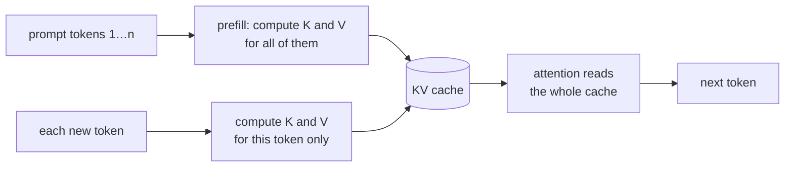

<!-- Written by `npm run lessons` from the lesson data in src/data. Edit the lesson there, not this page. -->

# KV cache and the cost of generation

**ML Foundations · Unit 4: Transformers and LLMs · Lesson 9 of 14**

> **In one line.** The KV cache stores the keys and values of every token already processed. Generating a new token then computes only that token's keys and values, instead of recomputing them for the whole sequence.

[Open this lesson on the site](https://learn.hamropedia.com/foundations/kv-cache-and-the-cost-of-generation/) for its animation, the practice game and tap-to-explain words.

## The problem it solves

Each new token attends to all earlier tokens. Recomputing every earlier key and value at every step makes generation cost grow with the square of the length, which is far too slow for long replies.

The cache makes each step cheap, but its memory grows with every token, layer and user. It often limits how many users a GPU can serve, and how long a context can be.

## The idea

When generating, each new token needs the keys and values of all earlier tokens. Instead of recomputing them at every step, we store them. This is the KV cache. It is much faster, but it uses a lot of memory.

## How it works, step by step

1. The prompt is processed in one pass (prefill), and the keys and values of every layer are saved.
2. For each new token, compute only its query, key and value.
3. Append its key and value to the cache.
4. Attend from the new query to all cached keys, and mix the cached values.
5. Without the cache, step n recomputes n tokens' keys and values; with it, just one.
6. Memory ≈ 2 (K and V) × layers × tokens × d_model × bytes per number, per sequence. With 32 layers, d_model 4,096, 4,096 tokens and bf16 (2 bytes): about 2.1 GB.
7. Grouped-query or multi-query attention shares keys and values across heads to shrink this; paged attention (vLLM) manages the cache like virtual memory.

## Picture it



*Without the cache, every step would recompute the keys and values for the whole text. With it, each step only adds one row.*

## Analogy

Taking notes during a long meeting, instead of replaying the whole recording each time someone speaks.

**Where the analogy breaks.** Meeting notes are small. The KV cache grows with every token, every layer and every user, and it can use more memory than the model itself.

## Worked example

Memory ≈ 2 (K and V) × layers × tokens × d_model × bytes. With 32 layers, d_model 4,096, 4,096 tokens in bf16 (2 bytes): about 2.1 GB for one sequence. (Models with grouped-query attention use less.)

## Must know

- Prefill (the prompt) is compute-heavy; decode (new tokens) is memory-heavy.
- The cache grows linearly with sequence length and with the number of users in a batch.
- It can use more memory than the model's weights at long contexts.
- Grouped-query attention, cache quantisation and paged attention reduce its cost.
- Time to first token depends on prefill; time per output token depends on decode.

## Common mistakes

- Forgetting the cache when estimating how many users a GPU can serve.
- Estimating memory from the parameter count alone.
- Running past the cache's maximum length without a strategy (truncation, sliding window).

> **Not true:** The KV cache changes the model's answers a little, in exchange for speed.  
> **In fact:** The cache stores exactly what would otherwise be recomputed, so the output is identical. It trades memory for time, not quality.

> **Not true:** The memory needed to serve a model can be worked out from its parameter count alone.  
> **In fact:** The KV cache grows with every token and every user, and at long contexts it can take more memory than the weights. Count it when planning capacity.

## Practise

Try each one yourself first: on paper, in code or out loud. Then open the answer and compare.

### 1. Derive

Work out the KV cache size for a model with 24 layers, d_model 2,048 and 8,192 tokens, in bf16.

<details>
<summary>Show one good answer</summary>

For every layer and every token, the cache stores one key vector and one value vector, each of size d_model.

Size = 2 (K and V) × layers × tokens × d_model × bytes per number  
= 2 × 24 × 8,192 × 2,048 × 2 (bf16)  
= 1,610,612,736 bytes ≈ 1.6 GB (1.5 GiB),  
for a single sequence.

It grows linearly with every factor: 100 users at this length would need about 160 GB of cache, more than the model's own weights. That is why long context and large batches are limited by memory, and why grouped-query attention (several query heads sharing one key/value head), cache quantisation and paged caches exist.

</details>

### 2. Build

Add a KV cache to your GPT's generate(). Time 500 generated tokens with and without it.

<details>
<summary>Show one good answer</summary>

Without a cache, generating each new token re-runs the whole context through the model, recomputing the keys and values of every earlier token, over and over. With a cache, the first step processes the prompt and stores every layer's keys and values; each later step feeds in only the one new token, computes its query, key and value, appends the key and value to the cache, and attends over the cache.

The check that matters first: with greedy decoding, both versions produce exactly the same tokens, so the cache changes speed, not results. On a model with a 512-character context, generating 500 tokens is several times faster with the cache here, and the gap grows with the context length, because the uncached cost per step grows with the number of tokens so far while the cached cost stays nearly flat.

```python
import time
import torch
import torch.nn.functional as F
from gpt import GPT, Config

@torch.no_grad()
def generate_uncached(model, idx, n):
    for _ in range(n):
        logits, _ = model(idx[:, -model.c.block_size:])
        idx = torch.cat([idx, logits[:, -1].argmax(-1, keepdim=True)], dim=1)
    return idx

@torch.no_grad()
def generate_cached(model, idx, n):
    c, H = model.c, model.c.n_head
    cache = [None] * c.n_layer
    new, start = idx, 0
    for _ in range(n):
        T = new.shape[1]
        x = model.tok(new) + model.pos(torch.arange(start, start + T))
        for i, block in enumerate(model.blocks):
            h = block.ln1(x)
            q, k, v = block.attn.qkv(h).split(c.n_embd, dim=2)
            q, k, v = [t.view(1, T, H, -1).transpose(1, 2) for t in (q, k, v)]
            if cache[i] is not None:                       # reuse every earlier key and value
                k, v = torch.cat([cache[i][0], k], dim=2), torch.cat([cache[i][1], v], dim=2)
            cache[i] = (k, v)
            y = F.scaled_dot_product_attention(q, k, v, is_causal=(T > 1))
            x = x + block.attn.proj(y.transpose(1, 2).reshape(1, T, c.n_embd))
            x = x + block.mlp(block.ln2(x))
        logits = model.head(model.ln(x))
        nxt = logits[:, -1].argmax(-1, keepdim=True)
        idx, start, new = torch.cat([idx, nxt], dim=1), start + T, nxt
    return idx

torch.manual_seed(0)
model = GPT(Config(block_size=512)).eval()        # speed doesn't depend on training
prompt = torch.zeros((1, 1), dtype=torch.long)
t = time.perf_counter(); a = generate_uncached(model, prompt, 500); slow = time.perf_counter() - t
t = time.perf_counter(); b = generate_cached(model, prompt, 500); fast = time.perf_counter() - t
assert torch.equal(a, b)                           # identical tokens
print(f"without cache {slow:.2f} s, with cache {fast:.2f} s: {slow / fast:.1f}x faster")
```

</details>

### 3. Break

Generate past the cache's maximum length. What breaks? Then measure memory as the number of users in a batch grows.

<details>
<summary>Show one good answer</summary>

Past the maximum length, a model with learned position embeddings simply has no embedding for position 512: the lookup fails with "index out of range". Models with rotary or similar encodings can technically keep going, but quality usually collapses beyond the lengths they were trained on. Real systems either stop at the limit, slide a window (drop the oldest tokens, which with a cache means also dropping and, for learned positions, recomputing), or use long-context techniques.

Memory with many users: each user in a batch has their own cache, so memory grows exactly linearly with the batch size: twice the users, twice the cache. For this tiny model in float32 that is about 2 MB per 512-token sequence, so 64 users take about 134 MB. For a real 7B-class model (32 layers, width 4,096, bf16) it is about 2 GB per user at 4,096 tokens, or about 0.5 GB with grouped-query attention, which is why the number of users a GPU can serve at once is usually limited by cache memory, not by compute.

```python
import torch
from gpt import GPT, Config

c = Config(block_size=512)
model = GPT(c).eval()
try:
    model(torch.zeros((1, 513), dtype=torch.long))
except IndexError as e:
    print("too long:", e)

for users in [1, 8, 64]:
    k = torch.zeros(users, c.n_head, c.block_size, c.n_embd // c.n_head)      # one layer's keys
    total = 2 * c.n_layer * k.numel() * k.element_size()                      # keys and values, all layers
    print(f"{users:3d} users x 512 tokens: KV cache {total / 1e6:.0f} MB")
```

</details>

### 4. Explain

Explain the KV cache with the meeting-notes picture.

<details>
<summary>Show one good answer</summary>

Taking notes during a long meeting. Without notes, every time someone speaks you would replay the whole recording from the start to remember what was said, which gets slower as the meeting goes on. With notes, you just add one line for each new remark and glance back at your notes.

In a transformer, every new token needs the keys and values of all the earlier tokens. The KV cache is the notes: it stores them once, so each new token only computes its own and adds them to the cache, which makes generation much faster. The cost is that the notes take up memory, a lot of it for long conversations and many users at once.

</details>

## Check you understood

Answer in your head first, then open each one.

<details>
<summary>&lt;b>What exactly is stored in the KV cache?&lt;/b></summary>

The key and value vectors of every past token, at every layer (and every key/value head).

</details>

<details>
<summary>&lt;b>Why don't we cache the queries?&lt;/b></summary>

Each query is used only once, for its own token. Later tokens only need the earlier keys and values.

</details>

<details>
<summary>&lt;b>What happens to KV-cache memory if you double the context length?&lt;/b></summary>

It doubles: it grows linearly with the number of tokens.

</details>

<details>
<summary>&lt;b>How does grouped-query attention help?&lt;/b></summary>

Several query heads share one key/value head, so far fewer keys and values need to be stored.

</details>

## Go further (optional)

The lesson above is enough on its own. These free extras give a second explanation.

- READ · [Understanding and Coding the KV Cache in LLMs from Scratch](https://magazine.sebastianraschka.com/p/coding-the-kv-cache-in-llms) · Sebastian Raschka
- WATCH · [LLaMA explained: KV-Cache, Rotary Positional Embedding, RMS Norm](https://www.youtube.com/results?search_query=Umar+Jamil+LLaMA+explained+KV+cache+rotary+positional+embedding) · Umar Jamil

---

[← Sampling: greedy, temperature, top-k, top-p](sampling-greedy-temperature-top-k-top-p.md) · [All lessons](../../README.md) · [Pretraining data and scaling laws →](pretraining-data-and-scaling-laws.md)
