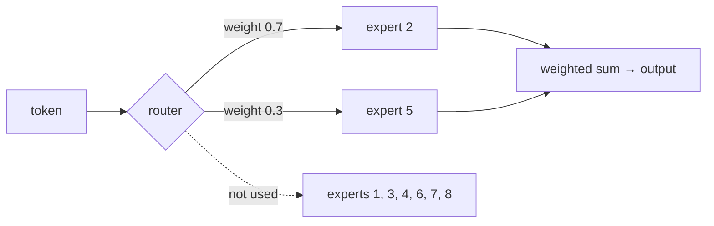

<!-- Written by `npm run lessons` from the lesson data in src/data. Edit the lesson there, not this page. -->

# Mixture of experts

**ML Foundations · Unit 4: Transformers and LLMs · Lesson 11 of 14**

> **In one line.** A mixture-of-experts (MoE) layer replaces one big MLP with many expert MLPs, plus a router that sends each token to only a few of them. The model has many parameters, but uses only a fraction of them for each token.

[Open this lesson on the site](https://learn.hamropedia.com/foundations/mixture-of-experts/) for its animation, the practice game and tap-to-explain words.

## The problem it solves

Bigger models know more, but every parameter normally runs for every token, so cost grows with size. MoE breaks that link: total knowledge can grow while compute per token stays modest. Many frontier models use it, and it changes how you think about model size, memory and serving.

## The idea

A mixture-of-experts (MoE) layer replaces one big MLP with many smaller 'expert' MLPs and a router. For each token, the router picks only a few experts, often 2, to run. So the model can have a huge number of parameters in total while each token uses only a small part of them: more knowledge for about the same compute per token.

## How it works, step by step

1. Inside each block, replace the single MLP with E experts (for example 8), each an MLP of its own.
2. A small router (a linear layer) scores every expert for each token.
3. Keep the top k experts (often 2), turn their scores into weights with softmax, and run only those experts.
4. The token's output is the weighted sum of its chosen experts' outputs.
5. Different tokens choose different experts, so experts can specialise.
6. A load-balancing loss pushes the router to spread tokens evenly; without it a few experts get everything and the rest never learn.
7. All experts must be in memory even though each token uses only some of them, so memory scales with the total size while compute scales with the active size.

## Picture it



*Only 2 of the 8 experts run for this token, so the model is huge but each token's compute stays small.*

## Analogy

A hospital with many specialists. Each patient sees only the one or two doctors they need, not every doctor in the building.

**Where the analogy breaks.** A hospital can spread patients fairly. In an MoE, if the router sends too many tokens to the same few experts, they are overloaded and the others learn nothing, so training adds a load-balancing loss. And every expert must still sit in memory, even the unused ones.

## Worked example

Mixtral 8x7B has 8 experts per layer with top-2 routing. It has about 47B parameters in total, but uses only about 13B for each token.

```python
scores = router(x)                                  # (tokens, n_experts)
top_w, top_i = scores.softmax(-1).topk(2, dim=-1)   # 2 experts per token
out = torch.zeros_like(x)
for k in range(2):
    for e in range(n_experts):
        mask = top_i[:, k] == e
        if mask.any():
            out[mask] += top_w[mask, k].unsqueeze(-1) * experts[e](x[mask])
```

## Must know

- Total parameters ≠ active parameters. Mixtral 8x7B: about 47B total, about 13B active per token.
- Top-k routing: each token is sent only to its k best-scoring experts, usually 1 or 2.
- Load balancing is essential: without it the router sends almost every token to a few experts, and the rest never learn.
- A mixture of experts saves compute, not memory: every expert must still be loaded, although each token uses only a few.
- Experts across GPUs need fast communication (expert parallelism).

## Common mistakes

- Quoting the total parameter count as if it were the compute cost per token.
- Training without a balancing loss and getting "dead" experts.
- Forgetting that serving still needs memory for every expert.

> **Not true:** A mixture-of-experts model needs memory only for the experts that a token actually uses.  
> **In fact:** Every expert must be loaded, because the next token may be sent to a different one. The saving is in compute per token, not in memory.

> **Not true:** Routing: each token passes through the full set of experts.  
> **In fact:** A router sends each token to only its k best-scoring experts, usually 1 or 2. That is why the active parameters are far fewer than the total.

## Practise

Try each one yourself first: on paper, in code or out loud. Then open the answer and compare.

### 1. Derive

A model has 24 layers, each with 64 experts of 100M parameters, and top-2 routing. How many expert parameters exist in total, and how many run for each token?

<details>
<summary>Show one good answer</summary>

Total expert parameters: 24 layers × 64 experts × 100M = 153,600M, about 153.6 billion.

Used for each token: with top-2 routing, each token goes through 2 experts per layer: 24 × 2 × 100M = 4.8 billion.

So each token uses only 2 of 64 experts, about 3% of the expert parameters. The compute per token is like a 4.8B model (plus the shared attention and embeddings), while the model's total knowledge capacity is like a 150B+ model. But all 153.6B parameters must still sit in memory, because different tokens need different experts.

</details>

### 2. Build

Replace the MLP in your GPT's blocks with a 4-expert, top-2 MoE layer. Train it and log how many tokens each expert receives.

<details>
<summary>Show one good answer</summary>

The MoE layer has 4 small expert MLPs and a router: a linear layer that gives each token a score for each expert. For each token, take the top 2 scores, softmax them into two weights, run the token through those 2 experts only, and add their outputs with those weights. Each block's MLP is swapped for this layer.

Logging how many tokens each expert receives shows how the router spreads the work. This version also computes the standard load-balancing loss (used in the break exercise), which is small when the experts are used evenly.

```python
import torch
import torch.nn as nn
import torch.nn.functional as F
from gpt import GPT, Config, get_batch, estimate_loss

class MoE(nn.Module):
    def __init__(self, d, n_experts=4, k=2):
        super().__init__()
        self.k, self.n = k, n_experts
        self.router = nn.Linear(d, n_experts)
        self.experts = nn.ModuleList(nn.Sequential(nn.Linear(d, 2 * d), nn.GELU(), nn.Linear(2 * d, d))
                                     for _ in range(n_experts))
    def forward(self, x):
        B, T, d = x.shape
        flat = x.reshape(-1, d)
        probs = F.softmax(self.router(flat), dim=-1)                  # (tokens, experts)
        weights, chosen = probs.topk(self.k, dim=-1)
        weights = weights / weights.sum(-1, keepdim=True)
        out = torch.zeros_like(flat)
        for e, expert in enumerate(self.experts):
            rows, slot = (chosen == e).nonzero(as_tuple=True)
            if len(rows):
                out[rows] += weights[rows, slot, None] * expert(flat[rows])
        share = F.one_hot(chosen, self.n).float().sum(1).mean(0) / self.k  # fraction of tokens per expert
        self.counts = share.detach()
        self.balance_loss = self.n * (share * probs.mean(0)).sum()       # 1.0 when perfectly even
        return out.reshape(B, T, d)

def train_moe(balance_coef, steps=800, seed=0, n_experts=4, k=2):
    torch.manual_seed(seed)
    model = GPT(Config())
    for block in model.blocks:
        block.mlp = MoE(model.c.n_embd, n_experts, k)
    opt = torch.optim.AdamW(model.parameters(), lr=1e-3)
    for _ in range(steps):
        x, y = get_batch("train")
        loss = model(x, y)[1] + balance_coef * sum(b.mlp.balance_loss for b in model.blocks)
        opt.zero_grad(); loss.backward(); opt.step()
    return model

if __name__ == "__main__":
    model = train_moe(balance_coef=0.01)
    print(f"val loss {estimate_loss(model):.3f}")
    for i, block in enumerate(model.blocks):
        print(f"layer {i}: share of tokens per expert {block.mlp.counts.numpy().round(2)}")
```

</details>

### 3. Break

Train without any load-balancing loss and watch expert usage. Do some experts die? Then add a simple balancing loss and compare.

<details>
<summary>Show one good answer</summary>

Without a balancing loss, the router is free to send most tokens to whichever experts got slightly ahead early on. Those experts get more training, so they become better, so the router prefers them even more: a rich-get-richer loop. With 8 experts and top-1 routing (an even share would be 12.5% each), the run below shows it: without a balancing loss, the busiest expert in a layer takes about 23% of the tokens on average, and some experts get only about 3%. Those experts get too few tokens and barely train, and in large models this goes all the way to "dead" experts that receive almost no tokens and waste their parameters. (With only 4 experts and top-2 routing, as in the Build answer, it stays fairly even in a short run; imbalance grows with more experts, sparser routing and longer training.)

With the balancing loss, which is smallest when the share of tokens and the router's average probability are equal across experts, every expert stays between about 10% and 15%. Real MoE models also cap how many tokens one expert may take per batch (a capacity factor), so no expert is overloaded on the hardware.

```python
import torch

# MoE and train_moe come from the Build answer above: save it as moe.py
from moe import train_moe

for coef in [0.0, 0.01]:
    model = train_moe(balance_coef=coef, steps=1500, n_experts=8, k=1)    # 8 experts, top-1: an even share is 12.5%
    shares = torch.stack([b.mlp.counts for b in model.blocks])
    print(f"balance loss x {coef}: share of tokens per expert, one row per layer\n{shares.numpy().round(2)}")
    print(f"  busiest expert, averaged over layers: {shares.max(dim=1).values.mean():.2f}, quietest anywhere: {shares.min():.2f}\n")
```

</details>

### 4. Explain

Explain mixture of experts with the hospital picture, and why memory is still a cost.

<details>
<summary>Show one good answer</summary>

A big hospital has many specialists. A patient doesn't see every doctor in the building, only the one or two the front desk sends them to. So the hospital as a whole knows an enormous amount, but each visit only uses a little of it, and visits stay quick.

In a mixture-of-experts model, each layer has many expert networks and a router (the front desk) that sends each token to its top one or two experts. The model has a huge number of parameters, but each token uses only a small part, so it is fast to run for its size. Memory is still a cost: every specialist must be employed and in the building even when idle, so all the experts must sit in GPU memory, ready for whichever tokens need them.

</details>

## Check you understood

Answer in your head first, then open each one.

<details>
<summary>&lt;b>What does the router do?&lt;/b></summary>

For each token, it scores every expert and picks the top few to run, with weights for mixing their outputs.

</details>

<details>
<summary>&lt;b>Why is MoE cheaper per token than a dense model of the same total size?&lt;/b></summary>

Each token runs through only k experts, not all of them.

</details>

<details>
<summary>&lt;b>Why add a load-balancing loss?&lt;/b></summary>

Without it, the router tends to send most tokens to a few experts, overloading them while the others stop learning.

</details>

<details>
<summary>&lt;b>An MoE has 8 experts per layer and top-2 routing. What share of the expert parameters does each token use?&lt;/b></summary>

2 of 8, so a quarter.

</details>

## Go further (optional)

The lesson above is enough on its own. These free extras give a second explanation.

- READ · [A Visual Guide to Mixture of Experts](https://newsletter.maartengrootendorst.com/p/a-visual-guide-to-mixture-of-experts) · Maarten Grootendorst · dozens of diagrams  
  **Worth it:** Colourful step-by-step diagrams of routers, experts, top-k selection and load balancing. Makes MoE intuitive in one read.
- READ · [Mixture of Experts Explained](https://huggingface.co/blog/moe) · Hugging Face blog
- PAPER · [Outrageously Large Neural Networks: the Sparsely-Gated MoE Layer (2017)](https://arxiv.org/abs/1701.06538) · Shazeer et al. · arXiv
- PAPER · [Mixtral of Experts (2024)](https://arxiv.org/abs/2401.04088) · Jiang et al. · arXiv

---

[← Pretraining data and scaling laws](pretraining-data-and-scaling-laws.md) · [All lessons](../../README.md) · [Fine-tuning and LoRA →](fine-tuning-and-lora.md)
