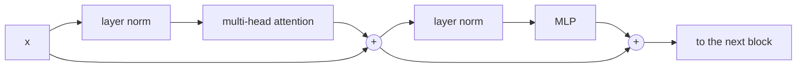

<!-- Written by `npm run lessons` from the lesson data in src/data. Edit the lesson there, not this page. -->

# Multi-head attention and the transformer block

**ML Foundations · Unit 4: Transformers and LLMs · Lesson 4 of 14**

> **In one line.** Multi-head attention runs several smaller attentions side by side and joins their results. A transformer block wraps attention and an MLP, each with a layer norm and a residual connection, and a model stacks many of these blocks.

[Open this lesson on the site](https://learn.hamropedia.com/foundations/multi-head-attention-and-the-transformer-block/) for its animation, the practice game and tap-to-explain words.

## The problem it solves

One attention pattern per layer is limiting: a word may need to look at its subject, its object and the previous word all at once. Several heads can each specialise. And attention alone only mixes information between tokens; the MLP then processes it inside each token. The block is the repeating unit of every transformer, so knowing it means you can read any model's architecture.

## The idea

Multi-head attention runs several smaller attentions in parallel, so each head can track a different kind of relationship. A transformer block is attention plus an MLP, each wrapped with layer norm and a residual connection.

## How it works, step by step

1. Split d_model into h heads: with d_model = 768 and 12 heads, each head works with 64-dimensional queries, keys and values.
2. Each head computes its own attention, with its own projection matrices, so each can learn a different relationship.
3. Join the heads' outputs back together (768 numbers per token) and mix them with one more matrix, W_O.
4. Pre-norm block: x = x + Attention(LayerNorm(x)). Attention lets tokens exchange information.
5. Then x = x + MLP(LayerNorm(x)). The MLP is usually 4 times wider inside (768 → 3,072 → 768) and works on each token on its own.
6. Stack N identical blocks (12 in GPT-2 small, dozens in large models). Every block reads from and writes to the residual stream.
7. After the last block: a final layer norm, then a linear layer to vocabulary-sized logits.

## Picture it



*One pre-norm transformer block: attention, then an MLP, each wrapped with layer norm and a residual shortcut.*

## Analogy

A team reading the same contract. One person checks dates, one checks names, one checks money. Then they merge their notes.

**Where the analogy breaks.** People choose their roles. Heads learn their roles on their own, and many heads do not have clean, readable roles.

## Worked example

GPT-2 small: d_model = 768 with 12 heads, so each head works in 64 dimensions.

```python
# one pre-norm transformer block
x = x + attention(layer_norm(x))
x = x + mlp(layer_norm(x))
```

## Must know

- Heads run in parallel: reshape (batch, T, d) to (batch, heads, T, d/heads).
- Total attention cost is about the same as one big head; the work is just split up.
- Attention = communication between tokens; MLP = computation within each token.
- Residual connections and layer norm make deep stacks trainable.
- Most of a transformer's parameters are in the MLPs.
- Grouped-query attention lets several query heads share one key/value head, shrinking the KV cache.

## Common mistakes

- Reshaping heads in the wrong order and silently mixing tokens with heads.
- Forgetting the output projection after joining the heads.
- Leaving out the residual connections or the layer norms.

> **Not true:** A deep stack of transformer blocks trains equally well without residual connections.  
> **In fact:** Without the residual path, gradients fade through a deep stack and training gets much worse. Every block adds its output back to its input.

> **Not true:** Eight attention heads cost about eight times as much as one big head.  
> **In fact:** Each head works with vectors of size d/heads, so the total cost is about the same as one big head. The work is split up, not multiplied.

## Practise

Try each one yourself first: on paper, in code or out loud. Then open the answer and compare.

### 1. Derive

For d_model = 768, 12 heads and an MLP ratio of 4, count the parameters in one transformer block (ignore biases and layer norm).

<details>
<summary>Show one good answer</summary>

d_model = 768, so one d × d matrix has 768² = 589,824 weights.

Attention: four projections, Q, K, V and the output, each 768 × 768: 4 × 589,824 = 2,359,296. The number of heads doesn't change this: 12 heads of 64 dimensions just split the same matrices into 12 slices.

MLP with ratio 4: up from 768 to 3,072 and back down. 768 × 3,072 + 3,072 × 768 = 2 × 2,359,296 = 4,718,592.

One block: 2,359,296 + 4,718,592 = 7,077,888, about 7.1 million (the two layer norms and the biases add only about 10,000 more).

The MLP holds two-thirds of the block's weights. GPT-2 small stacks 12 of these blocks (about 85M) plus token and position embeddings (about 39M), for its 124M parameters.

</details>

### 2. Build

Write multi-head attention by reshaping (batch, T, d) into (batch, heads, T, d / heads). Then build a full pre-norm transformer block.

<details>
<summary>Show one good answer</summary>

Multi-head attention with one projection for all heads: compute Q, K and V as (batch, T, d), reshape each to (batch, T, heads, d/heads), and swap the axes to (batch, heads, T, d/heads). Now every head attends independently in one batched operation. Afterwards, swap back and reshape to (batch, T, d), then apply the output projection.

The pre-norm block is x = x + attention(layer_norm(x)), then x = x + MLP(layer_norm(x)). To check the attention, copy the same weights into PyTorch's nn.MultiheadAttention: the outputs agree to about 1e-6.

```python
import torch
import torch.nn as nn
import torch.nn.functional as F

class MultiHeadAttention(nn.Module):
    def __init__(self, d, heads):
        super().__init__()
        self.heads, self.qkv, self.out = heads, nn.Linear(d, 3 * d), nn.Linear(d, d)
    def forward(self, x, causal=False):
        B, T, d = x.shape
        q, k, v = self.qkv(x).split(d, dim=2)
        q, k, v = [t.view(B, T, self.heads, d // self.heads).transpose(1, 2) for t in (q, k, v)]
        scores = q @ k.transpose(-2, -1) / (d // self.heads) ** 0.5       # (B, heads, T, T)
        if causal:
            scores = scores.masked_fill(torch.ones(T, T).tril() == 0, float("-inf"))
        y = F.softmax(scores, dim=-1) @ v                                 # (B, heads, T, d/heads)
        return self.out(y.transpose(1, 2).reshape(B, T, d))

class Block(nn.Module):                                  # pre-norm transformer block
    def __init__(self, d, heads):
        super().__init__()
        self.ln1, self.ln2, self.attn = nn.LayerNorm(d), nn.LayerNorm(d), MultiHeadAttention(d, heads)
        self.mlp = nn.Sequential(nn.Linear(d, 4 * d), nn.GELU(), nn.Linear(4 * d, d))
    def forward(self, x):
        x = x + self.attn(self.ln1(x), causal=True)
        return x + self.mlp(self.ln2(x))

torch.manual_seed(0)
mine, ref = MultiHeadAttention(64, 8), nn.MultiheadAttention(64, 8, batch_first=True)
with torch.no_grad():
    ref.in_proj_weight.copy_(mine.qkv.weight); ref.in_proj_bias.copy_(mine.qkv.bias)
    ref.out_proj.weight.copy_(mine.out.weight); ref.out_proj.bias.copy_(mine.out.bias)
x = torch.randn(2, 10, 64)
print((mine(x) - ref(x, x, x, need_weights=False)[0]).abs().max().item())
print(Block(64, 8)(x).shape)                              # torch.Size([2, 10, 64])
print(sum(p.numel() for p in Block(768, 12).parameters()))   # 7,087,872 with biases and norms
```

</details>

### 3. Break

Remove the residual connections from a 6-block model and train it. Then move layer norm after the addition (post-norm) and compare stability.

<details>
<summary>Show one good answer</summary>

Without residual connections, a 6-block model trains much worse: in the same number of steps its loss stays far higher than the normal model's (numbers below). Every block must now transform the whole signal, and the gradient has to pass through every block's layers in turn, with no shortcut, so the early blocks learn slowly.

Post-norm (LayerNorm after the addition, as in the original 2017 transformer) is fragile: at a learning rate of 5e-3, pre-norm trains fine (loss about 1.79), while post-norm fails to learn (about 3.37, barely better than guessing from letter frequencies). Without residuals the loss is equally stuck, about 3.37, against 1.86 for the normal model. With pre-norm, the residual path from input to output is an uninterrupted sum, so gradients reach every layer at a steady size. With post-norm, every addition is followed by a normalisation the gradient must pass through, which is why post-norm models needed careful learning-rate warm-up. Modern LLMs use pre-norm.

```python
import torch
from gpt import GPT, Config, train, estimate_loss

for name, cfg, lr in [("pre-norm, residual", Config(n_layer=6), 1e-3),
                      ("no residual", Config(n_layer=6, residual=False), 1e-3),
                      ("pre-norm, lr 5e-3", Config(n_layer=6), 5e-3),
                      ("post-norm, lr 5e-3", Config(n_layer=6, prenorm=False), 5e-3)]:
    torch.manual_seed(0)
    model = train(GPT(cfg), steps=800, lr=lr, log_every=0)
    print(f"{name:20s} val loss {estimate_loss(model):.3f}")
```

</details>

### 4. Explain

Explain multi-head attention with the team-reading-a-contract picture.

<details>
<summary>Show one good answer</summary>

A team reads the same contract. One person looks only at dates, one at names, one at amounts of money, one at who must do what. Each focuses on their own kind of detail, then they put their notes together into one summary.

Multi-head attention is that team: the model runs several attention "heads" side by side, each with its own queries, keys and values, so each can track a different kind of relationship, such as the previous word, the subject of the sentence, or a matching bracket. Their outputs are joined and mixed. The transformer block then adds a small MLP that thinks about each word on its own, with layer norm and residual connections around both, and that block is stacked many times.

</details>

## Check you understood

Answer in your head first, then open each one.

<details>
<summary>&lt;b>With d_model = 512 and 8 heads, how big is each head?&lt;/b></summary>

512 / 8 = 64 dimensions.

</details>

<details>
<summary>&lt;b>What does the MLP in a block do that attention doesn't?&lt;/b></summary>

It processes each token's vector on its own (a per-token computation), while attention moves information between tokens.

</details>

<details>
<summary>&lt;b>Write the two lines of a pre-norm transformer block.&lt;/b></summary>

x = x + attention(layer_norm(x)), then x = x + mlp(layer_norm(x)).

</details>

<details>
<summary>&lt;b>Why use several heads instead of one?&lt;/b></summary>

Each head can learn its own attention pattern, so a token can gather different kinds of information at once.

</details>

## Go further (optional)

The lesson above is enough on its own. These free extras give a second explanation.

- PLAY · [Transformer Explainer](https://poloclub.github.io/transformer-explainer/) · Georgia Tech Polo Club · a live GPT-2 in your browser  
  **Worth it:** Type your own text and click through a real GPT-2: every head, every block, every probability, animated. The best way to see a transformer block from the inside.
- PLAY · [LLM Visualization](https://bbycroft.net/llm) · Brendan Bycroft · a 3-D walk through a GPT
- WATCH · [Let's build GPT: from scratch, in code, spelled out](https://karpathy.ai/zero-to-hero.html) · Andrej Karpathy
- READ · [The Annotated Transformer](https://nlp.seas.harvard.edu/annotated-transformer/) · Harvard NLP
- CODE · [Build a Large Language Model (From Scratch), Ch 4 (implementing a GPT model)](https://github.com/rasbt/LLMs-from-scratch) · Sebastian Raschka · code free

---

[← Self-attention: queries, keys and values](self-attention-queries-keys-and-values.md) · [All lessons](../../README.md) · [GPT-style models and next-token prediction →](gpt-style-models-and-next-token-prediction.md)
