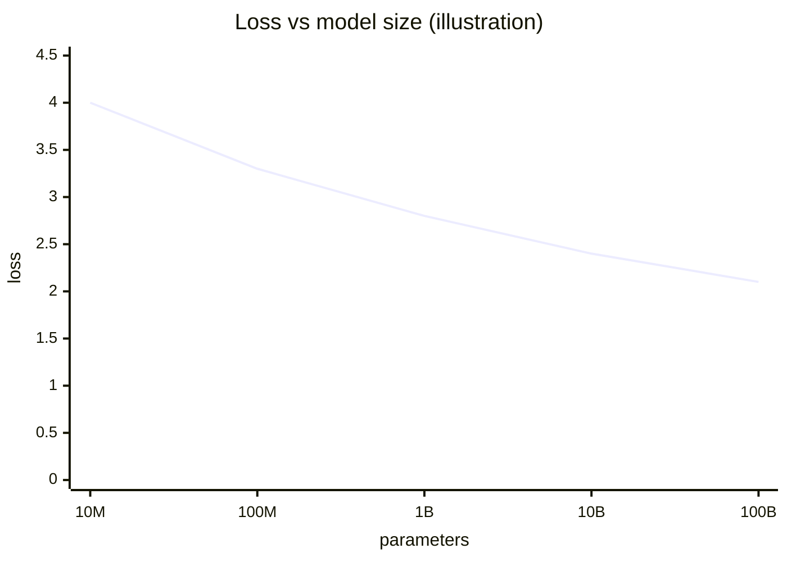

<!-- Written by `npm run lessons` from the lesson data in src/data. Edit the lesson there, not this page. -->

# Pretraining data and scaling laws

**ML Foundations · Unit 4: Transformers and LLMs · Lesson 10 of 14**

> **In one line.** Pretraining is next-token prediction on an enormous text collection, and scaling laws describe how the resulting loss falls smoothly and predictably as model size, data and compute grow.

[Open this lesson on the site](https://learn.hamropedia.com/foundations/pretraining-data-and-scaling-laws/) for its animation, the practice game and tap-to-explain words.

## The problem it solves

Training a large model costs millions, so you need to predict, before spending, how big to make it and how much data to use. Scaling laws let labs fit small experiments and extrapolate. They also explain the shape of the field: why models kept growing, why data quality became the bottleneck, and why small models are now trained on far more data than "optimal".

## The idea

Pretraining is next-token prediction on a huge text collection. Scaling laws say the loss falls smoothly and predictably as model size, data and compute grow. The Chinchilla result: for a fixed compute budget, use roughly 20 training tokens per parameter.

## How it works, step by step

1. Collect web pages, books, code and papers, then filter them hard: remove duplicates, spam and low-quality pages, and personal data.
2. Tokenise everything and train a GPT on next-token prediction, usually for one pass (or a few) over the data.
3. Measure the final loss for many runs of different sizes. Plotted against compute on log–log axes, the points fall on a smooth power-law curve.
4. Compute ≈ 6 × parameters × tokens (in floating-point operations). For a fixed compute budget, you choose how to split it between parameters and tokens.
5. Chinchilla's result: grow both together, about 20 training tokens per parameter. A 1B-parameter model "wants" about 20B tokens.
6. In practice, models meant to be served cheaply are trained far past that point (Llama-style models use trillions of tokens): a smaller, longer-trained model costs less to run.

## Picture it



*Scaling laws: every 10× in size (with matching data and compute) buys a smooth, predictable drop in loss.*

## Analogy

Learning a language by reading a whole library. More books and a bigger brain both help, in a predictable way.

**Where the analogy breaks.** Reading the same book a thousand times does not help. Data quality and variety matter as much as size.

## Worked example

A 1-billion-parameter model would get about 20 billion tokens by the Chinchilla rule. Modern models often train on far more, because a smaller, well-trained model is cheaper to run.

## Must know

- Loss falls as a power law in parameters, data and compute.
- Training compute is about 6·N·D floating-point operations, for a model with N parameters trained on D tokens.
- Compute-optimal: roughly 20 tokens per parameter.
- Data quality, deduplication and mixture matter as much as size.
- Lower loss doesn't map neatly to every ability; some skills seem to appear suddenly with scale.
- Running out of high-quality text is a real constraint; synthetic data is one response.

## Common mistakes

- Assuming more data always helps, even when it is duplicated or low quality.
- Reading scaling laws as guarantees for specific skills rather than for the average loss.
- Comparing models trained on different data as if size were the only difference.

> **Not true:** More training text improves a model even when much of it is duplicated or low quality.  
> **In fact:** Duplicates and poor text waste compute and can teach bad habits. Filtering the text and removing repeats is a large part of building a pretraining set.

> **Not true:** Fixed compute budget: put it into the biggest model that fits, and train on what data is left.  
> **In fact:** A model that is too big for its data ends up under-trained. The compute-optimal balance is roughly 20 training tokens for every parameter.

## Practise

Try each one yourself first: on paper, in code or out loud. Then open the answer and compare.

### 1. Derive

With the rule of about 20 tokens per parameter, how many training tokens would a 125M, a 1B and a 7B model get?

<details>
<summary>Show one good answer</summary>

About 20 training tokens per parameter (the Chinchilla rule of thumb for compute-optimal training):

125M parameters → 125M × 20 = 2.5 billion tokens  
1B parameters → 20 billion tokens  
7B parameters → 140 billion tokens

Modern models often train on far more than this, for example several trillion tokens for a 7B model, because the rule is about the best model for a fixed training budget. If the model will be used by millions of people, it is cheaper overall to train a smaller model for longer, since running it costs less every day.

</details>

### 2. Build

Train your GPT at 3 sizes on the same data. Plot final loss against parameter count on log-log axes.

<details>
<summary>Show one good answer</summary>

Train three GPTs of increasing width and depth on the same Shakespeare data, with the same number of steps, and record the final validation loss. On log-log axes, loss against parameter count falls in a roughly straight line: each multiplication of the size gives a similar reduction in loss. That straight line is a scaling law.

With this tiny dataset (1 MB) and short training, the line already bends at the big end: the largest model is held back by too little data and too few steps, which is the same lesson the Chinchilla paper drew: size and data have to grow together.

```python
import matplotlib.pyplot as plt
import torch
from gpt import GPT, Config, train, estimate_loss

sizes, losses = [], []
for n_embd, n_layer in [(32, 2), (64, 3), (128, 4)]:
    torch.manual_seed(0)
    model = train(GPT(Config(n_embd=n_embd, n_layer=n_layer, n_head=4)), steps=1500, log_every=0)
    sizes.append(sum(p.numel() for p in model.parameters()))
    losses.append(estimate_loss(model, iters=50))
    print(f"{sizes[-1]:>8,} parameters: val loss {losses[-1]:.3f}")
plt.loglog(sizes, losses, marker="o")
plt.xlabel("parameters"); plt.ylabel("validation loss"); plt.show()
```

</details>

### 3. Break

Train on a dataset full of duplicated documents, then on a deduplicated version. Compare the validation losses.

<details>
<summary>Show one good answer</summary>

Make two training sets of the same size: one is 900,000 different characters of Shakespeare; the other is only the first 100,000 characters, copied 9 times. Train the same model for the same number of steps on each, and measure on the same held-out text.

The duplicated set gives a clearly worse validation loss. The model sees the same passages again and again and starts memorising them, which lowers its training loss but doesn't help on new text; meanwhile the unique set teaches it nine times as much real variety. Same compute, less learned.

Real web data is full of near-duplicates (boilerplate, mirrored pages, copied articles), which is why deduplication is a standard step in building pretraining data: it improves the model for free, and reduces memorisation of specific documents, a privacy and copyright concern.

```python
import torch
from gpt import GPT, Config, get_batch, train_data, estimate_loss

unique = train_data[:900_000]
duplicated = train_data[:100_000].repeat(9)           # same length, a ninth of the variety
for name, source in [("unique", unique), ("duplicated", duplicated)]:
    torch.manual_seed(0)
    model = GPT(Config())
    opt = torch.optim.AdamW(model.parameters(), lr=1e-3)
    for _ in range(1500):
        x, y = get_batch("train", source=source)
        loss = model(x, y)[1]
        opt.zero_grad(); loss.backward(); opt.step()
    print(f"{name:10s} training data: val loss {estimate_loss(model, iters=50):.3f}")
```

</details>

### 4. Explain

Explain scaling laws with the library-and-brain picture, and why data quality matters.

<details>
<summary>Show one good answer</summary>

Learning a language by reading a library. A bigger brain can hold more of what it reads, and a bigger library gives it more to learn from. Scaling laws are the discovery that this works in a smooth, predictable way: make the model and the data bigger together, and the loss falls along a straight line on a log-log chart, so you can predict how good a much bigger model will be before you train it.

But the library has to be good. A library of the same book photocopied a thousand times, or full of spam and broken pages, teaches far less than its size suggests: the brain memorises the copies instead of learning the language. That is why deduplication, filtering and careful mixing of data sources matter as much as raw size.

</details>

## Check you understood

Answer in your head first, then open each one.

<details>
<summary>&lt;b>What is the Chinchilla rule of thumb?&lt;/b></summary>

For compute-optimal training, use about 20 training tokens per parameter.

</details>

<details>
<summary>&lt;b>Roughly how much compute does training take?&lt;/b></summary>

About 6 × parameters × tokens floating-point operations.

</details>

<details>
<summary>&lt;b>Why train a small model far past the compute-optimal point?&lt;/b></summary>

It costs more to train, but it is much cheaper to run for millions of users, and keeps improving.

</details>

<details>
<summary>&lt;b>Why does deduplicating pretraining data matter?&lt;/b></summary>

Repeated documents waste compute, encourage memorisation, and can make the model regurgitate text.

</details>

## Go further (optional)

The lesson above is enough on its own. These free extras give a second explanation.

- WATCH · [Deep Dive into LLMs like ChatGPT (the pretraining part)](https://www.youtube.com/results?search_query=Andrej+Karpathy+Deep+Dive+into+LLMs+like+ChatGPT) · Andrej Karpathy
- READ · [FineWeb: decanting the web for the finest text data at scale](https://huggingface.co/spaces/HuggingFaceFW/blogpost-fineweb-v1) · Hugging Face
- PAPER · [Training Compute-Optimal Large Language Models (Chinchilla, 2022)](https://arxiv.org/abs/2203.15556) · Hoffmann et al. · arXiv

---

[← KV cache and the cost of generation](kv-cache-and-the-cost-of-generation.md) · [All lessons](../../README.md) · [Mixture of experts →](mixture-of-experts.md)
