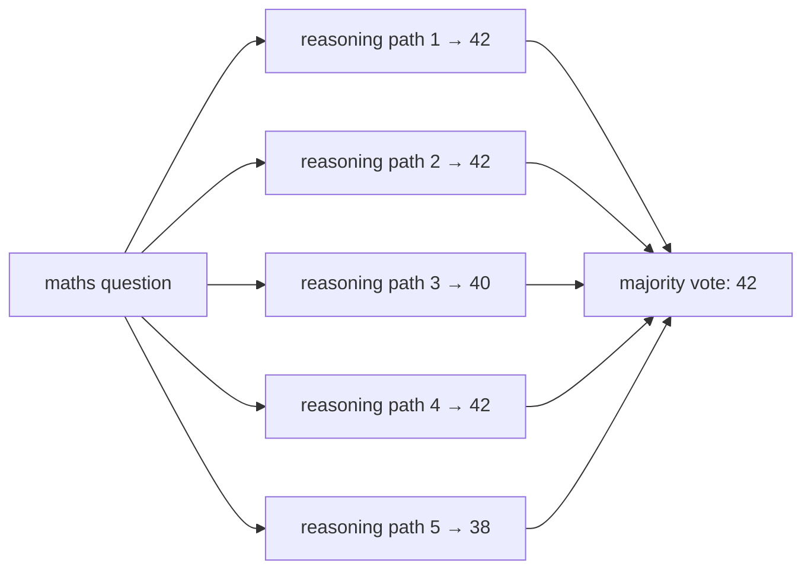

<!-- Written by `npm run lessons` from the lesson data in src/data. Edit the lesson there, not this page. -->

# Reasoning models and test-time compute

**ML Foundations · Unit 4: Transformers and LLMs · Lesson 14 of 14**

> **In one line.** A reasoning model is trained to write out its steps before answering. Test-time compute means spending more computation at answer time, through longer reasoning or several samples and a vote, to get better answers.

[Open this lesson on the site](https://learn.hamropedia.com/foundations/reasoning-models-and-test-time-compute/) for its animation, the practice game and tap-to-explain words.

## The problem it solves

Some problems can't be solved in a single forward pass: multi-step maths, tricky code, planning. Letting the model work step by step, and spend more tokens on harder questions, greatly improves accuracy. It gives a new knob — accuracy versus cost per query — alongside model size, and it is behind the jump in maths and coding ability of recent models.

## The idea

A reasoning model is trained to 'think' before answering: it writes out intermediate steps (a chain of thought) and can spend more tokens on harder problems.

Spending more computation at answer time, by reasoning for longer or by sampling several answers and picking the best, is called test-time compute. Much of this ability is trained with reinforcement learning on problems whose answers can be checked, like maths and code.

## How it works, step by step

1. Chain of thought: the model writes its reasoning first ("12 pens is 4 groups of 3 …"), then the answer. Each step is a smaller, easier prediction that the next step can build on.
2. Prompting ("think step by step") helps a little; training helps a lot. Reasoning models are trained with reinforcement learning on problems whose answers can be checked, such as maths with known answers and code with unit tests.
3. The reward is simply "was the final answer right?" Over many attempts, the model learns reasoning habits that lead to right answers: checking work, trying again, breaking problems down.
4. Self-consistency: sample several reasoning paths at a temperature above 0 and take a majority vote on the final answers.
5. Best-of-N with a verifier: generate N answers and let a checker (tests, a reward model) choose.
6. More thinking costs more tokens and time, so it is worth it for hard, checkable problems, not for simple lookups.

## Picture it



*Self-consistency: spend more compute at answer time by sampling several reasoning paths and taking the most common answer.*

## Analogy

A student allowed to use scrap paper and check their work, instead of shouting the first answer that comes to mind.

**Where the analogy breaks.** A student's scrap paper shows their real reasoning. A model's written steps are not guaranteed to be the true cause of its answer. And more thinking costs more time and money; it helps most on problems with checkable steps.

## Worked example

Self-consistency: sample 10 reasoning paths for a maths question and take the most common final answer. It is often more accurate than one greedy answer, at 10 times the cost.

```python
from collections import Counter

answers = [final_answer(llm(question, temperature=0.8)) for _ in range(10)]
best, votes = Counter(answers).most_common(1)[0]   # majority vote
```

## Must know

- Test-time compute is a new scaling axis: spend more per query for better answers.
- RL with verifiable rewards trains models to reason.
- Majority voting and verifiers turn several noisy attempts into one more reliable answer.
- Written reasoning isn't guaranteed to be the true cause of the answer.
- Cost and latency grow with reasoning length; use it where accuracy matters.

## Common mistakes

- Paying for long reasoning on simple factual questions.
- Trusting a chain of thought as a faithful explanation.
- Using self-consistency at temperature 0, which gives the same answer every time.

> **Not true:** The reasoning a model writes out is a faithful record of how it reached its answer.  
> **In fact:** The written steps can leave out or misstate what really drove the answer. Treat them as useful output, not as a guaranteed explanation.

> **Not true:** Self-consistency works at temperature 0.  
> **In fact:** At temperature 0 every sample is the same answer, so there is nothing to vote on. Self-consistency needs varied attempts, so sample with some randomness.

## Practise

Try each one yourself first: on paper, in code or out loud. Then open the answer and compare.

### 1. Derive

A model is right 60% of the time on a type of question, independently each time. With a majority vote over 5 samples, is it right more or less often? Calculate it.

<details>
<summary>Show one good answer</summary>

The majority of 5 is right when at least 3 of the 5 samples are right. With p = 0.6 per sample, independently:

P(5 right) = 0.6⁵ = 0.07776  
P(4 right) = 5 × 0.6⁴ × 0.4 = 5 × 0.1296 × 0.4 = 0.2592  
P(3 right) = 10 × 0.6³ × 0.4² = 10 × 0.216 × 0.16 = 0.3456

Total: 0.07776 + 0.2592 + 0.3456 ≈ 0.683.

So the vote is right about 68% of the time, more often than one sample (60%). In practice it can be even better, because wrong answers usually disagree with each other (many different wrong numbers), so the right answer can win with fewer than 3 votes. And it can be worse when the samples aren't independent, for example when the model makes the same mistake every time.

```python
from math import comb
print(sum(comb(5, k) * 0.6**k * 0.4**(5 - k) for k in range(3, 6)))   # 0.68256
```

</details>

### 2. Build

On 50 arithmetic word problems, compare: a direct answer, 'think step by step', and self-consistency with 5 and 10 samples. Plot accuracy against tokens used.

<details>
<summary>Show one good answer</summary>

The experiment: generate 50 word problems whose answers you know, then compare four methods. A direct answer ("reply with just the number"); "think step by step, then give the answer"; and self-consistency, which samples the step-by-step answer 5 or 10 times and takes the most common final answer. For each method record accuracy and the total output tokens, which is where the time goes, and plot accuracy against tokens.

It uses llm.py, the free helper from the Prompting topic in Unit 5 (Groq, then Gemini, then NVIDIA on free tiers, then a local Ollama model). Self-consistency needs varied samples, so those calls use temperature 1.0; the others use 0.

What to expect depends on the model. The first models in the chain (gpt-oss) are reasoning models: they think before answering anyway, so "think step by step" adds less, and self-consistency adds a few points on the hardest problems at 5 to 10 times the tokens. A small model without built-in reasoning, such as llama3.2:3b on Ollama (pass providers=[("Ollama", "http://localhost:11434/v1/chat/completions", None, "llama3.2:3b")]), shows the classic big jump from step-by-step. A 3-problem trial on qwen2.5:7b (local, no built-in reasoning) gave: direct 0 of 3, step by step 3 of 3, self-consistency 2 of 3. Sampling at temperature 1.0 made the small model sloppier, so self-consistency did worse than one careful answer; try a temperature of 0.6 to 0.8. It makes about 850 calls (50 × (1 + 1 + 5 + 10)), which will hit free-tier rate limits and fall back down the chain, so try 10 problems first.

```python
import random
import re
from collections import Counter
from llm import ask, text_of          # llm.py from Unit 5's Prompting topic: free APIs, then a local model

random.seed(0)
problems = []
for _ in range(50):
    a, b, c = random.randint(12, 99), random.randint(3, 19), random.randint(2, 9)
    q = f"A shop has {a} boxes with {b} apples each. It sells {c} full boxes, then gets {b} more apples. How many apples does it have now?"
    problems.append((q, (a - c) * b + b))

def solve(prompt, temperature):
    reply = ask(prompt, temperature=temperature, max_tokens=1500)
    numbers = re.findall(r"ANSWER:\s*(-?\d+)", text_of(reply))
    return (int(numbers[-1]) if numbers else None), reply["output_tokens"]

DIRECT = "{q}\nReply with only the final number, written as ANSWER: <number>."
STEPS = "{q}\nThink step by step, then finish with ANSWER: <number>."

def run(template, samples=1):
    correct = tokens = 0
    for q, truth in problems:
        answers = []
        for _ in range(samples):
            answer, used = solve(template.format(q=q), temperature=1.0 if samples > 1 else 0.0)
            answers.append(answer); tokens += used
        votes = Counter(a for a in answers if a is not None)
        correct += bool(votes) and votes.most_common(1)[0][0] == truth
    return correct / len(problems), tokens

for name, template, samples in [("direct", DIRECT, 1), ("step by step", STEPS, 1),
                                ("self-consistency x5", STEPS, 5), ("self-consistency x10", STEPS, 10)]:
    accuracy, tokens = run(template, samples)
    print(f"{name:22s} accuracy {accuracy:.0%}, output tokens {tokens:,}")
```

</details>

### 3. Break

Try the same methods on simple factual questions, like capital cities. Does extra thinking still help, or just cost more? Find one case where the reasoning is wrong but the answer is right.

<details>
<summary>Show one good answer</summary>

On simple factual questions ("What is the capital of Canada?"), extra thinking doesn't help: the model either knows the fact or it doesn't, and reasoning can't create knowledge that isn't there. Step-by-step and voting cost several times the tokens and the accuracy stays the same, already near 100% for easy facts. Occasionally overthinking even hurts, talking itself out of the right first answer. Test-time compute pays off on problems that need several steps (arithmetic, logic, code, planning), not on recall.

Reasoning wrong, answer right: look through the step-by-step outputs for cases like "15% of 80: 10% is 8, and 5% is 3, so 15% is 12". The answer, 12, is right, but the step "5% is 3" is wrong (it is 4), and 8 + 3 isn't even 12. The model reached the answer some other way and wrote a plausible-looking explanation. The lesson: a written chain of thought is not a guaranteed record of how the model got its answer. Check the answer, and don't treat the reasoning as proof; when the steps matter, verify them, for example with code or a calculator tool.

</details>

### 4. Explain

Explain test-time compute with the scrap-paper picture, and when it is worth the cost.

<details>
<summary>Show one good answer</summary>

A student in an exam can shout out the first answer that comes to mind, or use scrap paper: write out the steps, check the work, even solve it two different ways and see if they agree. The scrap paper costs time, but on a hard maths problem it makes a right answer far more likely.

Test-time compute is giving the model scrap paper: letting it generate reasoning before the answer, or sampling several answers and voting. Reasoning models are trained to do this well. It is worth the cost when the problem needs several steps and a wrong answer is expensive: maths, code, tricky analysis. It is wasted on simple lookups and chit-chat, where the first answer is already right and the extra tokens only add time and cost.

</details>

## Check you understood

Answer in your head first, then open each one.

<details>
<summary>&lt;b>What is test-time compute?&lt;/b></summary>

Extra computation spent when answering — longer reasoning, or several samples — to improve accuracy, instead of a bigger model.

</details>

<details>
<summary>&lt;b>How does self-consistency work?&lt;/b></summary>

Sample several reasoning paths with some randomness and take the most common final answer.

</details>

<details>
<summary>&lt;b>Why train reasoning on maths and code first?&lt;/b></summary>

Their answers can be checked automatically, which gives a clear reward signal for reinforcement learning.

</details>

<details>
<summary>&lt;b>When is extra reasoning not worth it?&lt;/b></summary>

For simple lookups or questions the model already answers reliably: it only adds cost and delay.

</details>

## Go further (optional)

The lesson above is enough on its own. These free extras give a second explanation.

- READ · [Understanding Reasoning LLMs](https://magazine.sebastianraschka.com/p/understanding-reasoning-llms) · Sebastian Raschka
- WATCH · [Deep Dive into LLMs like ChatGPT (the 'thinking' and RL sections)](https://www.youtube.com/results?search_query=Andrej+Karpathy+Deep+Dive+into+LLMs+like+ChatGPT) · Andrej Karpathy
- PAPER · [Chain-of-Thought Prompting Elicits Reasoning in Large Language Models (2022)](https://arxiv.org/abs/2201.11903) · Wei et al. · arXiv
- PAPER · [Self-Consistency Improves Chain of Thought Reasoning (2022)](https://arxiv.org/abs/2203.11171) · Wang et al. · arXiv
- PAPER · [DeepSeek-R1: Incentivizing Reasoning Capability via RL (2025)](https://arxiv.org/abs/2501.12948) · DeepSeek-AI · arXiv

---

[← Instruction tuning and preference tuning (RLHF, DPO)](instruction-tuning-and-preference-tuning-rlhf-dpo.md) · [All lessons](../../README.md) · [Prompting: clear instructions, examples, structured output →](../unit-5-ai-engineering/prompting-clear-instructions-examples-structured-output.md)
