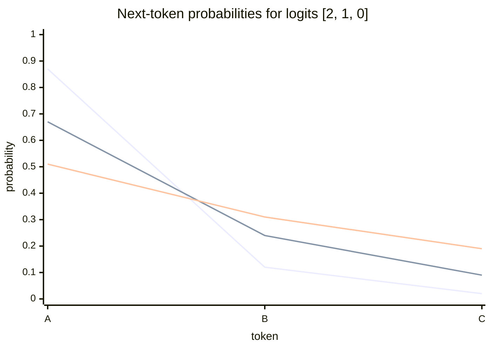

<!-- Written by `npm run lessons` from the lesson data in src/data. Edit the lesson there, not this page. -->

# Sampling: greedy, temperature, top-k, top-p

**ML Foundations · Unit 4: Transformers and LLMs · Lesson 8 of 14**

> **In one line.** Decoding turns the model's next-token probabilities into an actual choice: greedy takes the top token, temperature reshapes the distribution, and top-k and top-p cut off unlikely tokens before sampling.

[Open this lesson on the site](https://learn.hamropedia.com/foundations/sampling-greedy-temperature-top-k-top-p/) for its animation, the practice game and tap-to-explain words.

## The problem it solves

The same model can sound dull and repetitive or creative and unhinged depending only on how you pick tokens. Greedy decoding tends to loop; pure sampling sometimes picks absurd words from the long tail. Decoding settings are the cheapest, most-used control you have over an LLM's output.

## The idea

The model gives a probability for every possible next token. Greedy decoding always picks the top one. Temperature divides the logits by T before softmax: T &lt; 1 makes choices sharper, T > 1 makes them flatter. Top-k keeps only the k best tokens. Top-p keeps the smallest set whose probabilities add up to p.

## How it works, step by step

1. The model gives logits for every token in the vocabulary. Softmax turns them into probabilities.
2. Greedy: always take the most likely token. Deterministic, but prone to repetition.
3. Temperature T: divide the logits by T before the softmax. T &lt; 1 sharpens the distribution (safer); T > 1 flattens it (more varied); T → 0 becomes greedy.
4. Top-k: keep only the k most likely tokens, set the rest to zero, renormalise, then sample.
5. Top-p (nucleus): sort tokens by probability and keep the smallest set whose probabilities add up to at least p (such as 0.9). The set is small when the model is sure and larger when it isn't.
6. Sample from what is left. A fixed random seed makes sampling repeatable.
7. Typical settings: T around 0.7 with top-p 0.9 for chat; T = 0 for extraction, classification and code that must be exact.

## Picture it



*The steepest line is temperature 0.5 (sharp, safe), the middle is 1, the flattest is 2 (more random). Same logits, different temperature.*

## Analogy

Ordering at a restaurant. Greedy: always the most popular dish. High temperature: feeling adventurous. Top-k: only choose from the top 5 dishes.

**Where the analogy breaks.** One restaurant order does not change the next one. In text, each choice changes everything after it, so one odd pick can send the text off track.

## Worked example

Logits [2, 1, 0]. At T = 1: about [0.67, 0.24, 0.09]. At T = 0.5: about [0.87, 0.12, 0.02].

```python
p = softmax(logits / T)
next_id = np.random.choice(len(p), p=p)
```

## Must know

- Temperature changes the shape of the distribution; top-k and top-p change which tokens are allowed.
- Low temperature = focused and repetitive; high = diverse and error-prone.
- Top-p adapts to the model's confidence; top-k uses a fixed count.
- Beam search keeps several high-probability sequences; good for translation, often bland for chat.
- One unlucky pick changes everything after it, so errors compound.

## Common mistakes

- Using high temperature for tasks that need exact, repeatable answers.
- Using T = 0 for creative writing and getting loops.
- Setting both a tiny top-k and a high temperature, then wondering why the settings seem to fight.

> **Not true:** Temperature 0 = the setting for creative writing.  
> **In fact:** At temperature 0 the model always takes the most likely token, which makes the text repetitive and can trap it in loops. Creative writing needs some randomness.

> **Not true:** High temperature: the choice for answers that have to be exact and repeatable.  
> **In fact:** High temperature adds randomness, so answers vary and errors appear. For exact, repeatable output use a low temperature, or greedy decoding.

## Practise

Try each one yourself first: on paper, in code or out loud. Then open the answer and compare.

### 1. Derive

For probabilities [0.5, 0.2, 0.15, 0.1, 0.05], which tokens are kept with top-k = 2, and which with top-p = 0.8?

<details>
<summary>Show one good answer</summary>

Probabilities, already sorted: [0.5, 0.2, 0.15, 0.1, 0.05].

Top-k = 2: keep the 2 most likely tokens, 0.5 and 0.2. Renormalise so they add up to 1: 0.5/0.7 ≈ 0.714 and 0.2/0.7 ≈ 0.286.

Top-p = 0.8: keep the smallest set of top tokens whose probabilities add up to at least 0.8. Running total: 0.5, then 0.7 (not enough), then 0.85 (enough). So keep the first three: 0.5, 0.2, 0.15. Renormalise by 0.85: about 0.588, 0.235 and 0.176.

The difference: top-k always keeps exactly k tokens; top-p keeps a number that adapts. When the model is confident, a few tokens pass 0.8; when it is unsure, many do.

</details>

### 2. Build

Add temperature, top-k and top-p to your generate(). Generate 5 samples with each setting and compare.

<details>
<summary>Show one good answer</summary>

generate() gets three knobs. Temperature divides the logits before softmax. Top-k sets every logit outside the k largest to −infinity. Top-p sorts the probabilities, keeps the smallest prefix whose total passes p (always at least the top token), and zeroes the rest. Then renormalise and sample as before.

Comparing five short samples per setting from the trained Shakespeare GPT: temperature 1.0 is varied, with some made-up words; temperature 0.5 gives safer, more repetitive text with more common words; top-k = 10 and top-p = 0.9 cut off the rarest characters, so there are fewer odd letter combinations while keeping variety. For this tiny character model the differences are modest; for large models, these settings change the feel of the output a lot.

```python
import torch
import torch.nn.functional as F
from gpt import GPT, train, decode, encode

@torch.no_grad()
def generate(model, idx, n, temperature=1.0, top_k=None, top_p=None):
    model.eval()
    for _ in range(n):
        logits = model(idx[:, -model.c.block_size:])[0][:, -1] / temperature
        if top_k is not None:
            kth = torch.topk(logits, top_k).values[:, -1, None]
            logits = logits.masked_fill(logits < kth, float("-inf"))
        probs = F.softmax(logits, dim=-1)
        if top_p is not None:
            sorted_p, order = probs.sort(descending=True)
            drop = sorted_p.cumsum(-1) - sorted_p > top_p           # drop once the total before it passes p
            sorted_p[drop] = 0
            probs = torch.zeros_like(probs).scatter(-1, order, sorted_p)
            probs = probs / probs.sum(-1, keepdim=True)
        idx = torch.cat([idx, torch.multinomial(probs, 1)], dim=1)
    return idx

torch.manual_seed(0)
model = train(GPT(), steps=1500, log_every=0)
for name, kwargs in [("T=1.0", {}), ("T=0.5", {"temperature": 0.5}),
                     ("top-k 10", {"top_k": 10}), ("top-p 0.9", {"top_p": 0.9})]:
    torch.manual_seed(1)
    start = torch.tensor([encode("ROMEO:")] * 5)
    out = generate(model, start, 50, **kwargs)
    print(f"--- {name}")
    for row in out:
        print(repr(decode(row.tolist())))
```

</details>

### 3. Break

Generate with temperature 0.01 and with 3.0. Describe the failure at each end.

<details>
<summary>Show one good answer</summary>

Temperature 0.01 is effectively greedy: the most likely next character every time. The text quickly falls into a loop, the same few words or the same line repeated over and over ("the the the", or one speaker's line again and again), because once the most likely continuation leads back to a state it has seen, it will repeat forever. It is also bland: it never takes the slightly less likely word that makes text interesting.

Temperature 3.0 flattens the probabilities so much that rare characters are almost as likely as common ones. The text becomes random-looking characters: mixed capitals, punctuation in odd places, and no words.

The useful range is in between, often 0.7 to 1.0 for creative text and close to 0 for factual or structured answers, usually combined with top-p to cut off the junk tail.

```python
import torch
from gpt import GPT, train, decode, encode

torch.manual_seed(0)
model = train(GPT(), steps=1500, log_every=0)
for temperature in [0.01, 3.0]:
    torch.manual_seed(1)
    out = model.generate(torch.tensor([encode("ROMEO:")]), 150, temperature=temperature)
    print(f"--- temperature {temperature}\n{decode(out[0].tolist())}\n")
```

</details>

### 4. Explain

Explain temperature with the restaurant-ordering picture.

<details>
<summary>Show one good answer</summary>

Ordering at a restaurant. Temperature 0 means you always order the most popular dish: reliable, and boring after a while. A low temperature means you usually pick from the favourites. A high temperature means you feel adventurous and might order anything on the menu, including the dish nobody ever orders. Turn it up too far and you are choosing at random.

The model's "menu" is every possible next token with a probability. Temperature reshapes those probabilities before choosing: low makes the favourite even more likely, high flattens them so long shots get picked more often. Top-k and top-p are like crossing the worst dishes off the menu first.

</details>

## Check you understood

Answer in your head first, then open each one.

<details>
<summary>&lt;b>What does a temperature of 0.5 do to logits [2, 0]?&lt;/b></summary>

It divides them by 0.5, giving [4, 0], so the top token's probability rises (from about 0.88 to about 0.98).

</details>

<details>
<summary>&lt;b>How does top-p differ from top-k?&lt;/b></summary>

Top-k keeps a fixed number of tokens; top-p keeps however many it takes for their probabilities to reach p.

</details>

<details>
<summary>&lt;b>Why does greedy decoding often repeat itself?&lt;/b></summary>

Once a phrase becomes likely, picking the top token every time can lock the model into the same loop.

</details>

<details>
<summary>&lt;b>Which setting would you use to extract a date from an email?&lt;/b></summary>

Temperature 0 (greedy): you want the single most likely, repeatable answer.

</details>

## Go further (optional)

The lesson above is enough on its own. These free extras give a second explanation.

- READ · [How to generate text: using different decoding methods](https://huggingface.co/blog/how-to-generate) · Hugging Face blog
- CODE · [Build a Large Language Model (From Scratch), Ch 5 (decoding strategies)](https://github.com/rasbt/LLMs-from-scratch) · Sebastian Raschka · code free
- PAPER · [The Curious Case of Neural Text Degeneration (2019)](https://arxiv.org/abs/1904.09751) · Holtzman et al. · arXiv

---

[← Vision transformers and CLIP](vision-transformers-and-clip.md) · [All lessons](../../README.md) · [KV cache and the cost of generation →](kv-cache-and-the-cost-of-generation.md)
