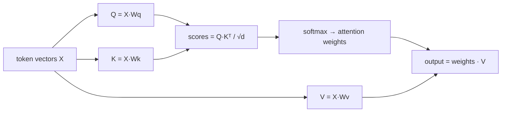

<!-- Written by `npm run lessons` from the lesson data in src/data. Edit the lesson there, not this page. -->

# Self-attention: queries, keys and values

**ML Foundations · Unit 4: Transformers and LLMs · Lesson 3 of 14**

> **In one line.** Self-attention lets every token look at all the tokens and build a new version of itself as a weighted mix of their values. The weights come from how well its query matches each token's key.

[Open this lesson on the site](https://learn.hamropedia.com/foundations/self-attention-queries-keys-and-values/) for its animation, the practice game and tap-to-explain words.

## The problem it solves

The meaning of a word depends on other words, often far away: "it" depends on what "it" refers to, and "bank" depends on "river" or "money". RNNs pass information step by step and forget. Attention lets every word look directly at every other word in one step, in parallel, and learn which ones matter. It is the core operation of every transformer.

## The idea

Every token makes three vectors: a query (what I am looking for), a key (what I contain) and a value (what I will share). Each token compares its query with every key, turns the scores into weights with softmax, and takes a weighted average of the values.

## How it works, step by step

1. Each token's vector x is multiplied by three learned matrices: query q = x·W_Q, key k = x·W_K, value v = x·W_V.
2. For a token, compare its query with every key: score = q·k / √d. A high score means "this word is relevant to me".
3. Softmax turns the scores into weights that add up to 1. For "it", most weight might go to "animal".
4. The output for that token is the weighted sum of all the value vectors: mostly the animal's value, a little of the others.
5. Do it for all tokens at once with matrices: A = softmax(QKᵀ/√d), output = A·V. A has shape (T, T): one row of weights per token.
6. Divide by √d because dot products of long vectors are large; without it, softmax becomes nearly one-hot and gradients vanish.
7. In a GPT, a causal mask sets the scores for future tokens to −∞ before the softmax, so each token only looks back.

## Picture it



*Every token compares its query with every key, turns the scores into weights, and takes that weighted mix of the values.*

## Analogy

A library. Your question is the query. Book titles are keys. The contents are values. You read a mix of the books whose titles best match your question.

**Where the analogy breaks.** In a library you read only the best books. In attention you get a blend of all of them, weighted by how well they match.

## Worked example

In 'The animal didn't cross the street because it was tired', attention for 'it' can put a high weight on 'animal'. With numbers: suppose the scores of 'it' against animal, street and tired are 2, 0 and 1. Softmax turns them into weights of about 0.67, 0.09 and 0.24. The new vector for 'it' is then 0.67 × the value of animal + 0.09 × the value of street + 0.24 × the value of tired.

```python
Q, K, V = X @ Wq, X @ Wk, X @ Wv            # each (T, d)
scores = Q @ K.T / np.sqrt(d)                # (T, T)
scores = scores - scores.max(axis=1, keepdims=True)
A = np.exp(scores); A /= A.sum(axis=1, keepdims=True)
out = A @ V                                  # (T, d)
```

## Must know

- The whole operation in one line: Attention(Q, K, V) = softmax(QKᵀ/√d)·V. Score, scale, turn into weights, then mix the values.
- Query: what I am looking for. Key: what I offer for matching. Value: what I pass on.
- Every pair of tokens is compared, so the cost grows with the square of the sequence length.
- The weights depend on the input: attention is a data-dependent mixing of tokens.
- All tokens are processed in parallel, unlike an RNN.
- Self-attention: Q, K and V come from the same sequence. Cross-attention: queries from one sequence, keys and values from another.

## Common mistakes

- Forgetting the √d scaling, so the scores are large, the softmax becomes almost one-hot and gradients vanish.
- Applying the softmax over the wrong axis: each row (one query) must sum to 1.
- Adding the causal mask after the softmax instead of before.
- Mixing up the roles of keys (for matching) and values (for the content passed on).

> **Not true:** The causal mask can be applied after the softmax and still hide the future correctly.  
> **In fact:** After the softmax the future tokens have already taken their share of the weight, and the rows no longer add up to 1. Set their scores to −∞ before the softmax.

> **Not true:** The √d scaling in attention is optional: leaving it out makes little difference.  
> **In fact:** Without dividing by √d, the scores are large and the softmax becomes almost one-hot. The gradients then vanish and training stalls.

## Go deeper (optional): Why the scores are divided by √d, and not by d

1. Model a query q and a key k as vectors of d independent numbers, each with mean 0 and variance 1. That is roughly true at the start of training.
2. The score is q·k = Σ qᵢkᵢ. Each term has mean 0 and variance E[qᵢ²]·E[kᵢ²] = 1.
3. The d terms are independent, so their variances add: Var(q·k) = d. The typical size of a score is √d, about 23 for d = 512.
4. Softmax compares scores through e to their difference. A score 22 above another gets about 3.6 billion times its weight, so one token takes almost everything and the gradient through the softmax is close to 0.
5. Divide by √d: Var(q·k/√d) = d/d = 1, whatever the size of the model. The softmax sees scores of ordinary size and spreads its weight.
6. Dividing by d would go too far: the variance would be 1/d, every score would be nearly equal, and attention would be an almost uniform average that ignores the content.

**The result.** Var(q·k) = d, so q·k/√d has variance 1 for any model size: the softmax neither saturates nor goes flat.

## Practise

Try each one yourself first: on paper, in code or out loud. Then open the answer and compare.

### 1. Derive

With 3 tokens, d = 2, and small whole-number Q, K and V matrices you make up, compute the attention weights and the output by hand.

<details>
<summary>Show one good answer</summary>

Made-up numbers, d = 2:  
Q = K = [[1, 0], [0, 1], [1, 1]] (token 3 is "both"), V = [[1, 2], [3, 4], [5, 6]].

Scores S = Q·Kᵀ / √2 (√2 ≈ 1.414):  
Q·Kᵀ = [[1, 0, 1], [0, 1, 1], [1, 1, 2]], so S ≈ [[0.707, 0, 0.707], [0, 0.707, 0.707], [0.707, 0.707, 1.414]].

Softmax of each row (e^0.707 ≈ 2.03, e^1.414 ≈ 4.11):  
row 1: [2.03, 1, 2.03] / 5.06 ≈ [0.40, 0.20, 0.40]  
row 2: [1, 2.03, 2.03] / 5.06 ≈ [0.20, 0.40, 0.40]  
row 3: [2.03, 2.03, 4.11] / 8.17 ≈ [0.25, 0.25, 0.50]

Output = weights · V:  
token 1: 0.40·[1, 2] + 0.20·[3, 4] + 0.40·[5, 6] ≈ [3.0, 4.0]  
token 2: 0.20·[1, 2] + 0.40·[3, 4] + 0.40·[5, 6] ≈ [3.41, 4.41]  
token 3: 0.25·[1, 2] + 0.25·[3, 4] + 0.50·[5, 6] ≈ [3.51, 4.51]

Each output is a blend of the value vectors, weighted by how well that token's query matched each key. Token 3 matches itself best, so it takes half of its own value.

```python
import numpy as np
Q = K = np.array([[1, 0], [0, 1], [1, 1]])
V = np.array([[1, 2], [3, 4], [5, 6]])
S = Q @ K.T / np.sqrt(2)
W = np.exp(S) / np.exp(S).sum(axis=1, keepdims=True)
print(W.round(2)); print((W @ V).round(2))
```

</details>

### 2. Build

Write single-head self-attention in NumPy, then in PyTorch, and check that they match. Add the causal mask.

<details>
<summary>Show one good answer</summary>

Single-head attention: project the inputs to Q, K and V, score every query against every key, scale by √d, apply the causal mask (set the scores for future positions to −infinity before softmax, so their weight becomes exactly 0), softmax each row, and mix the values.

The NumPy and PyTorch versions agree to about 1e-6 (and both match torch's built-in scaled_dot_product_attention). With the mask, the weight matrix is lower-triangular: token t only uses tokens 1 to t.

```python
import numpy as np
import torch
import torch.nn.functional as F

def attention_np(X, Wq, Wk, Wv, causal=True):
    Q, K, V = X @ Wq, X @ Wk, X @ Wv
    S = Q @ K.T / np.sqrt(K.shape[1])
    if causal:
        S = np.where(np.tril(np.ones_like(S)) == 1, S, -np.inf)
    W = np.exp(S - S.max(axis=1, keepdims=True))
    W /= W.sum(axis=1, keepdims=True)
    return W @ V, W

def attention_torch(X, Wq, Wk, Wv, causal=True):
    Q, K, V = X @ Wq, X @ Wk, X @ Wv
    S = Q @ K.T / K.shape[1] ** 0.5
    if causal:
        S = S.masked_fill(torch.tril(torch.ones_like(S)) == 0, float("-inf"))
    return F.softmax(S, dim=-1) @ V

rng = np.random.default_rng(0)
X, Wq, Wk, Wv = (rng.normal(size=s).astype(np.float32) for s in [(5, 8), (8, 4), (8, 4), (8, 4)])
out_np, W = attention_np(X, Wq, Wk, Wv)
out_t = attention_torch(*(torch.tensor(a) for a in (X, Wq, Wk, Wv)))
ref = F.scaled_dot_product_attention(*(torch.tensor(a)[None] for a in (X @ Wq, X @ Wk, X @ Wv)), is_causal=True)[0]
print(np.abs(out_np - out_t.numpy()).max(), np.abs(out_np - ref.numpy()).max())
print(W.round(2))                                   # lower-triangular: no peeking ahead
```

</details>

### 3. Break

Remove the √d scaling and use d = 512. Look at the softmax outputs. Why do they become almost one-hot, and what does that do to the gradients?

<details>
<summary>Show one good answer</summary>

Without the √d, the scores get far too big. If the entries of q and k have variance 1, their dot product is a sum of d = 512 terms, so its standard deviation is √512 ≈ 23. Softmax of numbers that far apart puts almost all the weight on the single largest score: in the run below, more than half of the rows become essentially one-hot (their largest weight is above 0.99), against none with scaling, and the average entropy of a row drops from about 3.7 (spread over many tokens) to about 0.16.

What that does to gradients: softmax passes gradient back as wᵢ(gᵢ − Σⱼ wⱼgⱼ). When one weight is about 1 and the rest about 0, every term is close to 0, so a saturated row sends almost nothing back to its scores. In the run below, the typical (median) row passes back about 37 times less gradient, and the most saturated rows pass back about 1e-17, nothing at all. The attention pattern for those tokens freezes: it can't learn to look anywhere else.

(One subtlety: the total gradient into q isn't smaller here, because without the division each score is also 23 times more sensitive to q, and the few unsaturated rows dominate. That is the other problem: training is driven by a handful of rows and becomes unstable.) Dividing by √d brings the scores back to a standard deviation of about 1, where softmax spreads its weight and every row keeps learning.

```python
import torch

torch.manual_seed(0)
d, T = 512, 64
q, k, g = torch.randn(T, d), torch.randn(T, d), torch.randn(T, T)   # g: some downstream gradient
for scaled in [True, False]:
    scores = (q @ k.T / (d ** 0.5 if scaled else 1.0)).requires_grad_()
    weights = torch.softmax(scores, dim=-1)
    (weights * g).sum().backward()
    entropy = -(weights * torch.log(weights + 1e-12)).sum(-1).mean()
    rows = scores.grad.norm(dim=-1)
    print(f"scaled={scaled}: score std {scores.std().item():.1f}, "
          f"rows almost one-hot {(weights.max(-1).values > 0.99).float().mean().item():.0%}, "
          f"entropy {entropy.item():.2f}, median row gradient {rows.median().item():.1e}, smallest {rows.min().item():.0e}")
```

</details>

### 4. Explain

Explain queries, keys and values with the library picture.

<details>
<summary>Show one good answer</summary>

A library. You arrive with a question: that is your query. Every book has a title on its spine: the keys. Each book's contents are its values. You compare your question with every title, and the better a title matches, the more of that book you read. You leave with a blend of the contents, mostly from the best matches.

In self-attention, every word does this at the same time: each word asks a question (query), advertises what it is about (key), and offers what it can tell (value). "it" asks "who am I referring to?", "animal" advertises "I am a noun, a creature", and "it" ends up reading mostly from "animal".

</details>

## Check you understood

Answer in your head first, then open each one.

<details>
<summary>&lt;b>What shape is the attention weight matrix for a sequence of T tokens?&lt;/b></summary>

(T, T): one row of weights per query token, each row summing to 1.

</details>

<details>
<summary>&lt;b>Why divide the scores by √d?&lt;/b></summary>

Dot products grow with the vector size. Large scores make softmax nearly one-hot, with tiny gradients; dividing by √d keeps them in a good range.

</details>

<details>
<summary>&lt;b>What is the difference between a key and a value?&lt;/b></summary>

The key is used to decide how much attention a token gets; the value is the information it actually passes on.

</details>

<details>
<summary>&lt;b>Why is attention expensive for long texts?&lt;/b></summary>

Every token is compared with every other one, so time and memory grow with the square of the length.

</details>

## Go further (optional)

The lesson above is enough on its own. These free extras give a second explanation.

- WATCH · [Attention in transformers, step-by-step](https://www.3blue1brown.com/lessons/attention) · 3Blue1Brown  
  **Worth it:** The clearest moving-picture explanation of queries, keys and values anywhere: you watch word meanings shift as attention mixes them.
- PLAY · [Transformer Explainer](https://poloclub.github.io/transformer-explainer/) · Georgia Tech Polo Club · a live GPT-2 in your browser
- READ · [The Illustrated Transformer](https://jalammar.github.io/illustrated-transformer/) · Jay Alammar
- CODE · [Build a Large Language Model (From Scratch), Ch 3 (coding attention mechanisms)](https://github.com/rasbt/LLMs-from-scratch) · Sebastian Raschka · code free

---

[← Token embeddings and positional encoding](token-embeddings-and-positional-encoding.md) · [All lessons](../../README.md) · [Multi-head attention and the transformer block →](multi-head-attention-and-the-transformer-block.md)
