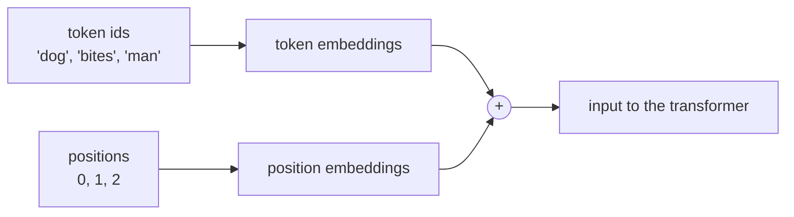

<!-- Written by `npm run lessons` from the lesson data in src/data. Edit the lesson there, not this page. -->

# Token embeddings and positional encoding

**ML Foundations · Unit 4: Transformers and LLMs · Lesson 2 of 14**

> **In one line.** Token embeddings turn each token id into a learned vector, and positional encodings add information about where each token sits, because attention on its own ignores order.

[Open this lesson on the site](https://learn.hamropedia.com/foundations/token-embeddings-and-positional-encoding/) for its animation, the practice game and tap-to-explain words.

## The problem it solves

Attention compares every token with every other token, but it treats the input as an unordered set: shuffle the words and each output just moves with its word. "dog bites man" and "man bites dog" would look the same. Position information fixes that, and how you encode positions decides how well a model handles long contexts.

## The idea

Each token id becomes a vector (its embedding). Attention on its own does not know word order, so we add position information: a learned position vector, sine waves, or rotations (RoPE).

## How it works, step by step

1. Look up each token id in the embedding table: a vector of size d_model (768 in GPT-2 small).
2. Make a position vector for each position 0, 1, 2, … of the same size.
3. Learned positions: a second table with one row per position, trained like any weight (GPT-2).
4. Sinusoidal positions: fixed sine and cosine waves of different frequencies, so every position gets a unique pattern (the original transformer).
5. Add the two: x = token_embedding + position_embedding. The sum goes into the first transformer block.
6. RoPE (rotary embeddings, used by Llama and many others) works differently. It rotates each query and key by an angle that depends on its position, so attention scores depend on the relative distance between tokens.

## Picture it



*Each token's vector gets its position added, so 'dog bites man' and 'man bites dog' look different to the model.*

## Analogy

Seat numbers in a theatre. Everyone is a person (the embedding), but the seat number (the position) tells you who sits next to whom.

**Where the analogy breaks.** Seats are fixed. A model trained on 1,000 positions often struggles at 10,000, so long-context models need special tricks.

## Worked example

'dog bites man' and 'man bites dog' use the same tokens but mean different things. Without positions, the model sees the same bag of words.

```python
x = tok_emb[ids] + pos_emb[np.arange(len(ids))]   # shape (T, d)
```

## Must know

- Without positions, attention is blind to order.
- Learned positions can't go beyond the longest position seen in training.
- Sinusoidal and rotary schemes generalise further, and can be stretched for longer contexts.
- RoPE encodes relative position directly in the query·key dot product.
- Embeddings and positions are both d_model wide, so they can simply be added.
- Many models tie the input embedding table to the output layer (weight tying) to save parameters.

## Common mistakes

- Forgetting positions entirely in a hand-built transformer.
- Running a model past its trained context length and expecting good results.
- Adding positions with the wrong shape, so they broadcast across the batch instead of the sequence.

> **Not true:** Position information reaches the model as a separate input, kept apart from the token embeddings.  
> **In fact:** Learned and sinusoidal positions are simply added to the token embeddings, and rotary positions are applied inside attention. There is no separate position input.

> **Not true:** A model works just as well on texts longer than the context length it was trained on.  
> **In fact:** Learned positions do not exist beyond the longest one seen in training, and quality drops quickly past it. Stay within the trained context length.

## Practise

Try each one yourself first: on paper, in code or out loud. Then open the answer and compare.

### 1. Derive

Show that self-attention without positions gives the same outputs, just reordered, if you shuffle the input tokens. Why does that mean we need positions?

<details>
<summary>Show one good answer</summary>

Self-attention for inputs X (one token per row) is Attn(X) = softmax(Q·Kᵀ/√d)·V with Q = XW_Q, K = XW_K, V = XW_V.

Shuffle the tokens: X becomes P·X, where P is a permutation matrix (it reorders rows; PᵀP = I).  
Then Q, K and V become PQ, PK and PV, and the scores become (PQ)(PK)ᵀ = P·(QKᵀ)·Pᵀ: the same scores, with rows and columns reordered the same way.  
Softmax works row by row, so softmax(P·S·Pᵀ) = P·softmax(S)·Pᵀ.  
The output: P·softmax(S)·Pᵀ·P·V = P·softmax(S)·V = P·Attn(X).

So shuffling the input just shuffles the output in the same way: every token gets exactly the same vector as before, wherever it sits. The layer computes a function of the set of tokens, not their order, so "dog bites man" and "man bites dog" would look identical. The MLP works on each token separately, so it can't add order either. That is why positions must be added to the input, as position embeddings or rotary encodings.

</details>

### 2. Build

Implement sinusoidal position encodings and plot them as a heatmap. Then add learned position embeddings to your model.

<details>
<summary>Show one good answer</summary>

Sinusoidal encoding gives position p and dimension pair i the values sin(p / 10000^(2i/d)) and cos(p / 10000^(2i/d)). Low dimensions wave quickly, high ones slowly, so every position gets a unique pattern, like the hands of a clock running at different speeds, and nearby positions get similar patterns. The heatmap shows fast stripes on the left fading into slow ones on the right.

Learned position embeddings are simpler: a table with one trainable vector per position, added to the token embedding. The shared gpt.py already does this: self.pos = nn.Embedding(block_size, n_embd), and the forward pass adds self.pos(torch.arange(T)) to the token embeddings. The model learns whatever position pattern helps, but can't handle positions beyond block_size.

```python
import numpy as np
import matplotlib.pyplot as plt

def sinusoidal(n_positions, d):
    pos = np.arange(n_positions)[:, None]
    i = np.arange(0, d, 2)[None, :]
    angles = pos / 10000 ** (i / d)
    pe = np.zeros((n_positions, d))
    pe[:, 0::2], pe[:, 1::2] = np.sin(angles), np.cos(angles)
    return pe

pe = sinusoidal(100, 64)
plt.imshow(pe, aspect="auto", cmap="RdBu"); plt.colorbar()
plt.xlabel("dimension"); plt.ylabel("position"); plt.title("sinusoidal position encoding")
plt.show()
cos = lambda a, b: a @ b / (np.linalg.norm(a) * np.linalg.norm(b))
print("similarity of position 10 with 11:", round(cos(pe[10], pe[11]), 3), "| with 60:", round(cos(pe[10], pe[60]), 3))
```

</details>

### 3. Break

Train your small GPT with no position information at all. Compare the generated text with and without it.

<details>
<summary>Show one good answer</summary>

Training the same GPT with no position information gives a clearly worse validation loss than with learned positions, and the text gets worse: words fall apart into letter salad more often, and line structure (names followed by a colon, lines of similar length) is weaker.

It is not a total failure, and that is interesting. A model with a causal mask can partly work out position by itself: the first token can only attend to itself, the second to two tokens, and so on, so the "amount of context" leaks some order information. But it is a weak, indirect signal, and an encoder with no mask would get none at all. That is why every practical transformer adds positions.

```python
import torch
from gpt import GPT, Config, train, estimate_loss, decode, encode

for positions in [True, False]:
    torch.manual_seed(0)
    model = train(GPT(Config(positions=positions)), steps=1500, log_every=0)
    torch.manual_seed(1)
    sample = decode(model.generate(torch.tensor([encode("\n")]), 200)[0].tolist())
    print(f"positions={positions}: val loss {estimate_loss(model):.3f}\n{sample}\n")
```

</details>

### 4. Explain

Explain positional encoding with the theatre-seats picture.

<details>
<summary>Show one good answer</summary>

In a theatre, every seat holds a person, and each person is who they are wherever they sit: that is the token embedding. But the seat number tells you who is next to whom, who is at the front, who is at the back: that is the position.

Attention on its own sees the audience as a crowd with no seat numbers, so "dog bites man" and "man bites dog" look like the same group of people. Positional encoding pins a seat number onto everyone before the show starts, by adding a position vector to each token's vector, so the model can tell the order.

</details>

## Check you understood

Answer in your head first, then open each one.

<details>
<summary>&lt;b>Why does a transformer need positional information?&lt;/b></summary>

Attention treats the input as a set; without positions, reordering the words wouldn't change what the model sees.

</details>

<details>
<summary>&lt;b>What is the main limit of learned position embeddings?&lt;/b></summary>

There is one learned vector per position, so the model can't handle positions longer than it was trained on.

</details>

<details>
<summary>&lt;b>What does RoPE do differently?&lt;/b></summary>

It rotates queries and keys by position-dependent angles, so their dot product depends on the distance between the tokens.

</details>

<details>
<summary>&lt;b>How are the token and position vectors combined?&lt;/b></summary>

They have the same size and are added together element by element.

</details>

## Go further (optional)

The lesson above is enough on its own. These free extras give a second explanation.

- CODE · [Build a Large Language Model (From Scratch), Ch 2 (token and positional embeddings)](https://github.com/rasbt/LLMs-from-scratch) · Sebastian Raschka · code free
- READ · [The Illustrated Transformer (positional encoding section)](https://jalammar.github.io/illustrated-transformer/) · Jay Alammar
- READ · [Rotary Embeddings: A Relative Revolution](https://blog.eleuther.ai/rotary-embeddings/) · EleutherAI blog

---

[← Tokenisation and byte-pair encoding (BPE)](tokenisation-and-byte-pair-encoding-bpe.md) · [All lessons](../../README.md) · [Self-attention: queries, keys and values →](self-attention-queries-keys-and-values.md)
