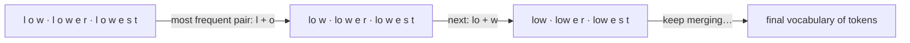

<!-- Written by `npm run lessons` from the lesson data in src/data. Edit the lesson there, not this page. -->

# Tokenisation and byte-pair encoding (BPE)

**ML Foundations · Unit 4: Transformers and LLMs · Lesson 1 of 14**

> **In one line.** Tokenisation splits text into the units a language model reads, called tokens. Byte-pair encoding (BPE) builds those units by starting from single characters (or bytes) and repeatedly merging the most frequent neighbouring pair.

[Open this lesson on the site](https://learn.hamropedia.com/foundations/tokenisation-and-byte-pair-encoding-bpe/) for its animation, the practice game and tap-to-explain words.

## The problem it solves

A model needs a fixed vocabulary of ids. Whole words give a huge vocabulary and no way to handle new or misspelled words. Single characters make sequences very long and slow. BPE sits in between: common words become one token, rare words break into familiar pieces, and nothing is ever "unknown". Tokens are also how LLM context and cost are measured.

## The idea

A model reads tokens, not letters or whole words. Byte-pair encoding (BPE) starts from single characters (or bytes) and repeatedly merges the most frequent neighbouring pair into a new token.

## How it works, step by step

1. Start with every character (or every byte, in GPT-style tokenizers) as its own token.
2. Count every pair of neighbouring tokens across the training text.
3. Merge the most frequent pair into one new token and add it to the vocabulary. In "low lower lowest", "l"+"o" is merged first, then "lo"+"w" makes "low".
4. Repeat, tens of thousands of times, until the vocabulary reaches its target size (GPT-2 has about 50,000 tokens).
5. To encode new text, apply the learned merges in the same order. To decode, join the tokens' bytes back together.
6. Spaces usually travel with the next word, so " the" (with a space) and "the" are different tokens.

## Picture it



*BPE builds tokens bottom-up by merging the most frequent neighbouring pair, again and again.*

## Analogy

Shorthand notes. You notice you write 'the' all the time, so you invent one symbol for it.

**Where the analogy breaks.** You choose shorthand by meaning. BPE merges only by frequency, so tokens can be odd pieces like 'ing' or ' the' with a space.

## Worked example

In 'low lower lowest', the pair l + o is most frequent, so it becomes 'lo'. Then lo + w becomes 'low'. Now 'lowest' is 'low' + 'e' + 's' + 't', until more merges happen.

```python
from collections import Counter
pairs = Counter(zip(tokens, tokens[1:]))
best = pairs.most_common(1)[0][0]    # merge this pair next
```

## Must know

- Token ≠ word. In English, 1 token is roughly 4 characters, or about three-quarters of a word.
- Byte-level BPE can encode any text, emoji included, with no unknown tokens.
- Context length, prices and speed are all counted in tokens.
- Numbers and non-English scripts often split into many tokens, which costs more and makes arithmetic harder.
- The tokenizer is trained once and fixed; the model must always use the same one.
- Vocabulary size trades sequence length against the size of the embedding table.

## Common mistakes

- Assuming one token = one word when estimating cost or context.
- Using a different tokenizer from the one the model was trained with.
- Forgetting that leading spaces and capital letters change tokens.
- Blaming the model for odd behaviour on spelling or digit-counting that really comes from tokenisation.

> **Not true:** A word always becomes the same tokens, with or without a space or a capital letter in front of it.  
> **In fact:** A leading space or a capital letter changes the tokens: "apple", " apple" and "Apple" are all different. That is why exact spacing matters in a prompt.

> **Not true:** One token is always one word.  
> **In fact:** A token is often a piece of a word. In English, one token is about 4 characters, or three-quarters of a word, so a text has more tokens than words.

## Practise

Try each one yourself first: on paper, in code or out loud. Then open the answer and compare.

### 1. Derive

Run 3 BPE merges by hand on 'aaabdaaabac'. Write the token list after each merge. When pairs tie, pick the one that appears first.

<details>
<summary>Show one good answer</summary>

Start with characters: a a a b d a a a b a c.

Merge 1. Count adjacent pairs: aa appears 4 times (twice inside each "aaa"), ab 2, and bd, da, ba, ac once each. Merge aa. Reading left to right, "aaa" becomes aa + a:  
aa a b d aa a b a c

Merge 2. Now (aa, a) and (a, b) both appear twice. The tie goes to the pair that appears first, which is (aa, a), so it becomes aaa:  
aaa b d aaa b a c

Merge 3. (aaa, b) appears twice, everything else once. Merge it:  
aaab d aaab a c

Eleven characters became five tokens, and the tokenizer learned three new vocabulary entries: aa, aaa and aaab. On real text the same process discovers common pieces such as "th", "ing" and " the".

```python
from collections import Counter

tokens = list("aaabdaaabac")
for merge in range(1, 4):
    pairs = list(zip(tokens, tokens[1:]))
    counts = Counter(pairs)
    best = next(p for p in pairs if counts[p] == max(counts.values()))   # ties: first one seen
    out, i = [], 0
    while i < len(tokens):
        if i + 1 < len(tokens) and (tokens[i], tokens[i + 1]) == best:
            out.append(tokens[i] + tokens[i + 1]); i += 2
        else:
            out.append(tokens[i]); i += 1
    tokens = out
    print(merge, "merge", best, "->", tokens)
```

</details>

### 2. Build

Build a BPE tokenizer: train it on a text file, then write encode and decode, and check that decode(encode(text)) == text.

<details>
<summary>Show one good answer</summary>

Byte-level BPE, the kind GPT models use: start from the 256 possible bytes, so any text in any language can be encoded. Training repeats one step: count adjacent pairs of ids, merge the most frequent pair into a new id, and remember the merge. Encoding applies the learned merges to new text in the order they were learned; decoding turns each id back into its bytes and joins them.

Trained with 200 merges on the first 50,000 characters of Shakespeare, it shrinks that text to roughly half as many tokens as bytes, and decode(encode(text)) gives back the exact text, including for text it never saw, emoji and other scripts (they just use more tokens).

```python
import os
import urllib.request
from collections import Counter

def train_bpe(text, n_merges):
    ids, merges = list(text.encode("utf-8")), {}
    for new_id in range(256, 256 + n_merges):
        pair = Counter(zip(ids, ids[1:])).most_common(1)[0][0]
        merges[pair] = new_id
        ids = merge(ids, pair, new_id)
    return merges

def merge(ids, pair, new_id):
    out, i = [], 0
    while i < len(ids):
        if i + 1 < len(ids) and (ids[i], ids[i + 1]) == pair:
            out.append(new_id); i += 2
        else:
            out.append(ids[i]); i += 1
    return out

def encode(text, merges):
    ids = list(text.encode("utf-8"))
    for pair, new_id in merges.items():          # dicts keep the order they were learned in
        ids = merge(ids, pair, new_id)
    return ids

def decode(ids, merges):
    vocab = {i: bytes([i]) for i in range(256)}
    for (a, b), new_id in merges.items():
        vocab[new_id] = vocab[a] + vocab[b]
    return b"".join(vocab[i] for i in ids).decode("utf-8", errors="replace")

path = "data/shakespeare.txt"
if not os.path.exists(path):
    os.makedirs("data", exist_ok=True)
    urllib.request.urlretrieve("https://raw.githubusercontent.com/karpathy/char-rnn/master/data/tinyshakespeare/input.txt", path)
text = open(path, encoding="utf-8").read()[:50_000]
merges = train_bpe(text, 200)
ids = encode(text, merges)
print(f"{len(text.encode())} bytes -> {len(ids)} tokens")
for sample in [text, "To be, or not to be: that is the question.", "नमस्ते 👋 naïve café"]:
    assert decode(encode(sample, merges), merges) == sample
print("round trip OK")
```

</details>

### 3. Break

Tokenise long numbers like 1234567, and text in a language with a non-Latin script. How many tokens does each need compared with English? Why does that matter for cost and for arithmetic?

<details>
<summary>Show one good answer</summary>

With a GPT-4-style tokenizer (tiktoken's cl100k_base):  
• "1234567" becomes 3 tokens: "123", "456", "7". Long numbers are cut into chunks of up to three digits, and where the cuts fall has nothing to do with place value. The model never sees "the 4 is in the thousands column" directly, which is one reason language models are clumsy at long arithmetic.  
• "Hello, how are you today?" is 7 tokens. A Nepali greeting of similar length, "नमस्ते, आज तपाईंलाई कस्तो छ?", is 28 tokens, about one per character, because Devanagari is rare in the training data, so few merges were learned for it. "The quick brown fox jumps over the lazy dog." is 10 tokens; its Nepali translation is 41.

Why it matters: you pay, wait and fill the context window per token. The same message in Nepali costs about four times as much, is slower, and fits less into the model's context, and models often perform worse in languages that are split into many small pieces. Newer tokenizers with larger, more multilingual vocabularies reduce this gap.

```python
import tiktoken

enc = tiktoken.get_encoding("cl100k_base")
for text in ["1234567", "Hello, how are you today?", "नमस्ते, आज तपाईंलाई कस्तो छ?",
             "The quick brown fox jumps over the lazy dog.", "छिटो खैरो स्याल अल्छी कुकुरमाथि उफ्रन्छ।"]:
    ids = enc.encode(text)
    print(f"{len(ids):3d} tokens  {text}")
print([enc.decode([i]) for i in enc.encode("1234567")])     # ['123', '456', '7']
```

</details>

### 4. Explain

Explain BPE with the shorthand-notes picture.

<details>
<summary>Show one good answer</summary>

Taking shorthand notes in class. You notice you write "the" constantly, so you invent one squiggle for it. Then "ing", then "tion". After a while your most common words and word-pieces each have their own symbol, and you write far fewer symbols, while rare words are still spelled out letter by letter.

BPE builds a model's vocabulary the same way. It starts with single characters (or bytes), finds the most frequent pair of neighbours in a huge pile of text, and makes that pair one new token. Repeat tens of thousands of times. Common words become a single token, rare words split into a few pieces, and nothing is ever impossible to write.

</details>

## Check you understood

Answer in your head first, then open each one.

<details>
<summary>&lt;b>Why not use whole words as tokens?&lt;/b></summary>

The vocabulary would be enormous, and any new, rare or misspelled word would be unknown.

</details>

<details>
<summary>&lt;b>Why not use single characters?&lt;/b></summary>

Sequences would be several times longer, which makes attention far more expensive and learning slower.

</details>

<details>
<summary>&lt;b>How does BPE decide what to merge?&lt;/b></summary>

It counts neighbouring pairs in the training text and merges the most frequent one, again and again.

</details>

<details>
<summary>&lt;b>Why might an LLM struggle to count the letters in a word?&lt;/b></summary>

It sees tokens, not letters. A word may be one or two tokens, so the individual letters aren't directly visible to it.

</details>

## Go further (optional)

The lesson above is enough on its own. These free extras give a second explanation.

- PLAY · [Tiktokenizer](https://tiktokenizer.vercel.app/) · interactive · type any text  
  **Worth it:** Type any sentence, number or emoji and instantly see how GPT-style tokenizers split it, colour-coded, with the token count. It makes tokens concrete in seconds.
- WATCH · [Let's build the GPT Tokenizer](https://karpathy.ai/zero-to-hero.html) · Andrej Karpathy
- READ · [Byte-Pair Encoding tokenization](https://huggingface.co/learn/llm-course/chapter6/5) · Hugging Face LLM Course
- CODE · [Build a Large Language Model (From Scratch), Ch 2 (working with text data)](https://github.com/rasbt/LLMs-from-scratch) · Sebastian Raschka · code free

---

[← LSTMs and GRUs: gates for long memory](../unit-3-deep-learning/lstms-and-grus-gates-for-long-memory.md) · [All lessons](../../README.md) · [Token embeddings and positional encoding →](token-embeddings-and-positional-encoding.md)
