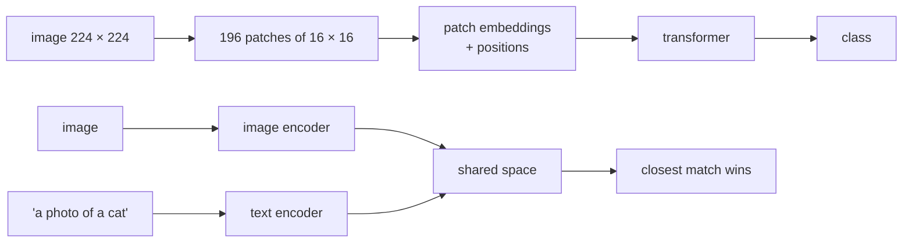

<!-- Written by `npm run lessons` from the lesson data in src/data. Edit the lesson there, not this page. -->

# Vision transformers and CLIP

**ML Foundations · Unit 4: Transformers and LLMs · Lesson 7 of 14**

> **In one line.** A vision transformer (ViT) cuts an image into patches and feeds them to a standard transformer as if they were tokens. CLIP trains an image encoder and a text encoder together, so that a picture and its caption get similar vectors.

[Open this lesson on the site](https://learn.hamropedia.com/foundations/vision-transformers-and-clip/) for its animation, the practice game and tap-to-explain words.

## The problem it solves

CNNs needed hand-designed structure for images, and every vision task needed its own labelled data. ViT showed the same transformer recipe works for images given enough data, unifying vision and language architectures. CLIP links the two worlds, so you can search photos with words, classify images with no task-specific training, and give language models eyes.

## The idea

A vision transformer (ViT) treats an image like a sentence. Cut the image into small patches, for example 16 × 16 pixels. Turn each patch into a vector, add positions, and run a normal transformer.

CLIP trains an image encoder and a text encoder together, so a picture and its caption land close together in the same embedding space. That lets you search images with text, and classify images with no task-specific training.

## How it works, step by step

1. Cut the image into a grid of patches, for example 16 × 16 pixels. A 224 × 224 image gives 14 × 14 = 196 patches.
2. Flatten each patch and map it to a d_model vector with one linear layer: the patch embedding.
3. Add position embeddings and (often) a special class token, then run ordinary transformer blocks. Read the class token (or the average) for the image's vector.
4. CLIP: an image encoder (a ViT) and a text encoder each map their input to a vector of the same size, normalised to length 1.
5. Train on huge numbers of image–caption pairs. In a batch of N pairs, compute the N × N matrix of similarities.
6. Contrastive loss: each image must pick its own caption out of the N (cross-entropy along each row), and each caption its own image (along each column).
7. Zero-shot classification: embed the image, embed texts like "a photo of a dog", and choose the most similar.

## Picture it



*Top: a ViT reads an image as a sequence of patches. Bottom: CLIP places images and captions in one space, so matching ones land close together.*

## Analogy

ViT reads a photo like a comic strip, panel by panel. CLIP is two translators, one for pictures and one for words, trained until they give the same 'meaning code' to a picture and its description.

**Where the analogy breaks.** Comic panels come in a set order. A ViT has no built-in sense of which patch sits next to which, so it must learn that from position embeddings. That is one reason ViTs need much more data than CNNs.

## Worked example

A 224 × 224 image cut into 16 × 16 patches gives 14 × 14 = 196 patches, so 196 'tokens'. For zero-shot classification, CLIP compares an image with texts like 'a photo of a cat' and 'a photo of a dog', and picks the closest.

```python
# CLIP's contrastive loss for a batch of N image-caption pairs
img = F.normalize(image_encoder(images), dim=-1)    # (N, d)
txt = F.normalize(text_encoder(captions), dim=-1)   # (N, d)
logits = img @ txt.T / temperature                   # (N, N)
targets = torch.arange(N)                             # true pairs sit on the diagonal
loss = (F.cross_entropy(logits, targets) + F.cross_entropy(logits.T, targets)) / 2
```

## Must know

- ViT = patches as tokens + a standard transformer.
- ViTs have fewer built-in assumptions than CNNs, so they need more data (or pretraining) to shine.
- CLIP puts images and text into one shared embedding space.
- Contrastive learning: pull matching pairs together and push mismatches apart.
- CLIP-style encoders power image search and give multimodal LLMs their vision input.

## Common mistakes

- Training a ViT from scratch on a small dataset and expecting it to beat a CNN.
- Forgetting position embeddings, so patch order is lost.
- Comparing unnormalised CLIP vectors with a raw dot product instead of cosine similarity.

> **Not true:** CLIP is trained on images that each carry a class label from a fixed list.  
> **In fact:** CLIP learns from pictures paired with their captions. No fixed list of classes is needed, which is why it can recognise new categories from a text description.

> **Not true:** A vision transformer trained from scratch on a small dataset beats a CNN.  
> **In fact:** A ViT has fewer built-in assumptions about images, so it needs far more data, or pretraining, to do well. On small data a CNN usually wins.

## Practise

Try each one yourself first: on paper, in code or out loud. Then open the answer and compare.

### 1. Derive

For a 224 × 224 RGB image with 16 × 16 patches, how many patches are there, and how long is each flattened patch vector?

<details>
<summary>Show one good answer</summary>

224 ÷ 16 = 14 patches along each side, so 14 × 14 = 196 patches.

Each patch is 16 × 16 pixels with 3 colour channels: 16 × 16 × 3 = 768 numbers when flattened.

So the image becomes a sequence of 196 "tokens", each a 768-number vector, which a linear layer then projects to the model width. (ViT-Base's width is also 768, a coincidence of these sizes.) Add one class token and the transformer sees 197 positions. Halving the patch size to 8 × 8 would give 784 patches: four times as many tokens, and about 16 times the attention cost.

</details>

### 2. Build

Build a small ViT in PyTorch (patchify, linear embedding, positions, class token, transformer blocks) and train it on CIFAR-10. Compare it with your CNN. Then use a pretrained CLIP model for zero-shot classification on a few classes.

<details>
<summary>Show one good answer</summary>

The small ViT: cut each 32 × 32 CIFAR image into 4 × 4 patches (64 patches of 48 numbers), project each to 128 dimensions, add a learned position embedding, put a learnable class token in front, run 4 pre-norm transformer blocks, and classify from the class token's output.

Trained for the same 2 epochs as the CNN in the convolution topic, it scores noticeably lower: about 48%, against the CNN's 60%. That is the expected result: a CNN has built-in assumptions that suit images (nearby pixels matter, the same pattern can appear anywhere), while a ViT has to learn them from data. ViTs win when trained on very large datasets.

Zero-shot CLIP: a pretrained CLIP turns the image and each label sentence, such as "a photo of a cat", into vectors in the same space; the label whose vector is closest wins. With no CIFAR training at all, it gets 92% of 200 test images right, far better than both models trained on CIFAR itself, because it learned from hundreds of millions of image–caption pairs. (The CLIP part downloads about 600 MB.)

```python
import torch
import torch.nn as nn
import torch.nn.functional as F
from torchvision import datasets
from transformers import CLIPModel, CLIPProcessor

train, test = datasets.CIFAR10("data", train=True, download=True), datasets.CIFAR10("data", train=False, download=True)
Xtr = torch.tensor(train.data).permute(0, 3, 1, 2).float() / 255.0
Xte = torch.tensor(test.data).permute(0, 3, 1, 2).float() / 255.0
ytr, yte = torch.tensor(train.targets), torch.tensor(test.targets)

class ViT(nn.Module):
    def __init__(self, patch=4, d=128, depth=4, heads=4, classes=10):
        super().__init__()
        self.patch, n = patch, (32 // patch) ** 2
        self.embed = nn.Linear(3 * patch * patch, d)
        self.cls = nn.Parameter(torch.zeros(1, 1, d))
        self.pos = nn.Parameter(torch.randn(1, n + 1, d) * 0.02)
        layer = nn.TransformerEncoderLayer(d, heads, 4 * d, dropout=0.0, batch_first=True, norm_first=True)
        self.blocks = nn.TransformerEncoder(layer, depth)
        self.head = nn.Sequential(nn.LayerNorm(d), nn.Linear(d, classes))
    def patchify(self, x):                                   # (B, 3, 32, 32) -> (B, 64, 48)
        p = self.patch
        x = x.unfold(2, p, p).unfold(3, p, p)                    # (B, 3, 8, 8, p, p)
        return x.permute(0, 2, 3, 1, 4, 5).reshape(x.shape[0], -1, 3 * p * p)
    def forward(self, x, shuffle=False):
        tokens = self.embed(self.patchify(x))
        if shuffle:                      # used by the Break answer: move the patches, keep the position numbers
            tokens = tokens[:, torch.randperm(tokens.shape[1])]
        tokens = torch.cat([self.cls.expand(len(x), -1, -1), tokens], dim=1) + self.pos
        return self.head(self.blocks(tokens)[:, 0])

def fit(model, X, y, epochs=2):
    opt = torch.optim.AdamW(model.parameters(), lr=1e-3)
    for _ in range(epochs):
        for idx in torch.randperm(len(X)).split(128):
            opt.zero_grad(); F.cross_entropy(model(X[idx]), y[idx]).backward(); opt.step()
    return model

torch.manual_seed(0)
vit = fit(ViT(), Xtr, ytr)
with torch.no_grad():
    print(f"ViT test accuracy: {(vit(Xte).argmax(1) == yte).float().mean().item():.1%}")

clip, proc = CLIPModel.from_pretrained("openai/clip-vit-base-patch32"), CLIPProcessor.from_pretrained("openai/clip-vit-base-patch32")
prompts = [f"a photo of a {name}" for name in test.classes]
images = [test[i][0] for i in range(200)]
with torch.no_grad():
    inputs = proc(text=prompts, images=images, return_tensors="pt", padding=True)
    guess = clip(**inputs).logits_per_image.argmax(dim=1)
print(f"CLIP zero-shot on 200 test images: {(guess == yte[:200]).float().mean().item():.0%}")
```

</details>

### 3. Break

Train your ViT on only 10% of CIFAR-10 and compare with the CNN again. Then shuffle the patch order at test time. What does each result tell you?

<details>
<summary>Show one good answer</summary>

With only 10% of the training data (5,000 images, 10 epochs), the CNN still wins, about 50% against the ViT's 41%. In this small run the gap did not grow compared with the full data (60% against 48%): at this tiny scale both models are short of data and training. The famous result needs much larger scales: the original ViT lost to ResNets when trained on ImageNet's 1.3 million images, and only won when pretrained on hundreds of millions. The reason is the trade-off worth remembering: a CNN's built-in assumptions (look at small neighbourhoods, reuse the same filter everywhere) are worth a lot when data is limited; a ViT must learn even "neighbouring pixels belong together" from examples, and wins only once there are enough of them. Small experiments don't always reproduce large-scale effects, which is itself a useful lesson.

Shuffling the patch order at test time (moving the patches but keeping the position numbers in place, so each patch gets the wrong position): accuracy drops from about 41% to about 30%, but not to chance (10%). The drop shows the model does use the position embeddings: once patches are moved, shapes are scrambled. That it stays well above chance shows a lot of its decision comes from the contents of the patches alone, colours and textures, a bag-of-patches view. (A subtle trap: shuffling the tokens after the position embeddings have been added changes nothing at all, because attention without positions is order-blind, as the positional-encoding topic shows.) (A CNN can't be "shuffled" like this, because position is built into how it slides its filters.)

```python
import torch
import torch.nn as nn
import torch.nn.functional as F
from torchvision import datasets

train, test = datasets.CIFAR10("data", train=True, download=True), datasets.CIFAR10("data", train=False, download=True)
Xtr = torch.tensor(train.data[:5000]).permute(0, 3, 1, 2).float() / 255.0      # 10% of the data
ytr = torch.tensor(train.targets[:5000])
Xte, yte = torch.tensor(test.data).permute(0, 3, 1, 2).float() / 255.0, torch.tensor(test.targets)

class ViT(nn.Module):
    def __init__(self, patch=4, d=128, depth=4, heads=4):
        super().__init__()
        self.patch = patch
        self.embed = nn.Linear(3 * patch * patch, d)
        self.cls = nn.Parameter(torch.zeros(1, 1, d))
        self.pos = nn.Parameter(torch.randn(1, (32 // patch) ** 2 + 1, d) * 0.02)
        layer = nn.TransformerEncoderLayer(d, heads, 4 * d, dropout=0.0, batch_first=True, norm_first=True)
        self.blocks, self.head = nn.TransformerEncoder(layer, depth), nn.Sequential(nn.LayerNorm(d), nn.Linear(d, 10))
    def forward(self, x, shuffle=False):
        p = self.patch
        x = x.unfold(2, p, p).unfold(3, p, p).permute(0, 2, 3, 1, 4, 5).reshape(len(x), -1, 3 * p * p)
        t = self.embed(x)
        if shuffle:                      # move the patches before positions are added
            t = t[:, torch.randperm(t.shape[1])]
        t = torch.cat([self.cls.expand(len(x), -1, -1), t], dim=1) + self.pos
        return self.head(self.blocks(t)[:, 0])

cnn = nn.Sequential(nn.Conv2d(3, 32, 3, padding=1), nn.ReLU(), nn.MaxPool2d(2),
                    nn.Conv2d(32, 64, 3, padding=1), nn.ReLU(), nn.MaxPool2d(2),
                    nn.Flatten(), nn.Linear(64 * 8 * 8, 10))
torch.manual_seed(0)
vit = ViT()
for model in (vit, cnn):
    opt = torch.optim.AdamW(model.parameters(), lr=1e-3)
    for _ in range(10):                                   # 10 epochs of the small set
        for idx in torch.randperm(5000).split(128):
            opt.zero_grad(); F.cross_entropy(model(Xtr[idx]), ytr[idx]).backward(); opt.step()
acc = lambda out: (out.argmax(1) == yte).float().mean().item()
with torch.no_grad():
    print(f"10% data: CNN {acc(cnn(Xte)):.1%}, ViT {acc(vit(Xte)):.1%}")
    print(f"ViT with patches shuffled: {acc(vit(Xte, shuffle=True)):.1%}")
```

</details>

### 4. Explain

Explain ViT and CLIP with the comic-strip and two-translators pictures.

<details>
<summary>Show one good answer</summary>

ViT reads a photo like a comic strip. It cuts the picture into a grid of small square panels, turns each panel into a vector, writes a panel number on each (the position), and then lets every panel look at every other panel with attention, just as a transformer does with words in a sentence. A special extra "summary" token gathers the whole story and makes the final decision.

CLIP is two translators trained side by side, one for pictures and one for sentences. Shown millions of photos with their captions, they are trained until the picture-translator and the sentence-translator give the same "meaning code" to a photo and its own caption, and different codes to mismatched pairs. After that, you can classify any image without training: write sentences like "a photo of a dog", translate them, and pick the one whose code is closest to the photo's.

</details>

## Check you understood

Answer in your head first, then open each one.

<details>
<summary>&lt;b>How does a ViT turn an image into tokens?&lt;/b></summary>

It cuts the image into patches, flattens each one and maps it to a vector with a linear layer.

</details>

<details>
<summary>&lt;b>What is CLIP trained to do?&lt;/b></summary>

Give a picture and its caption similar vectors, and mismatched pairs dissimilar ones.

</details>

<details>
<summary>&lt;b>How does CLIP classify an image it was never trained to classify?&lt;/b></summary>

It compares the image's vector with the vectors of text prompts such as "a photo of a cat" and picks the closest.

</details>

<details>
<summary>&lt;b>Why do ViTs usually need more data than CNNs?&lt;/b></summary>

They lack a CNN's built-in assumptions about local, shift-invariant patterns, so they must learn them from data.

</details>

## Go further (optional)

The lesson above is enough on its own. These free extras give a second explanation.

- READ · [Understanding Deep Learning, Ch 12 (transformers for images)](https://udlbook.github.io/udlbook/) · Simon Prince · free
- WATCH · [Vision Transformer explained, with code](https://www.youtube.com/results?search_query=Umar+Jamil+vision+transformer+explained) · Umar Jamil
- CODE · [OpenCLIP](https://github.com/mlfoundations/open_clip) · GitHub
- PAPER · [An Image is Worth 16x16 Words (ViT, 2020)](https://arxiv.org/abs/2010.11929) · Dosovitskiy et al. · arXiv
- PAPER · [Learning Transferable Visual Models From Natural Language Supervision (CLIP, 2021)](https://arxiv.org/abs/2103.00020) · Radford et al. · arXiv

---

[← Encoder models (BERT) vs decoder models (GPT)](encoder-models-bert-vs-decoder-models-gpt.md) · [All lessons](../../README.md) · [Sampling: greedy, temperature, top-k, top-p →](sampling-greedy-temperature-top-k-top-p.md)
