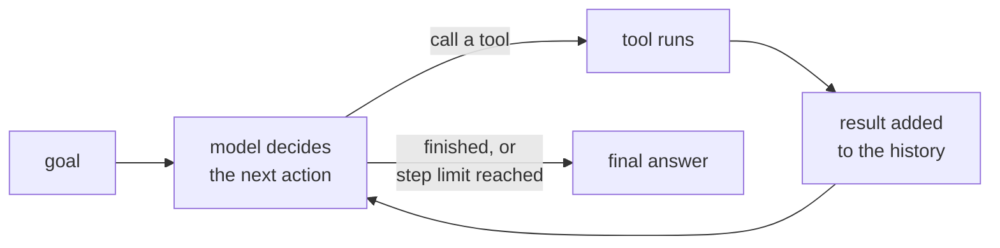

<!-- Written by `npm run lessons` from the lesson data in src/data. Edit the lesson there, not this page. -->

# Agents and tool use

**ML Foundations · Unit 5: AI engineering · Lesson 8 of 16**

> **In one line.** An agent is an LLM running in a loop. It decides an action (usually a tool call), sees the result, and decides again, until the task is done or a limit is reached.

[Open this lesson on the site](https://learn.hamropedia.com/foundations/agents-and-tool-use/) for its animation, the practice game and tap-to-explain words.

## The problem it solves

Many tasks need several steps whose order isn't known in advance: look something up, calculate, check, try again. A single prompt can't do that. Agents let a model plan and adapt as results come in. They are powerful, but they fail in new ways — loops, wrong tools, compounding errors — so they need limits, logging and evaluation.

## The idea

An agent is a model in a loop. It chooses an action, such as calling a search tool or a calculator, sees the result, and chooses again until the task is done.

## How it works, step by step

1. Give the model a goal, a list of tools with clear descriptions, and instructions on when to stop.
2. Think: the model decides what to do next and outputs a tool call (or a final answer).
3. Act: your code runs the tool, with checks and permissions.
4. Observe: the tool's result is added to the context.
5. Loop until the model gives a final answer, or a step, time or cost limit is hit.
6. Handle errors: return tool errors to the model so it can recover, and stop if it repeats itself.
7. Log every step, and evaluate both the final answers and the paths taken.

## Picture it



*An agent is a model in a loop: act, look at the result, decide again — with a step limit so it can't loop forever.*

## Analogy

A new assistant with a phone and a laptop, working through a task step by step.

**Where the analogy breaks.** A human assistant notices when they are going in circles. Agents can loop, call the wrong tool, or trust a bad result, so they need step limits, logging and evaluation.

## Worked example

"How many days from 3 March to the 2026 ML conference?" The agent calls search("ML conference 2026 date") and sees "12 June 2026". It then calls a date calculator for 3 March to 12 June, gets 101 days, decides it is done, and answers "101 days". Two tool calls, each result fed back in before the next decision.

```python
# pseudo-code
while steps < 10:
    action = llm(history)
    if action.type == "final":
        break
    result = tools[action.name](**action.args)
    history.append(result)
    steps += 1
```

## Must know

- Agent = model + tools + loop + stopping rules.
- Start with the simplest workflow that works; use open-ended agents only when the steps can't be fixed in advance.
- Step limits, timeouts and budgets are essential.
- Errors compound over steps: a 95%-reliable step repeated 10 times succeeds about 60% of the time.
- Tool descriptions and good error messages strongly affect behaviour.
- Risky actions, such as sending an email or spending money, need a person to confirm them first.

## Common mistakes

- No step limit, so a confused agent loops forever.
- Hiding tool errors instead of returning them, so the agent can't recover.
- Too many overlapping tools, so it can't choose.
- Using an agent where a fixed pipeline would be simpler and more reliable.

> **Not true:** Hiding tool errors from the model helps an agent stay on track.  
> **In fact:** An agent can only recover from an error it can see. Return the error message as the tool's result, so that it can try something else.

> **Not true:** An agent needs no step limit: it stops by itself when the task is done.  
> **In fact:** A confused agent can loop for ever, spending money on every step. Step limits, timeouts and budgets are essential.

## Practise

Try each one yourself first: on paper, in code or out loud. Then open the answer and compare.

### 1. Derive

Write the agent loop in pseudo-code from memory, with a step limit and error handling.

<details>
<summary>Show one good answer</summary>

messages = [the user's task]  
for step in 1 .. MAX_STEPS:                  # always a hard limit  
    response = model(messages, tools)  
    add response to messages  
    if response has no tool calls:  
        return response.text                    # the model is done  
    results = []  
    for each tool call in response:  
        if tool name is unknown or not allowed:  
            result = error("unknown tool")  
        else:  
            try:  
                result = run the tool with its inputs, with a timeout  
            except an error:  
                result = error(short, useful message)   # tell the model; don't crash  
        log(step, tool, inputs, result, time)  
        results.append(result, matched to the call's id)  
    add all results to messages in one user turn  
    if the same call with the same inputs repeats 3 times:  
        add "You are repeating yourself. Try something else or stop and explain."  
return "Stopped: step limit reached" plus what was done so far

The parts interviewers look for: the step limit, errors returned to the model as results (so it can recover), every tool result matched to its call, logging, and a clear ending when it can't finish.

</details>

### 2. Build

Build an agent with 2 tools, a calculator and a search over your documents. Log every step.

<details>
<summary>Show one good answer</summary>

Two tools: a calculator (it evaluates arithmetic safely by walking the expression tree, never with eval) and search_docs, which calls the RAG app's retrieve(). The loop follows the pseudo-code: call the model with the tools, run every tool call, return each result as a "tool" message with the matching tool_call_id, and stop when the model stops calling tools or after 8 steps. Every step is printed: which tool, with what input, what came back.

Ask it "How many more samples does the wine data have than the iris data?" and it answers 28. But read the log: on the local qwen2.5:7b it went straight to the calculator with 178 − 150 and never searched, because these two datasets are famous and the model already knew the counts. That is a real lesson about agents: a model happily answers from memory instead of your documents. For company data, tell it to use search_docs for any fact about the documents, and test it with facts it can't possibly know, such as an internal number, to check it really searches.

```python
import ast
import json
import operator
from llm import ask, text_of
from rag import CHUNKS, VECTORS, retrieve

OPS = {ast.Add: operator.add, ast.Sub: operator.sub, ast.Mult: operator.mul, ast.Div: operator.truediv,
       ast.Pow: operator.pow, ast.USub: operator.neg}

def calculator(expression):
    def walk(node):
        if isinstance(node, ast.Constant) and isinstance(node.value, (int, float)):
            return node.value
        if isinstance(node, ast.BinOp) and type(node.op) in OPS:
            return OPS[type(node.op)](walk(node.left), walk(node.right))
        if isinstance(node, ast.UnaryOp) and type(node.op) in OPS:
            return OPS[type(node.op)](walk(node.operand))
        raise ValueError("only numbers and + - * / ** are allowed")
    return str(walk(ast.parse(expression, mode="eval").body))

def search_docs(query):
    return "\n\n".join(c["text"][:400] for c in retrieve(query, CHUNKS, VECTORS, k=2))

def tool(name, description, argument):
    return {"type": "function", "function": {"name": name, "description": description, "parameters": {
        "type": "object", "properties": {argument: {"type": "string"}}, "required": [argument]}}}

TOOLS = [tool("calculator", "Evaluate an arithmetic expression, e.g. '178 - 150'.", "expression"),
         tool("search_docs", "Search the dataset documentation. Returns the most relevant passages.", "query")]
RUN = {"calculator": lambda a: calculator(a["expression"]), "search_docs": lambda a: search_docs(a["query"])}

def agent(task, max_steps=8):
    messages = [{"role": "user", "content": task}]
    for step in range(1, max_steps + 1):
        reply = ask(messages=messages, tools=TOOLS)
        messages.append(reply["message"])
        if not reply["tool_calls"]:
            return text_of(reply)
        for call in reply["tool_calls"]:
            name = call["function"]["name"]
            try:
                result = RUN[name](json.loads(call["function"]["arguments"]))
            except Exception as e:                       # tell the model, don't crash
                result = f"Error: {e}"
            print(f"step {step}: {name}({call['function']['arguments']}) -> {result[:80]!r}")
            messages.append({"role": "tool", "tool_call_id": call["id"], "content": result})
    return "Stopped: step limit reached."

print(agent("How many more samples does the wine data have than the iris data?"))
```

</details>

### 3. Break

Give the agent a task it cannot finish, and a tool that returns an error. Does it loop? Does it recover? Add a fix for each.

<details>
<summary>Show one good answer</summary>

An impossible task ("find the price of the Iris dataset", which isn't in the documents): a careless agent keeps searching with slightly different words, step after step. Without a step limit it can loop until you kill it, using up your free quota (or money, on a paid API). With the limit it stops, but only with "step limit reached", which helps nobody.

A tool that returns an error: if the error is a vague crash (or an exception that kills the loop), the agent either stops dead or repeats the same failing call. If the error comes back as a tool_result marked is_error, with a short, useful message ("search is down; try again later or answer from what you have"), a good model adapts: it retries once, or explains that it couldn't check.

Fixes, one per failure: a hard step limit and a budget; a repeat detector that notices the same call with the same input and tells the model to change approach or stop; errors returned as results with a clear message, never thrown away; and an instruction in the system prompt: "If the information isn't available after a couple of searches, say so and stop." Then add both cases to your agent's test set.

```python
import json
from collections import Counter

class LoopGuard:
    """Notices when an agent repeats the same tool call, and says what to do instead."""
    def __init__(self, limit=2):
        self.seen, self.limit = Counter(), limit
    def check(self, name, tool_input):
        key = (name, json.dumps(tool_input, sort_keys=True))
        self.seen[key] += 1
        if self.seen[key] > self.limit:
            return ("You have already made this exact call. Do not repeat it. Either try a different "
                    "approach, or stop and explain what you could not find.")
        return None

def run_tool_safely(fn, tool_input):
    try:
        return fn(**tool_input), False
    except Exception as e:
        return f"Error from tool: {e}. You can retry once, or answer with what you have.", True

guard = LoopGuard()
for _ in range(4):
    warning = guard.check("search_docs", {"query": "price of the iris dataset"})
print(warning)

def broken_search(query):
    raise TimeoutError("search service did not respond in 5 s")
print(run_tool_safely(broken_search, {"query": "wine"}))
```

</details>

### 4. Explain

Explain agents with the new-assistant picture, and name their main ways of failing.

<details>
<summary>Show one good answer</summary>

An agent is like a new assistant with a phone and a laptop, working through a task step by step. You give them a goal ("book me a meeting room for Thursday"), and they decide what to do next: check the calendar, call reception, compare options, until the job is done. Each step's result shapes the next one. In software, the model chooses the next action, your code runs the tool, the result goes back to the model, and that repeats.

Their main ways of failing are the same as a new assistant's: going round in circles (repeating the same search), giving up too late or never (no step limit), misusing a tool (wrong inputs, the wrong tool), believing bad information (an error or an injected instruction in a tool's output), and small mistakes early that grow into big ones, because every step builds on the last. That is why agents need limits, logs and checks.

</details>

## Check you understood

Answer in your head first, then open each one.

<details>
<summary>&lt;b>What are the steps of the agent loop?&lt;/b></summary>

Think (choose an action), act (run the tool), observe (add the result to the context), repeat until done or a limit is reached.

</details>

<details>
<summary>&lt;b>Why do agents need step limits?&lt;/b></summary>

They can get stuck repeating actions or chasing a wrong path, wasting time and money.

</details>

<details>
<summary>&lt;b>Each step works 95% of the time. Roughly how often does a 10-step task fully succeed?&lt;/b></summary>

About 0.95¹⁰ ≈ 60%. Errors compound, so long agent runs need checks.

</details>

<details>
<summary>&lt;b>When is a fixed workflow better than an agent?&lt;/b></summary>

When the steps are known in advance: it is cheaper, faster and easier to test.

</details>

## Go further (optional)

The lesson above is enough on its own. These free extras give a second explanation.

- READ · [Building effective agents](https://www.anthropic.com/engineering/building-effective-agents) · Anthropic  
  **Worth it:** Clear diagrams of the main patterns, from simple workflows to full agents, with advice on when each is worth it. The best starting point for building agents.
- READ · [LLM Powered Autonomous Agents](https://lilianweng.github.io/posts/2023-06-23-agent/) · Lilian Weng
- READ · AI Engineering, Ch 6 (the agents half) · Chip Huyen · book you own

---

[← Evaluation: test sets, LLM-as-judge, error analysis](evaluation-test-sets-llm-as-judge-error-analysis.md) · [All lessons](../../README.md) · [MCP: connecting models to tools and data →](mcp-connecting-models-to-tools-and-data.md)
