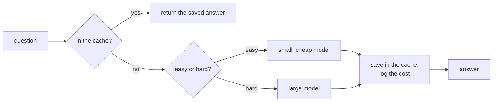

<!-- Written by `npm run lessons` from the lesson data in src/data. Edit the lesson there, not this page. -->

# Caching, model routing and cost control

**ML Foundations · Unit 5: AI engineering · Lesson 13 of 16**

> **In one line.** Cost control for LLM apps uses caching (reuse answers or processed prompts), routing (send easy requests to cheaper models) and budgets (limits, timeouts and per-request cost tracking).

[Open this lesson on the site](https://learn.hamropedia.com/foundations/caching-model-routing-and-cost-control/) for its animation, the practice game and tap-to-explain words.

## The problem it solves

LLM costs scale with every token and every user, and the biggest model is often far more than most requests need. Without control, a successful product can become unaffordable, and slow. Caching and routing commonly cut costs by large factors with little or no loss in quality, if you measure that quality.

## The idea

LLM apps can get slow and expensive fast. There are three main tools. Caching reuses answers, or processed prompts, you have already paid for. Routing sends easy requests to a small, cheap model and only hard ones to a big model. Budgets limit tokens, set timeouts and track the cost of every request.

## How it works, step by step

1. Exact cache: store answers keyed by the exact request; a repeat costs nothing.
2. Semantic cache: match new questions to stored ones by embedding similarity, with a strict threshold and an expiry time.
3. Prompt caching: providers can reuse the processed form of a long, unchanging prompt prefix, making repeated calls cheaper and faster. Keep stable content (instructions, documents) at the start.
4. Routing: a rule or small classifier sends easy requests to a small model and hard ones to a large model.
5. The saving from routing is roughly (share routed) × (1 − cost ratio): 70% of traffic at a tenth of the price saves about 63%.
6. Budgets: cap tokens per request, set timeouts, and log the cost of every request.
7. Check quality on your eval set before and after, so savings don't hide worse answers.

## Picture it



*Repeats come from the cache for free; easy questions go to the cheap model; only hard ones pay for the big model.*

## Analogy

A help desk. Common questions get a ready-made answer sheet (the cache). Simple questions go to a junior (the small model), hard ones to a senior (the big model).

**Where the analogy breaks.** A help desk knows when two questions are really the same. A semantic cache matches questions by meaning, so it can return a wrong answer for a question that only looks similar. Use a strict similarity threshold and an expiry time.

## Worked example

If 70% of questions can be handled by a model that costs a tenth as much, routing them there cuts the bill by about 63%: 0.7 × 0.9 = 0.63.

```python
def answer(question):
    if (hit := cache.get(normalise(question))):
        return hit
    model = SMALL if classify_difficulty(question) == "easy" else LARGE
    reply = call(model, question, max_tokens=400, timeout=20)
    cache.set(normalise(question), reply, ttl_hours=24)
    log_cost(model, reply.usage)
    return reply
```

## Must know

- Cache what repeats; route what is easy; cap what is unbounded.
- Semantic caches can return wrong answers for questions that only look similar.
- Prompt caching rewards stable prompt prefixes.
- Track cost per request and per user.
- Every cost optimisation needs a quality check.

## Common mistakes

- A semantic cache threshold so loose that different questions share answers.
- Caching personalised or time-sensitive answers, so one user is shown another's answer, or yesterday's facts.
- Routing hard questions to the small model without measuring.
- Putting changing content at the start of the prompt, which defeats prompt caching.

> **Not true:** Routing only affects cost, so hard questions can go to the small model without checking.  
> **In fact:** Routing affects quality too: a hard question sent to a weak model gets a worse answer. Measure the quality of each route before relying on it.

> **Not true:** A semantic cache can safely store any answer, including personal ones.  
> **In fact:** A cached personal answer can be shown to a different user, and a cached fact can go out of date. Cache only what is the same for everyone and slow to change.

## Practise

Try each one yourself first: on paper, in code or out loud. Then open the answer and compare.

### 1. Derive

Your app gets 50,000 questions a day. The big model costs 10 times the small one, 30% of questions are exact repeats, and 60% of the rest are easy. Estimate the saving from a cache plus a router, compared with sending everything to the big model.

<details>
<summary>Show one good answer</summary>

50,000 questions a day. Price the small model at 1 unit and the big one at 10.

Without anything: 50,000 × 10 = 500,000 units.

With a cache: 30% are exact repeats, so 15,000 are answered from the cache, at almost no cost. 35,000 still need a model.  
With a router on those: 60% are easy, so 21,000 go to the small model (21,000 units) and 14,000 to the big one (140,000 units).

Total: 161,000 units, about 32% of the original. A saving of about 68%.

The router contributes more than the cache here, because 60% of the remaining traffic goes 10 times cheaper. Two cautions: the router itself has a cost (a small classifier call per question), and every misrouted hard question to the small model risks a worse answer, so the saving only counts if quality holds on your evals.

```python
total = 50_000
cached = 0.30 * total
rest = total - cached
cost = 0.60 * rest * 1 + 0.40 * rest * 10
print(cost, total * 10, f"saving {1 - cost / (total * 10):.0%}")   # 161000.0 500000 saving 68%
```

</details>

### 2. Build

Add an exact-match cache, a semantic cache and a two-model router to your RAG app. Log cost and latency per request, and compare quality on your eval set before and after.

<details>
<summary>Show one good answer</summary>

Three layers in front of the RAG answer, cheapest first. The exact cache: normalise the question (lower-case, collapse spaces) and look it up in a dictionary. The semantic cache: embed the question and reuse a stored answer if a past question is very similar (cosine above a high threshold, 0.95 here). The router: a cheap check decides "easy" or "hard"; here a simple rule (short, single-fact questions are easy), and in production often a small classifier or a small model. Easy questions go to a small model on your own computer (llama3.2:3b through Ollama: free and unlimited), hard ones to the big model at the top of the free chain. Every request is logged with which path it took, its latency and its tokens.

With paid APIs the same router is how companies cut their bill; with free tiers it saves your rate limits and time. Then run the eval set through the old and new pipelines and compare quality next to tokens and speed. Keep the change only if quality is within your tolerance. The cache answers here are only as fresh as their source; give entries an expiry time and clear them when the documents change.

```python
import re
import time
import numpy as np
from rag import CHUNKS, VECTORS, retrieve, build_prompt, embedder
from llm import ask, text_of, PROVIDERS

SMALL = [("Ollama", "http://localhost:11434/v1/chat/completions", None, "llama3.2:3b")]   # local, free
BIG = PROVIDERS                                            # the big model at the top of the free chain
exact_cache, semantic_keys, semantic_values, log = {}, [], [], []

def is_easy(question):
    return len(question.split()) <= 12 and not re.search(r"\b(compare|why|explain|which .* more)\b", question, re.I)

def answer(question, threshold=0.95):
    start = time.perf_counter()
    key = re.sub(r"\s+", " ", question.lower()).strip()
    tokens = 0
    if key in exact_cache:
        text, path = exact_cache[key], "exact cache"
    else:
        q = embedder.encode([question], normalize_embeddings=True)[0]
        sims = np.array(semantic_keys) @ q if semantic_keys else np.array([])
        if len(sims) and sims.max() >= threshold:
            text, path = semantic_values[int(sims.argmax())], "semantic cache"
        else:
            reply = ask(build_prompt(question, retrieve(question, CHUNKS, VECTORS)),
                        providers=SMALL if is_easy(question) else BIG)
            text, path = text_of(reply), f"{reply['provider']} {reply['model']}"
            tokens = reply["input_tokens"] + reply["output_tokens"]
            exact_cache[key] = text; semantic_keys.append(q); semantic_values.append(text)
    log.append({"q": question, "path": path, "ms": round((time.perf_counter() - start) * 1000), "tokens": tokens})
    return text

for q in ["How many instances are in the wine dataset?", "how many instances are in the wine dataset?",
          "How many instances does the wine dataset have?", "Why is the iris dataset famous, compared with others?"]:
    answer(q)
for row in log:
    print(row)
```

</details>

### 3. Break

Lower the semantic-cache threshold until it returns wrong answers. Then make the router send a hard question to the small model. How would your evals catch each problem?

<details>
<summary>Show one good answer</summary>

Lower the semantic-cache threshold and it starts returning answers to different questions. Pairs like "Can I cancel my order?" and "How do I cancel my account?", or "How many samples are in the wine data?" and "How many features are in the wine data?", are very similar to an embedding model (in the run below, around 0.6 to 0.9) but need different answers. At a threshold of 0.95 they are kept apart; at 0.8 or 0.7 several of them are wrongly treated as the same question, and the user silently gets the cached answer to someone else's question.

Send a hard question to the small model (one that needs combining two sources, or careful reasoning) and the answer is more likely to be wrong, but it still looks fluent and confident.

How evals catch each: for the cache, an eval set of near-duplicate question pairs with different correct answers, run through the cache path, plus monitoring how often cached answers get thumbs-down. For the router, scoring quality separately for each route (accuracy on questions sent to the small model versus the big one), plus a sample of small-model answers re-graded regularly. An average score over everything can hide both problems.

```python
from sentence_transformers import SentenceTransformer

model = SentenceTransformer("all-MiniLM-L6-v2")
pairs = [("Can I cancel my order?", "How do I cancel my account?"),
         ("How many samples are in the wine data?", "How many features are in the wine data?"),
         ("What is the refund time for UK orders?", "What is the refund time for US orders?"),
         ("How many instances are in the wine dataset?", "How many instances does the wine dataset have?")]
for a, b in pairs:
    va, vb = model.encode([a, b], normalize_embeddings=True)
    sim = float(va @ vb)
    reuse = [t for t in (0.95, 0.9, 0.8, 0.7) if sim >= t]
    print(f"{sim:.2f}  reused at thresholds {reuse}:  {a!r} vs {b!r}")
# only the last pair really is the same question
```

</details>

### 4. Explain

Explain caching and routing with the help-desk picture.

<details>
<summary>Show one good answer</summary>

A help desk. The most common questions get a ready-made answer sheet, so whoever is asked just hands it over: that is the cache, instant and free. Simple new questions go to a junior colleague, who is quick and costs less: the small model. Hard ones are passed to a senior expert, who is slower and expensive: the big model. Someone at the front decides who gets which question: the router.

It works only if the answer sheets are still correct (they go out of date), the sheets are only handed out for truly the same question (not just a similar-sounding one), and the person at the front doesn't send hard questions to the junior to save money. That is what you check with evals.

</details>

## Check you understood

Answer in your head first, then open each one.

<details>
<summary>&lt;b>What is the difference between an exact cache and a semantic cache?&lt;/b></summary>

An exact cache needs the identical request; a semantic cache matches requests with similar meaning, which saves more but can be wrong.

</details>

<details>
<summary>&lt;b>70% of traffic can go to a model costing a tenth as much. Roughly what is saved?&lt;/b></summary>

About 0.7 × 0.9 = 63% of the cost.

</details>

<details>
<summary>&lt;b>How do you structure a prompt to benefit from prompt caching?&lt;/b></summary>

Put the stable parts (instructions, long shared documents) first and the changing parts (the user's question) last.

</details>

<details>
<summary>&lt;b>How do you make sure cost cuts didn't hurt quality?&lt;/b></summary>

Run the eval set before and after the change and compare.

</details>

## Go further (optional)

The lesson above is enough on its own. These free extras give a second explanation.

- READ · [Prompt caching](https://docs.claude.com/en/docs/build-with-claude/prompt-caching) · Claude docs
- READ · AI Engineering, Ch 10 (AI engineering architecture: caches, routers and gateways) · Chip Huyen · book you own
- READ · AI Engineering, Ch 9 (inference optimisation) · Chip Huyen · book you own
- PAPER · [RouteLLM: Learning to Route LLMs with Preference Data (2024)](https://arxiv.org/abs/2406.18665) · Ong et al. · arXiv

---

[← Serving: APIs, Docker, latency and cost](serving-apis-docker-latency-and-cost.md) · [All lessons](../../README.md) · [Observability: tracing and debugging LLM apps →](observability-tracing-and-debugging-llm-apps.md)
