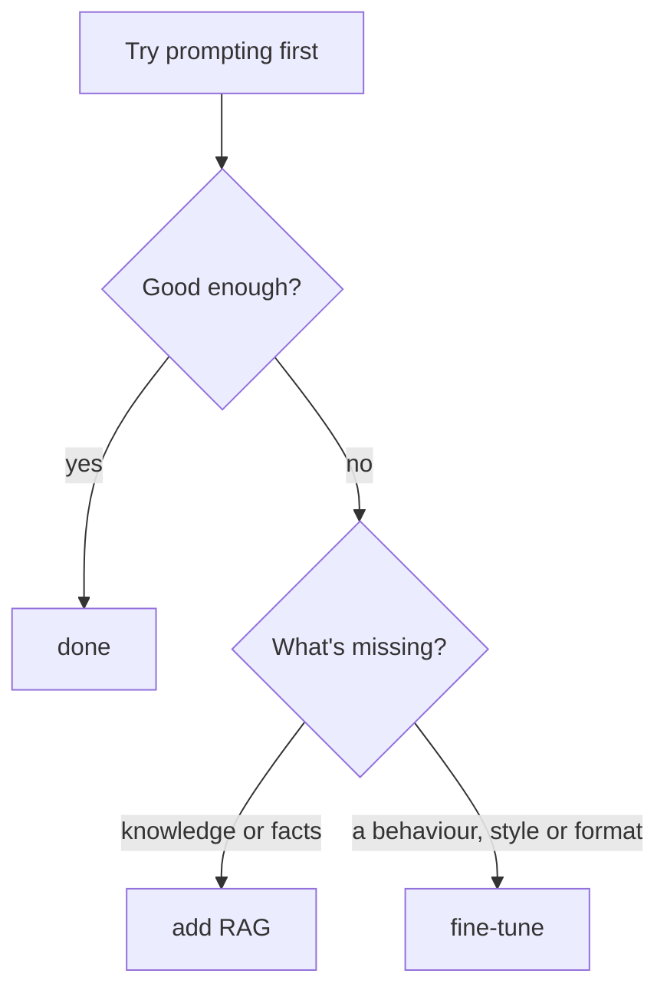

<!-- Written by `npm run lessons` from the lesson data in src/data. Edit the lesson there, not this page. -->

# Choosing between prompting, RAG and fine-tuning

**ML Foundations · Unit 5: AI engineering · Lesson 10 of 16**

> **In one line.** Prompting, RAG and fine-tuning are three ways to adapt an LLM: prompting changes the instructions, RAG supplies knowledge at question time, and fine-tuning changes the model's weights to change its behaviour.

[Open this lesson on the site](https://learn.hamropedia.com/foundations/choosing-between-prompting-rag-and-fine-tuning/) for its animation, the practice game and tap-to-explain words.

## The problem it solves

Teams often jump to fine-tuning when a better prompt or retrieval would do, wasting weeks, or try to prompt their way around missing knowledge. Choosing the right tool — or the right combination — saves cost and time and gives better results.

## The idea

Try in this order. Prompting first, because it is cheapest. RAG when the model needs knowledge it does not have. Fine-tuning when it needs a new behaviour, style or format that prompts cannot give reliably.

## How it works, step by step

1. Start with prompting: clear instructions and examples. Measure on your eval set.
2. If the model lacks knowledge (your documents, recent or per-user facts), add RAG or a lookup tool.
3. If it has the knowledge but won't reliably follow a behaviour, style or format despite good prompts and examples, consider fine-tuning.
4. Fine-tuning can also make a small model do one narrow task as well as a large one, cutting cost and latency.
5. Combine them when needed: a fine-tuned model that follows your format can still use RAG for facts.
6. Re-measure after each step, and stop as soon as quality is good enough.

## Picture it



*Start with the cheapest option. Missing facts point to RAG; missing behaviour points to fine-tuning.*

## Analogy

A new employee. First give instructions (the prompt). Give them the company handbook for facts (RAG). Send them on a training course to change how they work (fine-tuning).

**Where the analogy breaks.** Training courses are a poor way to learn facts that change often, and fine-tuning is too. Use RAG for changing knowledge.

## Worked example

'Answer from our 2026 price list' → RAG. 'Always reply in our strict legal-letter format' → prompt first, and fine-tune only if it keeps failing.

## Must know

- Order: prompt → RAG (knowledge) → fine-tune (behaviour).
- RAG for facts that change or are private; fine-tuning is poor at storing facts.
- Fine-tuning for format, style, tone and narrow skills.
- Fine-tuning needs data, evals and maintenance; prompts are instant to change.
- Prompting, RAG and fine-tuning are not exclusive: many systems use all three together.

## Common mistakes

- Fine-tuning to add knowledge that changes weekly.
- Fine-tuning before trying a good prompt with examples.
- Using RAG to fix a formatting problem.
- Not measuring, so the "improvement" is a guess.

> **Not true:** RAG: the tool for fixing the format of a model's answers.  
> **In fact:** RAG supplies knowledge. Format, style and tone are behaviour: fix them with a better prompt and examples first, and with fine-tuning if that is not enough.

> **Not true:** First thing to try when answers fall short: fine-tuning.  
> **In fact:** Start with a good prompt and examples: a prompt is instant to change. Add RAG for knowledge, and fine-tune only if the behaviour is still wrong.

## Practise

Try each one yourself first: on paper, in code or out loud. Then open the answer and compare.

### 1. Derive

Choose prompting, RAG or fine-tuning for each case, and say why: answering from company policies; always replying in strict JSON; writing in a company's tone; answering about yesterday's news.

<details>
<summary>Show one good answer</summary>

Answering from company policies: RAG. The facts live in documents that change, answers must be up to date and should cite the policy. Fine-tuning would bake in a snapshot and can't reliably store facts.

Always replying in strict JSON: structured outputs, which is a prompting-level feature, not fine-tuning. The API can enforce the schema directly. (Fine-tuning only for a model or provider that can't do this.)

Writing in a company's tone: prompting first (a style guide and a few examples of real writing). If that isn't consistent enough at scale, fine-tuning, because tone is behaviour, which is what fine-tuning is good at.

Answering about yesterday's news: RAG, or a search tool. The model's training stopped long before yesterday, and the news changes daily; you need fresh retrieval, never fine-tuning.

The pattern: knowledge that changes → retrieval; format → structured outputs; behaviour and style → prompting, then fine-tuning.

</details>

### 2. Build

Take one task. Try prompting first, then RAG. Measure both with your eval harness and write a one-paragraph decision.

<details>
<summary>Show one good answer</summary>

Use the same eval harness for both, so the comparison is fair. "Prompting only" sends the question with no documents; "RAG" retrieves three chunks first. Same model, same questions, same judge.

On this task RAG wins clearly: without documents the model can only answer what it happens to remember (it knows famous facts, like the 178 wine samples, but not the details only the documents contain), so it guesses or declines on those; with RAG it answers and cites. A one-paragraph decision might read: "Prompting alone scored 4/6 (measured on the local qwen2.5:7b): it knew the famous figures but missed the two that only the documents contain. RAG scored 6/6 with citations, for about 1,500 extra input tokens per question. We choose RAG. Fine-tuning isn't needed: the failures were missing knowledge, not behaviour."

The habit matters more than this result: decide with numbers from the same eval, and write the reason down.

```python
from llm import ask, text_of
from evals import run_eval, summary
from rag import CHUNKS, VECTORS, answer

def prompting_only(q):
    return text_of(ask(f"{q}\nIf you don't know, say \"I don't know\".")), []

def with_rag(q):
    return answer(q, CHUNKS, VECTORS)[:2]

for name, fn in [("prompting only", prompting_only), ("RAG", with_rag)]:
    print(f"--- {name}")
    summary(run_eval(fn))
```

</details>

### 3. Break

Try to teach the model new facts by fine-tuning on a few examples, then ask about them in different words. How well did it learn them?

<details>
<summary>Show one good answer</summary>

Fine-tune on a handful of examples that state a new fact, such as "Q: Who founded Northcode? A: Priya Shah, in 2019", then ask in different words: "Which person started Northcode?", "When was Northcode set up?", "Priya Shah founded which company?".

The usual result: the model repeats the fact well when asked in almost the same words as the training examples, and much less reliably when the question is rephrased, asked in reverse (from the name to the company), or combined with another fact. It may also become more confident about related facts it was never taught, and invent them. Teaching facts reliably by fine-tuning needs many varied phrasings of each fact, and even then it is fragile and hard to update.

That is the core reason for the advice: fine-tune for behaviour (format, tone, a narrow skill), and use retrieval for facts. A fact in a document can be changed in a second and cited; a fact in the weights can't.

</details>

### 4. Explain

Explain the order of choices with the new-employee picture.

<details>
<summary>Show one good answer</summary>

Think of how you would get a new employee working well. First, give clear instructions: that is prompting, and it is cheap, quick and often enough. If they keep lacking information, give them the company handbook to look things up: that is RAG, for facts that live in documents and change. Only if they need to work differently, in a new style or a new skill that instructions can't produce, do you send them on a training course: that is fine-tuning, which is slower, costs more and needs good training examples.

You go in that order, and only move to the next step when you can show the earlier one isn't enough, with the same test used each time.

</details>

## Check you understood

Answer in your head first, then open each one.

<details>
<summary>&lt;b>The model must answer from your 2026 price list. Which approach?&lt;/b></summary>

RAG: it is knowledge the model doesn't have, and it changes.

</details>

<details>
<summary>&lt;b>The model keeps breaking a strict output format despite examples. Next step?&lt;/b></summary>

Consider fine-tuning on good examples of the format (after checking structured-output features).

</details>

<details>
<summary>&lt;b>Why not fine-tune facts into the model?&lt;/b></summary>

Fine-tuning stores facts unreliably, can't be updated quickly, and gives no sources.

</details>

<details>
<summary>&lt;b>Can RAG and fine-tuning be used together?&lt;/b></summary>

Yes: fine-tune for behaviour or format and use RAG for the facts.

</details>

## Go further (optional)

The lesson above is enough on its own. These free extras give a second explanation.

- READ · AI Engineering, Ch 7 (finetuning: when to finetune) · Chip Huyen · book you own
- READ · [Patterns for Building LLM-based Systems & Products](https://eugeneyan.com/writing/llm-patterns/) · Eugene Yan

---

[← MCP: connecting models to tools and data](mcp-connecting-models-to-tools-and-data.md) · [All lessons](../../README.md) · [Dataset engineering for fine-tuning →](dataset-engineering-for-fine-tuning.md)
