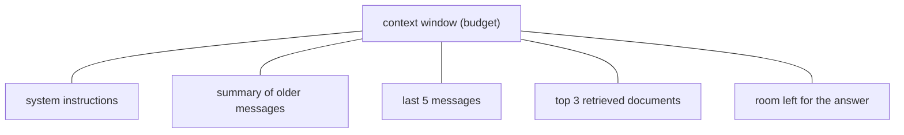

<!-- Written by `npm run lessons` from the lesson data in src/data. Edit the lesson there, not this page. -->

# Context engineering: long context and memory

**ML Foundations · Unit 5: AI engineering · Lesson 6 of 16**

> **In one line.** Context engineering is choosing exactly what goes into the model's context window on each call: instructions, examples, retrieved documents, history and tool results. The aim is to give it what it needs and nothing that distracts it.

[Open this lesson on the site](https://learn.hamropedia.com/foundations/context-engineering-long-context-and-memory/) for its animation, the practice game and tap-to-explain words.

## The problem it solves

Context windows are large but not free: every token adds cost and delay, and models use information buried in the middle of very long inputs less reliably. Long chats and agents keep adding history and tool output. Deciding what to keep, summarise or drop is now one of the main skills in building reliable LLM apps.

## The idea

Context engineering means deciding exactly what goes into the model's context window on each call: instructions, examples, retrieved documents, conversation history and tool results. More is not always better. Models use information in the middle of very long inputs less reliably, and every token costs time and money. For long conversations you summarise or store old turns and bring back only what matters. That is 'memory'.

## How it works, step by step

1. Set a token budget for the window: instructions, examples, retrieved documents, history, and room for the answer.
2. Keep instructions and the key examples stable at the start (which also makes prompt caching effective).
3. Retrieve only the most relevant documents, ranked, rather than everything that might help.
4. For long conversations, keep the last few turns word for word and replace older ones with a running summary.
5. Store long-term facts (user preferences, decisions) outside the context and bring them back only when relevant: memory.
6. Trim tool outputs to what matters, such as the 5 relevant rows rather than the whole table.
7. Place the most important material near the start or the end, and test with "needle in a haystack" checks at the sizes you actually use.

## Picture it



*Context engineering is packing the window on purpose: only what this call needs, with room left for the reply.*

## Analogy

Packing a small suitcase for a trip. You can't bring your whole wardrobe, so you choose what this trip needs.

**Where the analogy breaks.** A suitcase has a hard limit you can feel. A context window can hold a lot, so the danger is quieter: stuffing it full makes answers worse and slower without any error message.

## Worked example

A support bot with a 200-message history keeps the system instructions, a short running summary, the last 5 messages and the 3 most relevant documents. It does not send all 200 messages.

```python
context = [
    system_prompt,
    summary_of_older_turns,          # refreshed every few turns
    *last_messages[-5:],
    *top_k_documents(question, k=3),
]
assert count_tokens(context) < TOKEN_BUDGET
```

## Must know

- More context is not always better: quality, speed and cost can all get worse.
- Information in the middle of long contexts is used less reliably ("lost in the middle").
- Summaries plus retrieval scale better than whole histories.
- Every token is billed and adds latency.
- Agents need context management most, because tool results add up fast.

## Common mistakes

- Sending the entire history and every retrieved document by default.
- Assuming that fitting in the window means the model will use all of it.
- Leaving no room for the answer.
- Summarising away details the user will ask about later.

> **Not true:** Filling the whole context window with documents still leaves the model room to answer.  
> **In fact:** The answer has to fit in the same window. If the input fills it, the reply is cut short, so keep space free for the output.

> **Not true:** If a document fits in the context window, the model will use all of it.  
> **In fact:** Models use the start and the end of a long context best. Information in the middle is used less reliably ("lost in the middle").

## Practise

Try each one yourself first: on paper, in code or out loud. Then open the answer and compare.

### 1. Derive

Write a token budget for a 16,000-token window: how many tokens for instructions, examples, retrieved documents, history and the answer? Justify each number.

<details>
<summary>Show one good answer</summary>

A 16,000-token window, for a RAG assistant:

• Instructions (system prompt): 800. Role, rules, citation format, what to do when the answer is missing. Short and stable, so it caches well.  
• Examples: 1,200. Two short examples of a good cited answer. More examples give diminishing returns.  
• Retrieved documents: 8,000. About 8 chunks of 1,000 tokens. The biggest share, because the answer must come from here, but not all of it: more chunks add noise.  
• Conversation history: 2,500. The last few turns in full, older turns as a short summary.  
• The question itself: 500.  
• The answer: 2,000 reserved for output, so a long answer is never cut off.  
• Safety margin: 1,000, because token counts vary and some messages are longer than expected.

Total: 16,000. The principle: reserve space for the answer first, keep the fixed parts small, and spend most of the budget on the evidence. Then measure: if answers improve with 5 chunks rather than 8, give the space back.

</details>

### 2. Build

Build a 'needle in a haystack' test: hide one fact at different positions in a long document and ask for it. Plot accuracy against position and document length.

<details>
<summary>Show one good answer</summary>

Hide one fact (the needle), such as "The secret ingredient in Grandma's sauce is cardamom", at different depths (0%, 25%, 50%, 75%, 100% of the way through) in filler text of different lengths, then ask the model for it, and record whether the answer contains "cardamom". The filler here is Shakespeare, so the needle clearly doesn't belong.

Plot the result as a grid: length down the side, depth across the top. Modern long-context models usually find a single, distinctive needle almost everywhere; the test becomes informative when you make it harder: several needles, a needle phrased differently from the question, or a fact that must be combined with another one. Accuracy then typically drops for facts in the middle of long inputs, the "lost in the middle" effect.

It makes 15 calls, the longest about 40,000 tokens, which uses a good part of a free tier's per-minute token limit: start with the short lengths. If the chain falls back to your local Ollama model, give it a long enough context window (start Ollama with OLLAMA_CONTEXT_LENGTH=32768), otherwise it silently drops the start of long prompts and the needle with it, which is a lesson in itself. Run on qwen2.5:7b with Ollama's default context, the needle was found at every depth in 2,000 words, but in 8,000 and 30,000 words only when it was at the very end: everything before the last few thousand tokens had been cut, with no error.

```python
import os
import urllib.request
import matplotlib.pyplot as plt
import numpy as np
from llm import ask, text_of

path = "data/shakespeare.txt"
if not os.path.exists(path):
    os.makedirs("data", exist_ok=True)
    urllib.request.urlretrieve("https://raw.githubusercontent.com/karpathy/char-rnn/master/data/tinyshakespeare/input.txt", path)
filler = open(path, encoding="utf-8").read().split()
NEEDLE = "The secret ingredient in Grandma's sauce is cardamom."
lengths, depths = [2_000, 8_000, 30_000], [0.0, 0.25, 0.5, 0.75, 1.0]
grid = np.zeros((len(lengths), len(depths)))
for i, n in enumerate(lengths):
    for j, depth in enumerate(depths):
        words = filler[:n]
        words.insert(int(depth * n), NEEDLE)
        prompt = " ".join(words) + "\n\nWhat is the secret ingredient in Grandma's sauce? Answer in one word."
        grid[i, j] = "cardamom" in text_of(ask(prompt)).lower()
print(grid)
plt.imshow(grid, vmin=0, vmax=1, cmap="RdYlGn")
plt.xticks(range(len(depths)), [f"{d:.0%}" for d in depths]); plt.yticks(range(len(lengths)), lengths)
plt.xlabel("needle depth"); plt.ylabel("words of filler"); plt.show()
```

</details>

### 3. Break

Give your RAG app 3, 10 and 50 retrieved chunks for the same questions. Measure accuracy, latency and cost. When does more context start to hurt?

<details>
<summary>Show one good answer</summary>

Run the same questions with 3, 10 and 50 retrieved chunks, recording whether each answer is right, how long it took, and the input tokens.

The usual shape of the result: going from 3 to 10 chunks helps on questions whose evidence was ranked 4th to 10th, so accuracy rises a little. Going to 50 adds little or nothing to accuracy, and often loses some: the right chunk is now one of fifty, sometimes in the middle, and similar-but-wrong chunks distract the model. Meanwhile tokens and latency grow roughly in proportion to the context: on a big corpus, 50 chunks send about 15 times as many tokens as 3. On a paid API that is the bill; on free tiers it uses up your per-minute token limit 15 times faster.

More context starts to hurt as soon as the extra chunks are mostly irrelevant, which on a well-ranked retriever is usually after the first handful. Better ranking (a re-ranker) plus a small k beats a huge k. On this small corpus, 50 chunks is simply everything (all 10 chunks).

A real run on the local qwen2.5:7b showed a second trap: 3 chunks got 5 of 5 right, but 10 and 50 chunks got only 3 of 5, and both sent exactly the same 2,050 input tokens. The local model's default context window had silently cut the longer prompts, dropping the instructions at the top. Always look at the input token count your provider reports, and size the context window for your longest prompt.

```python
import time
from rag import CHUNKS, VECTORS, answer

QA = [("How many instances are in the wine dataset?", "178"), ("Who created the iris dataset?", "Fisher"),
      ("How many patients are in the diabetes data?", "442"), ("What size are the digit images?", "8x8"),
      ("What is the maximum proline in wine?", "1680")]
for k in [3, 10, 50]:
    right = tokens = 0
    start = time.perf_counter()
    for q, expected in QA:
        text, sources, reply = answer(q, CHUNKS, VECTORS, k=min(k, len(CHUNKS)))
        right += expected.lower() in text.lower()
        tokens += reply["input_tokens"]
    seconds = (time.perf_counter() - start) / len(QA)
    print(f"k = {k:2d}: {right}/{len(QA)} right, {seconds:.1f} s and {tokens // len(QA):,} input tokens per question")
```

</details>

### 4. Explain

Explain context engineering with the suitcase picture.

<details>
<summary>Show one good answer</summary>

You are packing a small suitcase for a trip. You can't bring your whole wardrobe, so you choose what this particular trip needs: the right clothes for the weather, in the right amounts, packed so you can find them. Over-pack, and you can't find anything, or the zip won't close.

The model's context window is the suitcase. Context engineering is choosing what goes in for this request: the instructions, a couple of examples, the most relevant documents, the parts of the conversation that still matter (older parts summarised), and room left for the answer. Stuffing in everything you have makes the model slower, more expensive, and often worse, because what matters gets buried.

</details>

## Check you understood

Answer in your head first, then open each one.

<details>
<summary>&lt;b>Why can a longer prompt give a worse answer?&lt;/b></summary>

Relevant facts get diluted by irrelevant text, and facts in the middle of long contexts are used less reliably.

</details>

<details>
<summary>&lt;b>How do you keep a 200-message chat within budget?&lt;/b></summary>

Keep the instructions, a running summary of older turns, the last few messages, and only the relevant retrieved documents.

</details>

<details>
<summary>&lt;b>What is "memory" in an LLM app?&lt;/b></summary>

Information stored outside the context (facts, preferences, past decisions) and retrieved back into the prompt when relevant.

</details>

<details>
<summary>&lt;b>How do you test long-context reliability?&lt;/b></summary>

Hide a known fact at different positions in documents of different lengths and measure how often the model finds it.

</details>

## Go further (optional)

The lesson above is enough on its own. These free extras give a second explanation.

- READ · [Effective context engineering for AI agents](https://www.anthropic.com/engineering/effective-context-engineering-for-ai-agents) · Anthropic  
  **Worth it:** A practical guide to treating context as a limited budget: what to keep, compact, retrieve just in time, and hand to sub-agents. Written for building real agents.
- READ · AI Engineering, Ch 5 (context length and context efficiency) · Chip Huyen · book you own
- PAPER · [Lost in the Middle: How Language Models Use Long Contexts (2023)](https://arxiv.org/abs/2307.03172) · Liu et al. · arXiv

---

[← RAG: chunking, retrieval and re-ranking](rag-chunking-retrieval-and-re-ranking.md) · [All lessons](../../README.md) · [Evaluation: test sets, LLM-as-judge, error analysis →](evaluation-test-sets-llm-as-judge-error-analysis.md)
