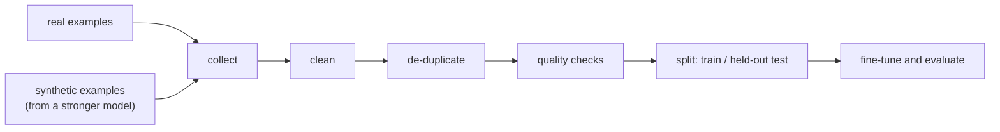

<!-- Written by `npm run lessons` from the lesson data in src/data. Edit the lesson there, not this page. -->

# Dataset engineering for fine-tuning

**ML Foundations · Unit 5: AI engineering · Lesson 11 of 16**

> **In one line.** Dataset engineering is designing, collecting, cleaning and checking the examples you fine-tune on, because a fine-tuned model learns exactly what its data shows, mistakes included.

[Open this lesson on the site](https://learn.hamropedia.com/foundations/dataset-engineering-for-fine-tuning/) for its animation, the practice game and tap-to-explain words.

## The problem it solves

When you fine-tune, the data is the product. A few hundred excellent, varied examples often beat thousands of messy ones, and every bad example — rude, wrong, duplicated — is actively taught. Most fine-tuning failures are data failures, so the data deserves most of the effort.

## The idea

When you fine-tune, the dataset is the product. Dataset engineering means deciding which examples you need, collecting or generating them, cleaning and de-duplicating them, and checking their quality. A few hundred excellent examples often beat thousands of messy ones. Synthetic data, written by a stronger model, is common, but it must be checked.

## How it works, step by step

1. Define the target behaviour precisely, with a few ideal examples written by hand.
2. Collect candidates: real historical data, human-written examples, and synthetic examples from a stronger model.
3. Remove exact and near duplicates.
4. Filter for quality with rules, a model-based grader and human review of a sample. Drop wrong, rude, outdated or off-policy examples.
5. Balance across topics and difficulty, so common cases don't drown out rare ones.
6. Format every example in the model's chat template, consistently.
7. Hold back a test set the model never trains on, and check that no test example leaks into training.

## Picture it



*The dataset is the product: every bad example that survives this pipeline gets taught to the model.*

## Analogy

Training a new chef with recipe cards. A small box of correct, varied recipes teaches more than a huge pile full of typos, repeats and burnt examples.

**Where the analogy breaks.** A chef can spot a bad recipe and ignore it. A model copies whatever is in the data, mistakes included, so every bad example is actively taught.

## Worked example

For a support-reply model, 400 real tickets with the best human replies, de-duplicated, balanced across topics, with 50 held back for testing, beats 5,000 unfiltered replies that include rude or wrong ones.

```python
seen, clean = set(), []
for ex in examples:
    key = normalise(ex["prompt"])             # lowercase, strip spaces
    if key in seen or not passes_checks(ex):   # drop duplicates and bad rows
        continue
    seen.add(key)
    clean.append(ex)
train, test = split(clean, test_size=0.1, seed=0)
```

## Must know

- For a fine-tuning dataset, quality and variety beat quantity: a few hundred clean, varied examples beat thousands of messy ones.
- Synthetic data is useful but must be filtered and checked.
- De-duplicate, balance and hold out a clean test set.
- Read samples of the final dataset yourself.
- Version datasets like code, so results can be reproduced.

## Common mistakes

- Training on raw logs without filtering.
- Test examples leaking into training, so scores lie.
- Synthetic data that copies the generator's mistakes and style.
- Formatting the examples inconsistently, so the model learns the mess as well as the task.

> **Not true:** Raw production logs make a good fine-tuning set just as they are.  
> **In fact:** Logs contain wrong, rude and outdated answers, and every one of them would be taught to the model. Filter and check the examples first.

> **Not true:** Thousands of similar examples beat a few hundred varied ones.  
> **In fact:** For fine-tuning, quality and variety beat quantity. A few hundred clean, varied examples teach more than thousands of near-copies.

## Practise

Try each one yourself first: on paper, in code or out loud. Then open the answer and compare.

### 1. Derive

Design a dataset for fine-tuning a model to write short, friendly replies to customer emails: the fields, how many examples, what counts as 'good', and what you hold back for testing.

<details>
<summary>Show one good answer</summary>

Fields for each example: the customer's email (input), the ideal reply (output), and metadata, such as the topic (delivery, refund…), the customer's mood (calm, angry), the source (real, edited, generated) and who approved it.

How many: 300 to 1,000 good examples is often enough for a style task. Coverage matters more than size: every common topic, every mood, short and long emails, and the hard cases (angry customers, requests you must refuse, missing order numbers).

What counts as "good", written down so labellers agree: short (under about 120 words); friendly, but not gushing; answers the actual question; never promises what the policy doesn't allow; asks for missing information; no invented facts (order numbers, dates); signed the standard way.

Held back for testing: 10 to 20% of examples, chosen before any training, never edited afterwards, and kept apart by customer and email thread, so near-duplicates can't leak across. Also keep a small set of tricky cases written separately, to catch regressions the random split misses.

</details>

### 2. Build

Create 200 training examples, some real and some generated by a stronger model. De-duplicate and filter them, fine-tune a small model with LoRA, and compare it with the base model on your held-out set.

<details>
<summary>Show one good answer</summary>

The data part is most of the work. Combine real and generated examples, then clean them: normalise whitespace and remove exact and near-duplicates (same text after lower-casing), then filter by rules from the derive step: word count, a greeting, no banned phrases, no rude words. Split into train and test before training, by thread, so nothing leaks.

The training part uses Hugging Face transformers and peft for LoRA on a small open model (Qwen2.5-0.5B-Instruct here), trained only on the reply tokens. The fair comparison is the held-out set, scored the same way for both models: here, the average loss on the ideal replies (lower means the model finds good replies more likely); in a real project, also an LLM judge with your rubric, and a person reading samples.

Without a GPU this is slow: try a tiny model first by setting BASE_MODEL, then switch to the real one. The generated examples here are a stand-in list; in practice you would ask a stronger model to draft them and review each one.

```python
import os
import random
import re
import torch
from peft import LoraConfig, get_peft_model
from transformers import AutoModelForCausalLM, AutoTokenizer

BASE_MODEL = os.environ.get("BASE_MODEL", "Qwen/Qwen2.5-0.5B-Instruct")

real = [("Where is my order 5512? It's late.", "Hi Sam, sorry it's late! Order 5512 left our warehouse yesterday and should reach you by Friday. Thanks for your patience, Ana"),
        ("I want a refund for the broken mug.", "Hi Jo, I'm sorry the mug arrived broken. I've started your refund; you'll see it in 3-5 days. Best, Ana")]
generated = [("Can I change my delivery address?", "Hi there, yes! Reply with your new address and order number and I'll update it today. Best, Ana"),
             ("Can I change my delivery address?", "Hi there, yes! Reply with your new address and order number and I'll update it today. Best, Ana"),
             ("Do you deliver on Sundays?", "No.")]
BANNED = re.compile(r"\b(stupid|calm down|not my problem)\b", re.I)

def clean(pairs):
    seen, kept = set(), []
    for email, reply in pairs:
        key = re.sub(r"\s+", " ", (email + "|" + reply).lower()).strip()
        if key in seen:
            continue                                            # duplicate
        words = len(reply.split())
        if not (8 <= words <= 120) or not reply.lower().startswith("hi") or BANNED.search(reply):
            continue                                            # breaks the "good reply" rules
        seen.add(key); kept.append((email, reply))
    return kept

data = clean(real * 50 + generated * 50)
random.seed(0); random.shuffle(data)
cut = int(0.8 * len(data))
train, test = data[:cut], data[cut:]
print(f"{len(data)} examples after cleaning: {len(train)} train, {len(test)} test")

tok = AutoTokenizer.from_pretrained(BASE_MODEL)
tok.pad_token = tok.pad_token or tok.eos_token

def encode(email, reply):
    prompt = f"Customer email: {email}\nReply:"
    p, r = tok(prompt)["input_ids"], tok(" " + reply + tok.eos_token)["input_ids"]
    return torch.tensor([p + r]), torch.tensor([[-100] * len(p) + r])      # learn the reply only

def held_out_loss(model):
    model.eval()
    with torch.no_grad():
        return sum(model(input_ids=x, labels=y).loss.item() for x, y in map(lambda e: encode(*e), test)) / len(test)

base = AutoModelForCausalLM.from_pretrained(BASE_MODEL)
print(f"base model held-out loss: {held_out_loss(base):.3f}")
lora_cfg = LoraConfig(r=8, lora_alpha=16, lora_dropout=0.05, target_modules="all-linear", task_type="CAUSAL_LM")
model = get_peft_model(base, lora_cfg)
model.print_trainable_parameters()
opt = torch.optim.AdamW([p for p in model.parameters() if p.requires_grad], lr=2e-4)
model.train()
for epoch in range(2):
    for email, reply in train:
        x, y = encode(email, reply)
        loss = model(input_ids=x, labels=y).loss
        opt.zero_grad(); loss.backward(); opt.step()
print(f"fine-tuned held-out loss: {held_out_loss(model):.3f}")
```

</details>

### 3. Break

Put 20% bad examples (wrong or rude replies) into the training set and fine-tune again. How much worse does it get? Then leak test examples into training and see how the score lies.

<details>
<summary>Show one good answer</summary>

With 20% bad examples (wrong facts, rude or curt replies), the fine-tuned model learns them too: it doesn't know which examples are mistakes. Typically its average quality drops noticeably, and, worse, it becomes inconsistent: most replies are fine, but some fraction is rude or wrong, and you can't predict which. A few bad examples can teach a behaviour that no amount of good ones fully cancels, especially if they are memorable (a rude phrase). That is why filtering and review matter more than volume.

Leaking test examples into training makes the score lie. The model has seen those exact emails and replies, so on the "held-out" set its loss falls sharply and the judge rates it highly, but that is memorisation. On genuinely new emails it does no better than before. Leaks often happen by accident: the same email thread in both sets, near-duplicates that differ by a name, or generated examples that copy test emails. Defend with a split made first, by thread or customer, deduplication across the split (including near-duplicates), and a final check on brand-new data.

</details>

### 4. Explain

Explain why data quality beats quantity, with the recipe-cards picture.

<details>
<summary>Show one good answer</summary>

Training a new chef with recipe cards. A small box of correct, varied recipes, each one tested, teaches far more than a huge pile full of typos, duplicates and a few burnt disasters written down as if they were good. The chef copies whatever is on the cards, including the mistakes, and can't tell which cards were wrong.

Fine-tuning works the same way: the model learns the patterns in its examples, good and bad alike. A thousand clean, varied, reviewed examples usually beat ten thousand messy ones, and a few bad ones can teach a habit you really don't want.

</details>

## Check you understood

Answer in your head first, then open each one.

<details>
<summary>&lt;b>Why can 400 examples beat 5,000?&lt;/b></summary>

If the 400 are clean, correct and varied while the 5,000 include errors and duplicates, the model learns the right behaviour instead of copying the mistakes.

</details>

<details>
<summary>&lt;b>Why de-duplicate?&lt;/b></summary>

Repeated examples are over-weighted and memorised, and duplicates across splits make test scores look better than they are.

</details>

<details>
<summary>&lt;b>What is the risk of synthetic data?&lt;/b></summary>

It can be wrong, repetitive or copy the generating model's quirks, so it needs filtering and checking.

</details>

<details>
<summary>&lt;b>Why hold out a test set before training?&lt;/b></summary>

To measure honestly on examples the model has never seen.

</details>

## Go further (optional)

The lesson above is enough on its own. These free extras give a second explanation.

- READ · AI Engineering, Ch 8 (dataset engineering) · Chip Huyen · book you own
- PAPER · [LIMA: Less Is More for Alignment (2023)](https://arxiv.org/abs/2305.11206) · Zhou et al. · arXiv
- PAPER · [Self-Instruct: aligning language models with self-generated instructions (2022)](https://arxiv.org/abs/2212.10560) · Wang et al. · arXiv

---

[← Choosing between prompting, RAG and fine-tuning](choosing-between-prompting-rag-and-fine-tuning.md) · [All lessons](../../README.md) · [Serving: APIs, Docker, latency and cost →](serving-apis-docker-latency-and-cost.md)
