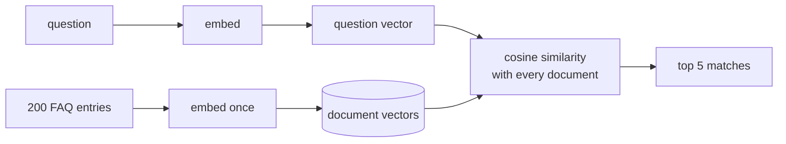

<!-- Written by `npm run lessons` from the lesson data in src/data. Edit the lesson there, not this page. -->

# Embeddings and semantic search

**ML Foundations · Unit 5: AI engineering · Lesson 3 of 16**

> **In one line.** Semantic search finds texts with similar meaning by turning texts into embedding vectors and returning the ones whose vectors are closest to the query's vector.

[Open this lesson on the site](https://learn.hamropedia.com/foundations/embeddings-and-semantic-search/) for its animation, the practice game and tap-to-explain words.

## The problem it solves

Keyword search fails when users and documents use different words for the same thing: "can't sign in" versus "forgot my login". Embedding-based search matches meaning, which makes help centres, document search and RAG far better. It is also the retrieval half of almost every LLM application.

## The idea

An embedding model turns text into a vector. Texts with similar meaning get similar vectors, even with different words. Search means: embed the question, then find the closest document vectors with cosine similarity.

## How it works, step by step

1. Choose an embedding model (a text encoder). It maps any text to a fixed-length vector, for example 384 or 1,024 numbers.
2. Embed every document (or chunk) once, ahead of time, and store the vectors, usually normalised to length 1.
3. At query time, embed the query with the same model.
4. Score each document by cosine similarity with the query: with unit vectors, that is just a dot product.
5. Return the top k documents. A matrix multiply scores thousands of documents in one step.
6. For exact terms (codes, names), combine with keyword search such as BM25: hybrid search, merging the two rankings.

## Picture it



*Documents are embedded once in advance; each question is embedded and compared by meaning, not by exact words.*

## Analogy

A library shelved by topic, not by title. 'How do I reset my password' sits next to 'I forgot my login'.

**Where the analogy breaks.** Meaning-based search can miss exact things like product codes or names. That is why many systems combine it with keyword search (hybrid search).

## Worked example

A help centre embeds 200 FAQ entries. The query "can't sign in" is embedded the same way. The closest vectors are "I forgot my login", "reset my password" and "locked out of account", though none of them shares a word with the query. A search for the code "SKU-4471" fails semantically, so a keyword index is added alongside.

```python
D = doc_vecs / np.linalg.norm(doc_vecs, axis=1, keepdims=True)
q = q_vec / np.linalg.norm(q_vec)
top5 = np.argsort(-(D @ q))[:5]
```

## Must know

- Same model for documents and queries, always.
- Cosine similarity: 1 = same direction, 0 = unrelated.
- Normalise vectors once, then dot products are cosine similarities.
- Semantic search handles synonyms and paraphrases; keyword search handles exact strings. Hybrid gets both.
- Quality depends heavily on the embedding model and on how documents are chunked.

## Common mistakes

- Mixing embeddings from different models. Each model has its own space, so their vectors can't be compared.
- Relying on semantic search alone for product codes, IDs and names.
- Embedding whole long documents as one vector, so specific details are blurred.
- Not evaluating retrieval separately from the final answer.

> **Not true:** Semantic search is reliable for exact product codes, IDs and names.  
> **In fact:** Embeddings capture meaning, not exact strings, so a code like SKU-4471 can be missed. Combine semantic search with keyword search for those.

> **Not true:** A whole long document is best embedded as one vector.  
> **In fact:** One vector for a long document blurs its details into an average. Split the document into chunks and embed each chunk.

## Practise

Try each one yourself first: on paper, in code or out loud. Then open the answer and compare.

### 1. Derive

One pair of unit vectors has cosine similarity 0.9, another has 0.1. What does each say about the texts? Compute the angle for each.

<details>
<summary>Show one good answer</summary>

For unit vectors, cosine similarity is the cosine of the angle between them.

Similarity 0.9: angle = arccos(0.9) ≈ 25.8°. The vectors point in nearly the same direction, so the texts are close in meaning, for example a question and a paraphrase of it.

Similarity 0.1: angle = arccos(0.1) ≈ 84.3°. Almost at right angles, so the texts are basically unrelated.

Two cautions. What counts as "high" depends on the embedding model: with some models even unrelated texts score 0.6 or more, so compare scores within one model rather than using a fixed number. And similarity measures closeness in meaning as the model learned it, not truth: "the drug is safe" and "the drug is not safe" can score very high.

```python
import numpy as np
for c in [0.9, 0.1]:
    print(c, round(np.degrees(np.arccos(c)), 1), "degrees")   # 25.8 and 84.3
```

</details>

### 2. Build

Embed 200 FAQ entries with an embedding model. Build search in NumPy that returns the top 5 for a question.

<details>
<summary>Show one good answer</summary>

Embed every FAQ question once with a sentence-embedding model, normalise the vectors to length 1, and keep them in a NumPy array. For a new question, embed it the same way; because everything has length 1, the dot product with every stored vector is the cosine similarity, and np.argsort gives the top 5.

The search finds answers by meaning: "I forgot my login" finds "How do I reset my password?", although they share no words. The list here has 16 entries; the same code works unchanged for 200 or 20,000. The model (all-MiniLM-L6-v2) is free, small (about 90 MB) and runs on a laptop.

```python
import numpy as np
from sentence_transformers import SentenceTransformer

FAQ = [
    "How do I reset my password?", "How can I change my email address?", "Where is my order?",
    "How long does delivery take?", "Can I return an item?", "How do refunds work?",
    "Do you ship abroad?", "How do I cancel my order?", "Can I pay with PayPal?",
    "Why was my card declined?", "How do I delete my account?", "Do you have gift cards?",
    "Error E-4071 when paying with Apple Pay", "How do I use a discount code?",
    "Is my personal data safe?", "Can I change my delivery address after ordering?",
]
model = SentenceTransformer("all-MiniLM-L6-v2")
index = model.encode(FAQ, normalize_embeddings=True)          # (16, 384), each of length 1

def search(question, k=5):
    q = model.encode([question], normalize_embeddings=True)[0]
    scores = index @ q                                         # cosine similarities
    best = np.argsort(-scores)[:k]
    return [(FAQ[i], round(float(scores[i]), 3)) for i in best]

for question in ["I forgot my login", "my parcel hasn't come", "send it to my new flat instead"]:
    print(question, "->", search(question)[:3])
```

</details>

### 3. Break

Search for a product code or a rare name. Does semantic search find it? Add keyword search and combine the two scores.

<details>
<summary>Show one good answer</summary>

Search for an exact code. In a list this small, semantic search may still put the right entry first for "error E-2210 on checkout", but look at the scores: it is judging by look-alike tokens, not by knowing what E-2210 is. The real failure shows with a code that isn't in the FAQ: "E-4072" returns the E-4071 entry as its best match, which is a different error. The embedding model has no meaning for codes, product numbers or rare names, so it matches them loosely to anything that looks similar.

The fix is hybrid search: add a keyword score that rewards exact token matches (BM25 in real systems; a simple token-overlap score here), and combine the two rankings. Reciprocal rank fusion is the standard simple combiner: each result scores 1/(60 + its rank) in each list it appears in, and the scores are added, so exact matches rise to the top while meaning-based matches still work for normal questions. Keyword search also lets you notice when a code has no exact match at all, so the app can say "I couldn't find error E-4072" instead of confidently answering about E-4071.

```python
import re
import numpy as np
from sentence_transformers import SentenceTransformer

FAQ = ["How do I reset my password?", "Where is my order?", "Why was my card declined?",
       "Error E-4071 when paying with Apple Pay", "Error E-2210 when saving your address",
       "How do I use a discount code?", "Can I pay with PayPal?"]
model = SentenceTransformer("all-MiniLM-L6-v2")
index = model.encode(FAQ, normalize_embeddings=True)
tokens = lambda s: set(re.findall(r"[a-z0-9-]+", s.lower()))

def semantic_ranking(q):
    return list(np.argsort(-(index @ model.encode([q], normalize_embeddings=True)[0])))

def keyword_ranking(q):
    overlap = np.array([len(tokens(q) & tokens(doc)) for doc in FAQ])
    return [i for i in np.argsort(-overlap, kind="stable") if overlap[i] > 0]   # only real matches

def hybrid(q, k=3):
    score = np.zeros(len(FAQ))
    for ranking in (semantic_ranking(q), keyword_ranking(q)):
        for rank, i in enumerate(ranking):
            score[i] += 1 / (60 + rank)                      # reciprocal rank fusion
    return [FAQ[i] for i in np.argsort(-score)[:k]]

def exact_codes_missing(q):
    codes = [t for t in tokens(q) if re.fullmatch(r"[a-z]+-\d+", t)]
    return [c for c in codes if not any(c in tokens(doc) for doc in FAQ)]

for q in ["error E-2210 on checkout", "E-4072"]:
    q_vec = model.encode([q], normalize_embeddings=True)[0]
    top = semantic_ranking(q)[:2]
    print(q, "| semantic:", [(FAQ[i], round(float(index[i] @ q_vec), 2)) for i in top])
    print("   hybrid:", hybrid(q)[:2], "| codes with no exact match:", exact_codes_missing(q))
```

</details>

### 4. Explain

Explain semantic search with the library-shelved-by-topic picture.

<details>
<summary>Show one good answer</summary>

Imagine a library shelved by topic instead of by title. "How do I reset my password?" sits right next to "I forgot my login", because they are about the same thing, even though they share no words. To search, you walk to the shelf where your question would belong and look at what is there.

An embedding model is the librarian who decides where everything goes: it turns each text into a position (a vector), placing similar meanings close together. Semantic search embeds your question and returns the nearest texts. A keyword index is the old card catalogue, and you still want it for exact things such as product codes, which the topic shelves don't understand.

</details>

## Check you understood

Answer in your head first, then open each one.

<details>
<summary>&lt;b>Why can "can't sign in" find "I forgot my login"?&lt;/b></summary>

The embedding model maps texts with similar meaning to nearby vectors, even when they share no words.

</details>

<details>
<summary>&lt;b>Your vectors are normalised. How do you compute cosine similarity?&lt;/b></summary>

With a plain dot product.

</details>

<details>
<summary>&lt;b>Why add keyword search?&lt;/b></summary>

Embeddings capture meaning but can miss exact strings like codes or rare names; keywords catch those.

</details>

<details>
<summary>&lt;b>What must stay the same between indexing and querying?&lt;/b></summary>

The embedding model (and any text preprocessing).

</details>

## Go further (optional)

The lesson above is enough on its own. These free extras give a second explanation.

- READ · [Embeddings: What they are and why they matter](https://simonwillison.net/2023/Oct/23/embeddings/) · Simon Willison  
  **Worth it:** A clear, practical tour of embeddings with real examples of related-content search, clustering and code. The best single read on using them.
- WATCH · [Cosine Similarity, Clearly Explained](https://www.youtube.com/results?search_query=StatQuest+Cosine+Similarity%2C+Clearly+Explained) · StatQuest (Josh Starmer)
- READ · [Semantic Search](https://sbert.net/examples/sentence_transformer/applications/semantic-search/README.html) · Sentence Transformers docs

---

[← Structured outputs and function calling](structured-outputs-and-function-calling.md) · [All lessons](../../README.md) · [Vector databases and approximate nearest-neighbour search →](vector-databases-and-approximate-nearest-neighbour-search.md)
