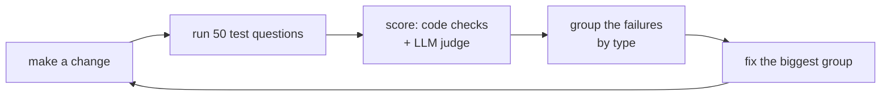

<!-- Written by `npm run lessons` from the lesson data in src/data. Edit the lesson there, not this page. -->

# Evaluation: test sets, LLM-as-judge, error analysis

**ML Foundations · Unit 5: AI engineering · Lesson 7 of 16**

> **In one line.** Evaluation measures whether an LLM system does its job. It uses a fixed test set of real inputs, automatic checks or judges for scoring, and careful reading of the failures to find what to fix.

[Open this lesson on the site](https://learn.hamropedia.com/foundations/evaluation-test-sets-llm-as-judge-error-analysis/) for its animation, the practice game and tap-to-explain words.

## The problem it solves

LLM apps change constantly — prompts, models, retrieval settings — and every change can quietly break something else. Without evals you are guessing from a few hand-picked examples. A good eval set turns "it feels better" into a number you can compare, and error analysis tells you which fix will help most.

## The idea

Evaluation tells you whether a change made your system better or worse. Build a test set of real inputs with expected results. Score with code checks where you can, and with an LLM judge where you must. Most important: read the failures and group them into error types.

## How it works, step by step

1. Collect 50–200 real inputs that cover the cases you care about, including hard and edge cases, each with an expected answer or a grading rule.
2. Score with code wherever possible: does the JSON parse, is the number right, was the right document cited?
3. Where judgement is needed, use an LLM judge with a precise rubric, and check it against your own labels on a sample.
4. Run the whole system on the set and record the score and every output.
5. Read the failures one by one and label why each failed; group the labels into error types.
6. Fix the biggest error type first, rerun the same set, and compare.
7. Keep adding new failures from real use to the set, so the same bug can't return unnoticed.

## Picture it



*Evaluation is a loop. Every change is measured on the same questions, and the failure groups tell you what to fix next.*

## Analogy

Unit tests for software, but for behaviour that is fuzzy.

**Where the analogy breaks.** Unit tests pass or fail. LLM outputs need judgement, and the judge (human or model) can be wrong, so check the judge against human labels.

## Worked example

50 questions for your RAG app. Before the change: 31 of 50 correct. Of the 19 failures, 12 retrieved the wrong chunk, 5 made things up and 2 had a bad format. So fix retrieval first.

## Must know

- Evals for LLM apps are like unit tests, but graded on fuzzy behaviour.
- Code checks first; LLM judges where you must; humans to check the judges.
- Error analysis (reading failures) is the most valuable step.
- Compare versions on the same test set.
- Measure the parts (retrieval, tool choice) as well as the end result.
- Watch cost and latency alongside quality.

## Common mistakes

- Testing on a handful of examples you already know work.
- Trusting an LLM judge you have never checked against people.
- Changing the test set and the system at the same time.
- Tracking one overall score without reading any failures.

> **Not true:** One overall score shows what to fix in an LLM app.  
> **In fact:** A score says how often the app fails, not why. Reading the failures and grouping them into types shows what to fix first.

> **Not true:** An LLM judge can be trusted without ever comparing it with human judgement.  
> **In fact:** A judge model has its own blind spots and biases. Check a sample of its verdicts against people before relying on it.

## Practise

Try each one yourself first: on paper, in code or out loud. Then open the answer and compare.

### 1. Derive

Design a test set for your RAG app: which question types, how many questions, and how you decide what counts as 'correct'.

<details>
<summary>Show one good answer</summary>

Question types, so every way the app is used is covered:  
• Simple facts that are in the documents ("How many samples are in the wine data?").  
• Questions needing two or more chunks ("Which has more samples, wine or iris?").  
• Paraphrases and vocabulary mismatch (the user's words differ from the document's).  
• Exact identifiers: codes, names, numbers.  
• Questions whose answer is not in the documents: the right answer is "I don't know".  
• Tricky or adversarial ones: misleading premises, attempts to make it ignore the rules.

How many: start with about 50 to 100 well-chosen questions, at least 10 per type, more for the types that matter most to users. Grow it from every real failure you find.

What counts as correct, decided before you look at results:  
• Facts: the expected value appears in the answer (a code check: exact or normalised match).  
• Open answers: a rubric for an LLM judge, such as correct, supported by the cited sources, and no unsupported claims, checked against your own labels on a sample.  
• "Not in the documents": correct only if it declines rather than guesses.  
• Citations: the cited source really contains the claim.

Also record which chunks should be retrieved, so you can score retrieval separately from the answer.

</details>

### 2. Build

Build an eval harness: 50 questions with expected answers, a code check, an LLM judge, and a table of errors by type.

<details>
<summary>Show one good answer</summary>

This is evals.py. Each test case has a question, the expected answer, and a type. For every case it runs the RAG app, then grades the answer twice: a code check (does the expected string appear?) and an LLM judge that returns a structured verdict (correct, partial or incorrect) and an error type. Every row is kept, so you can read failures, not just a score.

The summary table groups errors by type (retrieval miss, wrong fact, didn't answer, unsupported claim), and that table is where your next fix comes from. Where the code check and the judge disagree is worth reading by hand: one of them is wrong, and you learn which.

The list here has 6 cases; grow it to 50 from the QA list in the RAG break answer plus questions that are not answerable.

```python
# evals.py: a small eval harness for the RAG app. Later answers import from this file.
import json
from collections import Counter
from llm import ask, text_of
from rag import CHUNKS, VECTORS, answer

CASES = [
    {"q": "How many instances are in the wine dataset?", "expected": "178", "type": "fact"},
    {"q": "Who created the iris dataset?", "expected": "Fisher", "type": "fact"},
    {"q": "Which dataset has more samples, wine or iris?", "expected": "wine", "type": "multi-chunk"},
    {"q": "How big is each handwritten digit image?", "expected": "8x8", "type": "paraphrase"},
    {"q": "What is field 10 in the breast cancer data?", "expected": "Radius SE", "type": "identifier"},
    {"q": "What is the price of the wine dataset?", "expected": "I don't know", "type": "not in documents"},
]
VERDICT = {
    "type": "object",
    "properties": {
        "verdict": {"type": "string", "enum": ["correct", "partial", "incorrect"]},
        "error_type": {"type": "string", "enum": ["none", "retrieval_miss", "wrong_fact", "did_not_answer",
                                                  "unsupported_claim", "should_have_declined"]},
        "reason": {"type": "string"},
    },
    "required": ["verdict", "error_type", "reason"],
    "additionalProperties": False,
}
JUDGE = """You are grading an answer from a document Q&A assistant.
Question: {q}
Expected answer: {expected}
Sources the assistant was given:
{sources}
Assistant's answer: {answer}

Grade strictly. "correct" only if the answer matches the expected answer AND every claim is supported by the sources.
If the expected answer is "I don't know", it is correct only if the assistant declined to answer.
If the answer is wrong because the right information is not in the sources, the error_type is retrieval_miss."""

def judge(case, reply, sources):
    prompt = JUDGE.format(q=case["q"], expected=case["expected"], answer=reply,
                          sources="\n".join(s["text"][:500] for s in sources))
    return json.loads(text_of(ask(prompt, schema=VERDICT)))

def run_eval(answer_fn, cases=CASES):
    rows = []
    for case in cases:
        reply, sources = answer_fn(case["q"])
        code_ok = case["expected"].lower() in reply.lower()
        rows.append({**case, "answer": reply, "code_ok": code_ok, **judge(case, reply, sources)})
    return rows

def summary(rows):
    print(f"code check: {sum(r['code_ok'] for r in rows)}/{len(rows)}, "
          f"judge correct: {sum(r['verdict'] == 'correct' for r in rows)}/{len(rows)}")
    print("errors by type:", dict(Counter(r["error_type"] for r in rows if r["verdict"] != "correct")))
    for r in rows:
        if r["code_ok"] != (r["verdict"] == "correct"):
            print("  check vs judge disagree:", r["q"], "|", r["answer"][:80])

if __name__ == "__main__":
    rag = lambda q: answer(q, CHUNKS, VECTORS)[:2]
    summary(run_eval(rag))
```

</details>

### 3. Break

Compare your LLM judge with your own labels on 20 answers. How often do they disagree? Then try a judge prompt that is too lenient.

<details>
<summary>Show one good answer</summary>

Label 20 answers yourself (correct or incorrect) without looking at the judge, then compare. Typical findings: the judge agrees on clear cases, and disagrees on the grey ones: partly right answers, answers with one unsupported extra claim, and "I don't know" answers. An agreement rate of 85 to 95% is common for a decent judge prompt; what matters is to read every disagreement and decide who was right. If it is the judge, change its rubric; if it was you, your labels were inconsistent, which is also worth knowing.

A lenient judge prompt ("Is this a reasonable answer to the question?") passes wrong answers that sound plausible and on topic. You can only see that by testing the judge on answers you know are wrong, so the code plants four, such as "The wine dataset has 150 instances". On the local qwen2.5:7b, the strict judge passed none of them; the lenient one marked 2 of the 4 as correct. Its scores rise, and its agreement with your labels falls. That is the danger of LLM judges: a weak rubric gives you a high, meaningless score. Strict, specific criteria (compare with the expected answer, every claim must be in the sources) and measuring the judge against human labels are what make it trustworthy.

```python
import json
from llm import ask, text_of
from evals import CASES, JUDGE, VERDICT, judge, run_eval
from rag import CHUNKS, VECTORS, answer

rows = run_eval(lambda q: answer(q, CHUNKS, VECTORS)[:2])
my_labels = [True, True, True, True, False, True]       # your own verdicts, made before reading the judge's
judge_says = [r["verdict"] == "correct" for r in rows]
agree = sum(a == b for a, b in zip(my_labels, judge_says))
print(f"strict judge agrees with me on {agree}/{len(rows)}")
for r, mine in zip(rows, my_labels):
    if mine != (r["verdict"] == "correct"):
        print("  disagree:", r["q"], "| judge:", r["verdict"], "-", r["reason"][:80])

LENIENT = "Question: {q}\nAnswer: {answer}\nIs this a reasonable answer? Reply with JSON."
# A judge is only tested by wrong answers: plant plausible mistakes and see which judge catches them.
planted = [("How many instances are in the wine dataset?", "178", "The wine dataset has 150 instances."),
           ("Who created the iris dataset?", "Fisher", "The iris dataset was created by Ronald Coase in 1988."),
           ("What size are the digit images?", "8x8", "Each digit image is 16x16 pixels."),
           ("How many patients are in the diabetes data?", "442", "There are 768 patients in the diabetes data.")]
for name, make_prompt in [
    ("strict", lambda q, exp, ans: JUDGE.format(q=q, expected=exp, answer=ans, sources="(not shown)")),
    ("lenient", lambda q, exp, ans: LENIENT.format(q=q, answer=ans)),
]:
    passed = sum(json.loads(text_of(ask(make_prompt(q, exp, ans), schema=VERDICT)))["verdict"] == "correct"
                 for q, exp, ans in planted)
    print(f"{name} judge marked {passed} of {len(planted)} wrong answers as correct")
```

</details>

### 4. Explain

Explain why evaluation matters with the unit-tests picture, and where the picture breaks.

<details>
<summary>Show one good answer</summary>

Evaluation is unit tests for software, but for fuzzy behaviour. You keep a fixed set of cases, run them after every change (to the prompt, the model, the data), and see at once whether something got better or broke, instead of trusting a few demos.

Where the picture breaks: a unit test has one exact right answer and passes or fails. LLM outputs can be right in many different wordings and can be partly right, so some grading needs judgement (a person or an LLM judge, which itself can be wrong), and scores have noise, so a 2% change on 50 questions may mean nothing. And unlike code, the same input can give a different output next time, so you may need to run cases more than once.

</details>

## Check you understood

Answer in your head first, then open each one.

<details>
<summary>&lt;b>What is error analysis?&lt;/b></summary>

Reading each failure, labelling why it failed, and counting the labels to see which problem is most common.

</details>

<details>
<summary>&lt;b>When should you use an LLM as a judge?&lt;/b></summary>

When the quality can't be checked by code, such as helpfulness or faithfulness, and only after checking it agrees with human labels.

</details>

<details>
<summary>&lt;b>Why keep the test set fixed between versions?&lt;/b></summary>

So differences in score come from the system change, not from different questions.

</details>

<details>
<summary>&lt;b>31 of 50 pass; 12 failures are retrieval errors. What do you do first?&lt;/b></summary>

Fix retrieval: it is the biggest group of failures. Then rerun the same 50 questions.

</details>

## Go further (optional)

The lesson above is enough on its own. These free extras give a second explanation.

- READ · [Your AI Product Needs Evals](https://hamel.dev/blog/posts/evals/) · Hamel Husain  
  **Worth it:** The most practical guide to evaluating LLM products: unit-test-style checks, LLM judges, and reading traces, from real client work.
- READ · [Creating a LLM-as-a-Judge That Drives Business Results](https://hamel.dev/blog/posts/llm-judge/) · Hamel Husain
- READ · AI Engineering, Ch 3–4 (evaluation) · Chip Huyen · book you own

---

[← Context engineering: long context and memory](context-engineering-long-context-and-memory.md) · [All lessons](../../README.md) · [Agents and tool use →](agents-and-tool-use.md)
