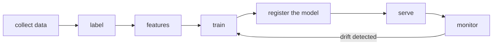

<!-- Written by `npm run lessons` from the lesson data in src/data. Edit the lesson there, not this page. -->

# ML system design: pipelines, training vs serving, drift

**ML Foundations · Unit 5: AI engineering · Lesson 16 of 16**

> **In one line.** ML system design is building everything around a model — data collection, labelling, features, training, serving, monitoring and retraining — so it keeps working in production as the world changes.

[Open this lesson on the site](https://learn.hamropedia.com/foundations/ml-system-design-pipelines-training-vs-serving-drift/) for its animation, the practice game and tap-to-explain words.

## The problem it solves

In production the model is a small part of the system. Most failures come from the data and pipelines: features computed differently in training and serving, labels arriving late, and the world drifting away from the training data. A model that was 95% accurate at launch can quietly decay with no error message.

## The idea

A real ML system is much more than a model: data collection, labelling, features, training pipelines, serving, monitoring and retraining. Training-serving skew means the model sees different data in production than in training. Drift means the world changes over time.

## How it works, step by step

1. Define the goal and the metric that matters for the business, and a simple baseline.
2. Collect and label data, version it, and split it by time when the future matters.
3. Build features with one shared pipeline (or a feature store) used by both training and serving, to avoid training–serving skew.
4. Train, evaluate on held-out data, and compare against the current production model.
5. Deploy carefully: shadow mode or a small percentage of traffic first, with a rollback plan.
6. Monitor inputs (data drift), predictions, outcomes (when labels arrive), latency and errors.
7. Retrain on a schedule or when monitoring shows drift, and repeat the evaluation before each release.

## Picture it



*A real ML system is a loop, not a one-off: models are watched in production and retrained as the world changes.*

## Analogy

A restaurant is not just a recipe. It needs suppliers, a kitchen and waiters, and it must change the menu when customers' tastes change.

**Where the analogy breaks.** A restaurant notices when customers stop coming. A model can fail silently. You only notice if you monitor the right numbers.

## Worked example

A fraud model is trained on 2024 data. By 2026, fraudsters use new tricks and precision drops. Monitor the input data and the outcomes, and retrain on recent data.

## Must know

- Training–serving skew: production features differ from training features.
- Data drift: the input distribution changes. Concept drift: the relationship between inputs and outputs changes.
- Monitor what you can see straight away (inputs, predictions) because true labels may arrive late.
- Roll out gradually and keep the ability to roll back.
- Most of the work is data and pipelines, not the model.

## Common mistakes

- Computing features one way in training and another way in serving.
- Testing on randomly shuffled data when the real use is predicting the future.
- Having no monitoring after launch, so nobody notices when the data drifts and the model quietly gets worse.
- Retraining automatically without evaluating the new model first.

> **Not true:** A freshly retrained model can go straight into production, because newer data makes it better.  
> **In fact:** New data can be broken or unrepresentative, so a retrained model can be worse. Evaluate it against the current one before it takes over.

> **Not true:** Testing a model that will predict the future: a random shuffle of the data is fair.  
> **In fact:** A random split lets the model train on later data and be tested on earlier data. Split by time: train on the past, test on what came after.

## Practise

Try each one yourself first: on paper, in code or out loud. Then open the answer and compare.

### 1. Derive

On one page, design a fraud-detection system: data, features, training, serving, monitoring and retraining.

<details>
<summary>Show one good answer</summary>

Fraud detection for card payments, on one page:

Data: payment events (amount, merchant, time, device, location), customer history, and labels that arrive late: chargebacks and confirmed fraud reports, weeks after the payment.

Features: per-payment (amount, merchant category, new device?) and aggregates over time windows (number of payments in the last hour, spend versus the customer's usual, distance from the last payment). Computed by one feature pipeline used by both training and serving (a feature store), so they can't disagree.

Training: gradient-boosted trees as a strong baseline; train on a past period and validate on a later one (time-based split); handle the heavy imbalance with class weights; choose the threshold by the cost of a missed fraud versus a blocked good customer.

Serving: a real-time decision in under about 100 ms: approve, decline, or step up (ask for an extra check); rules for known patterns run alongside the model; log every input, score and decision.

Monitoring: input drift per feature, the distribution of scores, the decline and step-up rates, latency, and, once labels arrive, precision and recall by week.

Retraining: scheduled (for example monthly) and triggered by drift or falling performance; every new model is compared with the current one offline, then shadow-run or A/B tested before it takes over.

</details>

### 2. Build

Add monitoring to one of your projects: log inputs and predictions, and raise an alert when the input distribution shifts.

<details>
<summary>Show one good answer</summary>

Log every prediction with its inputs and output to a JSON-lines file. Then compare the recent inputs with the training data, feature by feature, using the population stability index (PSI): bin the training values into deciles, and compare what share of recent values falls into each bin. PSI below 0.1 is usually stable, 0.1 to 0.25 is worth watching, above 0.25 is a real shift.

In the demo, a week of normal traffic has a PSI near 0 and raises no alerts. Prices going up by 30% gives a PSI of only about 0.07: a real change, but below the alert line, which is a reminder to choose thresholds by checking how big a shift actually hurts your model. When prices double, the "amount" PSI jumps above 0.25 and the alert fires, for that feature only. The same check on the model's output scores catches shifts in features you didn't monitor.

```python
import json
import numpy as np

def psi(reference, recent, bins=10):
    edges = np.quantile(reference, np.linspace(0, 1, bins + 1))
    edges[0], edges[-1] = -np.inf, np.inf
    ref = np.histogram(reference, edges)[0] / len(reference)
    new = np.histogram(recent, edges)[0] / len(recent)
    ref, new = np.clip(ref, 1e-4, None), np.clip(new, 1e-4, None)
    return float(np.sum((new - ref) * np.log(new / ref)))

rng = np.random.default_rng(0)
train = {"amount": rng.lognormal(3, 1, 10_000), "hour": rng.integers(0, 24, 10_000)}

def log_predictions(batch, path="predictions.jsonl"):
    with open(path, "a") as f:
        for amount, hour in zip(batch["amount"], batch["hour"]):
            f.write(json.dumps({"amount": float(amount), "hour": int(hour), "score": 0.1}) + "\n")

def check_drift(batch, threshold=0.25):
    alerts = []
    for feature in train:
        value = psi(train[feature], batch[feature])
        if value > threshold:
            alerts.append(f"ALERT: {feature} has shifted (PSI {value:.2f})")
    return alerts or ["no drift"]

batches = [("normal week", 1.0), ("prices up 30%", 1.3), ("prices doubled", 2.0)]
for name, scale in batches:
    batch = {"amount": rng.lognormal(3, 1, 2_000) * scale, "hour": rng.integers(0, 24, 2_000)}
    log_predictions(batch)
    print(name, "->", check_drift(batch), {f: round(psi(train[f], batch[f]), 3) for f in train})
```

</details>

### 3. Break

Simulate drift: train on an early period of data and test on a later one. Measure the drop, then retrain on recent data.

<details>
<summary>Show one good answer</summary>

Simulate a world that changes: 24 months of transactions where, from month 13, fraudsters change tactics (fraud moves from large night-time payments to small daytime ones). Train on months 1 to 6, then test month by month.

The model does well on the months it was trained near, then its recall collapses after the change: it is still looking for the old pattern. Overall accuracy barely moves (fraud is rare), which is exactly why you must watch recall and precision on the rare class.

Retraining on the most recent months (here, 13 to 18) brings the later months back up. In real life the labels for those months arrive late, so the delay between drift and recovery is real: that is why you also watch input drift and score drift, which show up before the labels do.

```python
import numpy as np

rng = np.random.default_rng(0)

def month(m, n=4_000):
    amount, night = rng.lognormal(3, 1, n), rng.random(n) < 0.3
    if m < 13:   # old tactic: large payments at night
        risk = 0.002 + 0.25 * night * (amount > 60)
    else:        # new tactic: small payments in the daytime
        risk = 0.002 + 0.25 * (~night) * (amount < 8)
    fraud = rng.random(n) < risk
    X = np.column_stack([np.log(amount), night, np.log(amount) * night, np.ones(n)])
    return X, fraud.astype(float)

def fit(X, y, steps=3000, lr=0.5):
    w = np.zeros(X.shape[1]); weight = np.where(y == 1, (1 - y.mean()) / y.mean(), 1.0)   # class weights
    for _ in range(steps):
        p = 1 / (1 + np.exp(-X @ w))
        w -= lr * X.T @ (weight * (p - y)) / weight.sum()
    return w

def recall(w, X, y):
    return ((1 / (1 + np.exp(-X @ w)) > 0.5)[y == 1]).mean()

data = {m: month(m) for m in range(1, 25)}
old = fit(np.vstack([data[m][0] for m in range(1, 7)]), np.concatenate([data[m][1] for m in range(1, 7)]))
new = fit(np.vstack([data[m][0] for m in range(13, 19)]), np.concatenate([data[m][1] for m in range(13, 19)]))
for m in [3, 9, 12, 14, 20, 24]:
    X, y = data[m]
    print(f"month {m:2d}: recall with the old model {recall(old, X, y):.0%}, with the retrained model {recall(new, X, y):.0%}")
```

</details>

### 4. Explain

Explain training-serving skew and drift with the restaurant-menu picture.

<details>
<summary>Show one good answer</summary>

A restaurant is not just a recipe. It needs suppliers, a kitchen and waiters, and it must change the menu when customers' tastes change. An ML system is the same: the model is the recipe, and the system is everything around it.

Training-serving skew is when the kitchen cooks differently from the recipe it was tested with: the test kitchen weighed flour in grams, the real kitchen uses cups, so the same recipe tastes wrong. In ML, features are computed one way in training and another way in production, and the model quietly gets worse.

Drift is when tastes change: the menu was perfect last year, but customers now want something else, so the same dishes sell less. In ML, the world changes (new customers, new products, new fraud tactics), and a model that was right becomes wrong. You watch for both, and update the menu: retrain.

</details>

## Check you understood

Answer in your head first, then open each one.

<details>
<summary>&lt;b>What is training–serving skew?&lt;/b></summary>

The model receives features in production that are computed differently from how they were computed in training.

</details>

<details>
<summary>&lt;b>What is the difference between data drift and concept drift?&lt;/b></summary>

Data drift: the inputs change. Concept drift: the right output for the same input changes.

</details>

<details>
<summary>&lt;b>Labels for fraud arrive weeks later. What can you monitor now?&lt;/b></summary>

The input distributions and the prediction distribution, which can show drift before labels arrive.

</details>

<details>
<summary>&lt;b>How do you release a new model safely?&lt;/b></summary>

Shadow mode or a small share of traffic first, compare against the current model, and keep a quick rollback.

</details>

## Go further (optional)

The lesson above is enough on its own. These free extras give a second explanation.

- READ · [Data Distribution Shifts and Monitoring](https://huyenchip.com/2022/02/07/data-distribution-shifts-and-monitoring.html) · Chip Huyen  
  **Worth it:** The clearest explanation of the kinds of drift, how to detect them and what to monitor, from the author of the standard book on ML systems.
- READ · [CS329S: Machine Learning Systems Design (notes)](https://stanford-cs329s.github.io/) · Stanford
- READ · Designing Machine Learning Systems (whole book) · Chip Huyen · paid

---

[← Safety: guardrails and prompt injection](safety-guardrails-and-prompt-injection.md) · [All lessons](../../README.md) · [How a GPU works: compute vs memory →](../unit-6-systems/how-a-gpu-works-compute-vs-memory.md)
