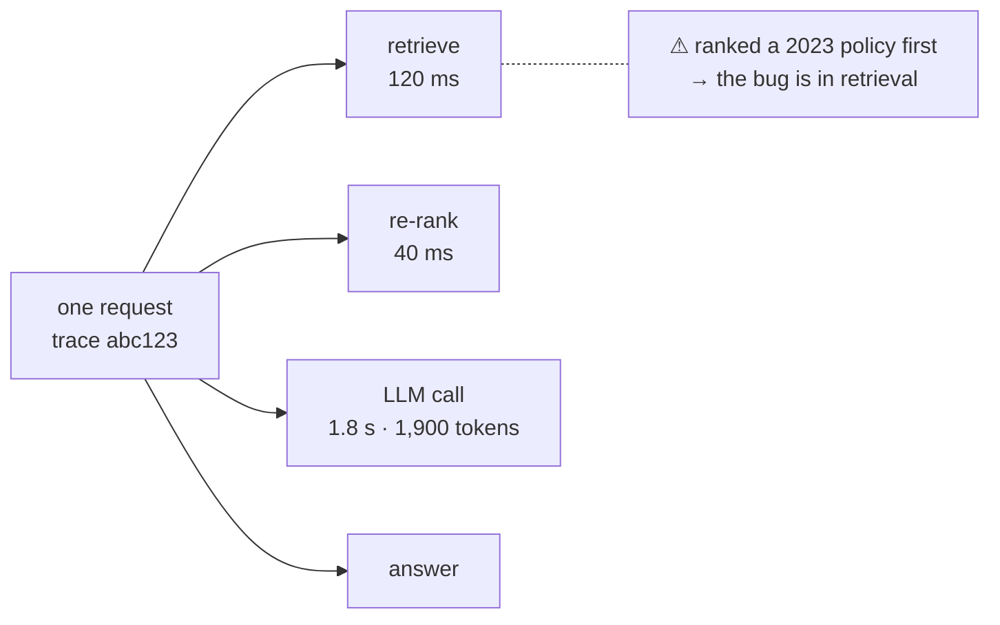

<!-- Written by `npm run lessons` from the lesson data in src/data. Edit the lesson there, not this page. -->

# Observability: tracing and debugging LLM apps

**ML Foundations · Unit 5: AI engineering · Lesson 14 of 16**

> **In one line.** Observability means recording what your LLM app did on every request: prompts, retrieved chunks, tool calls, outputs, tokens, time and cost. The record is a trace you can inspect, search and learn from.

[Open this lesson on the site](https://learn.hamropedia.com/foundations/observability-tracing-and-debugging-llm-apps/) for its animation, the practice game and tap-to-explain words.

## The problem it solves

LLM apps fail in quiet, specific ways: the wrong chunk retrieved, a tool error swallowed, an answer cut off. Without traces, a bad answer is a mystery, and you end up tweaking prompts at random. With traces, you can point at the step that went wrong, see where time and money go, and turn real failures into eval cases.

## The idea

Observability means you can see what your app actually did for any single request. That covers the prompt, the retrieved chunks, every tool call and the model's reply, plus the tokens, cost and time of each step. A trace records all of this as one tree of steps. Without it, a bad answer is a mystery. With it, you can point at the step that went wrong.

## How it works, step by step

1. Give every request a trace: a tree of steps (spans), such as embed, retrieve, re-rank, LLM call and tool call.
2. For each span record its inputs, outputs, start and end time, token counts and cost, plus any errors.
3. Draw traces as a waterfall to see which step dominates latency.
4. Search and filter traces: slowest, most expensive, user-flagged, failed.
5. Read a sample of real traces regularly, not only after complaints.
6. Turn each failure you find into a new eval case.
7. Redact or avoid logging personal data, and keep traces for a limited time.

## Picture it



*A trace shows every step of one request, with its time and cost, so you can point at exactly which step went wrong.*

## Analogy

A flight recorder, the 'black box'. When something goes wrong, you replay exactly what happened instead of guessing.

**Where the analogy breaks.** A flight recorder is only read after a crash. LLM traces are most useful every day: you read a sample of real traces, and turn the failures you find into new eval cases.

## Worked example

A user says the bot gave the wrong refund policy. The trace shows retrieval ranked a 2023 policy chunk first. The fix is in retrieval (add a date filter), not in the prompt.

```python
import time, uuid

def traced(step, fn, *args, trace, **kwargs):
    start = time.perf_counter()
    result = fn(*args, **kwargs)
    trace.append({"id": str(uuid.uuid4()), "step": step,
                  "ms": round(1000 * (time.perf_counter() - start)),
                  "input": repr(args)[:500], "output": repr(result)[:500]})
    return result
```

## Must know

- Trace = one request; span = one step inside it.
- Log inputs, outputs, timing, tokens, cost and errors for every step.
- Standards like OpenTelemetry make traces portable between tools.
- Traces feed evals: real failures become test cases.
- Set alerts on error rates, latency and cost.

## Common mistakes

- Logging only the final answer, so when it is wrong you can't see which step went wrong.
- Logging sensitive data with no redaction.
- Collecting traces but never reading them.
- Not linking traces to user feedback.

> **Not true:** Prompts and outputs can be logged in full, personal data included, without any risk.  
> **In fact:** Logs are stored, shared and searched, so personal data in them is a real risk. Remove or hide sensitive fields before logging.

> **Not true:** A log of the final answers gives what is needed to debug an LLM app.  
> **In fact:** When the answer is wrong, you need to see which step failed: the retrieval, a tool call or the model. Log the inputs and outputs of every step.

## Practise

Try each one yourself first: on paper, in code or out loud. Then open the answer and compare.

### 1. Derive

List every step of one request in your RAG app. For each step, write what you would log: inputs, outputs, tokens, time and cost. Mark anything that must not be logged, like personal data.

<details>
<summary>Show one good answer</summary>

One request through the RAG app, step by step, and what to log for each:

1. Request arrives: request id, timestamp, user id (pseudonymous), app version, prompt template version. Not the raw question if it may contain personal data; log a redacted copy or a hash.  
2. Embed the question: model name and version, time taken.  
3. Retrieve: the ids, titles and scores of the top chunks, how many were returned, filters applied, time. (Ids, not full text, keeps logs small.)  
4. Build the prompt: number of chunks used, total input tokens, which were cut by the budget.  
5. LLM call: model, effort, input and output tokens, cost, latency, stop reason (including refusals), any fallback, any retries.  
6. Tool calls, if any: each tool's name, inputs (redacted), result size, errors, time.  
7. Post-processing and checks: validation results, guardrail flags, cache hit or miss.  
8. Response: final latency, status, the answer (redacted), the cited sources, and later any user feedback, linked by the request id.

Must not be logged in plain text: names, emails, phone numbers, addresses, card or bank details, health information, passwords and API keys. Redact them before logging, restrict who can read traces, and delete them after a fixed time.

</details>

### 2. Build

Add tracing to your RAG app: one trace per request with nested steps, saved as JSON. Build a small page or notebook that shows the slowest and most expensive traces.

<details>
<summary>Show one good answer</summary>

A tiny tracer: a span() context manager records a step's name, start and end time, attributes (tokens, provider, counts) and any error, and spans nest, so one request becomes a tree, written as one JSON line per trace. The demo traces the RAG app's real retrieval plus the LLM call, recording the chunk count, the tokens and which provider answered on the right spans. (With a paid API you would also record the cost; tokens are what it is calculated from.)

The analysis part reads the JSON file and lists the slowest requests and the ones that used the most tokens, and the step that took the time, which is how you decide what to optimise. Real projects use OpenTelemetry or an LLM-tracing tool with a UI, but the data they collect is exactly this shape.

```python
import json
import time
import uuid
from contextlib import contextmanager
from rag import CHUNKS, VECTORS, retrieve, build_prompt
from llm import ask, text_of

_stack = []

@contextmanager
def span(name, **attrs):
    node = {"name": name, "attrs": attrs, "children": [], "start": time.time()}
    if _stack:
        _stack[-1]["children"].append(node)
    _stack.append(node)
    try:
        yield node
    except Exception as e:
        node["error"] = repr(e); raise
    finally:
        node["ms"] = round((time.time() - node.pop("start")) * 1000, 1)
        _stack.pop()
        if not _stack:                                   # the root span: write the whole trace
            with open("traces.jsonl", "a") as f:
                f.write(json.dumps(node) + "\n")

def traced_answer(question):
    with span("request", id=str(uuid.uuid4()), question_words=len(question.split())) as root:
        with span("retrieve") as s:
            chunks = retrieve(question, CHUNKS, VECTORS, k=3)
            s["attrs"].update(n_chunks=len(chunks), titles=[c["title"] for c in chunks])
        with span("llm") as s:
            reply = ask(build_prompt(question, chunks))
            s["attrs"].update(input_tokens=reply["input_tokens"], output_tokens=reply["output_tokens"],
                              provider=reply["provider"], model=reply["model"])
        root["attrs"]["tokens"] = reply["input_tokens"] + reply["output_tokens"]
        return text_of(reply)

for q in ["How many instances are in the wine dataset?", "Who created the digits dataset?", "What does s5 measure?"]:
    traced_answer(q)

traces = [json.loads(line) for line in open("traces.jsonl")]
print("slowest:", [(t["attrs"]["id"][:8], t["ms"], max(t["children"], key=lambda c: c["ms"])["name"])
                   for t in sorted(traces, key=lambda t: -t["ms"])[:3]])
print("most tokens:", [(t["attrs"]["id"][:8], t["attrs"]["tokens"]) for t in sorted(traces, key=lambda t: -t["attrs"]["tokens"])[:3]])
```

</details>

### 3. Break

Plant a bug: make retrieval quietly return nothing for some questions. Can you find it from the traces alone? Then add an alert that would have caught it.

<details>
<summary>Show one good answer</summary>

Plant the bug: a filter that quietly removes every chunk when the question contains a number (say, a date filter that misreads "how many in 2026?"). The app doesn't crash; the model receives no sources and says "I don't know", or worse, answers from memory. Users just see a slightly unhelpful app.

Can you find it from traces alone? Yes, if retrieval records how many chunks it returned. Group the traces by n_chunks: a cluster of requests with n_chunks = 0 stands out, and reading a few shows they all contain digits. Without that one attribute in the trace, you would be guessing.

The alert that would have caught it: track the share of requests with zero retrieved chunks over the last hour, and alert when it rises above its normal level (here, above 5%), plus a daily check of the "I don't know" rate. Good alerts watch the signals that silent failures change, not just errors and latency.

```python
import random

def retrieve_with_bug(question):
    chunks = ["chunk"] * 3
    if any(ch.isdigit() for ch in question):          # the planted bug: a broken date filter
        chunks = []
    return chunks

random.seed(0)
questions = [f"What happened in {random.randint(2000, 2026)}?" if random.random() < 0.2 else "How does RAG work?"
             for _ in range(500)]
traces = [{"question": q, "n_chunks": len(retrieve_with_bug(q))} for q in questions]

empty = [t for t in traces if t["n_chunks"] == 0]
print(f"{len(empty)} of {len(traces)} requests retrieved nothing")
print("examples:", [t["question"] for t in empty[:3]])

def zero_chunk_alert(window, threshold=0.05):
    share = sum(t["n_chunks"] == 0 for t in window) / len(window)
    if share > threshold:
        return f"ALERT: {share:.0%} of requests in the last hour retrieved no chunks (normal: under {threshold:.0%})"
print(zero_chunk_alert(traces[-100:]))
```

</details>

### 4. Explain

Explain observability with the flight-recorder picture, and why you read traces every day.

<details>
<summary>Show one good answer</summary>

An aeroplane's flight recorder, the "black box", records everything that happens during a flight. When something goes wrong, investigators replay exactly what happened instead of guessing. Tracing is the flight recorder for an LLM app: for every request it records each step, what went in, what came out, how long it took and what it cost.

You read traces every day, not just after a crash, because LLM apps fail quietly. A bad answer doesn't throw an error; it just sounds a bit off. Reading a sample of real traces daily is how you find the problems no alert was designed for, and how you learn what your users really ask.

</details>

## Check you understood

Answer in your head first, then open each one.

<details>
<summary>&lt;b>What is the difference between a trace and a span?&lt;/b></summary>

A trace is the record of one whole request; spans are the individual steps inside it.

</details>

<details>
<summary>&lt;b>A user reports a wrong answer. How do traces help?&lt;/b></summary>

Open that request's trace and inspect each step's output to find where it went wrong, such as retrieval returning an outdated document.

</details>

<details>
<summary>&lt;b>What should you be careful not to log?&lt;/b></summary>

Personal or sensitive data, unless it is redacted and handled under clear rules.

</details>

<details>
<summary>&lt;b>How do traces improve evals?&lt;/b></summary>

Failures found in real traces become new test cases, so the eval set keeps up with real use.

</details>

## Go further (optional)

The lesson above is enough on its own. These free extras give a second explanation.

- READ · [Your AI Product Needs Evals (the section on logging traces)](https://hamel.dev/blog/posts/evals/) · Hamel Husain
- READ · [Observability primer](https://opentelemetry.io/docs/concepts/observability-primer/) · OpenTelemetry docs
- READ · AI Engineering, Ch 10 (monitoring and observability) · Chip Huyen · book you own

---

[← Caching, model routing and cost control](caching-model-routing-and-cost-control.md) · [All lessons](../../README.md) · [Safety: guardrails and prompt injection →](safety-guardrails-and-prompt-injection.md)
