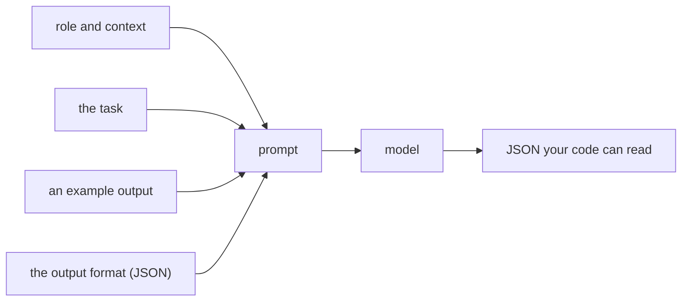

<!-- Written by `npm run lessons` from the lesson data in src/data. Edit the lesson there, not this page. -->

# Prompting: clear instructions, examples, structured output

**ML Foundations · Unit 5: AI engineering · Lesson 1 of 16**

> **In one line.** Prompting is writing the instructions, context and examples an LLM receives on each call; a good prompt is a complete, specific briefing that leaves the model little to guess.

[Open this lesson on the site](https://learn.hamropedia.com/foundations/prompting-clear-instructions-examples-structured-output/) for its animation, the practice game and tap-to-explain words.

## The problem it solves

The model knows nothing about your task, your users or your data except what is in the prompt. Vague prompts get vague, inconsistent answers that code can't parse. Prompting is the cheapest and fastest lever you have: improve it before reaching for RAG or fine-tuning, and measure the improvement on many inputs.

## The idea

The prompt is the model's only briefing. Be clear and specific, give context, show examples of the output you want, and ask for a fixed format, like JSON, when code will read the answer.

## How it works, step by step

1. Say who the model is acting as and for whom: "You are a support triage assistant for engineers."
2. Give the context it can't know: where the text comes from, what the product is, what matters.
3. State the task precisely, with limits: "Summarise in 2 sentences", "list at most 3 risks".
4. Show one or more examples of input and the exact output you want (few-shot prompting). Examples often beat paragraphs of rules.
5. Ask for a fixed format when code reads the output: JSON with named fields, or text between tags.
6. Put long documents first and the question last, and mark data clearly (for example inside &lt;document> tags) so it isn't mistaken for instructions.
7. Test the prompt on a set of real inputs, look at the failures, change one thing, and test again.

## Picture it



*A strong prompt briefs the model like a new colleague: who it is, what to do, an example, and exactly what shape the answer must take.*

## Analogy

Briefing a smart new colleague on their first day. They are capable, but they know nothing about your project unless you tell them.

**Where the analogy breaks.** A colleague asks when they are unsure. A model usually guesses instead, so leave less to guess.

## Worked example

Weak: 'Summarise this.' Strong: 'Summarise this support ticket in 2 sentences for an engineer. Then return JSON with product and urgency (low, medium or high).'

## Must know

- Specific beats short: role, context, task, constraints, examples, format.
- Examples are the strongest signal for style and format.
- Ask for structure (JSON, tags) whenever code consumes the answer.
- Tell the model what to do when it can't answer ("say you don't know").
- System prompts hold standing instructions; user messages hold the request.
- Prompts are code: keep them in version control and evaluate changes.

## Common mistakes

- Judging a prompt on one example instead of a test set.
- Contradictory instructions, or rules buried in long text.
- Asking for JSON without saying which fields, types and allowed values.
- Mixing untrusted data and instructions with no clear boundary.

> **Not true:** A prompt that works on one example is ready to use.  
> **In fact:** One example proves little: a prompt can pass it and fail on many others. Judge every prompt on a test set of varied cases.

> **Not true:** Asking for JSON: the model will choose sensible fields and types by itself.  
> **In fact:** Unless you name the fields, their types and the allowed values, each reply can come back in a different shape. Spell out the structure you want.

## Practise

Try each one yourself first: on paper, in code or out loud. Then open the answer and compare.

### 1. Derive

Rewrite this weak prompt into a strong one: 'Tell me about this CV.' Add a role, context, the task, an output format and an example.

<details>
<summary>Show one good answer</summary>

"Tell me about this CV" leaves the model guessing: who is asking, why, what matters, how long, in what shape. A strong prompt answers all of that, like a brief for a smart colleague on their first day:

• Role: who the model should be.  
• Context: what this is for and who will read it.  
• Task: exactly what to do, step by step if it matters.  
• Output format: the shape of the answer, so your code (or reader) can rely on it.  
• An example: one short sample of a good answer, so "good" is shown, not just described.  
• What to do when information is missing.

Check yours: could someone who has never met you do the task well from your prompt alone? If not, add what they would ask you.

```text
You are an experienced technical recruiter for AI engineering roles in the UK.

Context: I am screening CVs for a junior AI Engineer role. The job needs Python,
PyTorch, building and evaluating LLM applications (RAG, agents), and clear
communication. Hiring managers read your summary in under a minute.

Task: read the CV between the <cv> tags. Then:
1. List the candidate's three strongest pieces of evidence for this role.
2. List up to three gaps or risks, each with a question to ask in interview.
3. Give an overall fit: strong, possible, or weak, with one sentence why.
Only use what the CV says. If something is not stated, say "not stated".

Output format (exactly these headings):
Strengths: - ... (3 bullets, each with the evidence from the CV)
Gaps: - ... (up to 3 bullets, each ending with "Ask: ...")
Fit: strong | possible | weak. <one sentence>

Example of one good Strengths bullet:
- Built a RAG assistant and measured it: "retrieval recall 0.82 on 150 questions".

<cv>
{paste the CV here}
</cv>
```

</details>

### 2. Build

Send 20 support tickets to an LLM API with your prompt, and parse the JSON output. Count how many parse correctly.

<details>
<summary>Show one good answer</summary>

This is llm.py, the small helper the other Unit 5 answers import, plus the ticket experiment. Everything in it is free. It tries Groq first, then Gemini, then NVIDIA, using free-tier API keys from a .env file, and finally a model running on your own computer through Ollama, which needs no key and has no limits. All four accept the same OpenAI-style chat request, so one request shape covers them all; if one provider is rate-limited (HTTP 429), has no key, or fails, the next one answers. Each reply records which provider answered, so you can see it.

ask() returns the reply as a small dictionary: the text, any tool calls, the token counts and the provider. Temperature 0 keeps answers as repeatable as possible, which is what you want for extraction and grading.

The experiment: a prompt with a role, the allowed categories, the exact JSON shape and one worked example, sent for each ticket. Parse each reply with json.loads and check the fields against the allowed values: "parses" is not enough, it must also be valid. A clear prompt like this one typically gets every reply right; the next exercise shows what happens without it, and the structured-outputs topic shows how to guarantee it.

The list has 8 sample tickets; add your own to reach 20. Free keys: console.groq.com, aistudio.google.com (Gemini) and build.nvidia.com; or skip the keys and run only the local model: install Ollama, then ollama pull qwen2.5:7b.

```python
# llm.py: one helper for calling free model APIs, shared by the Unit 5 answers.
# A free chain: Groq, then Gemini, then NVIDIA, then a local Ollama
# model. All four speak the OpenAI-style chat API, so one request shape works.
# Keys (free tiers) go in a .env file: GROQ_API_KEY, GEMINI_API_KEY, NVIDIA_API_KEY.
import json
import os
import time
import requests
from dotenv import load_dotenv

load_dotenv()
PROVIDERS = [   # (name, endpoint, environment variable for the key, model), tried in order
    ("Groq", "https://api.groq.com/openai/v1/chat/completions", "GROQ_API_KEY", "openai/gpt-oss-120b"),
    ("Gemini", "https://generativelanguage.googleapis.com/v1beta/openai/chat/completions", "GEMINI_API_KEY", "gemini-3.5-flash-lite"),
    ("NVIDIA", "https://integrate.api.nvidia.com/v1/chat/completions", "NVIDIA_API_KEY", "openai/gpt-oss-20b"),
    ("Ollama", "http://localhost:11434/v1/chat/completions", None, "qwen2.5:7b"),   # on your computer: no key
    # (for long prompts, start Ollama with OLLAMA_CONTEXT_LENGTH=32768, or it silently cuts them)
]

def ask(prompt=None, *, system=None, messages=None, schema=None, tools=None,
        temperature=0.0, max_tokens=2000, providers=PROVIDERS):
    """Send one chat request down the chain. Returns a dict: text, tool_calls, message,
    input_tokens, output_tokens, provider, model and seconds."""
    messages = list(messages or [{"role": "user", "content": prompt}])
    if system:
        messages.insert(0, {"role": "system", "content": system})
    payload = {"messages": messages, "temperature": temperature, "max_tokens": max_tokens}
    if schema:                                             # the reply must match this JSON schema
        payload["response_format"] = {"type": "json_schema", "json_schema": {"name": "reply", "schema": schema}}
    if tools:
        payload["tools"] = tools
    failures = []
    for name, url, key_env, model in providers:
        key = os.getenv(key_env) if key_env else "local"
        if not key:
            failures.append(f"{name}: no key"); continue
        body = {**payload, "model": model}
        if "gpt-oss" in model or model.startswith("gemini"):
            body["reasoning_effort"] = "low"               # these models think first; keep it short
        started = time.time()
        try:
            r = requests.post(url, json=body, headers={"Authorization": f"Bearer {key}"}, timeout=180)
        except requests.RequestException as e:
            failures.append(f"{name}: {type(e).__name__}"); continue
        if r.status_code != 200:                           # 429 = rate-limited: try the next one
            failures.append(f"{name}: HTTP {r.status_code}"); continue
        data = r.json()
        message, usage = data["choices"][0]["message"], data.get("usage") or {}
        if not (message.get("content") or message.get("tool_calls")):
            failures.append(f"{name}: empty answer"); continue
        return {"text": (message.get("content") or "").strip(), "tool_calls": message.get("tool_calls") or [],
                "message": message, "input_tokens": usage.get("prompt_tokens", 0),
                "output_tokens": usage.get("completion_tokens", 0), "provider": name, "model": model,
                "seconds": round(time.time() - started, 2)}
    raise RuntimeError("every provider failed: " + "; ".join(failures))

def text_of(reply):
    return reply["text"]

CATEGORIES = {"billing", "delivery", "account", "product", "other"}
URGENCIES = {"low", "medium", "high"}
TICKETS = [
    "My parcel was meant to arrive on Monday and it's now Friday. Where is it?",
    "I was charged twice for order 4471. Please refund one of them.",
    "I can't log in. The reset email never arrives.",
    "The blender I bought makes a burning smell after two minutes.",
    "Do you sell gift cards?",
    "Please delete my account and all my data.",
    "The tracking says delivered but nothing is here and my neighbour has nothing either.",
    "Your app crashes every time I open my order history.",
]
PROMPT = """You are a support triage assistant for an online shop.

Classify the customer ticket below. Reply with JSON only, no other text, in exactly this shape:
{"category": "billing" | "delivery" | "account" | "product" | "other", "urgency": "low" | "medium" | "high", "summary": "<one sentence>"}

Example
Ticket: "I was charged twice for order 1182, please refund one."
Reply: {"category": "billing", "urgency": "high", "summary": "Customer was charged twice for one order and wants a refund."}

Ticket: "{ticket}"
Reply:"""

def parse(reply):
    """The reply as a dict if it is valid JSON with allowed values, otherwise None."""
    try:
        data = json.loads(reply)
    except json.JSONDecodeError:
        return None
    valid = (isinstance(data, dict) and data.get("category") in CATEGORIES
             and data.get("urgency") in URGENCIES and isinstance(data.get("summary"), str))
    return data if valid else None

if __name__ == "__main__":
    results = [parse(text_of(ask(PROMPT.replace("{ticket}", t)))) for t in TICKETS]
    for ticket, result in zip(TICKETS, results):
        print("OK  " if result else "BAD ", result or ticket)
    print(f"{sum(r is not None for r in results)} of {len(TICKETS)} replies parsed and valid")
```

</details>

### 3. Break

Make the prompt vague on purpose, or remove the example. Measure how the parse rate and quality change.

<details>
<summary>Show one good answer</summary>

Make the prompt vague ("Classify this support ticket and give me JSON") and remove the example, then run the same tickets through the same parse() check.

What typically happens with a capable model: it still tries to give JSON, but you lose control of the details. Replies come wrapped in a markdown code fence (```json … ```), which json.loads rejects; key names drift ("type" or "issue" instead of "category"); and the categories are invented per ticket ("shipping delay", "refund request"), so even replies that parse fail validation. So the measured success rate falls sharply, and the replies that do parse are harder to use, because two similar tickets get different labels.

The lesson: what the prompt doesn't specify, the model decides for you, differently each time. Name the allowed values, show the exact shape, and give an example. When the shape must be guaranteed, don't rely on the prompt at all: use structured outputs, the next topic.

```python
# Uses llm.py from the Build answer above.
from llm import ask, text_of, parse, TICKETS, PROMPT

VAGUE = "Classify this support ticket and give me JSON: {ticket}"
for name, template in [("clear prompt", PROMPT), ("vague prompt", VAGUE)]:
    replies = [text_of(ask(template.replace("{ticket}", t))) for t in TICKETS]
    valid = sum(parse(r) is not None for r in replies)
    fenced = sum(r.strip().startswith(chr(96) * 3) for r in replies)   # chr(96) is a backtick
    print(f"{name}: {valid}/{len(TICKETS)} valid, {fenced} wrapped in a code fence")
    print("   first reply:", replies[0][:120].replace("\n", " "))
```

</details>

### 4. Explain

Explain good prompting with the new-colleague picture.

<details>
<summary>Show one good answer</summary>

Brief the model like a smart new colleague on their first day. They are capable, but they know nothing about your project, your customers or what "good" means here, unless you tell them. "Tell me about this CV" would confuse a new colleague too: for which job? For whom? How long?

So you give them the same things you would give a person: their role, the background, the exact task, what the result should look like, one example of a good result, and what to do if something is missing. The model can't ask follow-up questions, so the prompt must answer them in advance.

</details>

## Check you understood

Answer in your head first, then open each one.

<details>
<summary>&lt;b>What are the main parts of a strong prompt?&lt;/b></summary>

A role, the context, a precise task with limits, examples of the desired output, and the output format.

</details>

<details>
<summary>&lt;b>Why do examples help so much?&lt;/b></summary>

They show the exact style, length and format you want, which is hard to describe fully in words.

</details>

<details>
<summary>&lt;b>How do you know a prompt change helped?&lt;/b></summary>

Run old and new prompts on the same set of real inputs and compare the scores, rather than eyeballing one answer.

</details>

<details>
<summary>&lt;b>Why mark documents with tags like &lt;document>?&lt;/b></summary>

So the model can tell your instructions apart from the data, which also makes prompt injection a little harder.

</details>

## Go further (optional)

The lesson above is enough on its own. These free extras give a second explanation.

- READ · [Prompt engineering overview](https://docs.claude.com/en/docs/build-with-claude/prompt-engineering/overview) · Claude docs  
  **Worth it:** The official guide, with concrete before-and-after prompts for clarity, examples, structure and long documents. Practical and short.
- READ · AI Engineering, Ch 5 (prompt engineering) · Chip Huyen · book you own

---

[← Reasoning models and test-time compute](../unit-4-llms/reasoning-models-and-test-time-compute.md) · [All lessons](../../README.md) · [Structured outputs and function calling →](structured-outputs-and-function-calling.md)
