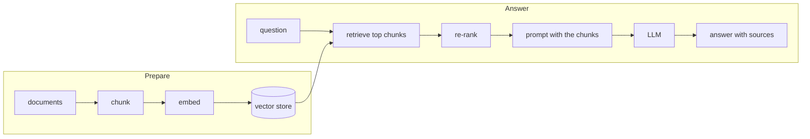

<!-- Written by `npm run lessons` from the lesson data in src/data. Edit the lesson there, not this page. -->

# RAG: chunking, retrieval and re-ranking

**ML Foundations · Unit 5: AI engineering · Lesson 5 of 16**

> **In one line.** Retrieval-augmented generation (RAG) answers questions by retrieving relevant pieces of your documents and giving them to the model in the prompt, so it answers from that evidence.

[Open this lesson on the site](https://learn.hamropedia.com/foundations/rag-chunking-retrieval-and-re-ranking/) for its animation, the practice game and tap-to-explain words.

## The problem it solves

Models don't know your private documents or anything after their training cut-off, and they make things up when they don't know. Fine-tuning facts in is slow, costly and unreliable. RAG keeps knowledge in documents you can update at any time, lets the model cite its sources, and is the most common pattern in real LLM products.

## The idea

Retrieval-augmented generation (RAG): find relevant pieces of your documents, put them in the prompt, and ask the model to answer from them. Chunking splits documents into pieces. Re-ranking uses a second, more careful model to re-order the top results.

## How it works, step by step

1. Indexing (offline): split documents into chunks of a few hundred words, with a little overlap, following headings where possible.
2. Embed each chunk and store it in an index with metadata (source, date, section).
3. At question time, embed the question and retrieve the most similar chunks, often with hybrid keyword + semantic search.
4. Optionally re-rank: a slower cross-encoder model scores each (question, chunk) pair and re-orders the top 20–50 candidates.
5. Build the prompt: instructions, the best chunks clearly marked as sources, then the question. Tell the model to answer only from the sources, cite them, and say when the answer isn't there.
6. The model generates a grounded answer with citations.
7. Evaluate retrieval (did the right chunk come back?) and generation (is the answer correct and faithful?) separately.

## Picture it



*RAG is an open-book exam: find the right pages first, then answer from them.*

## Analogy

An open-book exam. The model is the student. Retrieval is finding the right pages before answering.

**Where the analogy breaks.** A student can flip through the whole book. The model only sees the pages you hand it. If retrieval picks the wrong pages, the answer is wrong but still sounds confident.

## Worked example

A 200-page HR manual is split into chunks of about 300 words, with some overlap. Question: 'How many holiday days do new staff get?' Retrieve the top 5 chunks, then prompt: 'Answer using only the text below. If the answer is not there, say so.'

## Must know

- Retrieval quality caps answer quality: wrong chunks give confident, wrong answers.
- Chunk size is a trade-off: too small loses context, too large blurs relevance and wastes tokens.
- Hybrid search and re-ranking usually give the biggest retrieval gains.
- Add context to chunks (document title, section) so they make sense on their own.
- Citations let users check answers and make failures visible.
- Update knowledge by re-indexing documents, not retraining the model.

## Common mistakes

- Only evaluating final answers, so retrieval failures stay hidden.
- Chunking that cuts tables, lists or sentences in half.
- No instruction for "the answer isn't in the sources", so the model guesses.
- Ignoring dates and permissions in metadata.

> **Not true:** When the sources don't contain the answer, a RAG system says so without being told to.  
> **In fact:** Unless the prompt covers that case, the model usually guesses. Tell it plainly to say when the answer is not in the sources.

> **Not true:** Evaluating a RAG system: check the final answers; retrieval needs no separate check.  
> **In fact:** A wrong answer can come from retrieving the wrong chunks, or from misusing the right ones. Measure retrieval on its own, so you know which part failed.

## Practise

Try each one yourself first: on paper, in code or out loud. Then open the answer and compare.

### 1. Derive

Draw the RAG pipeline from question to answer, and mark 4 places where it can fail.

<details>
<summary>Show one good answer</summary>

The pipeline, in two halves.

Prepare (offline): documents → clean and split into chunks → embed each chunk → store vectors with metadata (source, date, permissions).  
Answer (per question): question → embed (and/or keyword search) → retrieve top candidates → re-rank → build the prompt with the best chunks as numbered sources → LLM → answer with citations.

Four places it can fail (more exist):  
1. Chunking: a table or a list is cut in half, or a chunk loses its heading ("it costs £5": what does?).  
2. Retrieval: the chunk with the answer isn't in the top k, because of wording mismatch, exact codes, or an outdated duplicate ranked higher.  
3. Context building: the right chunk is retrieved but cut off by the token budget, buried among irrelevant chunks, or contradicted by an older version.  
4. Generation: the model ignores the sources, answers from memory, cites the wrong source, or doesn't say "I don't know" when the answer isn't there.

Also: stale indexes (a document changed but wasn't re-embedded), and permissions (a user retrieves something they shouldn't see).

```text
PREPARE:  documents ─▶ chunk ─▶ embed ─▶ vector store (+ metadata)
                      ①                       │
ANSWER:   question ─▶ embed ─▶ retrieve top k ─▶ re-rank ─▶ prompt with sources ─▶ LLM ─▶ answer + citations
                               ②                          ③                       ④
① chunk cuts tables, loses headings     ② right chunk not in top k
③ cut by token budget, or contradicted  ④ ignores sources, no "I don't know"
```

</details>

### 2. Build

Build RAG over a real document set with no framework: chunking, embedding, retrieval, prompt, and an answer with sources.

<details>
<summary>Show one good answer</summary>

This is rag.py, the RAG app later answers import. Documents: the descriptions of the six datasets that ship with scikit-learn (Iris, Wine, Breast cancer, Diabetes, Digits, Linnerud): real technical documents, available offline. Each is split into overlapping chunks of words, each chunk starts with its document's title (so a chunk like "Number of Instances: 178" still says which dataset it belongs to), and the chunks are embedded with the free MiniLM model.

To answer: retrieve the top k chunks by cosine similarity, number them as sources in the prompt, and tell the model to answer only from them, cite the source numbers, and say "I don't know" when they don't contain the answer. The answer comes back with the list of sources used, so a person can check it.

Retrieval runs locally; the answer step calls Claude and needs an API key.

```python
# rag.py: a small RAG app with no framework. Later answers import from this file.
import numpy as np
from sentence_transformers import SentenceTransformer
from sklearn import datasets                      # only for its bundled dataset descriptions
from llm import ask, text_of

embedder = SentenceTransformer("all-MiniLM-L6-v2")
NAMES = ["iris", "wine", "breast_cancer", "diabetes", "digits", "linnerud"]

def load_documents():
    docs = []
    for name in NAMES:
        text = getattr(datasets, f"load_{name}")().DESCR
        title = text.split("\n")[2].strip()               # the line after ".. _name_dataset:" and a blank
        docs.append({"title": title, "text": text})
    return docs

def chunk(docs, size=300, overlap=50):
    chunks = []
    for doc in docs:
        words = doc["text"].split()
        for start in range(0, max(len(words) - overlap, 1), size - overlap):
            piece = " ".join(words[start:start + size])
            chunks.append({"title": doc["title"], "text": f"[{doc['title']}] {piece}"})
    return chunks

def build_index(chunks):
    return embedder.encode([c["text"] for c in chunks], normalize_embeddings=True)

def retrieve(question, chunks, vectors, k=3):
    q = embedder.encode([question], normalize_embeddings=True)[0]
    best = np.argsort(-(vectors @ q))[:k]
    return [chunks[i] for i in best]

def build_prompt(question, sources):
    numbered = "\n\n".join(f"<source id={i + 1}>\n{s['text']}\n</source>" for i, s in enumerate(sources))
    return (f"Answer the question using only the sources below. Cite sources like [1]. "
            f"If the sources do not contain the answer, say \"I don't know\".\n\n{numbered}\n\n"
            f"Question: {question}")

def answer(question, chunks, vectors, k=3):
    sources = retrieve(question, chunks, vectors, k)
    response = ask(build_prompt(question, sources))
    return text_of(response), sources, response

CHUNKS = chunk(load_documents())
VECTORS = build_index(CHUNKS)

if __name__ == "__main__":
    for q in ["How many instances are in the wine dataset?", "Who created the digits dataset?",
              "What is the capital of France?"]:
        text, sources, _ = answer(q, CHUNKS, VECTORS)
        print(q, "->", text, "| sources:", [s["title"] for s in sources])
```

</details>

### 3. Break

Try chunk sizes of 50, 300 and 2,000 words on the same 20 questions. Which size works best, and why do the extremes fail?

<details>
<summary>Show one good answer</summary>

Measure retrieval directly: 20 questions whose answers are exact strings in the documents (for example "178" for the number of wine samples), and count a hit when the answer string appears in the top 3 retrieved chunks. Also count how many words those 3 chunks send to the model, which is your token cost.

In the run below, 300-word chunks give the best balance: a high hit rate with a moderate amount of text. 50-word chunks miss more: a fact gets separated from the words that would match the question, so the chunk that holds "178" no longer looks like an answer to "how many samples are in the wine data?". 2,000-word chunks swallow each whole document here (these documents are 100 to 600 words long), so the hit rate looks fine, but every answer sends several entire documents, the most words by far. On a real corpus with long documents, giant chunks also blur relevance: one chunk mixes many topics, so its vector matches nothing well.

The lesson: chunk size is a trade-off between precision and context; measure it on your own questions rather than copying a default.

```python
from rag import load_documents, chunk, build_index, retrieve

QA = [("How many instances are in the wine dataset?", "178"), ("Who created the iris dataset?", "Fisher"),
      ("How many patients are in the diabetes data?", "442"), ("What range are digit pixel values in?", "0..16"),
      ("How many numeric features does the breast cancer data have?", "30"), ("What is the maximum alcohol in the wine data?", "14.8"),
      ("How many people wrote the digits training set?", "30"), ("What does s5 measure in the diabetes data?", "triglycerides"),
      ("What are the breast cancer classes?", "Malignant"), ("What is petal width's class correlation?", "0.9565"),
      ("How many flowers are in the iris data?", "150"), ("What size are the digit images?", "8x8"),
      ("How many instances does Linnerud have?", "20"), ("When was the iris data donated?", "1988"),
      ("Which paper is the diabetes data from?", "Least Angle Regression"), ("What is the maximum proline in wine?", "1680"),
      ("Who donated the iris data?", "Michael Marshall"), ("Who created the digits dataset?", "Alpaydin"),
      ("What is field 10 in the breast cancer data?", "Radius SE"), ("What is the mean magnesium in wine?", "99.7")]
docs = load_documents()
assert all(any(a in d["text"] for d in docs) for _, a in QA)          # every answer is in the documents
for size in [50, 300, 2000]:
    chunks = chunk(docs, size=size, overlap=min(50, size // 5))
    vectors = build_index(chunks)
    hits = words = 0
    for q, a in QA:
        top = retrieve(q, chunks, vectors, k=3)
        hits += any(a in c["text"] for c in top)
        words += sum(len(c["text"].split()) for c in top)
    print(f"chunks of {size:4d} words: {len(chunks):3d} chunks, hit rate {hits}/{len(QA)}, {words // len(QA)} words sent per question")
```

</details>

### 4. Explain

Explain RAG with the open-book-exam picture.

<details>
<summary>Show one good answer</summary>

RAG is an open-book exam. The model is the student: clever and well read, but it doesn't know your company's documents, and it has forgotten anything after its training. Retrieval is finding the right pages in the book before answering. The student then answers from those pages, and points to them ("see page 42"), so the examiner can check.

The weak spot is the page-finding. If the wrong pages are put in front of the student, the answer is wrong, but still written confidently. That is why you measure retrieval on its own, and tell the student to say "it's not in these pages" when it isn't.

</details>

## Check you understood

Answer in your head first, then open each one.

<details>
<summary>&lt;b>Why use RAG instead of fine-tuning to add company knowledge?&lt;/b></summary>

Documents can be updated instantly, answers can cite sources, and fine-tuning is poor at reliably storing facts.

</details>

<details>
<summary>&lt;b>What does a re-ranker add?&lt;/b></summary>

A more accurate (but slower) relevance score for each candidate chunk, used to re-order the top results from fast retrieval.

</details>

<details>
<summary>&lt;b>Name two places a RAG system can fail.&lt;/b></summary>

Retrieval returns the wrong or outdated chunk; the model ignores the sources or makes something up. (Chunking and the prompt can also fail.)

</details>

<details>
<summary>&lt;b>Why evaluate retrieval separately?&lt;/b></summary>

If the right chunk never reaches the prompt, no prompt change can fix the answer. Measuring retrieval shows where the problem is.

</details>

## Go further (optional)

The lesson above is enough on its own. These free extras give a second explanation.

- READ · [Introducing Contextual Retrieval](https://www.anthropic.com/news/contextual-retrieval) · Anthropic  
  **Worth it:** Shows, with measured results, why chunks lose context and how adding context plus hybrid search and re-ranking cuts retrieval failures. Directly useful for building RAG.
- READ · [Patterns for Building LLM-based Systems & Products](https://eugeneyan.com/writing/llm-patterns/) · Eugene Yan
- READ · AI Engineering, Ch 6 (RAG and agents) · Chip Huyen · book you own

---

[← Vector databases and approximate nearest-neighbour search](vector-databases-and-approximate-nearest-neighbour-search.md) · [All lessons](../../README.md) · [Context engineering: long context and memory →](context-engineering-long-context-and-memory.md)
