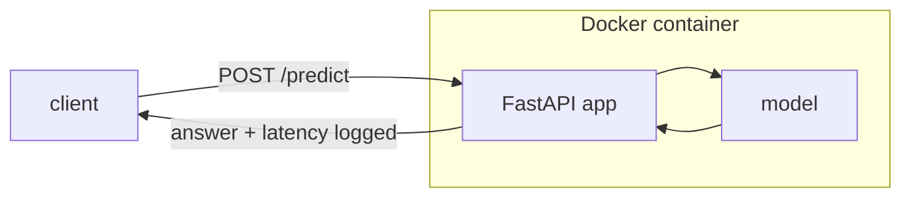

<!-- Written by `npm run lessons` from the lesson data in src/data. Edit the lesson there, not this page. -->

# Serving: APIs, Docker, latency and cost

**ML Foundations · Unit 5: AI engineering · Lesson 12 of 16**

> **In one line.** Serving puts a model behind an API so applications can use it, packaged (often in a Docker container) with everything it needs, and measured for latency, throughput and cost.

[Open this lesson on the site](https://learn.hamropedia.com/foundations/serving-apis-docker-latency-and-cost/) for its animation, the practice game and tap-to-explain words.

## The problem it solves

A model in a notebook helps nobody. Real users need a reliable endpoint that answers quickly, handles many requests at once, and doesn't cost more than it earns. Serving is where your model meets real traffic, and where latency and cost decisions are made.

## The idea

Put your model behind an API (for example with FastAPI), package it with everything it needs (Docker), and measure latency (time per request) and cost (per request or per token).

## How it works, step by step

1. Wrap the model in a web API (for example FastAPI): an endpoint like POST /generate that validates input and returns output.
2. Add a /health endpoint, request IDs and structured logs (latency, tokens, errors) for every call.
3. Package the code, model files and dependencies into a Docker image, so it runs the same everywhere.
4. Measure latency: time to first token (what users feel first) and tokens per second after that.
5. Under load, batch requests: one GPU pass serves many users. Continuous batching (vLLM, TGI) adds new requests as old ones finish.
6. Stream tokens back as they are generated, so users see progress immediately.
7. Estimate cost per request from input and output tokens, or from GPU hours and throughput, and track it.

## Picture it



*The model sits behind an API, packaged in a container that runs the same on your laptop and on a server.*

## Analogy

A restaurant: the recipe is the model, the serving counter is the API, and a food truck you can drive anywhere is the Docker container.

**Where the analogy breaks.** A chef cooks one order at a time. Model servers batch many requests together, which serves more users but can make each one wait a little longer.

## Worked example

A FastAPI service in Docker exposes POST /generate and GET /health. With one request at a time, the GPU sits mostly idle and users queue. With continuous batching, the same GPU serves several times as many requests per second, and each user's time to first token rises only a little.

```python
from fastapi import FastAPI
app = FastAPI()

@app.post("/predict")
def predict(req: dict):
    return {"answer": model(req["text"])}
```

## Must know

- API + container + monitoring = a deployable service.
- Time to first token and tokens per second are the key latency numbers.
- Batching trades a little latency per user for much higher throughput.
- Streaming improves the speed people feel: the first words appear at once, although the full answer takes just as long.
- Output tokens usually cost more than input tokens.
- Load-test before launch: send many requests at once to find the limit before real users do.

## Common mistakes

- Only testing one request at a time.
- No timeouts or limits, so a slow request blocks others.
- Logging prompts that contain personal data without care.
- Ignoring cold-start time when loading big models.

> **Not true:** A service that answers one request quickly will handle a thousand at once as quickly.  
> **In fact:** Under load, requests queue up, memory fills and response times climb. Send many requests at the same time before launch, to find the limit.

> **Not true:** A service does not need timeouts: slow requests finish in the end.  
> **In fact:** One slow request can hold a worker or a GPU slot while others queue behind it. Set timeouts and limits, so that a stuck request is cut off.

## Practise

Try each one yourself first: on paper, in code or out loud. Then open the answer and compare.

### 1. Derive

Estimate the cost of 1,000 requests that each use 1,500 input tokens and 300 output tokens, using real prices you look up for one model.

<details>
<summary>Show one good answer</summary>

First count the tokens: 1,000 requests × 1,500 input tokens = 1.5 million input tokens, and 1,000 × 300 output tokens = 0.3 million output tokens.

On the free setup these answers use (Groq, Gemini and NVIDIA free tiers, then a local Ollama model), this costs nothing. What limits you instead is the free tiers' rate limits, such as tokens per minute and requests per day, so 1.8 million tokens may need spreading over time or will fall through to the next provider; the local model has no limit except your computer's speed.

For interviews, know the method for paid APIs, because companies pay per token: cost = (input tokens ÷ 1,000,000) × input price + (output tokens ÷ 1,000,000) × output price, with prices looked up on the provider's page. With made-up example prices of $1 per million input tokens and $4 per million output, that is 1.5 × $1 + 0.3 × $4 = $2.70. Two things to say: output tokens are usually several times dearer than input tokens, and models that reason before answering produce extra output tokens, so measure real usage rather than guessing from the visible answer.

</details>

### 2. Build

Serve a model behind FastAPI in Docker. Add a /health endpoint and log the latency of every request.

<details>
<summary>Show one good answer</summary>

The app serves the small Shakespeare GPT from Unit 4 behind FastAPI. /health returns quickly without touching the model, which is what a load balancer or Docker checks; /generate returns text. A middleware times every request and logs its method, path, status and latency.

The model is loaded once at start-up, never per request. The endpoint is a plain def, not async def, so FastAPI runs it in a worker thread and a slow generation doesn't freeze the server for everyone else.

The Dockerfile is below the code. Build and run with: docker build -t gpt-api . and docker run -p 8000:8000 gpt-api. The script's own check uses FastAPI's TestClient, so it runs without Docker.

```python
# app.py: serve the small GPT with FastAPI. Needs gpt.py (Unit 4) next to it.
import logging
import time
import torch
from fastapi import FastAPI, Request
from pydantic import BaseModel
from gpt import GPT, train, encode, decode

logging.basicConfig(level=logging.INFO, format="%(asctime)s %(message)s")
torch.manual_seed(0)
MODEL = train(GPT(), steps=300, log_every=0)      # in real life: load trained weights from a file
MODEL.eval()
app = FastAPI()

@app.middleware("http")
async def log_latency(request: Request, call_next):
    start = time.perf_counter()
    response = await call_next(request)
    logging.info(f"{request.method} {request.url.path} {response.status_code} {(time.perf_counter() - start) * 1000:.0f} ms")
    return response

@app.get("/health")
def health():
    return {"status": "ok"}

class Prompt(BaseModel):
    text: str = "ROMEO:"
    max_new_tokens: int = 100

@app.post("/generate")
def generate(prompt: Prompt):                       # plain def: runs in a worker thread
    ids = torch.tensor([encode(prompt.text)])
    return {"text": decode(MODEL.generate(ids, min(prompt.max_new_tokens, 500))[0].tolist())}

if __name__ == "__main__":
    from fastapi.testclient import TestClient
    client = TestClient(app)
    print(client.get("/health").json())
    print(client.post("/generate", json={"text": "ROMEO:", "max_new_tokens": 40}).json()["text"])

# Dockerfile (save as "Dockerfile"):
#   FROM python:3.12-slim
#   WORKDIR /app
#   RUN pip install --no-cache-dir torch --index-url https://download.pytorch.org/whl/cpu \
#    && pip install --no-cache-dir fastapi uvicorn
#   COPY gpt.py app.py ./
#   EXPOSE 8000
#   HEALTHCHECK CMD python -c "import urllib.request; urllib.request.urlopen('http://localhost:8000/health')"
#   CMD ["uvicorn", "app:app", "--host", "0.0.0.0", "--port", "8000"]
```

</details>

### 3. Break

Send 50 requests at once with a simple load test. What happens to latency, and where is the bottleneck?

<details>
<summary>Show one good answer</summary>

Send 50 requests at the same moment. One request alone takes, say, a fraction of a second. With 50 at once, the median and especially the slowest requests take many times longer, and the total throughput hardly improves.

Where the bottleneck is: the model, not the web server. Generation is heavy CPU work, and a single process has a limited pool of worker threads that compete for the same CPU cores (and Python's global interpreter lock), so requests mostly wait in a queue. /health stays fast, which proves the server itself is fine.

The fixes, roughly in order: batch requests together so one forward pass serves many users (the biggest win for real model servers, which is what vLLM-style servers do); run several worker processes or replicas behind a load balancer; use a GPU; cap max_new_tokens and stream the output so users see the first words quickly; and add a queue with back-pressure, returning "busy, try again" instead of letting latency grow without limit.

```python
import asyncio
import statistics
import threading
import time
import httpx
import uvicorn
from app import app                                  # the Build answer above, saved as app.py

threading.Thread(target=lambda: uvicorn.run(app, port=8765, log_level="warning"), daemon=True).start()
time.sleep(2)

async def one(client):
    start = time.perf_counter()
    await client.post("http://127.0.0.1:8765/generate", json={"text": "ROMEO:", "max_new_tokens": 60}, timeout=300)
    return time.perf_counter() - start

async def main():
    async with httpx.AsyncClient() as client:
        single = await one(client)
        start = time.perf_counter()
        times = await asyncio.gather(*[one(client) for _ in range(50)])
        total = time.perf_counter() - start
        health = time.perf_counter(); await client.get("http://127.0.0.1:8765/health"); health = time.perf_counter() - health
    print(f"one request alone: {single:.2f} s")
    print(f"50 at once: median {statistics.median(times):.2f} s, slowest {max(times):.2f} s, all done in {total:.1f} s")
    print(f"/health during the load test: {health * 1000:.0f} ms")

asyncio.run(main())
```

</details>

### 4. Explain

Explain the API, the container and batching with the restaurant picture.

<details>
<summary>Show one good answer</summary>

Think of a restaurant. The recipe is the model: it knows how to make the dish. The serving counter is the API: customers don't walk into the kitchen; they place an order at the counter in a standard way and get their food back. A food truck you can drive anywhere is the Docker container: the whole kitchen, with its exact equipment, packed so it works the same in every car park.

Batching is the cook making several portions of the same dish in one big pan instead of one at a time: each customer waits a few seconds longer for their order to be grouped, but the kitchen serves far more people per hour. That is how model servers handle many users.

</details>

## Check you understood

Answer in your head first, then open each one.

<details>
<summary>&lt;b>What is time to first token, and why does it matter?&lt;/b></summary>

The delay before the first output token appears. It is what users feel as responsiveness, especially with streaming.

</details>

<details>
<summary>&lt;b>Why does batching raise throughput?&lt;/b></summary>

The GPU processes many requests in one pass, using its compute much more fully.

</details>

<details>
<summary>&lt;b>What does Docker give you?&lt;/b></summary>

One image with the code, model and all dependencies, so it runs identically on any machine.

</details>

<details>
<summary>&lt;b>A request uses 2,000 input and 500 output tokens. Prices are £1 per million input and £4 per million output tokens. Cost?&lt;/b></summary>

0.002 × £1 + 0.0005 × £4 = £0.002 + £0.002 = £0.004.

</details>

## Go further (optional)

The lesson above is enough on its own. These free extras give a second explanation.

- READ · [FastAPI tutorial](https://fastapi.tiangolo.com/tutorial/) · fastapi.tiangolo.com
- READ · [Get started with Docker](https://docs.docker.com/get-started/) · docs.docker.com
- READ · [Made With ML: serving and deployment lessons](https://madewithml.com/) · Goku Mohandas · free

---

[← Dataset engineering for fine-tuning](dataset-engineering-for-fine-tuning.md) · [All lessons](../../README.md) · [Caching, model routing and cost control →](caching-model-routing-and-cost-control.md)
