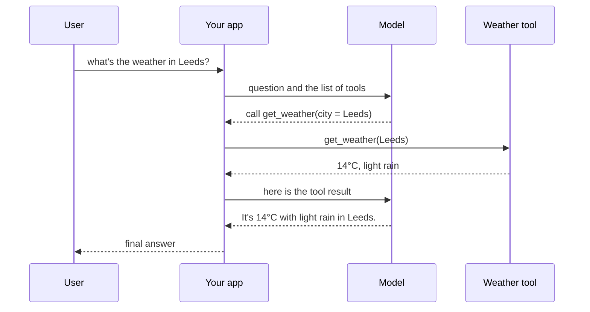

<!-- Written by `npm run lessons` from the lesson data in src/data. Edit the lesson there, not this page. -->

# Structured outputs and function calling

**ML Foundations · Unit 5: AI engineering · Lesson 2 of 16**

> **In one line.** Structured output makes the model reply in a fixed format that code can read, usually JSON that matches a schema. Function calling lets the model ask your code to run one of your functions, with the arguments it chose.

[Open this lesson on the site](https://learn.hamropedia.com/foundations/structured-outputs-and-function-calling/) for its animation, the practice game and tap-to-explain words.

## The problem it solves

Free-form text is hard for programs to use reliably: a missing field or an extra sentence breaks parsing. And models can't look things up or take actions by themselves. Structured outputs make answers reliable to parse, and tool calling connects the model to live data and real actions — the basis of every agent.

## The idea

Structured output means making the model reply in a fixed format, usually JSON that matches a schema, so your code can read it reliably. Function calling (tool use) goes one step further. You describe functions to the model. Instead of answering in prose, it replies with a function name and the arguments to call it with. Your code runs the function and sends the result back.

## How it works, step by step

1. Define the shape you want with a JSON Schema: field names, types, which are required, allowed values.
2. Send the schema with the request (many APIs can enforce it during generation), then validate every reply in code anyway.
3. For tools, describe each function: its name, what it does, and a schema for its arguments.
4. When a tool would help, the model replies with a tool call, such as {tool: get_weather, city: Leeds}, instead of prose.
5. Your code checks the arguments, runs the function, and sends the result back as a tool-result message.
6. The model then writes the final answer, or calls another tool. This loop is how agents work.
7. If validation fails, send the error back and ask once for a corrected reply.

## Picture it



*The model never runs the tool itself: it asks your code to, and then writes the final answer from the result.*

## Analogy

A form with labelled boxes instead of a blank page. The model fills in the boxes, and your program reads them.

**Where the analogy breaks.** A person filling in a form knows the boxes are strict. A model can still put a wrong value in the right box, like a real date that is the wrong date, so you check the content as well as the shape.

## Worked example

Instead of a sentence, a tool-calling model returns something like {"tool": "get_weather", "arguments": {"city": "Leeds"}}. Your code calls get_weather, then sends the result back so the model can write the final answer.

```python
import json

reply = llm(prompt)                        # the prompt asks for JSON only
try:
    data = json.loads(reply)
    ok = set(data) == {"city", "date"}
except json.JSONDecodeError:
    ok = False
if not ok:
    reply = llm(prompt + FIX_JSON_REMINDER)   # one retry, then fail loudly
```

## Must know

- The model chooses the call; your code runs it. Never execute arbitrary model output.
- Valid JSON can still contain wrong values: check content, not just shape.
- Good tool descriptions matter as much as good prompts.
- Make optional fields explicit, and allow null for missing data instead of invented values.
- Keep tools small and specific, with clear names.

## Common mistakes

- Trusting a reply because it parsed. Valid JSON can still hold wrong or invented values, so check them.
- Letting a tool take dangerous actions without checks or confirmation.
- Vague tool descriptions, so the model picks the wrong tool or invents arguments.
- Forcing a required field when the data may genuinely be missing, so the model makes something up.

> **Not true:** Marking a field as required makes the model fill it with correct information.  
> **In fact:** When the information is missing from the source, a required field forces the model to invent something. Let such fields be optional or null.

> **Not true:** A reply that parses as valid JSON can be trusted.  
> **In fact:** Valid JSON only means the shape is right. The values inside can still be wrong or invented, so check them.

## Practise

Try each one yourself first: on paper, in code or out loud. Then open the answer and compare.

### 1. Derive

Write a JSON schema for extracting a job advert: title, company, salary range (may be missing), location and a list of skills. Decide which fields are required.

<details>
<summary>Show one good answer</summary>

Required fields are the ones every advert has, or where a missing value must be stated explicitly rather than skipped: title, company, location and skills always; salary is required too, but allowed to be null, so the model must say "not given" instead of inventing a number.

Design choices worth copying:  
• Salary as a nested object with min, max and currency, each nullable. "£40,000–£50,000" fits, "up to £60k" fits (min null), and no salary fits (salary null).  
• Numbers as integers in a fixed unit (per year, whole pounds), so code can compare them.  
• Location with an explicit remote option, since "Remote (UK)" is common.  
• additionalProperties: false, so no surprise keys appear.

```text
{
  "type": "object",
  "properties": {
    "title":    {"type": "string"},
    "company":  {"type": "string"},
    "location": {"type": "string", "description": "City, or 'Remote' if fully remote"},
    "remote":   {"type": "boolean"},
    "salary": {
      "anyOf": [
        {"type": "null"},
        {
          "type": "object",
          "properties": {
            "min":      {"anyOf": [{"type": "integer"}, {"type": "null"}]},
            "max":      {"anyOf": [{"type": "integer"}, {"type": "null"}]},
            "currency": {"type": "string", "description": "ISO code, e.g. GBP"}
          },
          "required": ["min", "max", "currency"],
          "additionalProperties": false
        }
      ],
      "description": "Yearly salary. null if the advert gives none."
    },
    "skills": {"type": "array", "items": {"type": "string"}}
  },
  "required": ["title", "company", "location", "remote", "salary", "skills"],
  "additionalProperties": false
}
```

</details>

### 2. Build

Send 30 real job adverts to an LLM with your schema. Validate every reply in code, retry once on failure, and report the success rate. Then add one tool, such as a currency converter, and handle the tool-call loop.

<details>
<summary>Show one good answer</summary>

Structured outputs (response_format with a JSON schema; ask(..., schema=SCHEMA) in llm.py) make the model return JSON that matches the schema, so json.loads can't fail on shape. But the values can still be wrong, so validate them in code: salary min not above max, salary numbers that really appear in the advert, at least one skill. On any failure, retry once, giving the model the error; report the success rate over all adverts.

Then one tool: convert_currency. The loop is: send the request with the tool definition; if the reply contains tool_calls, run each one (its arguments arrive as a JSON string), send each result back as a message with role "tool" and the matching tool_call_id, and repeat until the model gives its final answer (with a step limit).

The list has 3 sample adverts; paste in 30 real ones. It runs on the free chain from llm.py.

```python
import json
import re
from llm import ask, text_of

SCHEMA = {
    "type": "object",
    "properties": {
        "title": {"type": "string"}, "company": {"type": "string"},
        "location": {"type": "string"}, "remote": {"type": "boolean"},
        "salary": {"anyOf": [{"type": "null"}, {
            "type": "object",
            "properties": {"min": {"anyOf": [{"type": "integer"}, {"type": "null"}]},
                           "max": {"anyOf": [{"type": "integer"}, {"type": "null"}]},
                           "currency": {"type": "string"}},
            "required": ["min", "max", "currency"], "additionalProperties": False}]},
        "skills": {"type": "array", "items": {"type": "string"}},
    },
    "required": ["title", "company", "location", "remote", "salary", "skills"],
    "additionalProperties": False,
}
ADVERTS = [
    "Junior AI Engineer at Brightwave, Manchester (hybrid). £38,000 - £45,000. Python, PyTorch, RAG, SQL.",
    "ML Engineer, Northcode. Fully remote within the UK. Up to £60k. You'll need Python, AWS and Docker.",
    "Graduate Data Scientist - Lumen Health, Birmingham. Competitive salary. Python, statistics, pandas.",
]

def check(data, advert):
    """Problems that valid JSON can still have."""
    problems = []
    salary = data["salary"]
    if salary:
        if salary["min"] and salary["max"] and salary["min"] > salary["max"]:
            problems.append("salary min is above max")
        digits = re.sub(r"[^0-9k]", "", advert.lower())
        for value in (salary["min"], salary["max"]):
            if value and str(value)[:2] not in digits:
                problems.append(f"salary {value} does not appear in the advert")
    if not data["skills"]:
        problems.append("no skills found")
    return problems

def extract(advert):
    prompt = f"Extract the job advert into the schema. Salaries are yearly, in whole units. Advert:\n{advert}"
    for attempt in range(2):                                   # first try, then one retry
        data = json.loads(text_of(ask(prompt, schema=SCHEMA)))
        problems = check(data, advert)
        if not problems:
            return data
        prompt += f"\nYour previous answer had these problems: {problems}. Fix them."
    return None

results = [extract(a) for a in ADVERTS]
print(f"success rate: {sum(r is not None for r in results)}/{len(ADVERTS)}")

RATES = {("GBP", "EUR"): 1.17, ("GBP", "USD"): 1.27, ("EUR", "GBP"): 0.85, ("USD", "GBP"): 0.79}
TOOLS = [{"type": "function", "function": {
    "name": "convert_currency",
    "description": "Convert an amount of money from one currency to another, using today's fixed rates.",
    "parameters": {"type": "object",
                   "properties": {"amount": {"type": "number"}, "from_currency": {"type": "string"},
                                  "to_currency": {"type": "string"}},
                   "required": ["amount", "from_currency", "to_currency"]},
}}]

def convert_currency(amount, from_currency, to_currency):
    rate = RATES.get((from_currency.upper(), to_currency.upper()))
    return f"{amount * rate:.0f} {to_currency.upper()}" if rate else f"No rate for {from_currency} to {to_currency}"

messages = [{"role": "user", "content": f"What is the top salary in this advert in euros? Use the tool. {ADVERTS[0]}"}]
for step in range(5):                                          # a step limit, always
    reply = ask(messages=messages, tools=TOOLS)
    messages.append(reply["message"])
    if not reply["tool_calls"]:
        break
    for call in reply["tool_calls"]:
        arguments = json.loads(call["function"]["arguments"])
        messages.append({"role": "tool", "tool_call_id": call["id"], "content": convert_currency(**arguments)})
print(text_of(reply), "| answered by", reply["provider"])
```

</details>

### 3. Break

Remove the schema from the prompt, or give an advert with no salary. What breaks? Then find a reply that is valid JSON but has a wrong value, and add a check that catches it.

<details>
<summary>Show one good answer</summary>

Without the schema (just "extract this as JSON"), the reply's shape is up to the model: keys get renamed, the salary comes back as a string like "£38k–£45k" instead of numbers, and sometimes the JSON arrives inside a code fence. Your parsing code breaks, or worse, it runs on the wrong shape.

An advert with no salary ("Competitive salary") is the classic trap. Without a nullable salary field and an instruction, models are tempted to fill the box with a plausible figure, which is a hallucination that looks exactly like data. The schema's null option plus "null if the advert gives none" lets the model say so.

Valid JSON with a wrong value: for example "Up to £60k" extracted as min 60,000 and max null, or a monthly salary stored as yearly, or min and max swapped. Every one passes the schema. Checks that catch them: min ≤ max; every salary number must appear in the advert's text (which also catches invented salaries); a plausible range for the role (say £15,000 to £500,000 a year); and for "up to" adverts, the number must be the max. Structured outputs guarantee the shape; only your own checks protect the meaning.

```python
import re

def salary_problems(salary, advert):
    if salary is None:
        return []
    problems = []
    lo, hi = salary["min"], salary["max"]
    if lo and hi and lo > hi:
        problems.append("min is above max")
    for value in (lo, hi):
        if value and not 15_000 <= value <= 500_000:
            problems.append(f"{value} is not a plausible yearly salary")
    text = advert.lower().replace(",", "")
    for value in (lo, hi):
        if value and str(value) not in text and f"{value // 1000}k" not in text:
            problems.append(f"{value} does not appear in the advert")
    if "up to" in text and lo and not hi:
        problems.append('"up to" means this is the max, not the min')
    return problems

advert = "ML Engineer, Northcode. Fully remote. Up to £60k."
print(salary_problems({"min": 60000, "max": None, "currency": "GBP"}, advert))   # caught
print(salary_problems({"min": None, "max": 60000, "currency": "GBP"}, advert))   # []
print(salary_problems({"min": 55000, "max": 65000, "currency": "GBP"},
                      "Graduate Data Scientist. Competitive salary."))           # invented: caught
```

</details>

### 4. Explain

Explain structured output and function calling with the form-with-boxes picture.

<details>
<summary>Show one good answer</summary>

A paper form with labelled boxes ("Job title: ___", "Salary from: ___ to: ___", tick if remote) instead of a blank page saying "tell us about the job". Whoever fills it in can't wander off topic, every answer lands in a known place, and a computer can read the form straight away. Structured output is that form: you give the model a schema, and its reply must fill exactly those boxes.

Function calling is a form the model fills in to ask your program to do something: "call convert_currency with amount 45,000, from GBP, to EUR". Your code does the work and hands back the result, and the model continues. The model never runs anything itself; it only fills in the request form.

</details>

## Check you understood

Answer in your head first, then open each one.

<details>
<summary>&lt;b>Who actually runs a function the model "calls"?&lt;/b></summary>

Your code. The model only outputs the function name and arguments.

</details>

<details>
<summary>&lt;b>Why validate output that is already valid JSON?&lt;/b></summary>

The structure can be right while the values are wrong, impossible or invented.

</details>

<details>
<summary>&lt;b>What goes in a tool definition?&lt;/b></summary>

A name, a clear description of what it does and when to use it, and a JSON schema for its arguments.

</details>

<details>
<summary>&lt;b>A field is often missing from the source text. How should the schema handle it?&lt;/b></summary>

Make it optional or nullable, and tell the model to use null rather than guess.

</details>

## Go further (optional)

The lesson above is enough on its own. These free extras give a second explanation.

- READ · [Tool use with Claude](https://docs.claude.com/en/docs/agents-and-tools/tool-use/overview) · Claude docs
- READ · [Creating your first schema](https://json-schema.org/learn/getting-started-step-by-step) · json-schema.org
- READ · AI Engineering, Ch 2 (sampling and structured outputs) · Chip Huyen · book you own

---

[← Prompting: clear instructions, examples, structured output](prompting-clear-instructions-examples-structured-output.md) · [All lessons](../../README.md) · [Embeddings and semantic search →](embeddings-and-semantic-search.md)
