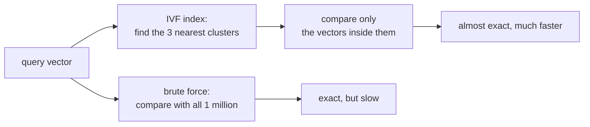

<!-- Written by `npm run lessons` from the lesson data in src/data. Edit the lesson there, not this page. -->

# Vector databases and approximate nearest-neighbour search

**ML Foundations · Unit 5: AI engineering · Lesson 4 of 16**

> **In one line.** A vector database stores embeddings with their metadata and an approximate nearest-neighbour (ANN) index, such as HNSW or IVF, that finds almost-the-closest vectors without comparing the query with every vector.

[Open this lesson on the site](https://learn.hamropedia.com/foundations/vector-databases-and-approximate-nearest-neighbour-search/) for its animation, the practice game and tap-to-explain words.

## The problem it solves

Exact search compares the query with every stored vector. With millions of vectors and many users, that is too slow and too expensive. ANN indexes search only a small, well-chosen part of the data, giving answers in milliseconds while keeping recall high. Choosing and tuning them is a core part of building retrieval at scale.

## The idea

Comparing a question with every document vector is exact but slow once you have millions. Approximate nearest-neighbour (ANN) indexes, such as HNSW or IVF, find almost-the-closest vectors much faster by searching only a small part of the data. A vector database stores the vectors, the index and metadata (like source and date) together, so you can filter and search at once.

## How it works, step by step

1. HNSW: build a graph where each vector links to its nearest neighbours, in several layers; higher layers hold fewer vectors and longer links.
2. Search starts at an entry point on the top layer and greedily hops to whichever neighbour is closer to the query.
3. When no neighbour is closer, drop a layer and continue. On the bottom layer, the closest vectors found are returned.
4. IVF: cluster the vectors with k-means, and at query time search only the few clusters nearest the query.
5. Product quantisation compresses vectors (for example to a few bytes each) to save memory, at some cost in accuracy.
6. Tune the speed–recall trade-off (HNSW's ef_search, IVF's number of probed clusters) and measure recall@k against exact search.
7. Store metadata (source, date, owner) with each vector, so you can filter and enforce permissions.

## Picture it



*Approximate search skips most of the data by first finding the right neighbourhood. You trade a little recall for a lot of speed.*

## Analogy

Finding a book by walking to the right section and shelf, instead of checking every book in the library.

**Where the analogy breaks.** A library's sections are exact. An ANN index can occasionally miss the true best match, so you trade a little accuracy (recall) for a lot of speed, and you should measure that trade.

## Worked example

HNSW builds a graph where each vector links to its near neighbours, in several layers. A search starts on the top, sparse layer and walks towards the query, dropping to denser layers as it gets close, like zooming in on a map.

```python
exact = np.argsort(-(D @ q))[:10]          # the true top 10
approx = index.search(q, k=10)            # your ANN index
recall_at_10 = len(set(exact) & set(approx)) / 10
```

## Must know

- Exact search: perfect recall, cost grows with the number of vectors.
- ANN: a little recall traded for a lot of speed.
- HNSW: graph-based, fast and accurate, memory-hungry.
- IVF: cluster-based; easy to understand and to scale.
- Measure recall@k against brute force on your own data.
- Metadata filters can hurt recall if applied after the search; good databases filter during it.

## Common mistakes

- Assuming an ANN index returns the exact nearest neighbours.
- Never measuring recall after tuning for speed.
- Using a vector database for a few thousand vectors, where NumPy brute force is simpler and fast enough.
- Forgetting permissions, so search returns documents a user must not see.

> **Not true:** A few thousand vectors: worth setting up a vector database.  
> **In fact:** With a few thousand vectors, comparing against all of them in NumPy takes milliseconds and is exact. An index only pays off at a much larger scale.

> **Not true:** ANN index: the exact nearest neighbours, found faster.  
> **In fact:** ANN stands for approximate: it searches only part of the data and can miss a true neighbour. It trades a little recall for a lot of speed.

## Practise

Try each one yourself first: on paper, in code or out loud. Then open the answer and compare.

### 1. Derive

Brute-force search over 1 million 768-dimensional float32 vectors: how many bytes does one search read, and roughly how many multiply-adds does it need? Why does that get slow at scale?

<details>
<summary>Show one good answer</summary>

One vector: 768 numbers × 4 bytes = 3,072 bytes. One million of them: about 3.07 GB, all read for every search.

Compute: one dot product per stored vector, so 1,000,000 × 768 ≈ 768 million multiply-adds per query.

Why that is slow at scale: a laptop reads memory at roughly 20 to 100 GB a second, so just streaming 3 GB takes about 0.03 to 0.15 seconds per query, before any other work. That is acceptable for one user, but at 100 queries a second you would need 300 GB/s of memory bandwidth, and the cost grows linearly with every new document: at 100 million vectors it is 300 GB per query. Approximate search avoids reading most of the vectors.

</details>

### 2. Build

Build a simple IVF index yourself: cluster the vectors with your own k-means, then search only the nearest few clusters. Measure recall@10 and speed against brute force. Then try a real library such as FAISS.

<details>
<summary>Show one good answer</summary>

An inverted-file (IVF) index in three steps. Cluster the vectors with k-means into, here, 256 groups. Store each vector in the list of its nearest centre. To search, compare the query with the 256 centres, then only scan the vectors in the few nearest clusters (nprobe of them) instead of all of them.

On 100,000 vectors, searching 8 of 256 clusters scans about 3% of the data. Recall@10 (how many of the true 10 nearest neighbours it finds) is 1.00 here, because the clusters in this made-up data are well separated (real embeddings are messier, so expect less), and each query is about 10 times faster than brute force. FAISS's IndexIVFFlat does the same thing in optimised C++, and is far faster again: around 0.02 ms per query here.

```python
import time
import numpy as np
import faiss

rng = np.random.default_rng(0)
centres = rng.normal(size=(200, 64))
X = (centres[rng.integers(0, 200, 100_000)] + 0.3 * rng.normal(size=(100_000, 64))).astype(np.float32)
Q = (centres[rng.integers(0, 200, 200)] + 0.3 * rng.normal(size=(200, 64))).astype(np.float32)

def kmeans(data, k, steps=15):
    c = data[rng.choice(len(data), k, replace=False)]
    for _ in range(steps):
        labels = np.argmin((data**2).sum(1)[:, None] - 2 * data @ c.T + (c**2).sum(1), axis=1)
        c = np.array([data[labels == j].mean(0) if np.any(labels == j) else c[j] for j in range(k)])
    return c

def sq_dists(a, b):
    return (a**2).sum(1)[:, None] - 2 * a @ b.T + (b**2).sum(1)

centroids = kmeans(X[rng.choice(len(X), 20_000, replace=False)], 256)
assign = np.argmin(sq_dists(X, centroids), axis=1)
lists = [np.where(assign == j)[0] for j in range(256)]

def ivf_search(q, k=10, nprobe=8):
    probe = np.argsort(sq_dists(q[None], centroids)[0])[:nprobe]
    candidates = np.concatenate([lists[j] for j in probe])
    return candidates[np.argsort(sq_dists(q[None], X[candidates])[0])[:k]]

t = time.perf_counter(); truth = np.argsort(sq_dists(Q, X), axis=1)[:, :10]; brute = (time.perf_counter() - t) / len(Q)
t = time.perf_counter(); found = [ivf_search(q) for q in Q]; ivf = (time.perf_counter() - t) / len(Q)
recall = np.mean([len(set(f) & set(tr)) / 10 for f, tr in zip(found, truth)])
print(f"my IVF: recall@10 {recall:.2f}, {ivf * 1000:.2f} ms/query vs brute force {brute * 1000:.2f} ms/query")

index = faiss.IndexIVFFlat(faiss.IndexFlatL2(64), 64, 256)
index.train(X); index.add(X); index.nprobe = 8
t = time.perf_counter(); _, I = index.search(Q, 10); fa = (time.perf_counter() - t) / len(Q)
print(f"FAISS IVF: recall@10 {np.mean([len(set(a) & set(b)) / 10 for a, b in zip(I, truth)]):.2f}, {fa * 1000:.3f} ms/query")
```

</details>

### 3. Break

Search fewer and fewer clusters until recall drops, and plot recall against speed. Then add a metadata filter (only documents from 2026) and see what happens to recall.

<details>
<summary>Show one good answer</summary>

Fewer clusters searched means less work but more misses: the true neighbours sometimes sit in a cluster you didn't open, especially near cluster borders. Plotted, recall rises steeply with the first few probes and then flattens near 1.0, while time per query grows roughly linearly. Choose the smallest nprobe that meets your recall target; that knee is the whole point of approximate search.

A metadata filter applied after the search (take the top 10, then keep only 2026 documents) breaks it: if only 10% of documents are from 2026, the top 10 usually contains about one of them, so you return one result, or none, instead of ten. The fix is to filter inside the search: either over-fetch (ask for 100 candidates, then filter), or keep the filter in the index so only matching vectors are scanned. In the run below, post-filtering returns only about 1 result per query on average; over-fetching 200 candidates restores all 10, at a higher cost.

```python
import time
import numpy as np
import faiss
import matplotlib.pyplot as plt

rng = np.random.default_rng(0)
centres = rng.normal(size=(200, 64))
X = (centres[rng.integers(0, 200, 100_000)] + 0.3 * rng.normal(size=(100_000, 64))).astype(np.float32)
Q = (centres[rng.integers(0, 200, 200)] + 0.3 * rng.normal(size=(200, 64))).astype(np.float32)
year = np.where(rng.random(100_000) < 0.1, 2026, 2025)          # 10% of documents are from 2026

flat = faiss.IndexFlatL2(64); flat.add(X)
_, truth = flat.search(Q, 10)
index = faiss.IndexIVFFlat(faiss.IndexFlatL2(64), 64, 256); index.train(X); index.add(X)
recalls, times = [], []
for nprobe in [1, 2, 4, 8, 16, 32, 64]:
    index.nprobe = nprobe
    t = time.perf_counter(); _, I = index.search(Q, 10); times.append((time.perf_counter() - t) / len(Q) * 1000)
    recalls.append(np.mean([len(set(a) & set(b)) / 10 for a, b in zip(I, truth)]))
    print(f"nprobe {nprobe:2d}: recall@10 {recalls[-1]:.2f}, {times[-1]:.3f} ms/query")
plt.plot(times, recalls, marker="o"); plt.xlabel("ms per query"); plt.ylabel("recall@10"); plt.show()

index.nprobe = 16
_, top10 = index.search(Q, 10)
post = np.mean([(year[row] == 2026).sum() for row in top10])
_, top200 = index.search(Q, 200)
over = np.mean([min(10, (year[row] == 2026).sum()) for row in top200])
print(f"2026-only results per query: filter after top-10 = {post:.1f}, over-fetch 200 then filter = {over:.1f}")
```

</details>

### 4. Explain

Explain approximate search with the library-sections picture, and what you give up.

<details>
<summary>Show one good answer</summary>

Finding a book by checking every single book in the library is exact, but slow, and gets slower with every book you add. Instead, you walk to the right section, then the right shelf, and only look there. That is approximate search: the index groups similar vectors together (sections), and a search only opens the few groups nearest to the question.

What you give up: certainty. A book shelved in the next section, right at the border, can be missed. So you trade a little recall (sometimes missing one of the true nearest neighbours) for a huge gain in speed, and tune how many sections to check until the trade is right for you.

</details>

## Check you understood

Answer in your head first, then open each one.

<details>
<summary>&lt;b>What does "approximate" give up?&lt;/b></summary>

A small chance of missing some of the true nearest vectors (lower recall), in exchange for much faster search.

</details>

<details>
<summary>&lt;b>How does HNSW search?&lt;/b></summary>

It hops greedily through a layered graph towards the query, starting on a sparse top layer and dropping to denser layers.

</details>

<details>
<summary>&lt;b>How does IVF decide where to search?&lt;/b></summary>

It clusters the vectors in advance and only searches the clusters closest to the query.

</details>

<details>
<summary>&lt;b>How do you measure an ANN index's quality?&lt;/b></summary>

Recall@k: the share of the true top-k results (from exact search) that the index also returns.

</details>

## Go further (optional)

The lesson above is enough on its own. These free extras give a second explanation.

- READ · [Hierarchical Navigable Small Worlds (HNSW)](https://www.pinecone.io/learn/series/faiss/hnsw/) · Pinecone Learn · illustrated  
  **Worth it:** Clear diagrams of the layered graph and the greedy search, plus how the tuning knobs change speed and recall.
- CODE · [Faiss: getting started](https://github.com/facebookresearch/faiss/wiki) · Meta AI · GitHub wiki
- PAPER · [Efficient and robust approximate nearest neighbor search using HNSW graphs (2016)](https://arxiv.org/abs/1603.09320) · Malkov and Yashunin · arXiv

---

[← Embeddings and semantic search](embeddings-and-semantic-search.md) · [All lessons](../../README.md) · [RAG: chunking, retrieval and re-ranking →](rag-chunking-retrieval-and-re-ranking.md)
