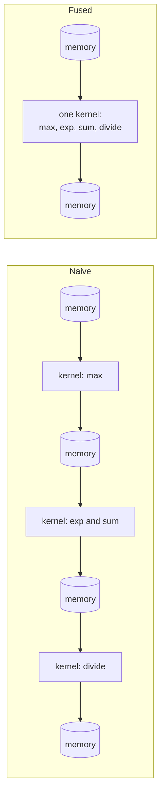

<!-- Written by `npm run lessons` from the lesson data in src/data. Edit the lesson there, not this page. -->

# GPU kernels with Triton

**ML Foundations · Unit 6: Systems and scale · Lesson 7 of 9**

> **In one line.** A GPU kernel is a function that runs as many parallel instances on the GPU, and Triton lets you write kernels in Python-like code. The biggest win is usually fusion: doing several steps in one kernel, so that the data leaves slow memory only once.

[Open this lesson on the site](https://learn.hamropedia.com/foundations/gpu-kernels-with-triton/) for its animation, the practice game and tap-to-explain words.

## The problem it solves

Many deep-learning operations are memory-bound chains of small steps (normalise, activate, scale). Run as separate PyTorch operations, each one reads and writes the full tensor in slow memory. A fused kernel can be several times faster. Triton makes writing such kernels possible without learning CUDA C++, and it is what torch.compile uses under the hood.

## The idea

A kernel is a small program that runs on the GPU as many parallel copies. Triton lets you write kernels in Python-like code. The biggest win is fusion: doing several steps, like the parts of a softmax, in one kernel, so data is read from slow GPU memory once instead of several times.

## How it works, step by step

1. Split the work into blocks: each kernel instance (a "program") handles one block, for example one row of a matrix.
2. Each program computes which addresses it owns from its program id, and loads that block with tl.load, using a mask for the ragged edge.
3. It does all the steps on the block in fast on-chip memory: for softmax, the max, the exponentials, the sum and the division.
4. It writes only the final result with tl.store.
5. A naive softmax as separate operations reads the data three times and writes twice; the fused kernel reads once and writes once.
6. Tune the block size: too small wastes parallel hardware, too large spills out of fast memory.
7. Always check correctness against PyTorch and benchmark across sizes.

## Picture it



*The naive softmax travels to memory and back three times; the fused kernel does it once.*

## Analogy

Cooking a dish in one trip to the fridge instead of fetching each ingredient separately.

**Where the analogy breaks.** In a kitchen, the fridge trip is the obvious cost. On a GPU you must measure: some operations are limited by the maths, not by memory, and fusion does not help them.

## Worked example

A naive softmax passes over the data several times (find the max, exponentiate and sum, divide). A fused Triton softmax reads each row once and writes it once, which can make it several times faster on large rows.

```python
@triton.jit
def add_kernel(x_ptr, y_ptr, out_ptr, n, BLOCK: tl.constexpr):
    pid = tl.program_id(0)
    offs = pid * BLOCK + tl.arange(0, BLOCK)
    mask = offs < n                         # don't read past the end
    x = tl.load(x_ptr + offs, mask=mask)
    y = tl.load(y_ptr + offs, mask=mask)
    tl.store(out_ptr + offs, x + y, mask=mask)
```

## Must know

- Kernel = one program, run as many parallel instances over blocks of data.
- Fusion cuts memory traffic for memory-bound chains.
- Masks handle sizes that aren't a multiple of the block size.
- Block size is a key tuning knob.
- torch.compile can often fuse operations for you automatically.
- Compute-bound operations (big matmuls) gain little from fusion.

## Common mistakes

- Forgetting the mask, so the last block reads or writes past the end of the tensor.
- Benchmarking without warm-up runs and torch.cuda.synchronize(), so the timing includes start-up costs or stops before the GPU has finished.
- Hand-writing a kernel for something torch.compile already fuses well.
- Not checking numerical stability (for softmax, subtract the max inside the kernel too).

> **Not true:** A kernel written by hand is faster than what torch.compile produces.  
> **In fact:** torch.compile already fuses many common chains of operations well. Write a kernel by hand only where measurement shows the compiler falls short.

> **Not true:** A kernel needs no mask when the tensor's size is not a multiple of the block size.  
> **In fact:** The last block would then read or write past the end of the tensor. A mask switches off the positions that fall outside it.

## Practise

Try each one yourself first: on paper, in code or out loud. Then open the answer and compare.

### 1. Derive

Estimate the bytes read and written by a naive softmax over a 4,096 × 4,096 fp32 matrix, and by a fused one. If it is memory-bound, what speed-up would you expect?

<details>
<summary>Show one good answer</summary>

A 4,096 × 4,096 fp32 matrix is 4,096² × 4 bytes ≈ 67 MB (64 MiB). Call that M.

Naive softmax in PyTorch runs several separate kernels, each going to memory and back:  
1. row max: read M (the output, one number per row, is tiny)  
2. subtract the max: read M, write M  
3. exp: read M, write M  
4. row sum: read M  
5. divide: read M, write M  
Total: about 5M read + 3M written = 8M ≈ 537 MB.

Fused softmax: one kernel loads each row into fast on-chip memory, does all five steps there, and writes the result once: M read + M written = 2M ≈ 134 MB.

Softmax is memory-bound (a few operations per number), so time is roughly proportional to bytes moved. Expected speed-up ≈ 8M / 2M = 4 times. The official Triton tutorial measures close to this on large rows.

</details>

### 2. Build

Work through the official Triton tutorials: vector add, fused softmax, then matrix multiply. Benchmark each one against PyTorch.

<details>
<summary>Show one good answer</summary>

These need an NVIDIA GPU with Triton installed (a free Colab GPU works). The vector-add kernel shows the basic pattern: each program instance handles one block of BLOCK_SIZE elements, computes its offsets from tl.program_id, masks off the elements past the end, loads, adds and stores. The fused softmax gives each row to one program, loads it once, computes max, exp, sum and divide in registers, and writes it once.

Benchmarks with triton.testing.do_bench: vector add matches PyTorch (both are limited by memory bandwidth; you can't beat the hardware); fused softmax is several times faster than the naive PyTorch version and roughly matches torch.softmax, which is itself a fused kernel. Matrix multiply, the third tutorial, adds tiling and is the place to learn how high-performance kernels reuse data; Triton's version gets close to cuBLAS.

```python
# Needs an NVIDIA GPU and: pip install triton
import torch
import triton
import triton.language as tl

@triton.jit
def add_kernel(x_ptr, y_ptr, out_ptr, n, BLOCK_SIZE: tl.constexpr):
    pid = tl.program_id(axis=0)
    offsets = pid * BLOCK_SIZE + tl.arange(0, BLOCK_SIZE)
    mask = offsets < n                                   # don't read past the end
    x = tl.load(x_ptr + offsets, mask=mask)
    y = tl.load(y_ptr + offsets, mask=mask)
    tl.store(out_ptr + offsets, x + y, mask=mask)

def add(x, y, block=1024):
    out = torch.empty_like(x)
    grid = lambda meta: (triton.cdiv(x.numel(), meta["BLOCK_SIZE"]),)
    add_kernel[grid](x, y, out, x.numel(), BLOCK_SIZE=block)
    return out

@triton.jit
def softmax_kernel(out_ptr, in_ptr, row_stride, n_cols, BLOCK_SIZE: tl.constexpr):
    row = tl.program_id(0)
    cols = tl.arange(0, BLOCK_SIZE)
    x = tl.load(in_ptr + row * row_stride + cols, mask=cols < n_cols, other=-float("inf"))
    x = x - tl.max(x, axis=0)                            # everything happens in registers
    e = tl.exp(x)
    tl.store(out_ptr + row * row_stride + cols, e / tl.sum(e, axis=0), mask=cols < n_cols)

def softmax(x):
    out = torch.empty_like(x)
    softmax_kernel[(x.shape[0],)](out, x, x.stride(0), x.shape[1], BLOCK_SIZE=triton.next_power_of_2(x.shape[1]))
    return out

def naive_softmax(x):                                    # 5 separate passes over memory
    m = x.max(dim=1, keepdim=True).values
    e = torch.exp(x - m)
    return e / e.sum(dim=1, keepdim=True)

x, y = torch.randn(10_000_000, device="cuda"), torch.randn(10_000_000, device="cuda")
assert torch.allclose(add(x, y), x + y)
print("add: triton", triton.testing.do_bench(lambda: add(x, y)), "ms | torch", triton.testing.do_bench(lambda: x + y), "ms")
m = torch.randn(4096, 4096, device="cuda")
assert torch.allclose(softmax(m), torch.softmax(m, dim=1), atol=1e-6)
for name, fn in [("triton fused", softmax), ("naive torch", naive_softmax), ("torch.softmax", lambda t: torch.softmax(t, 1))]:
    print(f"softmax {name}: {triton.testing.do_bench(lambda: fn(m)):.3f} ms")
```

</details>

### 3. Break

Remove the mask from your vector-add kernel and use a size that is not a multiple of BLOCK. What happens? Then try a very small and a very large BLOCK and compare speed.

<details>
<summary>Show one good answer</summary>

Without the mask, with a size that isn't a multiple of BLOCK (say 1,000,001 with BLOCK 1,024), the last program reads and writes past the end of the arrays. The result: garbage in memory just past your tensor, a crash with "an illegal memory access was encountered" (which then poisons the whole CUDA context, so later calls fail too), or, worst of all, nothing visible at all because the memory happened to be accessible, and something else is silently corrupted. That is why every load and store at the edge of the data must be masked.

BLOCK size: very small (say 16 or 32) means a huge number of programs, each doing almost nothing: the scheduling overhead and the poor use of wide memory transactions make it much slower. Very large (say 65,536) means few programs, each needing a lot of registers, so fewer run at once and some of the GPU sits idle; very large blocks can also fail to compile. The sweet spot for a simple element-wise kernel is usually around 1,024 to 4,096; Triton's autotuner can try several and pick the best.

```python
# Needs an NVIDIA GPU and: pip install triton
import torch
import triton
import triton.language as tl

@triton.jit
def add_no_mask(x_ptr, y_ptr, out_ptr, n, BLOCK_SIZE: tl.constexpr):
    offsets = tl.program_id(0) * BLOCK_SIZE + tl.arange(0, BLOCK_SIZE)
    tl.store(out_ptr + offsets, tl.load(x_ptr + offsets) + tl.load(y_ptr + offsets))   # no mask!

@triton.jit
def add_kernel(x_ptr, y_ptr, out_ptr, n, BLOCK_SIZE: tl.constexpr):
    offsets = tl.program_id(0) * BLOCK_SIZE + tl.arange(0, BLOCK_SIZE)
    mask = offsets < n
    tl.store(out_ptr + offsets, tl.load(x_ptr + offsets, mask=mask) + tl.load(y_ptr + offsets, mask=mask), mask=mask)

n = 50_000_001                                          # not a multiple of the block size
x, y = torch.randn(n, device="cuda"), torch.randn(n, device="cuda")
for block in [32, 256, 1024, 4096, 16384]:
    out = torch.empty_like(x)
    ms = triton.testing.do_bench(lambda: add_kernel[(triton.cdiv(n, block),)](x, y, out, n, BLOCK_SIZE=block))
    print(f"BLOCK {block:5d}: {ms:.3f} ms")
out = torch.empty_like(x)
add_no_mask[(triton.cdiv(n, 1024),)](x, y, out, n, BLOCK_SIZE=1024)    # reads and writes past the end
torch.cuda.synchronize()                                # may raise "illegal memory access", or silently corrupt
```

</details>

### 4. Explain

Explain kernel fusion with the one-trip-to-the-fridge picture.

<details>
<summary>Show one good answer</summary>

Cooking a dish in one trip to the fridge instead of walking back and forth for each ingredient. Unfused code is like fetching the eggs, cracking them, putting the bowl back in the fridge, fetching it again to add milk, putting it back, fetching it again to whisk: most of the time is spent walking, not cooking.

A GPU kernel that reads data from memory, does one small thing and writes it back is one trip to the fridge. Kernel fusion does several steps, such as subtract, exp, sum and divide, in one kernel while the data sits in the GPU's fast on-chip memory, then writes the result once. For memory-bound work, fewer trips means proportionally less time, which is the whole idea behind FlashAttention and fused softmax.

</details>

## Check you understood

Answer in your head first, then open each one.

<details>
<summary>&lt;b>What is kernel fusion?&lt;/b></summary>

Combining several operations into one kernel, so intermediate results stay in fast on-chip memory instead of making round trips to slow GPU memory.

</details>

<details>
<summary>&lt;b>Why does fusion speed up a softmax but barely help a large matmul?&lt;/b></summary>

Softmax is memory-bound, so fewer memory trips help a lot; a large matmul is compute-bound already.

</details>

<details>
<summary>&lt;b>What does the mask in a Triton load do?&lt;/b></summary>

It disables reads and writes for positions beyond the end of the data, for the last, partly filled block.

</details>

<details>
<summary>&lt;b>What is a "program" in Triton?&lt;/b></summary>

One instance of the kernel, responsible for one block of the data, identified by its program id.

</details>

## Go further (optional)

The lesson above is enough on its own. These free extras give a second explanation.

- CODE · [GPU Puzzles](https://github.com/srush/GPU-Puzzles) · Sasha Rush · GitHub · interactive notebook  
  **Worth it:** Small, visual puzzles that teach how GPU kernels index data, one idea at a time, in a notebook. The friendliest way into thinking like a GPU.
- CODE · [Triton tutorials: vector addition, fused softmax, matrix multiplication](https://triton-lang.org/) · triton-lang.org
- WATCH · [GPU MODE lectures on Triton](https://www.youtube.com/results?search_query=GPU+MODE+Triton+lecture) · GPU MODE

---

[← Profiling PyTorch code](profiling-pytorch-code.md) · [All lessons](../../README.md) · [Pruning and distillation →](pruning-and-distillation.md)
