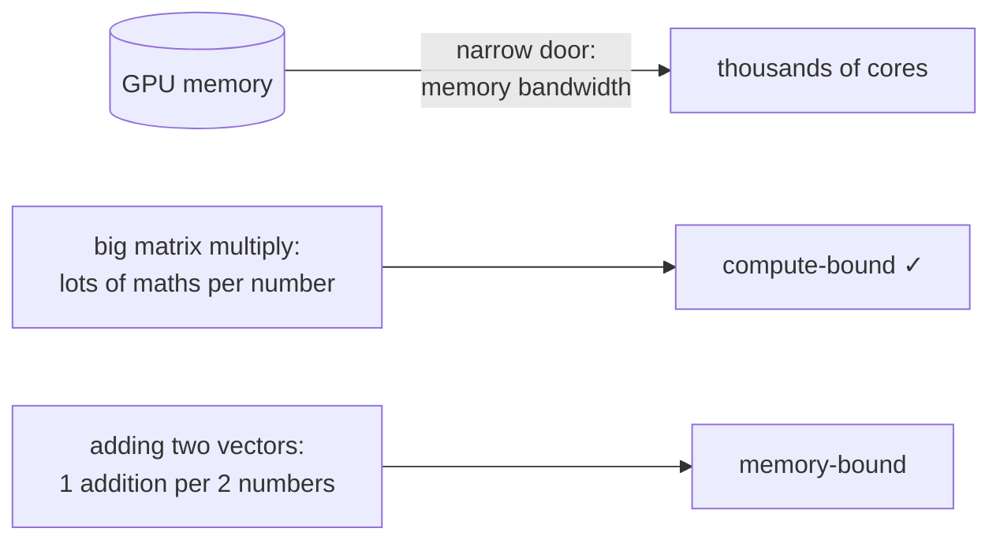

<!-- Written by `npm run lessons` from the lesson data in src/data. Edit the lesson there, not this page. -->

# How a GPU works: compute vs memory

**ML Foundations · Unit 6: Systems and scale · Lesson 1 of 9**

> **In one line.** A GPU runs thousands of simple cores in parallel. How fast your code runs depends on whether it is limited by the maths (compute-bound) or by moving data to the cores (memory-bound).

[Open this lesson on the site](https://learn.hamropedia.com/foundations/how-a-gpu-works-compute-vs-memory/) for its animation, the practice game and tap-to-explain words.

## The problem it solves

Deep learning is only practical because GPUs do enormous amounts of arithmetic in parallel. But many operations barely use that power: they spend their time waiting for data. Knowing which kind of operation you have tells you which optimisation can help — mixed precision, fusion, batching, quantisation — and which will do nothing.

## The idea

A GPU has thousands of simple cores that do the same operation on lots of data at once. Often the limit is not the maths but moving data between memory and the cores (memory bandwidth).

## How it works, step by step

1. A GPU has thousands of cores grouped into streaming multiprocessors. They all run the same instruction on different data at once.
2. Data lives in large GPU memory (HBM), which is fast by normal standards but slow compared with the cores. Each multiprocessor also has a small, very fast on-chip memory (registers and shared memory, or SRAM).
3. Every operation must move its inputs from HBM to the cores and its outputs back.
4. Arithmetic intensity = FLOPs done ÷ bytes moved. Adding two vectors does 1 addition for every 2 numbers loaded and 1 stored: very low intensity, so it is memory-bound.
5. Multiplying two big matrices reuses every loaded number many times: high intensity, so it is compute-bound — what GPUs are built for.
6. The roofline picture: below a certain intensity, speed is capped by memory bandwidth; above it, by peak compute.
7. So: memory-bound work gets faster by moving fewer bytes (fusing operations, using 16-bit or 8-bit numbers); compute-bound work by using tensor cores and lower precision maths.

## Picture it



*The cores are fast; getting numbers to them is often the real limit. Work that does lots of maths per number loaded uses the GPU well.*

## Analogy

A huge kitchen with 1,000 fast chefs but one narrow door for ingredients. The chefs spend a lot of time waiting at the door.

**Where the analogy breaks.** Chefs can each cook a different dish. GPU cores work best when they all do the same operation on different data.

## Worked example

Multiplying two big matrices does lots of maths for each number loaded, so it is compute-bound (good). Adding two vectors does 1 addition per 2 numbers loaded, so it is memory-bound. The ratio of maths to bytes moved is called arithmetic intensity.

## Must know

- GPUs are throughput machines: huge parallelism, same operation on lots of data.
- Memory bandwidth is often the real limit, not the FLOPs.
- Arithmetic intensity decides memory-bound versus compute-bound.
- Matrix multiplies are compute-bound; element-wise operations, norms and softmax are usually memory-bound.
- Many tiny operations are slow because of launch overhead and memory traffic; fewer, bigger operations are better.
- Tensor cores make 16-bit and 8-bit matrix maths much faster than 32-bit.

## Common mistakes

- Assuming the GPU's peak FLOPs is what your code achieves.
- Trying to speed up a memory-bound operation with more compute.
- Launching thousands of tiny kernels in a Python loop.
- Copying data between CPU and GPU inside the training loop.

> **Not true:** Your code runs at the GPU's advertised peak number of operations per second.  
> **In fact:** The peak is reached only while the chip is kept busy with maths. Most real code spends its time moving data in and out of memory, so it runs far below the peak.

> **Not true:** A memory-bound operation gets faster when the GPU has more compute.  
> **In fact:** A memory-bound operation is limited by how fast data moves in and out of memory. Extra compute sits idle: only moving less data makes it faster.

## Practise

Try each one yourself first: on paper, in code or out loud. Then open the answer and compare.

### 1. Derive

In fp32, compute the arithmetic intensity (FLOPs per byte moved) of adding two vectors of 1 million numbers, and of multiplying two 1,024 × 1,024 matrices.

<details>
<summary>Show one good answer</summary>

Arithmetic intensity = FLOPs ÷ bytes moved to and from memory. fp32 is 4 bytes per number.

Adding two vectors of 1 million numbers: 1 million additions. Bytes: read 2 × 1M × 4 = 8 MB, write 1M × 4 = 4 MB, so 12 MB.  
Intensity = 1,000,000 ÷ 12,000,000 ≈ 0.08 FLOPs per byte.

Multiplying two 1,024 × 1,024 matrices: each of the 1,024² outputs needs 1,024 multiplies and 1,024 adds, so 2 × 1,024³ ≈ 2.15 billion FLOPs. Bytes, at best (read A and B once, write C once): 3 × 1,024² × 4 ≈ 12.6 MB.  
Intensity ≈ 2.15 × 10⁹ ÷ 1.26 × 10⁷ ≈ 171 FLOPs per byte.

A modern GPU can do roughly 10 to 50 fp32 FLOPs (far more in bf16) in the time it moves one byte. So the vector add is memory-bound by a wide margin: the maths units sit idle waiting for data. The matrix multiply is compute-bound: there is enough work per byte to keep them busy. The bigger the matrices, the higher the intensity, which is why large matrix multiplications are where GPUs shine.

</details>

### 2. Build

Time matrix multiplication at growing sizes on CPU and on GPU (Colab is fine). Plot the achieved FLOPs per second against size.

<details>
<summary>Show one good answer</summary>

Time torch.matmul at sizes from 64 to 2,048 (more on a GPU), counting 2n³ FLOPs per multiply. Warm up first, repeat several times, and on a GPU call torch.cuda.synchronize() before stopping the clock (see the profiling topic for why).

The curve has the same shape on every device: tiny matrices reach a small fraction of the peak, because fixed costs (launching the operation, moving small amounts of data) dominate; as the size grows, the achieved FLOPs per second climbs and then levels off near the hardware's limit. On the laptop used here (an Apple M-series machine), the CPU levels off at about 1.5 TFLOP/s, thanks to built-in matrix units, while the small built-in GPU starts slower (37 GFLOP/s at n = 64) and keeps climbing, to about 4 TFLOP/s at n = 2,048. A data-centre GPU reaches tens of TFLOP/s in fp32 and hundreds in bf16. The lesson: GPUs only pay off when you give them big operations, which is one reason for batching.

```python
import time
import torch
import matplotlib.pyplot as plt

devices = ["cpu"] + (["cuda"] if torch.cuda.is_available() else []) + (["mps"] if torch.backends.mps.is_available() else [])
sync = {"cuda": torch.cuda.synchronize, "mps": torch.mps.synchronize, "cpu": lambda: None}
sizes = [64, 128, 256, 512, 1024, 2048]
for device in devices:
    rates = []
    for n in sizes:
        a, b = torch.randn(n, n, device=device), torch.randn(n, n, device=device)
        for _ in range(3):
            a @ b                                              # warm up
        sync[device]()
        repeats = max(1, int(2e9 // (2 * n**3)))
        start = time.perf_counter()
        for _ in range(repeats):
            a @ b
        sync[device]()
        rates.append(2 * n**3 * repeats / (time.perf_counter() - start) / 1e9)
    print(device, [f"{n}: {r:.0f} GFLOP/s" for n, r in zip(sizes, rates)])
    plt.plot(sizes, rates, marker="o", label=device)
plt.xscale("log"); plt.xlabel("matrix size n"); plt.ylabel("GFLOP/s achieved"); plt.legend(); plt.show()
```

</details>

### 3. Break

Time 1,000 tiny operations against 1 big operation doing the same total work. Why are the tiny ones so slow?

<details>
<summary>Show one good answer</summary>

1,000 tiny additions of 1,000 numbers do the same total work as one addition of 1 million numbers, but take several times longer: in the run below, about 4 times on this laptop's CPU, where each call costs about a microsecond. On a GPU the gap is usually far bigger, because every call also launches a kernel, which costs several microseconds by itself.

Why: every operation has a fixed cost that has nothing to do with its size. Python has to call into PyTorch, PyTorch checks the arguments, picks a kernel and allocates the output, and on a GPU it also launches the kernel, which costs several microseconds by itself. For 1,000 numbers the actual adding takes well under a microsecond, so almost all the time is overhead, paid 1,000 times. One big operation pays it once.

This is why good GPU code avoids Python loops over small pieces, batches work together, and fuses several small operations into one kernel.

```python
import time
import torch

device = "cuda" if torch.cuda.is_available() else "cpu"
sync = torch.cuda.synchronize if device == "cuda" else (lambda: None)
small = [(torch.randn(1000, device=device), torch.randn(1000, device=device)) for _ in range(1000)]
big_a, big_b = torch.randn(1_000_000, device=device), torch.randn(1_000_000, device=device)

sync(); start = time.perf_counter()
for a, b in small:
    a + b
sync(); tiny = time.perf_counter() - start

start = time.perf_counter()
big_a + big_b
sync(); one = time.perf_counter() - start
print(f"{device}: 1,000 tiny ops {tiny * 1000:.2f} ms, 1 big op {one * 1000:.3f} ms, {tiny / one:.0f}x slower")
```

</details>

### 4. Explain

Explain compute-bound and memory-bound with the kitchen-door picture.

<details>
<summary>Show one good answer</summary>

Picture a huge kitchen with 1,000 fast chefs and one narrow door for ingredients. If a dish needs many ingredients but little cooking per ingredient, like chopping one carrot each, the chefs spend most of their time waiting at the door: the kitchen is memory-bound, limited by how fast ingredients come in. If a dish needs a lot of cooking per ingredient, like a complex recipe from a few supplies, the chefs are busy all the time: it is compute-bound, limited by how fast they cook.

A GPU is that kitchen: enormous compute, comparatively narrow memory bandwidth. Matrix multiplications are the complex recipes, which is why they run fast. Element-wise operations, such as adding, activations and normalisation, are the carrots, which is why fusing several of them into one trip through the door helps so much.

</details>

## Check you understood

Answer in your head first, then open each one.

<details>
<summary>&lt;b>What is arithmetic intensity?&lt;/b></summary>

The number of floating-point operations done per byte moved between memory and the cores.

</details>

<details>
<summary>&lt;b>Is a big matrix multiply usually memory-bound or compute-bound?&lt;/b></summary>

Compute-bound: each loaded number is reused many times.

</details>

<details>
<summary>&lt;b>Why is element-wise addition of two vectors slow relative to the GPU's peak?&lt;/b></summary>

It does one addition per two numbers loaded, so the cores mostly wait for memory.

</details>

<details>
<summary>&lt;b>How do you speed up a memory-bound operation?&lt;/b></summary>

Move fewer bytes: fuse operations so data is loaded once, or use smaller number formats.

</details>

## Go further (optional)

The lesson above is enough on its own. These free extras give a second explanation.

- READ · [Making Deep Learning Go Brrrr From First Principles](https://horace.io/brrr_intro.html) · Horace He  
  **Worth it:** The clearest explanation of compute-bound, memory-bound and overhead-bound code, with memorable pictures. After it you will know where your training time goes.
- READ · [GPU Glossary](https://modal.com/gpu-glossary) · Modal
- WATCH · [GPU MODE lectures](https://www.youtube.com/@GPUMODE) · GPU MODE

---

[← ML system design: pipelines, training vs serving, drift](../unit-5-ai-engineering/ml-system-design-pipelines-training-vs-serving-drift.md) · [All lessons](../../README.md) · [Mixed precision: fp16 and bf16 →](mixed-precision-fp16-and-bf16.md)
