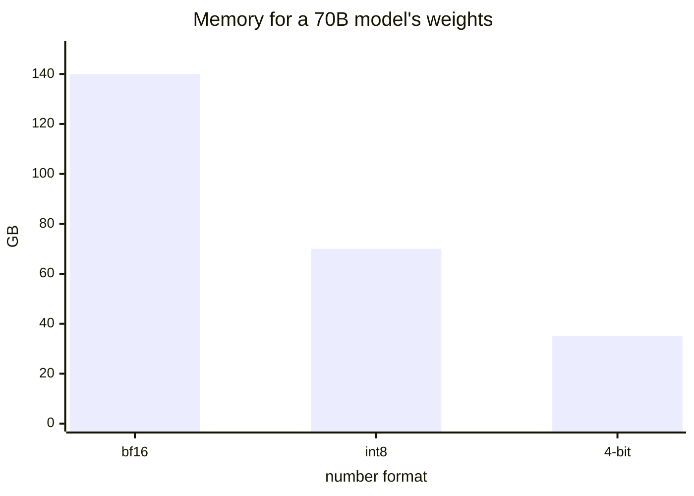

<!-- Written by `npm run lessons` from the lesson data in src/data. Edit the lesson there, not this page. -->

# Inference speed: batching, quantisation, FlashAttention

**ML Foundations · Unit 6: Systems and scale · Lesson 5 of 9**

> **In one line.** Inference is sped up by serving many requests together (batching), storing weights in fewer bits (quantisation), and computing attention without writing the full score matrix to memory (FlashAttention).

[Open this lesson on the site](https://learn.hamropedia.com/foundations/inference-speed-batching-quantisation-flashattention/) for its animation, the practice game and tap-to-explain words.

## The problem it solves

Generating text is mostly memory-bound: every token requires reading all the weights and the KV cache. Serving cost and speed decide whether a model is affordable to deploy. These three techniques are the main reasons modern models can be served cheaply and quickly, and on smaller hardware.

## The idea

Batching serves many requests together to use the GPU fully. Quantisation stores weights in 8 or 4 bits to save memory and bandwidth. FlashAttention computes attention in small tiles that stay in fast on-chip memory, so the big T × T matrix is never written out.

## How it works, step by step

1. Batching: one pass over the weights serves many users' next tokens at once, so the cost of reading the weights is shared. Continuous batching adds and removes requests on the fly.
2. Quantisation: store weights as 8-bit or 4-bit integers plus a scale factor, instead of 16-bit floats.
3. Each weight snaps to its nearest allowed level. Per-channel or per-group scales keep errors small; an outlier weight in a group stretches the scale and hurts everyone else in it.
4. Smaller weights mean less memory and fewer bytes per token: a 70B model needs about 140 GB in bf16, 70 GB in int8 and 35 GB in 4-bit.
5. FlashAttention splits attention into tiles that fit in fast on-chip memory, computes the softmax piece by piece with running totals, and never writes the T × T matrix to slow memory.
6. The result is identical attention with far less memory traffic, and memory that grows linearly with sequence length.

## Picture it



*Fewer bits per weight means less memory and faster loading — measure the quality loss before you choose.*

## Analogy

Batching is a bus instead of many taxis. Quantisation is a compressed photo: smaller, and usually looks the same.

**Where the analogy breaks.** A bus waits to fill up, so the first passenger waits longer. Heavy compression shows artefacts: at 4 bits or fewer, quality can drop, so always measure it.

## Worked example

A 70-billion-parameter model: bf16 is about 140 GB, int8 about 70 GB, and 4-bit about 35 GB.

```python
scale = np.abs(W).max() / 127
W_q = np.round(W / scale).astype(np.int8)    # 1 byte per weight
W_back = W_q.astype(np.float32) * scale      # close to W, small error
```

## Must know

- Generation is usually memory-bound, so moving fewer bytes is the main lever.
- Batching raises throughput; it can add a little latency per request.
- int8 is usually near-lossless; 4-bit needs care; always evaluate quality.
- Outliers are the main enemy of quantisation; finer-grained scales help.
- FlashAttention gives exactly the same result as ordinary attention: it changes how the work is laid out in memory, not the maths.
- These combine with KV caching and speculative decoding.

## Common mistakes

- Quantising without measuring quality on your own tasks.
- Using one scale for a whole tensor that contains outliers.
- Assuming FlashAttention changes the model's outputs.
- Tuning latency without measuring throughput, or the other way round.

> **Not true:** FlashAttention: faster, at the price of slightly different outputs.  
> **In fact:** It computes exactly the same result. It only changes how the work is arranged in memory, so that less data has to move.

> **Not true:** Quantisation: one scale for a whole tensor works well even when it contains outliers.  
> **In fact:** One huge value stretches the scale, so the many small values round to the same few numbers. Finer-grained scales, per channel or per group, fix that.

## Practise

Try each one yourself first: on paper, in code or out loud. Then open the answer and compare.

### 1. Derive

How much memory do the weights of a 13B model take in bf16, int8 and 4-bit?

<details>
<summary>Show one good answer</summary>

13 billion parameters:  
bf16 (2 bytes each): 13B × 2 = 26 GB.  
int8 (1 byte): 13 GB.  
4-bit (half a byte): 6.5 GB.

Plus a little extra for the scales that quantisation stores (one per row or per small group of weights), and, at run time, the KV cache and activations. So a 13B model that needs a large data-centre GPU in bf16 fits on a 16 GB consumer GPU in 4-bit, which is why quantisation is so popular for running models locally.

</details>

### 2. Build

Quantise your GPT's weights to int8, per-tensor and per-channel. Compare the error and the quality of the generated text.

<details>
<summary>Show one good answer</summary>

Int8 quantisation stores each weight as an integer from −127 to 127 plus a scale: w ≈ scale × q, with scale = max\|w\| / 127. Per-tensor uses one scale for a whole weight matrix; per-channel uses one scale per output row.

On the trained Shakespeare GPT, both are very accurate, because a typical weight matrix has no extreme values: the average relative error per weight is small, and the validation loss changes by less than a thousandth (1.7488 to 1.7487 per-tensor, 1.7486 per-channel). Per-channel is consistently more accurate than per-tensor, because each row gets a scale that fits its own range. The generated text looks just as good after quantisation. (This simulates quantisation by rounding the weights; real int8 kernels also do the maths in integers, which is where the speed comes from.)

```python
import copy
import torch
from gpt import GPT, train, estimate_loss, encode, decode

def quantise_(weight, per_channel):
    w = weight.data
    peak = w.abs().amax(dim=1, keepdim=True) if per_channel else w.abs().max()
    scale = peak.clamp(min=1e-12) / 127
    q = torch.round(w / scale).clamp(-127, 127)
    error = ((q * scale - w).abs() / w.abs().mean()).mean().item()
    weight.data = q * scale                            # simulate int8 storage
    return error

torch.manual_seed(0)
model = train(GPT(), steps=1500, log_every=0)
torch.manual_seed(1); base_loss = estimate_loss(model, iters=50)
print(f"original: val loss {base_loss:.4f}")
for per_channel in [False, True]:
    q = copy.deepcopy(model)
    errors = [quantise_(m.weight, per_channel) for m in q.modules() if isinstance(m, torch.nn.Linear)]
    torch.manual_seed(1)
    loss = estimate_loss(q, iters=50)
    torch.manual_seed(2)
    text = decode(q.generate(torch.tensor([encode("ROMEO:")]), 80)[0].tolist())
    print(f"{'per-channel' if per_channel else 'per-tensor '}: mean relative error {sum(errors) / len(errors):.4f}, "
          f"val loss {loss:.4f}\n{text}\n")
```

</details>

### 3. Break

Put one huge outlier weight in a layer and quantise per-tensor again. What happens to the error for every other weight?

<details>
<summary>Show one good answer</summary>

Put one huge weight (say 100 times the largest normal weight) into a layer and quantise per-tensor. The single scale is now set by the outlier: scale = 100 × normal max / 127. Every normal weight is now tiny compared with the step size, so almost all of them round to 0 or ±1: in the run below, most of the layer's weights become exactly 0, and the relative error for the other weights jumps from about 1% to around 100%. One number has destroyed the whole layer's precision.

Per-channel quantisation limits the damage to the outlier's own row: the other rows keep their own scales and stay accurate.

This is a real problem in LLMs: a few activation and weight channels have values far larger than the rest. That is why practical methods quantise per channel or in small groups (for example 128 weights per scale), keep the outlier channels in higher precision (as LLM.int8() does), or move the outliers into the weights before quantising (as SmoothQuant does).

```python
import torch

def quantise(w, per_channel):
    peak = w.abs().amax(dim=1, keepdim=True) if per_channel else w.abs().max()
    scale = peak.clamp(min=1e-12) / 127
    return torch.round(w / scale).clamp(-127, 127) * scale

torch.manual_seed(0)
w = torch.randn(256, 256) * 0.02
w_out = w.clone(); w_out[0, 0] = 100 * w.abs().max()             # one huge outlier
others = torch.ones_like(w, dtype=torch.bool); others[0, 0] = False
for name, weights in [("normal", w), ("with outlier", w_out)]:
    for per_channel in [False, True]:
        dq = quantise(weights, per_channel)
        rel = ((dq - weights).abs()[others] / weights.abs()[others]).median().item()
        zeros = (dq[others] == 0).float().mean().item()
        print(f"{name:12s} {'per-channel' if per_channel else 'per-tensor '}: "
              f"median relative error of the other weights {rel:.1%}, rounded to zero {zeros:.0%}")
```

</details>

### 4. Explain

Explain batching and quantisation with the bus and compressed-photo pictures.

<details>
<summary>Show one good answer</summary>

Batching is a bus instead of many taxis. Each taxi takes one passenger and needs its own driver and fuel; a bus takes 50 passengers for barely more than the cost of one trip. A GPU serving one request at a time wastes most of its power reading the whole model from memory for a single token; serving a batch of requests together reads the weights once and uses them for every request, so each user's share of the cost drops sharply. The price is that each passenger may wait a moment for the bus to fill.

Quantisation is a compressed photo. A JPEG takes a fraction of the space of the original and usually looks the same, because it throws away detail you wouldn't notice. Storing weights in 8 or 4 bits instead of 16 makes the model half or a quarter the size, so it fits on smaller hardware and loads from memory faster, with a small loss in quality. Compress too hard, and the artefacts start to show.

</details>

## Check you understood

Answer in your head first, then open each one.

<details>
<summary>&lt;b>Why does batching help so much in generation?&lt;/b></summary>

Each step must read all the weights; batching shares that one read across many requests.

</details>

<details>
<summary>&lt;b>How much memory do a 70B model's weights take in 4-bit?&lt;/b></summary>

About 35 GB (half a byte per parameter).

</details>

<details>
<summary>&lt;b>Why does an outlier weight hurt per-tensor quantisation?&lt;/b></summary>

It stretches the scale, so the allowed levels are spread far apart and every normal-sized weight is rounded more coarsely.

</details>

<details>
<summary>&lt;b>Does FlashAttention approximate attention?&lt;/b></summary>

No. It computes exactly the same result, just in an order that avoids storing the full score matrix in slow memory.

</details>

## Go further (optional)

The lesson above is enough on its own. These free extras give a second explanation.

- READ · [A Visual Guide to Quantization](https://newsletter.maartengrootendorst.com/p/a-visual-guide-to-quantization) · Maarten Grootendorst · many diagrams  
  **Worth it:** Dozens of clear diagrams of number formats, scales, outliers and the main quantisation methods. Makes a fiddly topic visual and intuitive.
- PAPER · [FlashAttention (2022)](https://arxiv.org/abs/2205.14135) · Dao et al. · arXiv
- PAPER · [PagedAttention / vLLM (2023)](https://arxiv.org/abs/2309.06180) · Kwon et al. · arXiv

---

[← Parallelism: data, tensor and pipeline (the ideas)](parallelism-data-tensor-and-pipeline-the-ideas.md) · [All lessons](../../README.md) · [Profiling PyTorch code →](profiling-pytorch-code.md)
