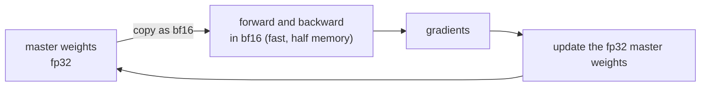

<!-- Written by `npm run lessons` from the lesson data in src/data. Edit the lesson there, not this page. -->

# Mixed precision: fp16 and bf16

**ML Foundations · Unit 6: Systems and scale · Lesson 2 of 9**

> **In one line.** Mixed precision trains with 16-bit numbers (bf16 or fp16) for most of the maths while keeping a few sensitive values in 32-bit, roughly halving memory traffic and greatly speeding up training.

[Open this lesson on the site](https://learn.hamropedia.com/foundations/mixed-precision-fp16-and-bf16/) for its animation, the practice game and tap-to-explain words.

## The problem it solves

32-bit floats are more precise than neural networks need for most operations, and they cost twice the memory and bandwidth of 16-bit. GPUs' tensor cores are also far faster at 16-bit maths. Using 16-bit everywhere, though, can lose small updates or overflow. Mixed precision gets the speed while keeping training stable, and it is standard for every large model.

## The idea

Mixed precision does most of the maths in 16-bit numbers instead of 32-bit: half the memory and much faster on modern GPUs. fp16 has more precision but a small range, so it can overflow. bf16 has the same range as fp32 with less precision, and it is the usual choice now.

## How it works, step by step

1. A float has a sign bit, exponent bits (which set the range) and mantissa bits (which set the precision).
2. fp32: 8 exponent bits and 23 mantissa bits. fp16: 5 and 10. bf16: 8 and 7.
3. fp16 has decent precision but a small range (largest value about 65,504), so gradients can overflow to inf or underflow to 0. It needs a gradient scaler: multiply the loss by a big number before backward, divide the gradients after.
4. bf16 has fp32's range (up to about 3.4 × 10³⁸) with less precision, so it rarely overflows and usually needs no scaler. It is the common choice on modern GPUs.
5. Under autocast, matrix multiplies and convolutions run in 16-bit; numerically sensitive operations such as reductions and softmax are kept in 32-bit.
6. A 32-bit master copy of the weights receives the optimiser update, so tiny updates aren't rounded away (in bf16, 1 + 0.001 rounds back to 1).

## Picture it



*Most of the maths runs in 16-bit, but the master copy of the weights stays in 32-bit so small updates aren't lost.*

## Analogy

Writing prices rounded to the nearest pound instead of exact to the penny. Faster, and usually good enough.

**Where the analogy breaks.** Some sums need the pennies. Sensitive parts, like the master copy of the weights and the optimiser update, stay in 32-bit.

## Worked example

fp16's largest value is about 65,504. bf16 reaches about 3.4 × 10³⁸, like fp32. But in bf16, 1 + 0.001 = 1.0: the small part is lost.

```python
with torch.autocast(device_type="cuda", dtype=torch.bfloat16):
    logits, loss = model(x, y)
loss.backward()
```

## Must know

- Exponent bits = range; mantissa bits = precision.
- bf16: fp32's range, low precision; fp16: more precision, small range.
- fp16 training needs loss scaling; bf16 usually doesn't.
- Keep fp32 master weights and do the optimiser step in fp32.
- 16-bit halves weight memory: 2 bytes per parameter instead of 4.
- In PyTorch, mixed precision is one line around the forward pass: torch.autocast(device_type="cuda", dtype=torch.bfloat16).

## Common mistakes

- Training in fp16 without a gradient scaler, so small gradients round down to zero.
- Making the optimiser update in 16-bit, so small updates vanish.
- Comparing losses across precisions without expecting small differences.
- Assuming lower precision is always faster: older hardware may not support bf16 well.

> **Not true:** 16-bit numbers: faster on old GPUs as well as on new ones.  
> **In fact:** Only on hardware built for it. Older GPUs may not support bf16 well, and then 16-bit is no faster, or even slower.

> **Not true:** Optimiser step: done in 16-bit, to match the forward pass.  
> **In fact:** A tiny update added to a 16-bit weight is rounded away. Keep a 32-bit master copy of the weights and do the optimiser step in fp32.

## Practise

Try each one yourself first: on paper, in code or out loud. Then open the answer and compare.

### 1. Derive

How many bytes do the weights of a 125M-parameter model take in fp32, fp16 and bf16?

<details>
<summary>Show one good answer</summary>

125 million parameters:  
fp32 (4 bytes each): 125M × 4 = 500 MB.  
fp16 (2 bytes): 250 MB.  
bf16 (2 bytes): 250 MB.

fp16 and bf16 take the same space; they differ in how the 16 bits are split. fp16 has more bits for precision but a small range (largest value about 65,504, and tiny values underflow to 0). bf16 has the same range as fp32 (up to about 3.4 × 10³⁸) but less precision. That is why bf16 is the usual choice for training: values almost never overflow or underflow, and neural networks tolerate the lower precision.

</details>

### 2. Build

Train your GPT with torch.autocast in bf16. Compare speed, memory and final loss with fp32.

<details>
<summary>Show one good answer</summary>

Wrap the forward pass and loss in torch.autocast(device, dtype=torch.bfloat16). Matrix multiplications then run in bf16 while the weights, the optimiser and precision-sensitive operations (like softmax and the loss) stay in fp32; backward follows automatically.

On a modern NVIDIA GPU, bf16 typically trains 1.5 to 3 times faster than fp32 and uses noticeably less memory for activations, with a final loss that is essentially the same. On a laptop CPU, as in the run below, the loss is the same, but bf16 was about 20 times slower (13 s against 256 s for 400 steps): this CPU has no fast bf16 maths, so every operation pays for conversions and slow fallback code. Mixed precision is a GPU technique; measure on the hardware you will actually use.

```python
import time
import torch
from gpt import GPT, Config, get_batch, estimate_loss

device = "cuda" if torch.cuda.is_available() else "cpu"
for precision in ["fp32", "bf16"]:
    torch.manual_seed(0)
    model = GPT(Config()).to(device)
    opt = torch.optim.AdamW(model.parameters(), lr=1e-3)
    if device == "cuda":
        torch.cuda.reset_peak_memory_stats()
    start = time.perf_counter()
    for _ in range(400):
        x, y = (t.to(device) for t in get_batch("train"))
        with torch.autocast(device, dtype=torch.bfloat16, enabled=(precision == "bf16")):
            _, loss = model(x, y)
        opt.zero_grad(); loss.backward(); opt.step()
    seconds = time.perf_counter() - start
    memory = f", peak memory {torch.cuda.max_memory_allocated() / 1e6:.0f} MB" if device == "cuda" else ""
    print(f"{precision} on {device}: {seconds:.1f} s for 400 steps, val loss {estimate_loss(model.cpu()):.3f}{memory}")
```

</details>

### 3. Break

Train in fp16 without a gradient scaler and watch for gradients that turn into 0 or inf. Then add the scaler.

<details>
<summary>Show one good answer</summary>

In fp16, any number smaller than about 6 × 10⁻⁸ becomes exactly 0, and anything above 65,504 becomes inf. Gradients in a real network are often tiny (1e-6 to 1e-9 for many weights), so in plain fp16 a large share of them underflow to 0, and those weights simply stop learning. In the run below, the same gradient values kept in fp16 lose a large fraction to 0.

The gradient scaler (torch.amp.GradScaler) fixes this by multiplying the loss by a big number, such as 65,536, before backward. Every gradient is multiplied by the same factor, which lifts the tiny ones into fp16's range. Before the optimiser step it divides them back, in fp32. If any gradient overflowed to inf, it skips that step and halves the scale; if steps succeed for a while, it raises the scale again.

bf16 has fp32's range, so it almost never needs a scaler, which is the main reason it replaced fp16 for training.

```python
import torch

grads = torch.logspace(-10, -3, 8)                         # typical small gradient sizes
print("fp32:          ", [f"{g:.0e}" for g in grads.tolist()])
print("fp16:          ", [f"{g:.0e}" for g in grads.half().float().tolist()])          # tiny ones become 0
scale = 65536.0
print("fp16 x 65,536: ", [f"{g:.0e}" for g in (grads * scale).half().float().div(scale).tolist()])
print("bf16:          ", [f"{g:.0e}" for g in grads.bfloat16().float().tolist()])
print("fp16 overflow: ", torch.tensor(70000.0).half())     # inf: why the scaler skips such steps

if torch.cuda.is_available():                              # the real training loop with a scaler
    model = torch.nn.Linear(10, 1).cuda()
    opt, scaler = torch.optim.SGD(model.parameters(), lr=0.1), torch.amp.GradScaler()
    x, y = torch.randn(64, 10, device="cuda"), torch.randn(64, 1, device="cuda")
    with torch.autocast("cuda", dtype=torch.float16):
        loss = torch.nn.functional.mse_loss(model(x), y)
    scaler.scale(loss).backward(); scaler.step(opt); scaler.update()
    print("scale now:", scaler.get_scale())
```

</details>

### 4. Explain

Explain mixed precision with the rounded-prices picture, and say which parts stay in 32-bit.

<details>
<summary>Show one good answer</summary>

Writing prices rounded to the nearest pound instead of exact to the penny. It is quicker to write, takes less space, and for most purposes the answer comes out the same. Mixed precision does most of a network's maths in 16-bit numbers, which are half the size of 32-bit ones, so they move twice as fast through memory and modern GPUs multiply them much faster.

But you keep the accounts that must add up exactly in full pennies. In mixed precision the 32-bit parts are: the master copy of the weights (small updates would be lost if added to a rounded number), the optimiser's running averages, and sensitive sums like softmax, layer norm and the loss. bf16 is the rounding that keeps the full range of prices; fp16 rounds more finely but can't write very large or very small amounts, which is why it needs a gradient scaler.

</details>

## Check you understood

Answer in your head first, then open each one.

<details>
<summary>&lt;b>Why does bf16 rarely overflow while fp16 does?&lt;/b></summary>

bf16 has 8 exponent bits, the same range as fp32; fp16 has only 5, so its largest value is about 65,504.

</details>

<details>
<summary>&lt;b>What does a gradient scaler do?&lt;/b></summary>

It multiplies the loss by a large factor so small fp16 gradients don't underflow to zero, then divides the gradients back before the update.

</details>

<details>
<summary>&lt;b>Why keep a 32-bit copy of the weights?&lt;/b></summary>

Updates are often tiny compared with the weights; in 16-bit they would round away to nothing.

</details>

<details>
<summary>&lt;b>How much memory do the weights of a 1B-parameter model take in bf16?&lt;/b></summary>

About 2 GB: 2 bytes per parameter.

</details>

## Go further (optional)

The lesson above is enough on its own. These free extras give a second explanation.

- READ · [Automatic Mixed Precision recipe](https://docs.pytorch.org/tutorials/recipes/recipes/amp_recipe.html) · PyTorch tutorials
- WATCH · [Let's reproduce GPT-2 (124M): the mixed-precision section](https://karpathy.ai/zero-to-hero.html) · Andrej Karpathy
- PAPER · [Mixed Precision Training (2017)](https://arxiv.org/abs/1710.03740) · Micikevicius et al. · arXiv

---

[← How a GPU works: compute vs memory](how-a-gpu-works-compute-vs-memory.md) · [All lessons](../../README.md) · [Training memory: weights, gradients, optimiser states, activations →](training-memory-weights-gradients-optimiser-states-activations.md)
