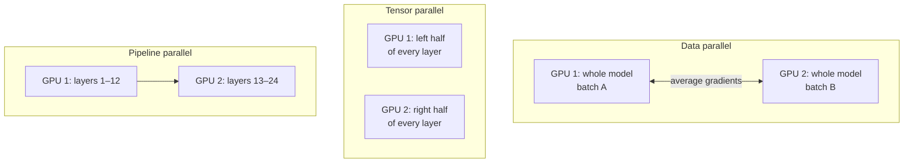

<!-- Written by `npm run lessons` from the lesson data in src/data. Edit the lesson there, not this page. -->

# Parallelism: data, tensor and pipeline (the ideas)

**ML Foundations · Unit 6: Systems and scale · Lesson 4 of 9**

> **In one line.** Parallelism spreads training across many GPUs: data parallelism splits the batch, tensor parallelism splits each layer's matrices, pipeline parallelism splits the layers, and FSDP/ZeRO shard the training state.

[Open this lesson on the site](https://learn.hamropedia.com/foundations/parallelism-data-tensor-and-pipeline-the-ideas/) for its animation, the practice game and tap-to-explain words.

## The problem it solves

Large models don't fit on one GPU, and even when they do, one GPU would take years to train them. Splitting the work is the only way to train at scale. How to split it depends on the model's size and on how fast the GPUs can talk to each other, and that choice decides how fast and how cheaply a model trains.

## The idea

Data parallel: every GPU holds a full copy of the model, gets different data, and gradients are averaged. Tensor parallel: one layer's matrices are split across GPUs. Pipeline parallel: different layers live on different GPUs. FSDP and ZeRO split weights, gradients and optimiser states across GPUs to save memory.

## How it works, step by step

1. Data parallel (DDP): every GPU holds the whole model and processes a different slice of the batch.
2. After backward, an all-reduce averages the gradients across GPUs, so every copy takes the same step and stays identical.
3. FSDP / ZeRO: like data parallel, but each GPU stores only a shard of the weights, gradients and optimiser states, gathering what it needs just in time. Much less memory per GPU.
4. Tensor parallel: split each large matrix across GPUs; each computes part of every layer, and they exchange results inside each layer. Needs very fast links, so it is used within one machine.
5. Pipeline parallel: put different layers on different GPUs and pass activations along, with micro-batches to keep stages busy. Idle time at the start and end is the "bubble".
6. Large runs combine them ("3-D parallelism"): tensor parallel within a machine, pipeline across machines, data parallel across groups.

## Picture it



*Three ways to share work across GPUs: split the data, split each layer, or split the stack of layers.*

## Analogy

Cooking a huge dinner. Data parallel: several kitchens cook the full menu for different tables. Tensor parallel: several chefs cut one giant cake together. Pipeline: an assembly line, one station per course.

**Where the analogy breaks.** Separate kitchens don't need to talk. GPUs talk constantly, and the speed of that communication often decides which method wins.

## Worked example

The model fits on one GPU and you want speed → data parallel. The model does not fit → FSDP, tensor or pipeline parallel.

## Must know

- Model fits on one GPU → data parallel; doesn't fit → FSDP, tensor or pipeline parallel.
- Communication speed often decides what works.
- All-reduce keeps data-parallel copies in sync.
- The slowest GPU sets the pace for everyone.
- Pipeline bubbles shrink with more micro-batches.

## Common mistakes

- Using tensor parallelism across slow network links.
- Forgetting that the effective batch size grows with the number of data-parallel GPUs, so the learning rate may need adjusting.
- Not checking that the multi-GPU run matches a single-GPU run on a small test.

> **Not true:** With eight data-parallel GPUs, the learning rate tuned for one GPU still fits unchanged.  
> **In fact:** Eight GPUs process eight times as many examples per step, so the effective batch is eight times larger. The learning rate usually has to be adjusted for it.

> **Not true:** Tensor parallelism works well even across slow network links.  
> **In fact:** Tensor parallelism splits each layer across GPUs, so they exchange data inside every layer. It needs very fast links, such as GPUs in the same server.

## Practise

Try each one yourself first: on paper, in code or out loud. Then open the answer and compare.

### 1. Derive

Draw data parallelism for 8 GPUs and a model that fits on one. Then draw tensor and pipeline parallelism for a model that needs 4 GPUs.

<details>
<summary>Show one good answer</summary>

Data parallelism, 8 GPUs, a model that fits on one: every GPU holds a full copy of the model. Each takes a different slice of the batch (8 slices), runs forward and backward on its own, and then all 8 average their gradients with an all-reduce. Every copy applies the same averaged update, so they stay identical. It scales the batch, not the model.

Tensor parallelism, a model that needs 4 GPUs: each big weight matrix is split across the 4 GPUs, for example by columns. For one layer, every GPU multiplies the input by its quarter of the matrix, then they exchange results (an all-reduce or all-gather) before the next layer. Very chatty, so it is used inside one machine with fast links.

Pipeline parallelism, 4 GPUs: the layers are split into 4 consecutive stages, layers 1 to 6 on GPU 0, 7 to 12 on GPU 1, and so on. Activations flow from stage to stage. To keep every GPU busy, the batch is cut into micro-batches that follow each other through the pipeline; the idle time at the start and end is the "bubble".

Large models combine them: tensor parallel within a machine, pipeline across machines, data parallel across groups, often with the optimiser state sharded too (FSDP or ZeRO).

```text
DATA PARALLEL (model fits on 1 GPU)        TENSOR PARALLEL (1 layer split 4 ways)
GPU0: full model, batch slice 1 ┐          input ─┬▶ GPU0: W[:, 0:¼]  ┐
GPU1: full model, batch slice 2 ├ all-reduce      ├▶ GPU1: W[:, ¼:½]  ├ gather ▶ next layer
...                             │ gradients       ├▶ GPU2: W[:, ½:¾]  │
GPU7: full model, batch slice 8 ┘                 └▶ GPU3: W[:, ¾:1]  ┘

PIPELINE PARALLEL (layers split into 4 stages, micro-batches m1, m2, m3 …)
GPU0 [layers 1–6]   m1 m2 m3 m4
GPU1 [layers 7–12]     m1 m2 m3 m4
GPU2 [layers 13–18]       m1 m2 m3 m4
GPU3 [layers 19–24]          m1 m2 m3 m4     (the empty corners are the "bubble")
```

</details>

### 2. Build

Run data-parallel training with PyTorch DDP on 2 GPUs, or 2 CPU processes. Check the gradients match single-device training.

<details>
<summary>Show one good answer</summary>

DistributedDataParallel with 2 CPU processes and the gloo backend, so no GPU is needed. Each process builds the same model (same seed), takes half of the batch, and after backward DDP averages the gradients across the processes automatically. Then compare with one process computing the gradient of the whole batch: they match to better than 1e-8. That equality is the guarantee data parallelism gives you: N workers on N slices compute exactly the update one worker would compute on the full batch.

On real GPUs, change the backend to "nccl", put each process on its own device, and launch with torchrun --nproc_per_node=2 train.py.

```python
import os
import torch
import torch.distributed as dist
import torch.multiprocessing as mp
from torch.nn.parallel import DistributedDataParallel as DDP

def make_model():
    torch.manual_seed(0)
    return torch.nn.Sequential(torch.nn.Linear(10, 32), torch.nn.ReLU(), torch.nn.Linear(32, 1))

def worker(rank, world, X, Y, queue):
    os.environ.update(MASTER_ADDR="127.0.0.1", MASTER_PORT="29511")
    dist.init_process_group("gloo", rank=rank, world_size=world)
    model = DDP(make_model())
    xs, ys = X.chunk(world)[rank], Y.chunk(world)[rank]            # this worker's slice
    torch.nn.functional.mse_loss(model(xs), ys).backward()        # DDP averages gradients here
    if rank == 0:
        queue.put(model.module[0].weight.grad.clone())
    dist.destroy_process_group()

if __name__ == "__main__":
    torch.manual_seed(1)
    X, Y = torch.randn(64, 10), torch.randn(64, 1)
    queue = mp.get_context("spawn").SimpleQueue()
    mp.spawn(worker, args=(2, X, Y, queue), nprocs=2)
    ddp_grad = queue.get()
    single = make_model()
    torch.nn.functional.mse_loss(single(X), Y).backward()
    print("max difference from single-device training:", (ddp_grad - single[0].weight.grad).abs().max().item())
```

</details>

### 3. Break

Make one process slower on purpose. What happens to the speed of the whole group, and why?

<details>
<summary>Show one good answer</summary>

Make one process sleep for a while in every step. Now every step of the whole group takes as long as the slowest process: in the run below, both workers' step time jumps to roughly the sleeper's, even though the other worker has nothing extra to do.

Why: the gradient all-reduce is a synchronisation point. No worker can finish the step until every worker has contributed its gradients, so the fast one waits at the all-reduce, idle. With 1,000 GPUs, one slow GPU, a bad network link, or one worker that got an unusually long batch slows all 1,000 down.

That is why large training runs watch for stragglers, keep batches the same size on every worker, overlap communication with computation, and replace failing machines quickly.

```python
import os
import time
import torch
import torch.distributed as dist
import torch.multiprocessing as mp
from torch.nn.parallel import DistributedDataParallel as DDP

def worker(rank, world, slow_rank, queue):
    os.environ.update(MASTER_ADDR="127.0.0.1", MASTER_PORT="29512")
    dist.init_process_group("gloo", rank=rank, world_size=world)
    torch.manual_seed(0)
    model = DDP(torch.nn.Linear(100, 100))
    x = torch.randn(32, 100)
    times = []
    for _ in range(5):
        start = time.perf_counter()
        if rank == slow_rank:
            time.sleep(0.2)                                    # this worker is slow
        model(x).sum().backward()                              # all-reduce waits for everyone
        times.append(time.perf_counter() - start)
    queue.put((rank, slow_rank, sum(times) / len(times)))
    dist.destroy_process_group()

if __name__ == "__main__":
    ctx = mp.get_context("spawn")
    for slow in [None, 1]:
        queue = ctx.SimpleQueue()
        mp.spawn(worker, args=(2, slow, queue), nprocs=2)
        results = sorted(queue.get() for _ in range(2))
        print(f"slow worker = {slow}: " + ", ".join(f"worker {r} step {t * 1000:.0f} ms" for r, _, t in results))
```

</details>

### 4. Explain

Explain data, tensor and pipeline parallelism with the dinner-kitchen picture.

<details>
<summary>Show one good answer</summary>

Cooking a huge dinner for a wedding.

Data parallel: several kitchens each cook the full menu, each for different tables, and at the end of every course the head chefs compare notes so every kitchen improves its recipe in the same way. It needs each kitchen to be big enough for the whole menu.

Tensor parallel: one cake is too big for any single chef, so several chefs work on the same cake at the same time, each on their own slice, constantly passing tools and checking with each other. They must stand close together (fast links in one machine).

Pipeline parallel: an assembly line, with one station per course. Starters go to station 1 and then move on, while station 1 starts the next table's starters, so all stations stay busy, except at the very start and end of the service.

</details>

## Check you understood

Answer in your head first, then open each one.

<details>
<summary>&lt;b>In data parallelism, what keeps the model copies identical?&lt;/b></summary>

All-reduce averages the gradients across GPUs, so every copy applies the same update.

</details>

<details>
<summary>&lt;b>How does FSDP save memory compared with plain data parallelism?&lt;/b></summary>

Each GPU stores only a shard of the weights, gradients and optimiser states, instead of a full copy.

</details>

<details>
<summary>&lt;b>What is the pipeline "bubble"?&lt;/b></summary>

Time when some stages sit idle, at the start and end of each batch, because work hasn't reached them yet or has already left.

</details>

<details>
<summary>&lt;b>Why is tensor parallelism usually kept inside one machine?&lt;/b></summary>

It needs communication inside every layer, which is only fast enough over the very fast links between GPUs in one machine.

</details>

## Go further (optional)

The lesson above is enough on its own. These free extras give a second explanation.

- READ · [The Ultra-Scale Playbook](https://huggingface.co/spaces/nanotron/ultrascale-playbook) · Hugging Face · interactive diagrams  
  **Worth it:** A long but beautifully illustrated guide to every kind of parallelism, with interactive memory and speed calculators, from people who train large models.
- READ · [Getting Started with Distributed Data Parallel](https://docs.pytorch.org/tutorials/intermediate/ddp_tutorial.html) · PyTorch tutorials
- PAPER · [Megatron-LM (2019)](https://arxiv.org/abs/1909.08053) · Shoeybi et al. · arXiv

---

[← Training memory: weights, gradients, optimiser states, activations](training-memory-weights-gradients-optimiser-states-activations.md) · [All lessons](../../README.md) · [Inference speed: batching, quantisation, FlashAttention →](inference-speed-batching-quantisation-flashattention.md)
