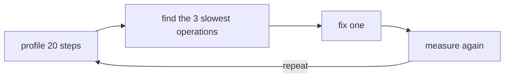

<!-- Written by `npm run lessons` from the lesson data in src/data. Edit the lesson there, not this page. -->

# Profiling PyTorch code

**ML Foundations · Unit 6: Systems and scale · Lesson 6 of 9**

> **In one line.** Profiling measures where time is actually spent in your code — CPU, GPU, data loading, copies — so you optimise the real bottleneck instead of guessing.

[Open this lesson on the site](https://learn.hamropedia.com/foundations/profiling-pytorch-code/) for its animation, the practice game and tap-to-explain words.

## The problem it solves

Intuition about performance is often wrong: the slow part of training may be data loading, a tiny operation called thousands of times, or a hidden copy between CPU and GPU. Optimising the wrong thing wastes days. A profiler shows the timeline and tells you exactly where to look.

## The idea

Measure where the time actually goes before you optimise. The profiler shows the time for each operation on the CPU and GPU. Common findings: the GPU waiting for data loading, many tiny operations, or slow copies between CPU and GPU.

## How it works, step by step

1. Wrap a few training steps in torch.profiler.profile(activities=[CPU, CUDA]), after a couple of warm-up steps.
2. Look at the table of operations sorted by total time on the CPU and on the GPU.
3. Open the timeline trace (in a browser trace viewer or TensorBoard) to see, over time, what the CPU and GPU are each doing.
4. Gaps on the GPU row mean it is waiting — usually for data loading or Python overhead.
5. Many tiny kernels mean launch overhead: fuse operations or use torch.compile.
6. Large CPU-to-GPU copies inside the loop mean data is being moved too often; keep tensors on the GPU and use pinned memory.
7. Fix one thing, profile again, and compare steps per second.

## Picture it



*Measure, fix the biggest cost, measure again. Never optimise by guessing.*

## Analogy

Timing each station in a kitchen before hiring more chefs. Maybe the slow part is the dishwasher.

**Where the analogy breaks.** Kitchen timing is simple. GPU work runs asynchronously, so normal Python timers can lie. Call torch.cuda.synchronize() before you read the time.

## Worked example

A training run shows the GPU busy only about a quarter of the time. The profiler trace reveals each step waiting for the DataLoader to decode images on one CPU process. Setting num_workers=8 and pin_memory=True keeps batches ready in advance, and steps per second roughly triple without touching the model.

```python
from torch.profiler import profile, ProfilerActivity
with profile(activities=[ProfilerActivity.CPU, ProfilerActivity.CUDA]) as prof:
    train_step()
print(prof.key_averages().table(sort_by="cuda_time_total", row_limit=10))
```

## Must know

- Measure first, optimise second: the slow part is often not the one you would have guessed.
- GPU work is asynchronous: call torch.cuda.synchronize() before reading a timer.
- Warm up before measuring; the first steps include one-off setup costs.
- Common bottlenecks: data loading, tiny operations, CPU–GPU copies, synchronisation points like .item().
- More DataLoader workers and pin_memory=True often remove data-loading stalls.

## Common mistakes

- Timing GPU code with time.time() without synchronising.
- Profiling the very first steps, which include compilation and caching.
- Calling .item() or printing every step, which forces the CPU to wait for the GPU.
- Optimising an operation that takes 2% of the time.

> **Not true:** Optimising an operation that takes 2% of the time: a noticeable speed-up for the whole program.  
> **In fact:** An operation that takes 2% of the time can save at most 2%. Find the biggest share of the time first, and optimise that.

> **Not true:** Timing GPU code: time.time() before and after the call gives how long the GPU took.  
> **In fact:** GPU work is asynchronous: the call returns before the work is finished. Call torch.cuda.synchronize() before reading the timer.

## Practise

Try each one yourself first: on paper, in code or out loud. Then open the answer and compare.

### 1. Derive

List 4 likely reasons a training step is slow, and how each one would show up in the profiler.

<details>
<summary>Show one good answer</summary>

1. The data loader is too slow. The GPU sits idle between steps waiting for the next batch. In the profiler trace: gaps between GPU kernels, with time on the CPU in DataLoader or image decoding. Fix: more num_workers, pin_memory=True, pre-process the data.

2. Synchronising every step. Calling loss.item(), print(tensor) or moving a tensor to the CPU in every step forces the CPU to wait for the GPU. In the trace: cudaStreamSynchronize or "aten::item" with long waits, and the GPU queue running dry. Fix: log less often, and keep values on the GPU.

3. Many small operations. Lots of short kernels, each with launch overhead; the GPU is "busy" but mostly launching. In the trace: thousands of tiny kernels and a high share of CPU time in operator dispatch. Fix: batch the work, fuse operations (torch.compile), avoid Python loops over tensors.

4. Slow, memory-bound operations or the wrong precision. Element-wise and normalisation operations dominate, or matrix multiplies run in fp32. In the trace: top operations are not matmuls, or matmuls are slower than they should be. Fix: mixed precision (bf16), fused kernels such as FlashAttention.

(Also common: copying data between CPU and GPU in every step, which shows up as memcpy in the trace.)

</details>

### 2. Build

Profile 20 training steps of your GPT with torch.profiler. Find the 3 slowest operations and speed one of them up.

<details>
<summary>Show one good answer</summary>

Wrap 20 training steps in torch.profiler.profile, then print the operations sorted by total time. On this GPT, on a CPU, the top three are:  
1. Attention (aten::scaled_dot_product_attention), about a quarter of the time, and it runs PyTorch's slowest "math" implementation.  
2. The batched matrix multiplies (aten::bmm) inside that math attention.  
3. Dropout, and specifically generating its random masks (aten::bernoulli_), about 16% of the time on its own.

The third one is a real finding: dropout isn't free, and the dropout inside attention is also what forces the slow math path, because the fast fused attention kernels on CPU don't support it. This small model trains on plenty of data and barely overfits in a few thousand steps, so dropout is a cost with little benefit here. Setting dropout to 0 raises throughput by about 40% in the run below (about 52,000 to 74,000 tokens per second); a bigger batch (64) then adds more, to about 106,000, by making each matrix multiply larger. Always profile again after a change: the bottleneck moves.

```python
import time
import torch
from torch.profiler import profile, ProfilerActivity
from gpt import GPT, Config, get_batch

def steps(model, opt, n, batch_size):
    for _ in range(n):
        x, y = get_batch("train", batch_size=batch_size)
        _, loss = model(x, y)
        opt.zero_grad(); loss.backward(); opt.step()

def throughput(dropout, batch_size):
    torch.manual_seed(0)
    model = GPT(Config(dropout=dropout))
    opt = torch.optim.AdamW(model.parameters(), lr=1e-3)
    steps(model, opt, 3, batch_size)                              # warm up
    start = time.perf_counter()
    steps(model, opt, 20, batch_size)
    return 20 * batch_size * 64 / (time.perf_counter() - start), model, opt

_, model, opt = throughput(0.1, 16)
with profile(activities=[ProfilerActivity.CPU] + ([ProfilerActivity.CUDA] if torch.cuda.is_available() else [])) as prof:
    steps(model, opt, 20, 16)
print(prof.key_averages().table(sort_by="cpu_time_total", row_limit=6))

for dropout, batch_size in [(0.1, 16), (0.0, 16), (0.0, 64)]:
    tokens_per_second, _, _ = throughput(dropout, batch_size)
    print(f"dropout {dropout}, batch {batch_size}: {tokens_per_second:,.0f} tokens per second")
```

</details>

### 3. Break

Time a GPU operation with time.time(), with and without torch.cuda.synchronize(). Explain why the numbers differ.

<details>
<summary>Show one good answer</summary>

On a GPU, operations are asynchronous: PyTorch queues the kernel and returns immediately, long before the GPU has finished. So time.time() around a GPU operation without torch.cuda.synchronize() measures only how long it took to queue the work, a few microseconds, however big the operation is. With synchronize() before stopping the clock, you wait for the GPU to finish, and get the real time, which for a large matrix multiply can be thousands of times longer.

The same trap appears elsewhere: the first call includes start-up costs (warm up first), and an innocent loss.item() somewhere synchronises and makes a later step look slow. For benchmarks, use torch.utils.benchmark or CUDA events, which handle this for you.

On a CPU, as in a run without a GPU, both numbers are the same, because CPU operations finish before they return. The code prints both on whatever device you have.

```python
import time
import torch

device = "cuda" if torch.cuda.is_available() else "cpu"
a = torch.randn(4096, 4096, device=device)
a @ a                                                        # warm up
if device == "cuda":
    torch.cuda.synchronize()

start = time.time(); b = a @ a; no_sync = time.time() - start
if device == "cuda":
    torch.cuda.synchronize()
start = time.time(); b = a @ a
if device == "cuda":
    torch.cuda.synchronize()
with_sync = time.time() - start
print(f"{device}: without synchronize {no_sync * 1000:.3f} ms, with synchronize {with_sync * 1000:.3f} ms")
```

</details>

### 4. Explain

Explain profiling with the kitchen-timing picture.

<details>
<summary>Show one good answer</summary>

Before hiring more chefs to speed up a slow kitchen, you time each station. Maybe the cooking is fast and the real hold-up is the dishwasher, or the one person fetching ingredients. Hiring more chefs wouldn't help at all.

Profiling is timing the stations of your program: which operations take the time, whether the GPU is busy or waiting, and on what. Without it, you optimise what you guess is slow, which is usually wrong. With it, you fix the actual bottleneck first, then time again, because fixing one station often reveals the next slowest one.

</details>

## Check you understood

Answer in your head first, then open each one.

<details>
<summary>&lt;b>Why can a Python timer give the wrong answer for GPU code?&lt;/b></summary>

GPU work runs asynchronously; without torch.cuda.synchronize() the timer may stop before the GPU has finished.

</details>

<details>
<summary>&lt;b>The GPU row of the trace has big gaps. What is the likely cause?&lt;/b></summary>

The GPU is waiting for input: slow data loading, CPU preprocessing or Python overhead.

</details>

<details>
<summary>&lt;b>Why can calling loss.item() every step slow training?&lt;/b></summary>

It forces the CPU to wait for the GPU to finish before continuing, removing overlap.

</details>

<details>
<summary>&lt;b>Why warm up before profiling?&lt;/b></summary>

The first iterations include one-off costs like memory allocation and compilation that don't reflect steady-state speed.

</details>

## Go further (optional)

The lesson above is enough on its own. These free extras give a second explanation.

- READ · [PyTorch Profiler recipe](https://docs.pytorch.org/tutorials/recipes/recipes/profiler_recipe.html) · PyTorch tutorials
- READ · [Performance Tuning Guide](https://docs.pytorch.org/tutorials/recipes/recipes/tuning_guide.html) · PyTorch tutorials

---

[← Inference speed: batching, quantisation, FlashAttention](inference-speed-batching-quantisation-flashattention.md) · [All lessons](../../README.md) · [GPU kernels with Triton →](gpu-kernels-with-triton.md)
