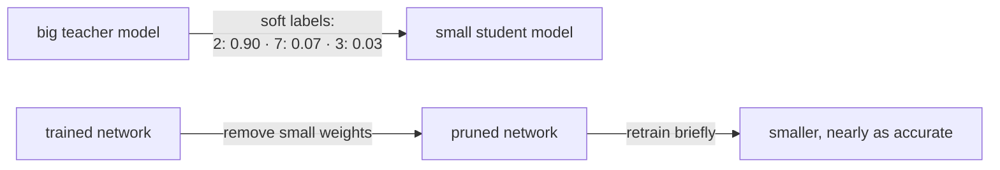

<!-- Written by `npm run lessons` from the lesson data in src/data. Edit the lesson there, not this page. -->

# Pruning and distillation

**ML Foundations · Unit 6: Systems and scale · Lesson 8 of 9**

> **In one line.** Pruning removes weights, neurons or heads that matter little; distillation trains a small student model to imitate a large teacher's full output probabilities; both make models smaller and cheaper to run.

[Open this lesson on the site](https://learn.hamropedia.com/foundations/pruning-and-distillation/) for its animation, the practice game and tap-to-explain words.

## The problem it solves

The best models are often too large, slow or expensive for phones, high-traffic services or tight latency budgets. Many of their parameters contribute little, and much of a big model's knowledge can be transferred into a smaller one. Pruning and distillation, alongside quantisation, are the standard ways to shrink models for deployment.

## The idea

Two ways to make a model smaller. Pruning removes weights, neurons or attention heads that matter little. Distillation trains a small 'student' model to copy a big 'teacher' model's full output probabilities, not just its top answer.

## How it works, step by step

1. Magnitude pruning: set the smallest-magnitude weights to zero, for example 50%, then fine-tune briefly to recover accuracy. Repeat in stages for higher sparsity.
2. Unstructured pruning leaves the matrix the same shape with scattered zeros, which rarely runs faster on standard hardware.
3. Structured pruning removes whole neurons, channels, attention heads or layers, so the model really shrinks and really speeds up.
4. Distillation: run the teacher on training inputs and keep its full probability distribution (soft labels), not just the top answer.
5. Soften both teacher and student with a temperature T > 1 (divide the logits by T), so small probabilities carry more signal.
6. Train the student to match the teacher's softened probabilities (a KL loss, scaled by T²), usually mixed with the normal loss on true labels.
7. For LLMs, distillation also means fine-tuning a small model on text generated by a large one.

## Picture it



*Distillation passes on the teacher's full opinion, not just its top answer. Pruning cuts weak weights, then retrains to recover.*

## Analogy

Pruning is trimming a tree's weak branches. Distillation is an expert teacher who explains not only the right answer, but also how close each wrong answer was.

**Where the analogy breaks.** A trimmed tree regrows on its own. A pruned network usually needs retraining to recover accuracy. And removing scattered single weights rarely makes it faster on real hardware, unless the pruning is structured (whole rows, channels or heads).

## Worked example

Soft labels carry more information than hard ones. For a picture of a 2, the teacher might say 2: 0.90, 7: 0.07, 3: 0.03, which tells the student that 2s look a bit like 7s. A temperature T > 1 softens these probabilities even more.

```python
T = 4.0
soft_teacher = F.softmax(teacher_logits / T, dim=-1)
log_student = F.log_softmax(student_logits / T, dim=-1)
distill = F.kl_div(log_student, soft_teacher, reduction="batchmean") * T * T
loss = 0.5 * distill + 0.5 * F.cross_entropy(student_logits, labels)
```

## Must know

- Soft labels carry "dark knowledge": which wrong answers are nearly right.
- Temperature softens distributions; T = 1 is the normal softmax.
- Structured pruning gives real speed-ups; unstructured mostly saves storage (unless hardware supports sparsity).
- Prune gradually and retrain in between: removing a little at a time lets the remaining weights make up for what was cut.
- Distillation, pruning and quantisation combine well.

## Common mistakes

- Pruning heavily in one shot with no retraining.
- Expecting scattered zeros to make inference faster on a normal GPU.
- Distilling with T = 1 only, losing most of the soft-label information.
- Evaluating the student only on the teacher's strengths.

> **Not true:** Pruning: remove most of the weights in one cut; no retraining is needed to keep the accuracy.  
> **In fact:** One heavy cut usually wrecks the accuracy. Prune a little at a time and retrain in between, so that the remaining weights can adjust.

> **Not true:** Unstructured pruning: scattered zeros that make inference faster on an ordinary GPU.  
> **In fact:** A normal GPU still multiplies by the zeros. Scattered (unstructured) pruning mostly saves storage; removing whole neurons or channels gives real speed-ups.

## Practise

Try each one yourself first: on paper, in code or out loud. Then open the answer and compare.

### 1. Derive

Show why the distillation loss is multiplied by T². Hint: look at how the gradient size changes when you divide the logits by T.

<details>
<summary>Show one good answer</summary>

Distillation compares the student's softened probabilities q = softmax(z/T) with the teacher's p = softmax(v/T), where z and v are the logits and T is the temperature.

The gradient of the soft cross-entropy with respect to a student logit is:  
∂L/∂zᵢ = (1/T) · (qᵢ − pᵢ).

Two factors of T shrink this gradient:  
1. The 1/T from the chain rule, because the logits are divided by T.  
2. The difference qᵢ − pᵢ itself: at high T both distributions are close to uniform, and expanding softmax for large T gives qᵢ − pᵢ ≈ (zᵢ − vᵢ) / (N·T), with N classes (when the logits have zero mean).

Together: ∂L/∂zᵢ ≈ (zᵢ − vᵢ) / (N·T²). The gradient shrinks with T².

Multiplying the soft loss by T² cancels that, so the soft-label term keeps roughly the same influence relative to the hard-label loss whatever temperature you choose. Without it, raising T from 1 to 4 would silently make the distillation signal 16 times weaker. (This is the argument in Hinton, Vinyals and Dean, 2015.)

</details>

### 2. Build

Distil your trained MNIST or CIFAR model into one a quarter of its size. Compare a student trained with soft labels against the same student trained on hard labels only.

<details>
<summary>Show one good answer</summary>

Teacher: an MLP 784 → 512 → 512 → 10 with dropout (about 670,000 parameters), trained on MNIST images 5,000 to 60,000. Student: 784 → 200 → 10 (about 159,000, a quarter of the size). Train three students with the same settings:  
• hard labels only, on images 0 to 5,000 (the labelled set);  
• distilled on the same 5,000 images: α × T² × KL(teacher's soft probabilities ‖ student's) + (1 − α) × cross-entropy with the hard labels, T = 4, α = 0.7;  
• soft labels only, on all 60,000 images, using no true labels at all: the teacher labels them.

The honest result, averaged over 3 seeds: on the same 5,000 images, distillation did not beat hard labels here (about 91.7% against 92.2%). With an MLP on an easy dataset, the teacher's soft labels added little that the true labels didn't already give. But the third student, which learned only from the teacher on 60,000 unlabelled images, reached about 95.7%, more than 3 points higher.

That is distillation's main practical use: once you have a good teacher, it can label as much extra data as you like for free, and a small student learns its behaviour from that. The "dark knowledge" in soft labels matters more on harder tasks with many similar classes; always compare against the hard-label baseline rather than assuming it helps.

```python
import torch
import torch.nn as nn
import torch.nn.functional as F
from torchvision import datasets

train, test = datasets.MNIST("data", train=True, download=True), datasets.MNIST("data", train=False, download=True)
X_all, y_all = train.data.reshape(-1, 784).float() / 255, train.targets
Xte, yte = test.data.reshape(-1, 784).float() / 255, test.targets
X_lab, y_lab = X_all[:5000], y_all[:5000]                  # the student's labelled data

def fit(model, X, y, loss_fn, epochs):
    opt = torch.optim.Adam(model.parameters(), lr=1e-3)
    for _ in range(epochs):
        for idx in torch.randperm(len(X)).split(128):
            opt.zero_grad(); loss_fn(model, X[idx], y[idx], idx).backward(); opt.step()
    with torch.no_grad():
        return (model(Xte).argmax(1) == yte).float().mean().item()

hard = lambda m, xb, yb, idx: F.cross_entropy(m(xb), yb)
torch.manual_seed(0)
teacher = nn.Sequential(nn.Linear(784, 512), nn.ReLU(), nn.Dropout(0.3), nn.Linear(512, 512), nn.ReLU(),
                        nn.Dropout(0.3), nn.Linear(512, 10))
print(f"teacher: {fit(teacher, X_all[5000:], y_all[5000:], hard, 4):.2%}")
teacher.eval()
with torch.no_grad():
    soft_lab, soft_all = teacher(X_lab), teacher(X_all)

T, alpha = 4.0, 0.7
def distill(m, xb, yb, idx):
    soft = F.kl_div(F.log_softmax(m(xb) / T, 1), F.softmax(soft_lab[idx] / T, 1), reduction="batchmean")
    return alpha * T * T * soft + (1 - alpha) * F.cross_entropy(m(xb), yb)
def soft_only(m, xb, yb, idx):                              # no true labels used at all
    return T * T * F.kl_div(F.log_softmax(m(xb) / T, 1), F.softmax(soft_all[idx] / T, 1), reduction="batchmean")

for name, X, y, loss_fn, epochs in [("hard labels, 5,000 images", X_lab, y_lab, hard, 10),
                                    ("distilled, same 5,000 images", X_lab, y_lab, distill, 10),
                                    ("teacher's labels only, 60,000 unlabelled", X_all, y_all, soft_only, 2)]:
    scores = []
    for seed in range(3):
        torch.manual_seed(seed)
        student = nn.Sequential(nn.Linear(784, 200), nn.ReLU(), nn.Linear(200, 10))
        scores.append(fit(student, X, y, loss_fn, epochs))
    print(f"student, {name}: {sum(scores) / 3:.2%} (mean of 3 seeds)")
```

</details>

### 3. Break

Prune 50%, 80% and 95% of the weights by magnitude, with and without retraining. Plot accuracy against sparsity. Then time the pruned model: is it actually faster?

<details>
<summary>Show one good answer</summary>

Magnitude pruning sets the smallest weights to zero. Without retraining, accuracy holds at 50% sparsity, drops somewhat at 80%, and drops sharply at 95%. With a short retraining after pruning (keeping the pruned weights at zero), the network recovers most of the accuracy even at 80%, and a good part of it at 95%: the remaining weights learn to compensate. Plotted, the "no retraining" curve falls off a cliff well before the "with retraining" curve does.

Is the pruned model faster? Not as it stands. The weights are zeros stored in an ordinary dense matrix, and the hardware multiplies zeros just as fast as any other number, so the time is the same. Real speed-ups need either structured pruning (remove whole neurons, heads or channels, so the matrices get smaller), hardware-supported patterns like 2:4 sparsity on recent NVIDIA GPUs, or sparse kernels that only win at very high sparsity. The run below shows the dense timing is unchanged.

```python
import copy
import time
import torch
import torch.nn as nn
import torch.nn.functional as F
from torchvision import datasets

train, test = datasets.MNIST("data", train=True, download=True), datasets.MNIST("data", train=False, download=True)
X, y = train.data[:20_000].reshape(-1, 784).float() / 255, train.targets[:20_000]
Xte, yte = test.data.reshape(-1, 784).float() / 255, test.targets
accuracy = lambda m: (m(Xte).argmax(1) == yte).float().mean().item()

def train_(model, epochs, masks=None):
    opt = torch.optim.Adam(model.parameters(), lr=1e-3)
    for _ in range(epochs):
        for idx in torch.randperm(len(X)).split(128):
            opt.zero_grad(); F.cross_entropy(model(X[idx]), y[idx]).backward(); opt.step()
            if masks:
                with torch.no_grad():
                    for layer, mask in masks.items():
                        layer.weight.mul_(mask)                  # keep pruned weights at zero
    return model

torch.manual_seed(0)
base = train_(nn.Sequential(nn.Linear(784, 300), nn.ReLU(), nn.Linear(300, 100), nn.ReLU(), nn.Linear(100, 10)), 3)
print(f"dense: {accuracy(base):.2%}")
for sparsity in [0.5, 0.8, 0.95]:
    pruned, masks = copy.deepcopy(base), {}
    for layer in [m for m in pruned if isinstance(m, nn.Linear)]:
        cut = layer.weight.abs().flatten().kthvalue(int(sparsity * layer.weight.numel())).values
        masks[layer] = (layer.weight.abs() > cut).float()
        layer.weight.data.mul_(masks[layer])
    before = accuracy(pruned)
    after = accuracy(train_(pruned, 1, masks))
    print(f"{sparsity:.0%} pruned: no retraining {before:.2%}, after 1 epoch of retraining {after:.2%}")

with torch.no_grad():
    for name, model in [("dense", base), ("95% zeros", pruned)]:
        start = time.perf_counter()
        for _ in range(50):
            model(Xte)
        print(f"{name}: {(time.perf_counter() - start) / 50 * 1000:.2f} ms per pass over the test set")
```

</details>

### 4. Explain

Explain pruning and distillation with the tree and teacher pictures.

<details>
<summary>Show one good answer</summary>

Pruning is trimming a tree's weakest branches. Many branches contribute almost nothing; cut them, and the tree keeps its shape and fruit, and if you give it a season to regrow (retraining), the remaining branches strengthen to make up for the loss. Cut too much at once, and the tree suffers.

Distillation is an expert teacher training a student. A normal answer key only says "the answer is 7". A good teacher also explains "it's a 7, but it looks a bit like a 1, and nothing like a 4": the soft probabilities. That extra information lets a much smaller student learn to behave like the teacher, faster and from less data, which is how small, fast models are made from big ones.

</details>

## Check you understood

Answer in your head first, then open each one.

<details>
<summary>&lt;b>Why train on soft labels instead of hard ones?&lt;/b></summary>

They tell the student how similar each wrong class is to the right one, which is extra information the one-hot label lacks.

</details>

<details>
<summary>&lt;b>What does a temperature above 1 do to the teacher's probabilities?&lt;/b></summary>

It softens them: the top class gets less, and the small probabilities become larger and more informative.

</details>

<details>
<summary>&lt;b>Why doesn't 80% unstructured pruning usually make a model 5 times faster?&lt;/b></summary>

The matrices keep their shape; standard hardware still multiplies the zeros unless special sparse support is used.

</details>

<details>
<summary>&lt;b>What does structured pruning remove?&lt;/b></summary>

Whole units — neurons, channels, attention heads or layers — so the computation genuinely shrinks.

</details>

## Go further (optional)

The lesson above is enough on its own. These free extras give a second explanation.

- READ · [Pruning Tutorial](https://docs.pytorch.org/tutorials/intermediate/pruning_tutorial.html) · PyTorch tutorials
- PAPER · [Distilling the Knowledge in a Neural Network (2015)](https://arxiv.org/abs/1503.02531) · Hinton, Vinyals, Dean · arXiv
- PAPER · [The Lottery Ticket Hypothesis (2018)](https://arxiv.org/abs/1803.03635) · Frankle and Carbin · arXiv

---

[← GPU kernels with Triton](gpu-kernels-with-triton.md) · [All lessons](../../README.md) · [Speculative decoding →](speculative-decoding.md)
