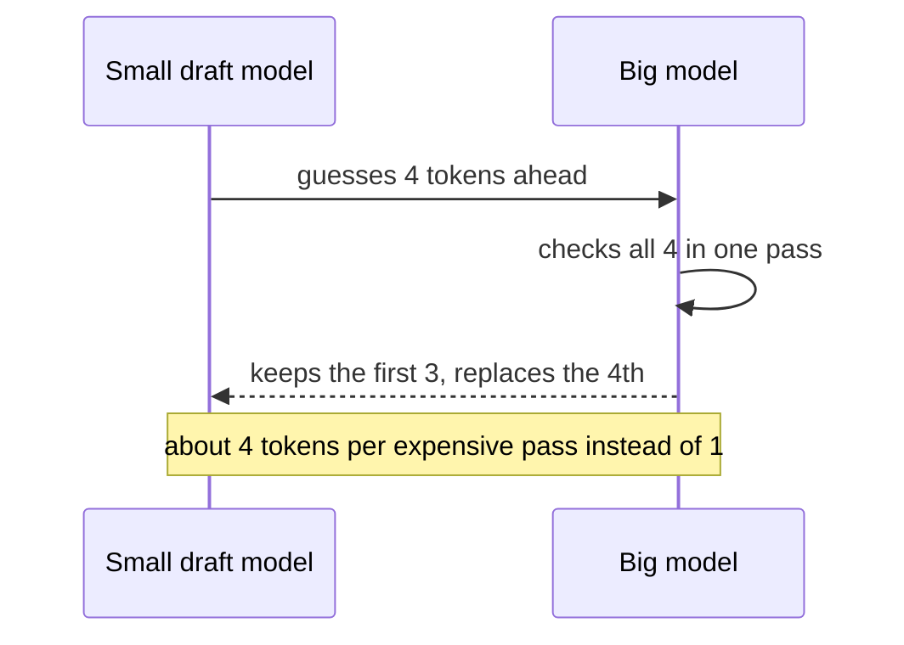

<!-- Written by `npm run lessons` from the lesson data in src/data. Edit the lesson there, not this page. -->

# Speculative decoding

**ML Foundations · Unit 6: Systems and scale · Lesson 9 of 9**

> **In one line.** Speculative decoding speeds up generation: a small draft model proposes several tokens, and the large model verifies them in a single pass. The output is exactly what the large model would have produced on its own.

[Open this lesson on the site](https://learn.hamropedia.com/foundations/speculative-decoding/) for its animation, the practice game and tap-to-explain words.

## The problem it solves

Large models generate one token per forward pass, and each pass is slow because it is memory-bound: the GPU spends its time reading weights, not computing. Checking several proposed tokens costs about the same as generating one. Speculative decoding turns that spare capacity into speed, with no change in output quality.

## The idea

A big model generates one token at a time, and each step is slow. In speculative decoding, a small, fast 'draft' model guesses several tokens ahead. The big model then checks all the guesses in one pass, keeps the ones it agrees with, and replaces the first wrong one. The output is exactly what the big model alone would produce, only faster.

## How it works, step by step

1. A small, fast draft model (or extra prediction heads) proposes the next k tokens, for example 4.
2. The large target model runs once over the context plus all k proposals, producing its own prediction at every position in parallel.
3. Walk through the proposals: accept each one the target model agrees with (with a probabilistic acceptance rule when sampling).
4. At the first disagreement, discard the rest and take the target model's own token there instead.
5. So each expensive pass yields between 1 and k + 1 tokens; with 3 of 4 accepted, you get 4 tokens from one pass.
6. The acceptance rule guarantees the output has exactly the target model's distribution: speed without any quality change.

## Picture it



*The output is exactly what the big model would write; it just gets there in fewer expensive steps.*

## Analogy

A junior writer drafts the next sentence, and a senior editor checks it in one read, instead of the senior writing every word slowly.

**Where the analogy breaks.** An editor can rewrite anything. Here, only the guesses up to the first rejected token are kept, so if the draft model guesses badly you gain almost nothing. The speed-up depends on the acceptance rate.

## Worked example

Say the draft model proposes 4 tokens and, on average, 3 are accepted. Then each expensive pass of the big model gives about 4 tokens (the 3 accepted plus 1 of its own) instead of 1.

```python
# pseudo-code, greedy version
draft = small_model.generate(prefix, k=4)        # cheap guesses
checks = big_model.next_tokens(prefix + draft)   # one pass scores every position
n = matching_prefix_length(draft, checks)        # keep the tokens both agree on
prefix = prefix + draft[:n] + [checks[n]]       # plus the big model's own next token
```

## Must know

- The speed-up depends on the acceptance rate, so the draft must imitate the target well.
- The draft must be much cheaper than the target.
- Output quality is identical to the target model alone.
- It helps most when generation is memory-bound (small batches, latency-sensitive serving).
- Variants use extra heads or the model's own earlier layers as the drafter.

## Common mistakes

- Using a draft model that rarely agrees with the target, gaining nothing.
- Assuming it changes or degrades the output (it doesn't, if done correctly).
- Expecting big gains at very large batch sizes, where the GPU is already busy.

> **Not true:** Speculative decoding gives its largest speed-up at very large batch sizes.  
> **In fact:** At large batch sizes the GPU is already busy, so the spare capacity that speculative decoding uses is gone. The gains are largest for single requests and small batches.

> **Not true:** Speculative decoding lowers the quality of the output a little.  
> **In fact:** The large model checks every drafted token and keeps only what it would have produced itself. The output is exactly the same; only the speed changes.

## Practise

Try each one yourself first: on paper, in code or out loud. Then open the answer and compare.

### 1. Derive

Each draft token is accepted with probability 0.8, independently, and the draft proposes k = 4. What is the expected number of tokens per big-model pass?

<details>
<summary>Show one good answer</summary>

The draft proposes k = 4 tokens; each is accepted with probability α = 0.8, and the first rejection stops the run. The big model's pass always adds one token of its own: a correction at the first rejection, or a bonus token if all 4 are accepted.

Tokens per pass = (number of accepted draft tokens) + 1.  
P(at least i drafts accepted) = αⁱ, so the expected number accepted is α + α² + α³ + α⁴ = 0.8 + 0.64 + 0.512 + 0.4096 = 2.3616.  
Add the big model's own token: 3.36 tokens per big-model pass.

The same in one formula: (1 − α^(k+1)) / (1 − α) = (1 − 0.8⁵) / 0.2 = (1 − 0.32768) / 0.2 ≈ 3.36.

So each expensive pass produces about 3.4 tokens instead of 1. The real speed-up is a bit lower, because the draft model's own passes cost something too.

```python
alpha, k = 0.8, 4
print(sum(alpha**i for i in range(1, k + 1)) + 1, (1 - alpha**(k + 1)) / (1 - alpha))   # both ≈ 3.3616
```

</details>

### 2. Build

Implement greedy speculative decoding with two sizes of your own GPT, or two small open models. Check the output is identical to the big model alone, and measure the speed-up.

<details>
<summary>Show one good answer</summary>

Train two GPTs on Shakespeare: the big one (the shared gpt.py model) and a small draft (width 32, 1 layer). Greedy speculative decoding: the draft proposes k tokens one at a time; the big model then scores the context plus all k proposals in a single forward pass, giving its own greedy choice at every position; accept the proposals up to the first one where the big model disagrees, then append the big model's own token there. Repeat.

The key check: the output is exactly identical to the big model decoding greedily on its own, because every token that is kept is one the big model would have chosen. (The test stays inside the model's 64-character window: once the context has to be cropped, the two methods would show the big model slightly different windows, so a fair comparison needs a model with a long enough context, or a KV cache.) In the run below, about a quarter of the draft's proposals are accepted, giving about 2 tokens per big-model pass, but the total time is about the same as plain decoding (about 1.0 times). Two reasons: this draft model is weak (a 1-layer model agrees with the big one too rarely), and the big model is tiny, so it is barely more expensive than the draft, while Python overhead costs the same for both. Real systems, where the big model is billions of parameters and the draft is a well-matched smaller model, see 2 to 3 times speed-ups. The fair check is the one the code makes first: identical output.

```python
import time
import torch
from gpt import GPT, Config, train, encode, decode

@torch.no_grad()
def greedy(model, idx, n):
    for _ in range(n):
        logits, _ = model(idx[:, -model.c.block_size:])
        idx = torch.cat([idx, logits[:, -1].argmax(-1, keepdim=True)], dim=1)
    return idx

@torch.no_grad()
def speculative(big, draft, idx, n, k=4):
    target, passes, accepted, proposed = idx.shape[1] + n, 0, 0, 0
    while idx.shape[1] < target:
        k_now = min(k, target - idx.shape[1])                         # never draft past the end
        proposal = greedy(draft, idx, k_now)[:, idx.shape[1]:]
        logits, _ = big(torch.cat([idx, proposal], dim=1))             # one big pass checks them all
        passes += 1; proposed += k_now
        choices = logits[0, -k_now - 1:].argmax(-1)                    # big model's pick at each position
        n_ok = 0
        while n_ok < k_now and proposal[0, n_ok] == choices[n_ok]:
            n_ok += 1
        accepted += n_ok
        idx = torch.cat([idx, proposal[:, :n_ok], choices[n_ok].view(1, 1)], dim=1)
    return idx[:, :target], passes, accepted, proposed

torch.manual_seed(0)
big = train(GPT(), steps=1500, log_every=0).eval()
draft = train(GPT(Config(n_embd=32, n_layer=1, n_head=2)), steps=1500, log_every=0).eval()
plain_s = fast_s = 0.0
passes = accepted = proposed = tokens = 0
for prompt in ["ROMEO:\n", "JULIET:\n", "KING RICHARD III:\n", "First Citizen:\n", "MENENIUS:\n"]:
    ids = torch.tensor([encode(prompt)])
    n = 64 - ids.shape[1]                     # stay inside the 64-character window, so the big model's
    t = time.perf_counter(); plain = greedy(big, ids, n); plain_s += time.perf_counter() - t   # context is never cropped
    t = time.perf_counter(); fast, p, a, q = speculative(big, draft, ids, n); fast_s += time.perf_counter() - t
    assert torch.equal(plain, fast)                                    # identical output
    passes, accepted, proposed, tokens = passes + p, accepted + a, proposed + q, tokens + n
print(f"tokens per big-model pass: {tokens / passes:.2f}, draft acceptance {accepted / proposed:.0%}")
print(f"plain {plain_s:.2f} s, speculative {fast_s:.2f} s: {plain_s / fast_s:.2f}x")
print(decode(fast[0].tolist()))
```

</details>

### 3. Break

Use a draft model trained on very different text. Measure the acceptance rate and the speed-up. At what acceptance rate does it become slower than normal decoding?

<details>
<summary>Show one good answer</summary>

A draft trained on very different text, here a list of first names instead of Shakespeare, rarely guesses what the big model would write next, so most proposals are rejected at the first token. In the run below, on real held-out text, a small draft trained on Shakespeare agrees with the big model's next character 37% of the time; the one trained on names agrees 3% of the time. Acceptance falls sharply and each big-model pass yields barely more than one token, while you still pay for the draft's k passes: the result is slower than plain decoding.

Where is the break-even? Each round costs one big pass plus k draft passes, c·k, where c is the draft's cost relative to the big model; it yields (1 − α^(k+1)) / (1 − α) tokens. Plain decoding gives 1 token per big pass. Speculative decoding only wins when tokens per round > 1 + c·k. With k = 4 and a draft costing 20% of the big model (c = 0.2), you need 1.8 tokens per round, which takes an acceptance rate of about 0.45 or more; with a draft costing 5% (c = 0.05), about 0.17 is enough. In practice: choose a draft trained on the same kind of data (often a smaller model of the same family), and lower k when acceptance is low.

```python
import urllib.request
import torch
from gpt import GPT, Config, train, encode, get_batch, val_data

def tokens_per_round(alpha, k):
    return (1 - alpha ** (k + 1)) / (1 - alpha) if alpha < 1 else k + 1
for c in [0.2, 0.05]:
    breakeven = next(a / 100 for a in range(1, 100) if tokens_per_round(a / 100, 4) > 1 + c * 4)
    print(f"draft cost {c:.0%} of the big model: speculative wins above acceptance {breakeven:.2f}")

@torch.no_grad()
def acceptance(big, draft, n=300):
    text = val_data[:n + 64].unsqueeze(0)                      # real held-out text
    hits = 0
    for i in range(64, 64 + n):
        ctx = text[:, i - 64:i]                                     # the 64 characters before position i
        hits += int(big(ctx)[0][0, -1].argmax() == draft(ctx)[0][0, -1].argmax())
    return hits / n

torch.manual_seed(0)
big = train(GPT(), steps=1500, log_every=0).eval()
names = torch.tensor(encode(urllib.request.urlopen("https://raw.githubusercontent.com/karpathy/makemore/master/names.txt").read().decode()))
for name, source in [("Shakespeare draft", None), ("names draft", names)]:
    torch.manual_seed(1)
    draft = GPT(Config(n_embd=32, n_layer=1, n_head=2))
    opt = torch.optim.AdamW(draft.parameters(), lr=1e-3)
    for _ in range(1500):
        loss = draft(*get_batch("train", source=source))[1]
        opt.zero_grad(); loss.backward(); opt.step()
    print(f"{name}: agrees with the big model's next token {acceptance(big, draft.eval()):.0%} of the time")
```

</details>

### 4. Explain

Explain speculative decoding with the junior-writer-and-editor picture.

<details>
<summary>Show one good answer</summary>

A junior writer drafts the next few words, and a senior editor checks them in one read. Wherever the editor agrees, the words stay; at the first word the editor would have written differently, the editor writes their own word, and the junior starts drafting again from there. The final text is exactly what the senior would have written alone, but the senior only had to read in quick passes instead of writing every word slowly.

In speculative decoding, a small, fast model drafts several tokens, and the big model checks them all in a single forward pass (checking several tokens at once costs about the same as generating one, because a pass processes many positions in parallel). The better the junior knows the senior's style, the more words survive each check, and the bigger the speed-up.

</details>

## Check you understood

Answer in your head first, then open each one.

<details>
<summary>&lt;b>Why is checking 4 tokens about as cheap as generating 1?&lt;/b></summary>

Generation is memory-bound: the cost is reading the weights, which happens once whether you score one position or several.

</details>

<details>
<summary>&lt;b>What happens at the first rejected draft token?&lt;/b></summary>

It and all later draft tokens are discarded, and the target model's own token is used at that position.

</details>

<details>
<summary>&lt;b>Does speculative decoding change what the big model outputs?&lt;/b></summary>

No. The acceptance rule makes the output exactly match the big model's own distribution.

</details>

<details>
<summary>&lt;b>What decides how much faster it is?&lt;/b></summary>

How often the draft model's guesses are accepted, and how cheap the draft model is.

</details>

## Go further (optional)

The lesson above is enough on its own. These free extras give a second explanation.

- READ · [Assisted Generation: a new direction toward low-latency text generation](https://huggingface.co/blog/assisted-generation) · Hugging Face blog · with animations  
  **Worth it:** Animated diagrams of a draft model proposing and a big model checking, plus measured speed-ups. Makes the idea click quickly.
- PAPER · [Fast Inference from Transformers via Speculative Decoding (2022)](https://arxiv.org/abs/2211.17192) · Leviathan, Kalman, Matias · arXiv

---

[← Pruning and distillation](pruning-and-distillation.md) · [All lessons](../../README.md) · [Autoencoders and VAEs (the ELBO) →](../unit-7-generative-rl/autoencoders-and-vaes-the-elbo.md)
