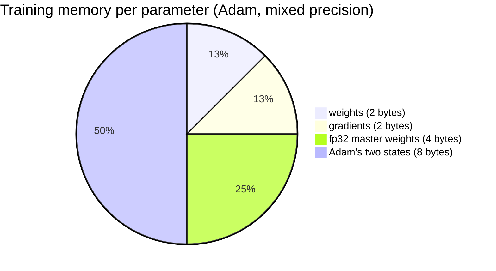

<!-- Written by `npm run lessons` from the lesson data in src/data. Edit the lesson there, not this page. -->

# Training memory: weights, gradients, optimiser states, activations

**ML Foundations · Unit 6: Systems and scale · Lesson 3 of 9**

> **In one line.** Training memory is the sum of the weights, the gradients, the optimiser states and the activations saved for backprop. With Adam and mixed precision, it is about 16 bytes per parameter before activations.

[Open this lesson on the site](https://learn.hamropedia.com/foundations/training-memory-weights-gradients-optimiser-states-activations/) for its animation, the practice game and tap-to-explain words.

## The problem it solves

Running out of GPU memory is the most common reason a training run won't start. Knowing where the bytes go lets you estimate whether a model fits before trying, and pick the right fix — a smaller batch, checkpointing, an 8-bit optimiser, or sharding across GPUs.

## The idea

Training needs memory for the weights, the gradients, the optimiser states (Adam keeps 2 extra numbers per weight) and the activations saved for backprop. With mixed precision and Adam, a common estimate is about 16 bytes per parameter, before activations.

## How it works, step by step

1. Weights in bf16: 2 bytes per parameter.
2. Gradients in bf16: another 2 bytes per parameter.
3. An fp32 master copy of the weights for the update: 4 bytes.
4. Adam's two running averages (m and v), each fp32: 8 bytes.
5. Total ≈ 16 bytes per parameter. A 1-billion-parameter model needs about 16 GB before activations, compared with about 2 GB just to run it in bf16.
6. Activations: every layer's outputs are saved for backprop. They grow with batch size × sequence length × width × layers, and often dominate for long sequences.
7. Fixes: gradient checkpointing (store fewer activations, recompute them in backward), gradient accumulation (smaller micro-batches), 8-bit optimisers, LoRA (far fewer trainable parameters), and ZeRO/FSDP (split weights, gradients and optimiser states across GPUs).

## Picture it



*About 16 bytes per parameter before activations — so a 1-billion-parameter model needs about 16 GB just for these.*

## Analogy

Moving house. It is not just the furniture (weights). You also need boxes (gradients), labels (optimiser states) and floor space to lay things out while packing (activations).

**Where the analogy breaks.** Moving house happens once. Activations grow with batch size and sequence length, so the same model can fit or not fit depending on your batch.

## Worked example

A 1-billion-parameter model: inference in bf16 needs about 1B × 2 bytes = 2 GB for the weights. Training with Adam needs about 1B × 16 bytes = 16 GB, plus activations. (2 bytes weights + 2 gradients + 4 master weights + 4 + 4 for Adam's two states.)

## Must know

- Inference ≈ 2 bytes/param (bf16) plus the KV cache.
- Training with Adam ≈ 16 bytes/param plus activations.
- Activations scale with batch size and sequence length.
- Checkpointing trades extra compute for much less activation memory.
- Gradient accumulation gives a large effective batch with small memory.
- Measure the peak GPU memory of a training step with torch.cuda.max_memory_allocated(), instead of estimating it.

## Common mistakes

- Estimating training memory from the weights alone.
- Ignoring activations when increasing sequence length.
- Lowering the batch size without accumulating gradients, which changes the training dynamics.

> **Not true:** Halving the batch size saves memory and has no other effect on training.  
> **In fact:** A smaller batch gives noisier gradients, so training behaves differently. To keep the same effective batch, add up the gradients of several small batches before each update.

> **Not true:** Training memory can be estimated from the size of the weights alone.  
> **In fact:** Training also stores gradients, optimiser states and the activations saved for backprop. With Adam that is about 16 bytes per parameter, before activations.

## Practise

Try each one yourself first: on paper, in code or out loud. Then open the answer and compare.

### 1. Derive

Estimate the training memory of a 350M model with Adam and mixed precision, before activations, at 16 bytes per parameter.

<details>
<summary>Show one good answer</summary>

With Adam and mixed precision, the usual per-parameter cost is about 16 bytes:  
• 2 bytes: bf16 weights used in the forward and backward pass  
• 2 bytes: bf16 gradients  
• 4 bytes: fp32 master copy of the weights  
• 4 bytes: Adam's first moment (running mean of gradients), fp32  
• 4 bytes: Adam's second moment (running mean of squared gradients), fp32

350 million × 16 bytes = 5.6 GB, before any activations.

For comparison, inference needs only the bf16 weights: 350M × 2 = 0.7 GB. Training needs 8 times as much before activations, and activations come on top, growing with batch size and sequence length; for long sequences they can be bigger than everything else. That is why a model you can run on a laptop may need a large GPU to train.

</details>

### 2. Build

Measure GPU memory while training your GPT with torch.cuda.max_memory_allocated. Change batch size and sequence length, and plot the effect.

<details>
<summary>Show one good answer</summary>

On a GPU, torch.cuda.max_memory_allocated() after a training step gives the peak; reset it between runs. Without a GPU you can measure the part that changes with batch size directly: the activations that autograd saves for the backward pass. A saved-tensors hook sees every tensor saved during the forward pass, so summing their sizes gives the activation memory.

The result: activation memory grows in proportion to the batch size (double the batch, double the memory) and faster than proportionally with sequence length (8 times the length gives about 14 times the memory here), because some of what attention saves grows with the square of the length. The weights, gradients and optimiser states don't change at all. So when you run out of memory, the batch size and sequence length are the first things to cut.

```python
import torch
import matplotlib.pyplot as plt
from gpt import GPT, Config, get_batch

def activation_bytes(model, batch_size, block_size):
    total = 0
    def pack(t):
        nonlocal total
        total += t.numel() * t.element_size()
        return t
    x, y = get_batch("train", block_size=block_size, batch_size=batch_size)
    with torch.autograd.graph.saved_tensors_hooks(pack, lambda t: t):
        _, loss = model(x, y)
    loss.backward()
    return total / 1e6

torch.manual_seed(0)
for name, values, make in [("batch size", [8, 16, 32, 64], lambda v: (v, 64)),
                           ("sequence length", [32, 64, 128, 256], lambda v: (16, v))]:
    results = []
    for v in values:
        b, t = make(v)
        results.append(activation_bytes(GPT(Config(block_size=max(t, 64))), b, t))
    print(name, [f"{v}: {mb:.0f} MB" for v, mb in zip(values, results)])
    plt.plot(values, results, marker="o", label=name)
plt.xlabel("value"); plt.ylabel("saved activations (MB)"); plt.legend(); plt.show()
if torch.cuda.is_available():
    print("GPU peak memory:", torch.cuda.max_memory_allocated() / 1e6, "MB")
```

</details>

### 3. Break

Raise the batch size until you run out of memory. Then make the same effective batch fit with gradient accumulation or checkpointing.

<details>
<summary>Show one good answer</summary>

Raise the batch size and, on a GPU, you eventually get "CUDA out of memory". (On a CPU the machine just starts swapping and crawls, so don't try it there.) Two ways to keep the same effective batch:

Gradient accumulation: split the big batch into small micro-batches, run backward on each (dividing each loss by the number of micro-batches), and only call optimizer.step() after all of them. Gradients add up in .grad, so the result is the same update as one big batch, using the memory of one micro-batch, at the cost of time. The run below checks this: the accumulated gradient matches the big-batch gradient to about 1e-6.

Activation checkpointing: don't save the activations inside each block during the forward pass; recompute them during backward. In the run below it cuts the saved activation memory about 10 times (153 MB to 15 MB), for roughly 30% more compute. Large-model training uses both, plus sharding the optimiser state across GPUs.

```python
import torch
from torch.utils.checkpoint import checkpoint
from gpt import GPT, Config, get_batch

torch.manual_seed(0)
model = GPT(Config(dropout=0.0))
x, y = get_batch("train", batch_size=64)

model.zero_grad(); model(x, y)[1].backward()
big = model.head.weight.grad.clone()
model.zero_grad()
for xs, ys in zip(x.chunk(4), y.chunk(4)):                 # 4 micro-batches of 16
    (model(xs, ys)[1] / 4).backward()                         # gradients add up in .grad
print("accumulated vs big batch, max difference:", (model.head.weight.grad - big).abs().max().item())

def saved_mb(use_checkpointing):
    total = 0
    def pack(t):
        nonlocal total
        total += t.numel() * t.element_size(); return t
    with torch.autograd.graph.saved_tensors_hooks(pack, lambda t: t):
        h = model.tok(x) + model.pos(torch.arange(x.shape[1]))
        for block in model.blocks:
            h = checkpoint(block, h, use_reentrant=False) if use_checkpointing else block(h)
        loss = torch.nn.functional.cross_entropy(model.head(model.ln(h)).flatten(0, 1), y.flatten())
    loss.backward()
    return total / 1e6
print(f"saved activations: normal {saved_mb(False):.0f} MB, with checkpointing {saved_mb(True):.0f} MB")
```

</details>

### 4. Explain

Explain the four parts of training memory with the moving-house picture.

<details>
<summary>Show one good answer</summary>

Moving house. It is not just the furniture you have to fit in the van. The furniture is the weights. You also need boxes to pack it in: the gradients, one for every weight. You need labels and notes about each box, saying where it goes and how fragile it is: the optimiser states, which for Adam take twice the space of the furniture itself. And while you pack, you need floor space to lay things out: the activations, which you need at the end to check everything, and which grow with how much you pack at once (the batch size).

Running a model (inference) is just living in the house: only the furniture. Training is moving house, which takes many times the space.

</details>

## Check you understood

Answer in your head first, then open each one.

<details>
<summary>&lt;b>Why does training need about 8 times the memory of inference for the same weights?&lt;/b></summary>

Besides the weights (2 bytes), it stores gradients (2), an fp32 master copy (4) and Adam's two states (8): about 16 bytes per parameter instead of 2.

</details>

<details>
<summary>&lt;b>What does gradient checkpointing trade?&lt;/b></summary>

It saves activation memory by storing fewer of them and recomputing the rest during the backward pass, which costs extra compute.

</details>

<details>
<summary>&lt;b>How can you train with an effective batch of 256 when only 32 fit?&lt;/b></summary>

Gradient accumulation: run 8 micro-batches of 32, adding up their gradients, then take one optimiser step.

</details>

<details>
<summary>&lt;b>What grows when you double the sequence length?&lt;/b></summary>

The activation memory (roughly doubling or more, because attention also grows with length).

</details>

## Go further (optional)

The lesson above is enough on its own. These free extras give a second explanation.

- READ · [Transformer Math 101](https://blog.eleuther.ai/transformer-math/) · EleutherAI blog  
  **Worth it:** All the back-of-the-envelope formulas for compute and memory in one short page: weights, optimiser states, activations, and how to estimate them for any model.
- READ · [The Ultra-Scale Playbook (memory usage section)](https://huggingface.co/spaces/nanotron/ultrascale-playbook) · Hugging Face
- PAPER · [ZeRO: Memory Optimizations Toward Training Trillion Parameter Models (2019)](https://arxiv.org/abs/1910.02054) · Rajbhandari et al. · arXiv

---

[← Mixed precision: fp16 and bf16](mixed-precision-fp16-and-bf16.md) · [All lessons](../../README.md) · [Parallelism: data, tensor and pipeline (the ideas) →](parallelism-data-tensor-and-pipeline-the-ideas.md)
