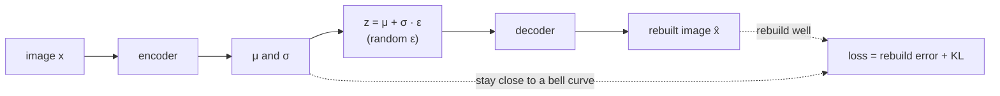

<!-- Written by `npm run lessons` from the lesson data in src/data. Edit the lesson there, not this page. -->

# Autoencoders and VAEs (the ELBO)

**ML Foundations · Unit 7: Generative models and reinforcement learning · Lesson 1 of 6**

> **In one line.** An autoencoder squeezes data into a small code and rebuilds it. A variational autoencoder (VAE) makes the code a probability distribution, pulled towards a simple bell curve, so that you can sample new codes and decode them into new data.

[Open this lesson on the site](https://learn.hamropedia.com/foundations/autoencoders-and-vaes-the-elbo/) for its animation, the practice game and tap-to-explain words.

## The problem it solves

A plain autoencoder learns good compression, but its codes are scattered with gaps, so a random code decodes into nonsense and it can't generate anything new. VAEs fix that by shaping the code space, giving a principled generative model with a smooth latent space. The same encoder–decoder idea is inside modern image generators, which run diffusion in a VAE's compact latent space.

## The idea

An autoencoder squeezes data into a small code and rebuilds it. A variational autoencoder (VAE) makes that code a probability distribution, so you can sample new codes and decode them into new data. It trains by maximising the ELBO: rebuild the input well, but keep the codes close to a simple bell curve.

## How it works, step by step

1. Encoder: a network maps the input x to the mean μ and spread σ of a distribution over codes z.
2. Sample a code with the reparameterisation trick: z = μ + σ·ε with ε ~ N(0, I). The randomness is in ε, so gradients can flow through μ and σ.
3. Decoder: a network maps z back to a reconstruction of x.
4. The loss is the negative ELBO: a reconstruction term (rebuild x well) plus a KL term that pulls each q(z \| x) towards the prior N(0, I).
5. The KL term packs codes into one smooth, gap-free cloud; the reconstruction term keeps them informative.
6. To generate: sample z from N(0, I) and decode it.
7. β-VAE weights the KL term by β: bigger β gives a tidier, more disentangled space but blurrier reconstructions.

## Picture it



*A VAE squeezes an image into a fuzzy code and rebuilds it. The loss balances rebuilding well against keeping the codes tidy.*

## Analogy

Describing a face to a sketch artist in 10 numbers. The encoder writes the description and the decoder draws. A VAE also forces the descriptions to be tidy, so a random description still gives a sensible face.

**Where the analogy breaks.** A person's description is exact. A VAE's code is fuzzy on purpose (it adds noise), which is one reason VAE images are often blurry.

## Worked example

ELBO = reconstruction term − KL(q(z \| x) ‖ N(0, I)). The reparameterisation trick writes z = μ + σ·ε with ε ~ N(0, 1), so gradients can flow through the sampling step.

```python
mu, log_var = encoder(x)
eps = torch.randn_like(mu)
z = mu + torch.exp(0.5 * log_var) * eps           # reparameterisation trick
x_hat = decoder(z)
recon = F.mse_loss(x_hat, x, reduction="sum")
kl = -0.5 * torch.sum(1 + log_var - mu**2 - log_var.exp())
loss = recon + kl                                 # minimising this maximises the ELBO
```

## Must know

- Autoencoder: compress and rebuild; VAE: also a generative model.
- A VAE is trained by maximising the ELBO = reconstruction − KL(q(z \| x) ‖ p(z)): rebuild the input well, and keep the codes close to the prior.
- The reparameterisation trick makes sampling differentiable.
- KL too weak → gaps; too strong → codes ignore the input ("posterior collapse").
- VAE samples tend to be blurry; diffusion and other models give sharper images.
- Latent spaces support interpolation: walk between two codes and decode.

## Common mistakes

- Sampling z directly without the reparameterisation trick, so gradients can't flow.
- Letting the KL term dominate early, so the decoder learns to ignore z.
- Expecting crisp, photo-quality samples from a basic VAE.

> **Not true:** Basic VAE samples: crisp and photo-quality.  
> **In fact:** They tend to be blurry. The code is fuzzy on purpose (noise is added to it), so the decoder learns to draw an average of the images that fit. Diffusion models give sharper images.

> **Not true:** Sampling z at random: gradients flow straight through that step.  
> **In fact:** Sampling is not differentiable. The reparameterisation trick writes z = μ + σ·ε, with the randomness in ε, so gradients can reach μ and σ.

## Practise

Try each one yourself first: on paper, in code or out loud. Then open the answer and compare.

### 1. Derive

Derive the ELBO on paper, starting from log p(x) and using Jensen's inequality. Then derive the closed-form KL between N(μ, σ²) and N(0, 1).

<details>
<summary>Show one good answer</summary>

The ELBO. A latent-variable model says p(x) = ∫ p(x \| z) p(z) dz, which we can't compute. Bring in the encoder's distribution q(z \| x) by multiplying and dividing by it:

log p(x) = log ∫ q(z \| x) · [p(x \| z) p(z) / q(z \| x)] dz = log E_q[ p(x \| z) p(z) / q(z \| x) ].

Jensen's inequality: log is concave, so log E[Y] ≥ E[log Y]. Therefore

log p(x) ≥ E_q[ log p(x \| z) + log p(z) − log q(z \| x) ]  
= E_q[ log p(x \| z) ] − KL( q(z \| x) ‖ p(z) ).

That lower bound is the ELBO. The first term rewards reconstructing x from z; the second keeps the encoder's distribution close to the prior. The gap between log p(x) and the ELBO is exactly KL(q(z \| x) ‖ p(z \| x)), so a better encoder makes the bound tighter.

The KL in closed form, for q = N(μ, σ²) and p = N(0, 1) in one dimension:  
KL = E_q[log q − log p] = E_q[ −½ log(2πσ²) − (z − μ)²/(2σ²) + ½ log(2π) + z²/2 ].  
Use E_q[(z − μ)²] = σ² and E_q[z²] = σ² + μ²:  
KL = −½ log σ² − ½ + ½(σ² + μ²) = ½ (σ² + μ² − 1 − log σ²).  
It is 0 exactly when μ = 0 and σ = 1, and for a d-dimensional diagonal Gaussian you add it up over the dimensions.

</details>

### 2. Build

Build a VAE on MNIST in PyTorch with a 2D latent space. Plot the latent space coloured by digit, and decode a grid of points into images.

<details>
<summary>Show one good answer</summary>

Encoder: 784 → 400 → two outputs of size 2, the mean μ and the log-variance log σ² (learning the log keeps σ positive). Sample z = μ + σ·ε with ε ~ N(0, 1), the reparameterisation trick, so gradients flow through the sampling. Decoder: 2 → 400 → 784 with a sigmoid. Loss: binary cross-entropy between input and reconstruction (summed over pixels) plus the closed-form KL.

After 5 epochs, the 2-D latent space coloured by digit shows the classes as overlapping regions arranged around the origin: similar-looking digits (4 and 9, 3 and 5) sit next to each other, with smooth transitions in between. Decoding a grid of points from −2 to 2 in each direction gives a map of digits morphing into one another, recognisable but blurry, which is the classic VAE picture.

```python
import numpy as np
import torch
import torch.nn as nn
import torch.nn.functional as F
import matplotlib.pyplot as plt
from torchvision import datasets

mnist = datasets.MNIST("data", train=True, download=True)
X, labels = mnist.data.reshape(-1, 784).float() / 255, mnist.targets

class VAE(nn.Module):
    def __init__(self, z=2):
        super().__init__()
        self.enc, self.mu, self.logvar = nn.Linear(784, 400), nn.Linear(400, z), nn.Linear(400, z)
        self.dec = nn.Sequential(nn.Linear(z, 400), nn.ReLU(), nn.Linear(400, 784), nn.Sigmoid())
    def forward(self, x):
        h = F.relu(self.enc(x))
        mu, logvar = self.mu(h), self.logvar(h)
        z = mu + torch.exp(0.5 * logvar) * torch.randn_like(mu)          # reparameterisation
        return self.dec(z), mu, logvar

def losses(model, x):
    recon, mu, logvar = model(x)
    rec = F.binary_cross_entropy(recon, x, reduction="sum") / len(x)
    kl = 0.5 * torch.sum(logvar.exp() + mu**2 - 1 - logvar) / len(x)
    return rec, kl

def train_vae(kl_weight=1.0, epochs=5, seed=0):
    torch.manual_seed(seed)
    model = VAE()
    opt = torch.optim.Adam(model.parameters(), lr=1e-3)
    for _ in range(epochs):
        for idx in torch.randperm(len(X)).split(128):
            rec, kl = losses(model, X[idx])
            opt.zero_grad(); (rec + kl_weight * kl).backward(); opt.step()
    return model

if __name__ == "__main__":
    model = train_vae()
    with torch.no_grad():
        rec, kl = losses(model, X[:10_000])
        mu = model(X[:10_000])[1]
        print(f"reconstruction {rec:.1f}, KL {kl:.2f} (per image)")
        grid = torch.tensor([[x, y] for y in np.linspace(2, -2, 15) for x in np.linspace(-2, 2, 15)], dtype=torch.float32)
        images = model.dec(grid).reshape(15, 15, 28, 28).permute(0, 2, 1, 3).reshape(15 * 28, 15 * 28)
    fig, axes = plt.subplots(1, 2, figsize=(12, 6))
    axes[0].scatter(mu[:, 0], mu[:, 1], c=labels[:10_000], cmap="tab10", s=2); axes[0].set_title("latent space by digit")
    axes[1].imshow(images, cmap="gray"); axes[1].axis("off"); axes[1].set_title("decoded grid")
    plt.show()
```

</details>

### 3. Break

Remove the KL term, then multiply it by 10. What happens to the samples and to the latent space in each case?

<details>
<summary>Show one good answer</summary>

No KL term: the model becomes a plain autoencoder with noise. Reconstructions get a little sharper (the reconstruction loss is only slightly lower here, 150.0 against 150.6, because a 2-number code is the real bottleneck), but the encoder is free to put each digit wherever it likes, spread far from the origin with gaps in between, and it shrinks σ so the noise barely matters. Sampling z from N(0, 1) and decoding then lands in empty or meaningless regions, so random samples are mostly not digits: the model is good at copying, useless at generating. In the run below the latent codes spread out to a standard deviation of about 4, where the prior expects 1, and the KL rises from about 5.6 to 34.

KL multiplied by 10: now staying close to N(0, 1) matters ten times more than reconstructing well. The encoder squeezes all digits towards the origin and keeps the noise large, so less information about each image gets through. Reconstructions become very blurry, an "average digit" look, and distinct digits merge; in the extreme, the latent space is ignored completely (posterior collapse). In the run below the reconstruction loss is clearly worse (about 168 against 151) and the KL is pushed down to about 2.

The ELBO's two terms are a trade-off between faithful reconstructions and a tidy, sample-able latent space; β-VAEs tune that weight on purpose.

```python
import torch
# VAE, losses, train_vae and X come from the Build answer above: save it as vae.py
from vae import X, losses, train_vae

for kl_weight in [0.0, 1.0, 10.0]:
    model = train_vae(kl_weight=kl_weight)
    with torch.no_grad():
        rec, kl = losses(model, X[:10_000])
        mu = model(X[:10_000])[1]
    print(f"KL weight {kl_weight:4}: reconstruction {rec:6.1f}, KL {kl:6.2f}, "
          f"spread of latent codes (std) {mu.std(0).mean():.2f}")
```

</details>

### 4. Explain

Explain a VAE with the sketch-artist picture, and why its images are blurry.

<details>
<summary>Show one good answer</summary>

You describe a face to a sketch artist using just a few numbers. The encoder writes the description (the latent code) and the decoder is the artist who draws from it. A plain autoencoder lets the descriptions be anything, so a random description gives nonsense. A VAE also forces the descriptions to be tidy: every face's code must look like it came from the same simple, rounded cloud of possible codes (the KL term), so any random code from that cloud still gives a sensible face. That is what makes it a generator.

Why the images are blurry: the description is fuzzy on purpose, because each image maps to a small cloud of codes, not one exact point. The decoder has to draw a picture that works for all codes in that cloud, and when it is unsure about a detail, say exactly where an edge is, the safest drawing under its loss is the average of the possibilities, which looks blurred. Sharp but wrong would cost more than blurry but close.

</details>

## Check you understood

Answer in your head first, then open each one.

<details>
<summary>&lt;b>Why can't a plain autoencoder generate new data well?&lt;/b></summary>

Its codes are scattered with gaps; random codes fall where it has never been trained and decode into nonsense.

</details>

<details>
<summary>&lt;b>What does the KL term in the ELBO do?&lt;/b></summary>

It pulls each input's code distribution towards a standard normal, packing the codes into a smooth, gap-free space you can sample from.

</details>

<details>
<summary>&lt;b>What is the reparameterisation trick?&lt;/b></summary>

Writing z = μ + σ·ε with ε random noise, so the sample depends smoothly on μ and σ and gradients can flow through them.

</details>

<details>
<summary>&lt;b>How do you generate a new sample from a trained VAE?&lt;/b></summary>

Draw z from N(0, I) and run it through the decoder.

</details>

## Go further (optional)

The lesson above is enough on its own. These free extras give a second explanation.

- READ · [Understanding Deep Learning, Ch 17 (variational autoencoders)](https://udlbook.github.io/udlbook/) · Simon Prince · free  
  **Worth it:** Exceptionally clear figures of the encoder, the latent space, the ELBO and the reparameterisation trick, building up one step at a time.
- READ · [From Autoencoder to Beta-VAE](https://lilianweng.github.io/posts/2018-08-12-vae/) · Lilian Weng
- WATCH · [Variational Autoencoders](https://www.youtube.com/results?search_query=Arxiv+Insights+variational+autoencoders) · Arxiv Insights
- PAPER · [Auto-Encoding Variational Bayes (2013)](https://arxiv.org/abs/1312.6114) · Kingma and Welling · arXiv

---

[← Speculative decoding](../unit-6-systems/speculative-decoding.md) · [All lessons](../../README.md) · [GANs: a generator against a discriminator →](gans-a-generator-against-a-discriminator.md)
