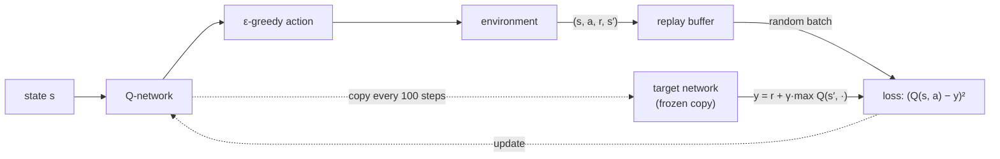

<!-- Written by `npm run lessons` from the lesson data in src/data. Edit the lesson there, not this page. -->

# Deep Q-networks (DQN): Q-learning with a neural network

**ML Foundations · Unit 7: Generative models and reinforcement learning · Lesson 5 of 6**

> **In one line.** A deep Q-network replaces the Q-table of Q-learning with a neural network that takes a state and outputs a value for every action. It is trained on remembered experience, towards targets computed by a slowly updated copy of itself.

[Open this lesson on the site](https://learn.hamropedia.com/foundations/deep-q-networks-dqn-q-learning-with-a-neural-network/) for its animation, the practice game and tap-to-explain words.

## The problem it solves

A Q-table needs one row for every state. A grid of 16 squares fits; a game screen, a robot's sensors or a conversation never will, because there are more possible states than could ever be stored. A network shares what it learns between similar states, so it can value states it has never seen.

DQN was the first method to learn dozens of Atari games from the raw pixels. Its two tricks, a replay buffer and a target network, are still in almost every value-based method.

## The idea

Keep Q-learning, but swap the table for a network that outputs a value for every action. Two additions keep the training stable: a replay buffer of past moves, learned from in random order, and a frozen copy of the network that computes the targets.

## How it works, step by step

1. The network takes a state (here 16 numbers, with a 1 for the agent's square) and outputs four numbers: the estimated Q-value of moving up, down, left and right.
2. Act with ε-greedy: with probability ε take a random action, otherwise the action with the highest Q-value. Start with ε = 1, all random, and lower it to 0.05.
3. Store every move (s, a, r, s′, done) in a replay buffer: a list of the last 5,000 moves.
4. At every step, draw 32 random moves from the buffer. For each, build the target y = r + γ·max Q_target(s′, ·), or just y = r if that move ended the episode.
5. Train the network to bring Q(s, a) closer to y, with the squared error. Only the output for the action that was taken is trained.
6. Q_target is a frozen copy of the network, refreshed every 100 steps. Without it the target would move every time the network changed, like chasing your own shadow.
7. After 300 episodes, following the highest Q-value from the start reaches the goal in 6 moves, the fewest possible. The network values the start at 0.59 = 0.9⁵: one reward, discounted five times.

## Picture it



*Acting fills the replay buffer; learning draws random batches from it. The frozen target network supplies the value to aim at.*

## Analogy

A chess player who keeps a diary of her games. Each evening she studies random old positions, not just today's game, and grades every move against last week's notes, which stay the same while she studies.

**Where the analogy breaks.** Her notes could come from a stronger player. The target network is only an older copy of the same learner, so early targets are as wrong as the learner is. The two improve together, and that is why the estimates can drift too high.

## Worked example

A 4 × 4 grid: start in the top-left corner, goal in the bottom-right, reward 1 for reaching the goal, γ = 0.9. After 300 episodes the greedy path is 6 moves long, the shortest possible, and Q(start, best move) = 0.59, which matches the exact value 0.9⁵ ≈ 0.59.

```python
q_taken = q(S).gather(1, A[:, None]).squeeze(1)       # Q(s, a) for the moves that were taken
with torch.no_grad():                                 # the target is not trained
    best_next = target(S2).max(dim=1).values
    y = R + gamma * best_next * (1 - done)            # just r when the episode ended
loss = nn.functional.mse_loss(q_taken, y)
opt.zero_grad(); loss.backward(); opt.step()
if steps % 100 == 0:
    target.load_state_dict(q.state_dict())            # refresh the frozen copy
```

## Must know

- A network Q(s, ·) replaces the table: one forward pass gives the value of every action.
- Target y = r + γ·max Q_target(s′, ·), loss (Q(s, a) − y)². It is the Q-learning update written as a regression problem.
- Replay buffer: train on random old moves. It reuses experience, and it stops a run of very similar moves from pulling the network one way and then another.
- Target network: a frozen copy used only to compute y, refreshed now and then, so that the target holds still.
- Exploration is not optional: the agent can only learn the value of what it has tried.
- The max in the target tends to overestimate values. Double DQN reduces this: one network chooses the action and the other scores it.

## Common mistakes

- Letting gradients flow through the target. Compute y with no gradient, from the target network.
- Forgetting the last move of an episode: there is no next state, so the target is just r.
- Dropping exploration too early, so the agent never finds the reward.
- Using DQN where actions are continuous. The max needs a short list of actions; use policy gradients there.

> **Not true:** Continuous actions (a steering angle): DQN handles them as well as a short list of actions.  
> **In fact:** DQN's target takes a max over the actions, which needs a short list of them. For continuous actions, use policy-gradient methods instead.

> **Not true:** Last move of an episode: the target is still y = r + γ·max Q_target(s′, ·).  
> **In fact:** After the last move there is no next state, so the target is just the reward r. Adding a value there teaches the network something false.

## Practise

Try each one yourself first: on paper, in code or out loud. Then open the answer and compare.

### 1. Derive

A move gives reward 0 and lands on a square where the target network says Q(s′, ·) = [0.2, 0.7, 0.1, 0.5]. With γ = 0.9, compute the target y. The network currently says Q(s, a) = 0.4: what is the loss, and which way is Q(s, a) pushed? Then do the same for a move that reaches the goal with reward 1.

<details>
<summary>Show one good answer</summary>

First move: reward 0, then the best the next square offers.  
y = r + γ·max Q_target(s′, ·) = 0 + 0.9 × 0.7 = 0.63.  
Loss = (Q(s, a) − y)² = (0.4 − 0.63)² = 0.0529.  
The network's value is below the target, so the update pushes Q(s, a) up, towards 0.63.

Second move: it reaches the goal, so the episode is over and there is no next square to add.  
y = r = 1.  
Loss = (0.4 − 1)² = 0.36.  
Again Q(s, a) is pushed up, towards 1.

Notice what the first target is made of: another estimate. The network learns from its own guesses about the next square, and only the moves into the goal bring in a real number from the environment. That is how value spreads backwards from the goal, one square per round of learning, and it is why a wrong estimate can be copied from square to square.

</details>

### 2. Build

Build the DQN from the lesson for the 4 × 4 grid: the environment, the network, ε-greedy actions, the replay buffer and the target network. Print the greedy path and Q(start, best move), and compare it with 0.9⁵.

<details>
<summary>Show one good answer</summary>

The environment is a function step(s, a) that returns the next square, the reward and whether the episode has ended. The agent acts with ε-greedy, stores every move in the replay buffer, and after each move trains on 32 random moves from it. The targets come from the frozen copy, which is refreshed every 100 steps.

After 300 episodes the greedy path from the start is [0, 4, 5, 6, 10, 11, 15]: 6 moves, the fewest possible on a 4 × 4 grid. The network values the start at 0.59, and the exact answer is 0.9⁵ = 0.59049, because the single reward arrives on the sixth move and is discounted five times.

A table would solve this small grid just as well. The point of the network is that nothing in this code depends on the number of states: swap the 16 numbers for the pixels of a game screen and a bigger network, and it is the method that learned Atari games.

```python
import random
import torch
import torch.nn as nn

N, GOAL = 4, 15                                         # a 4 x 4 grid, goal in the bottom-right corner
MOVES = [(-1, 0), (1, 0), (0, -1), (0, 1)]              # up, down, left, right

def step(s, a):                                         # the environment: (next state, reward, done)
    r, c = divmod(s, N)
    r = min(N - 1, max(0, r + MOVES[a][0]))             # a move into a wall leaves you where you are
    c = min(N - 1, max(0, c + MOVES[a][1]))
    s2 = r * N + c
    return s2, float(s2 == GOAL), s2 == GOAL

one_hot = lambda s: torch.eye(N * N)[s]                 # a state as 16 numbers

def train(gamma=0.9, explore=True, seed=0):
    random.seed(seed); torch.manual_seed(seed)
    q = nn.Sequential(nn.Linear(N * N, 32), nn.ReLU(), nn.Linear(32, 4))       # Q(s, ·): one value per move
    target = nn.Sequential(nn.Linear(N * N, 32), nn.ReLU(), nn.Linear(32, 4))  # the frozen copy
    target.load_state_dict(q.state_dict())
    opt = torch.optim.Adam(q.parameters(), lr=1e-3)
    buffer, steps, wins = [], 0, 0
    for episode in range(300):
        s = 0
        eps = max(0.05, 1 - episode / 200) if explore else 0.0                 # explore less over time
        for _ in range(50):
            a = random.randrange(4) if random.random() < eps else q(one_hot(s)).argmax().item()
            s2, r, done = step(s, a)
            buffer.append((s, a, r, s2, done)); buffer[:] = buffer[-5000:]     # the replay buffer
            s, steps = s2, steps + 1

            batch = random.sample(buffer, min(32, len(buffer)))                # learn from random old moves
            S, A, R, S2, Dn = zip(*batch)
            S, S2 = torch.stack([one_hot(x) for x in S]), torch.stack([one_hot(x) for x in S2])
            A, R, Dn = torch.tensor(A), torch.tensor(R), torch.tensor(Dn, dtype=torch.float32)
            with torch.no_grad():                                              # the target is not trained
                y = R + gamma * target(S2).max(dim=1).values * (1 - Dn)       # just r when the episode ended
            loss = nn.functional.mse_loss(q(S).gather(1, A[:, None]).squeeze(1), y)
            opt.zero_grad(); loss.backward(); opt.step()
            if steps % 100 == 0:
                target.load_state_dict(q.state_dict())                         # refresh the frozen copy
            if done:
                wins += 1
                break

    s, path = 0, [0]                                    # follow the learned values from the start
    for _ in range(20):
        s, _, done = step(s, q(one_hot(s)).argmax().item()); path.append(s)
        if done: break
    return path, q(one_hot(0)).max().item(), wins

path, q_start, wins = train()
print("greedy path:", path, "in", len(path) - 1, "moves")
print("Q(start, best move):", round(q_start, 2), "| exact value 0.9 ** 5 =", round(0.9 ** 5, 2))
# greedy path: [0, 4, 5, 6, 10, 11, 15] in 6 moves
# Q(start, best move): 0.59 | exact value 0.9 ** 5 = 0.59
```

</details>

### 3. Break

Set γ = 1 and train with five different seeds. Does the greedy path still reach the goal, and what is Q(start)? (No return can be more than 1.) Then put γ back to 0.9 and train with no exploration at all, ε = 0, for five seeds.

<details>
<summary>Show one good answer</summary>

γ = 1: in all five runs the greedy path fails to reach the goal within 20 moves, and Q(start) comes out between 1.22 and 1.51, although no return can be more than 1.

Two things go wrong together. With no discount, every square that can reach the goal is truly worth exactly 1, so the values no longer say "nearer is better": the agent has no reason to prefer a short route, or to stop wandering. And the max in the target picks the largest of four noisy estimates, which is too high on average. With γ below 1 each round of learning shrinks such errors; with γ = 1 nothing shrinks them, and they are copied from square to square. (The "Go deeper" of the previous lesson shows this shrinking factor is exactly γ.)

ε = 0, back with γ = 0.9: in two of five runs the agent never reaches the goal once in 300 episodes, and Q(start) stays at 0.00. It has never seen a reward, so there is nothing to learn from. The other three runs are lucky: their random starting weights happen to walk the agent to the goal, and two of them then learn the right value, 0.59.

So exploration is what turns "lucky or not" into "always". The agent can only learn the value of moves it has actually tried.

```python
# The same train() as in Build, called with different settings.
for seed in range(5):
    path, q_start, wins = train(gamma=1.0, seed=seed)
    print(f"gamma 1,   seed {seed}: reached the goal: {path[-1] == GOAL}, Q(start) = {q_start:.2f}")
for seed in range(5):
    path, q_start, wins = train(explore=False, seed=seed)
    print(f"epsilon 0, seed {seed}: goal reached in {wins} of 300 training episodes, Q(start) = {q_start:.2f}")
# gamma 1,   seed 0: reached the goal: False, Q(start) = 1.39
# gamma 1,   seed 1: reached the goal: False, Q(start) = 1.42
# gamma 1,   seed 2: reached the goal: False, Q(start) = 1.45
# gamma 1,   seed 3: reached the goal: False, Q(start) = 1.51
# gamma 1,   seed 4: reached the goal: False, Q(start) = 1.22
# epsilon 0, seed 0: goal reached in 50 of 300 training episodes, Q(start) = 0.06
# epsilon 0, seed 1: goal reached in 0 of 300 training episodes, Q(start) = 0.00
# epsilon 0, seed 2: goal reached in 245 of 300 training episodes, Q(start) = 0.59
# epsilon 0, seed 3: goal reached in 0 of 300 training episodes, Q(start) = 0.00
# epsilon 0, seed 4: goal reached in 279 of 300 training episodes, Q(start) = 0.59
```

</details>

### 4. Explain

Explain the replay buffer and the target network with the chess-diary picture.

<details>
<summary>Show one good answer</summary>

A chess player keeps a diary of every position she has played and the move she made. That diary is the replay buffer. In the evening she doesn't only think about today's game: she opens the diary at random pages and studies old positions again. Random pages matter. If she only studied the last game, ten positions in a row would be nearly the same, and she would over-learn that one situation and forget the others.

To grade a move she needs a view of how good the resulting position was. She uses last week's notes for that, and doesn't rewrite them while she studies. Those notes are the target network: a frozen copy of what she knew a little while ago. If she graded against notes she was changing at the same moment, the standard would shift under her with every move she looked at, and her opinions could spiral instead of settling.

Every so often she replaces the old notes with her current understanding, and starts again. That is the copy every 100 steps.

</details>

## Check you understood

Answer in your head first, then open each one.

<details>
<summary>&lt;b>What does the Q-network take in, and what does it put out?&lt;/b></summary>

It takes a state and outputs one Q-value for each possible action, all in one forward pass.

</details>

<details>
<summary>&lt;b>What is the replay buffer for?&lt;/b></summary>

It stores past moves so the network can train on random batches of them. That reuses experience and stops consecutive, very similar moves from dominating the updates.

</details>

<details>
<summary>&lt;b>Why use a separate target network?&lt;/b></summary>

The target r + γ·max Q(s′, ·) depends on the network being trained. If it moved with every update, training would chase a moving goal and could become unstable. A frozen copy keeps the target still for a while.

</details>

<details>
<summary>&lt;b>The start is 6 moves from the goal, the reward is 1 and γ = 0.9. What is the start worth?&lt;/b></summary>

0.9⁵ ≈ 0.59. The reward arrives on the sixth move, so it is discounted five times.

</details>

## Go further (optional)

The lesson above is enough on its own. These free extras give a second explanation.

- CODE · [Reinforcement Learning (DQN) Tutorial](https://docs.pytorch.org/tutorials/intermediate/reinforcement_q_learning.html) · PyTorch
- READ · [Reinforcement Learning: An Introduction, Ch 6 and Ch 9](http://incompleteideas.net/book/the-book-2nd.html) · Sutton and Barto · free
- PAPER · [Human-level control through deep reinforcement learning](https://www.nature.com/articles/nature14236) · Mnih et al., Nature 2015

---

[← Reinforcement learning basics: states, actions, rewards, values](reinforcement-learning-basics-states-actions-rewards-values.md) · [All lessons](../../README.md) · [Policy gradients and PPO →](policy-gradients-and-ppo.md)
