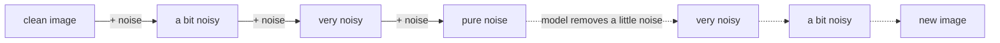

<!-- Written by `npm run lessons` from the lesson data in src/data. Edit the lesson there, not this page. -->

# Diffusion models

**ML Foundations · Unit 7: Generative models and reinforcement learning · Lesson 3 of 6**

> **In one line.** A diffusion model generates data by learning to remove noise. It is trained to predict the noise added to real data. Then it generates by starting from pure noise and denoising step by step.

[Open this lesson on the site](https://learn.hamropedia.com/foundations/diffusion-models/) for its animation, the practice game and tap-to-explain words.

## The problem it solves

Generating high-quality images, audio and video is hard: GANs are unstable to train and VAEs are blurry. Diffusion models train with a simple, stable loss and produce state-of-the-art images (Stable Diffusion, DALL·E, Imagen) and video. Their main cost is slow generation, which much current research tries to cut.

## The idea

A diffusion model learns to remove noise. In training, you take a real image, add a random amount of noise, and teach a network to predict that noise. To generate, you start from pure noise and remove it a little at a time, over many steps.

## How it works, step by step

1. Forward process: take a real sample x₀ and add Gaussian noise. In one jump to step t: x_t = √ᾱ_t · x₀ + √(1 − ᾱ_t) · ε, where ᾱ_t falls from 1 (clean) to almost 0 (pure noise).
2. Training: pick a random t, add noise ε, and train a network to predict ε from x_t and t. The loss is plain squared error.
3. The network is usually a U-Net or a transformer, told the noise level t through an embedding.
4. Generation: start from pure noise x_T and repeatedly use the predicted noise to take a small step towards cleaner data.
5. Classic DDPM uses hundreds to a thousand steps; samplers like DDIM, and distillation, cut that to a handful.
6. Conditioning: feed in a text embedding (for example from CLIP or a language model) so the denoiser follows a prompt; classifier-free guidance strengthens that effect.
7. Latent diffusion runs the whole process in a VAE's compressed latent space, which is much cheaper.

## Picture it



*Solid arrows: training adds noise. Dotted arrows: generation starts from pure noise and removes it step by step.*

## Analogy

A sculptor who starts with a rough block and removes a little stone at each step until a statue appears.

**Where the analogy breaks.** A sculptor sees the whole plan. The model only ever learns one small clean-up step, and the full picture comes from repeating it many times. That is also why generation is slow.

## Worked example

In DDPM, the noisy image is x_t = √ᾱ_t · x₀ + √(1 − ᾱ_t) · ε. The training loss is just the squared error between the true noise ε and the predicted noise.

```python
t = torch.randint(0, T, (batch,))
eps = torch.randn_like(x0)
a = alpha_bar[t].view(-1, 1, 1, 1)
x_t = a.sqrt() * x0 + (1 - a).sqrt() * eps     # add noise in one jump
loss = F.mse_loss(model(x_t, t), eps)          # learn to predict the noise
```

## Must know

- Training = predict the added noise; loss = mean squared error.
- Forward noising has a closed form for any step t.
- Generation = many small denoising steps from pure noise.
- Slow sampling is the main drawback; better samplers reduce the steps.
- Text-to-image = diffusion conditioned on a text embedding, usually in latent space.

## Common mistakes

- Thinking the model removes all the noise in one step.
- Using far fewer sampling steps with a sampler not designed for it, and getting noisy images.
- Forgetting to tell the network the noise level t.

> **Not true:** Denoising network: its input is the noisy image alone; the step t is not given.  
> **In fact:** The right correction depends on the noise level, so the step t is given to the network as an input. Without it, the network cannot tell a lightly noised image from pure noise.

> **Not true:** Fewer sampling steps: the same sampler gives equally clean images with a tenth of the steps.  
> **In fact:** A sampler built for many small steps gives noisy images when it is cut to a few. Faster samplers are designed to work with fewer steps.

## Practise

Try each one yourself first: on paper, in code or out loud. Then open the answer and compare.

### 1. Derive

Show that adding Gaussian noise step by step is the same as adding it in one jump: derive x_t = √ᾱ_t · x₀ + √(1 − ᾱ_t) · ε.

<details>
<summary>Show one good answer</summary>

One step of the forward process adds a little noise: x_t = √(1 − β_t) · x_{t−1} + √β_t · ε_t, with ε_t ~ N(0, I) fresh each step. Write α_t = 1 − β_t and ᾱ_t = α₁ · α₂ · … · α_t.

Claim: x_t = √ᾱ_t · x₀ + √(1 − ᾱ_t) · ε, with a single ε ~ N(0, I).

Proof by induction. For t = 1 it is the definition. Suppose it holds for t − 1: x_{t−1} = √ᾱ_{t−1} · x₀ + √(1 − ᾱ_{t−1}) · ε′. Then  
x_t = √α_t · x_{t−1} + √(1 − α_t) · ε_t  
= √(α_t ᾱ_{t−1}) · x₀ + √α_t · √(1 − ᾱ_{t−1}) · ε′ + √(1 − α_t) · ε_t.

The first term is √ᾱ_t · x₀, since α_t ᾱ_{t−1} = ᾱ_t. The two noise terms are independent Gaussians with mean 0, so their sum is a Gaussian whose variance is the sum of their variances:  
α_t (1 − ᾱ_{t−1}) + (1 − α_t) = α_t − α_t ᾱ_{t−1} + 1 − α_t = 1 − ᾱ_t.  
So they can be replaced by one Gaussian √(1 − ᾱ_t) · ε. Done.

Why it matters: in training you can jump straight to any step t in one line, without simulating the t steps before it, so every training example picks a random t.

</details>

### 2. Build

Train a small DDPM on MNIST or on 2D toy data like a spiral. Save samples at several points during generation to watch the noise disappear.

<details>
<summary>Show one good answer</summary>

Data: 2-D points on a spiral. Forward process: 1,000 steps with β rising linearly from 0.0001 to 0.02. The model is a small MLP that takes a noisy point x_t and the step t (as a sinusoidal embedding) and predicts the noise ε that was added. Training: pick a random point, a random t and fresh noise, build x_t in one jump with the closed form, and minimise the squared error between the true and predicted noise.

Generation (DDPM sampling): start from pure noise and run the 1,000 steps backwards, each removing the predicted noise a little and adding back a small amount of fresh noise. Snapshots at t = 1,000, 750, 500, 250 and 0 show a shapeless cloud slowly gathering into the spiral; most of the shape appears in the last few hundred steps. The final samples sit on the spiral: in the run below their average distance to the nearest real point is about 0.025, against 0.32 for pure noise and 0.009 for fresh real spiral points. (A smaller network trained for fewer steps got only to about 0.22: diffusion models need enough capacity and training to learn the noise at every level.) Training takes about 10 seconds on a laptop.

```python
import math
import torch
import torch.nn as nn
import matplotlib.pyplot as plt

def spiral(n):
    t = torch.rand(n) * 3 * math.pi + math.pi / 2
    return torch.stack([t * torch.cos(t), t * torch.sin(t)], 1) / 5 + 0.03 * torch.randn(n, 2)

class Denoiser(nn.Module):
    def __init__(self):
        super().__init__()
        self.net = nn.Sequential(nn.Linear(2 + 32, 256), nn.SiLU(), nn.Linear(256, 256), nn.SiLU(),
                                 nn.Linear(256, 256), nn.SiLU(), nn.Linear(256, 2))
    def forward(self, x, t, T):
        freqs = torch.exp(torch.arange(16) * -math.log(1000) / 16)
        angle = (t.float() / T)[:, None] * 1000 * freqs
        return self.net(torch.cat([x, torch.sin(angle), torch.cos(angle)], 1))

def train_ddpm(betas, steps=10_000, seed=0):
    torch.manual_seed(seed)
    T, alpha_bar = len(betas), torch.cumprod(1 - betas, 0)
    model, data = Denoiser(), spiral(20_000)
    opt = torch.optim.Adam(model.parameters(), lr=1e-3)
    for _ in range(steps):
        x0 = data[torch.randint(len(data), (256,))]
        t = torch.randint(0, T, (256,))
        eps = torch.randn_like(x0)
        xt = alpha_bar[t].sqrt()[:, None] * x0 + (1 - alpha_bar[t]).sqrt()[:, None] * eps    # one jump
        loss = ((model(xt, t, T) - eps) ** 2).mean()
        opt.zero_grad(); loss.backward(); opt.step()
    return model

@torch.no_grad()
def sample(model, betas, n=2000, timesteps=None, snapshots=()):
    T, alphas = len(betas), 1 - betas
    alpha_bar = torch.cumprod(alphas, 0)
    x, saved = torch.randn(n, 2), {}
    for t in (timesteps if timesteps is not None else range(T - 1, -1, -1)):
        eps = model(x, torch.full((n,), t), T)
        x = (x - betas[t] / (1 - alpha_bar[t]).sqrt() * eps) / alphas[t].sqrt()
        if t > 0:
            x = x + betas[t].sqrt() * torch.randn_like(x)
        if t in snapshots:
            saved[t] = x.clone()
    return x, saved

def distance_to_data(points, ref=spiral(5000)):
    return torch.cdist(points, ref).min(1).values.mean().item()

if __name__ == "__main__":
    betas = torch.linspace(1e-4, 0.02, 1000)
    model = train_ddpm(betas)
    x, saved = sample(model, betas, snapshots=(999, 750, 500, 250, 0))
    print(f"average distance to the spiral: samples {distance_to_data(x):.3f}, pure noise {distance_to_data(torch.randn(2000, 2)):.3f}, "
          f"real spiral points {distance_to_data(spiral(2000)):.3f}")
    fig, axes = plt.subplots(1, 5, figsize=(20, 4))
    for ax, t in zip(axes, (999, 750, 500, 250, 0)):
        ax.scatter(saved[t][:, 0], saved[t][:, 1], s=1); ax.set_title(f"t = {t}"); ax.set_xlim(-3, 3); ax.set_ylim(-3, 3)
    plt.show()
```

</details>

### 3. Break

Generate with only 10 steps instead of 1,000, using the same sampler. What goes wrong? Then try a noise schedule that rises too fast.

<details>
<summary>Show one good answer</summary>

Only 10 steps with the same DDPM sampler (using every 100th step): the samples come out as a shapeless cloud, about as far from the spiral as pure noise (0.32, against 0.025 with all 1,000 steps). The DDPM update is derived for one small step: it assumes that between step t and t − 1 only a tiny amount of noise changes. Jumping 100 steps at a time with that same formula removes far too little noise at each jump and adds the wrong amount back, so the process never reaches clean data. Fast samplers such as DDIM and DPM-Solver use update rules designed for big jumps, which is how modern models get good images in 20 to 50 steps.

A noise schedule that rises too fast (β up to 0.2 instead of 0.02): the signal is almost gone by about step 300 (√ᾱ ≈ 0.01, against 0.63 with the normal schedule), so the last 700 of the 1,000 steps are pure noise with no trace of the data. The model spends most of its training on steps where there is nothing to learn, and gets few examples of the in-between levels where the shape forms. The samples are clearly worse: in the run below, about 0.08 from the spiral against 0.025. Schedule design (like the cosine schedule) is about spreading the destruction evenly over the steps.

```python
import torch
# train_ddpm, sample and distance_to_data come from the Build answer above: save it as ddpm.py
from ddpm import train_ddpm, sample, distance_to_data

betas = torch.linspace(1e-4, 0.02, 1000)
model = train_ddpm(betas)
full, _ = sample(model, betas)
ten, _ = sample(model, betas, timesteps=range(999, -1, -100))       # 10 steps, same sampler
print(f"1,000 steps: {distance_to_data(full):.3f}, 10 steps: {distance_to_data(ten):.3f}")

fast = torch.linspace(1e-4, 0.2, 1000)                                  # noise rises 10 times faster
alpha_bar = torch.cumprod(1 - fast, 0)
print(f"signal left after 300 steps: fast schedule {alpha_bar[299].sqrt():.3f}, normal {torch.cumprod(1 - betas, 0)[299].sqrt():.3f}")
print(f"fast schedule samples: {distance_to_data(sample(train_ddpm(fast), fast)[0]):.3f}")
```

</details>

### 4. Explain

Explain diffusion with the sculptor picture, and why generation is slow.

<details>
<summary>Show one good answer</summary>

A sculptor starts with a rough block of stone and removes a little at each step until a statue appears. A diffusion model starts from pure noise and removes a little noise at each step until an image appears. To learn this, it practises the reverse: take real images, add more and more noise until nothing is left, and train a network to guess, at any noise level, what noise was added, so it can take it away.

Generation is slow because the sculpting really is step by step: each step needs a full pass through a large network, and the classic method uses hundreds to a thousand steps, where a GPT-style model makes one pass per token and a GAN one pass per image. Faster samplers and distilled models cut this to a handful of steps.

</details>

## Check you understood

Answer in your head first, then open each one.

<details>
<summary>&lt;b>What is a diffusion model trained to predict?&lt;/b></summary>

The noise ε that was added to a clean sample, given the noisy sample and the noise level.

</details>

<details>
<summary>&lt;b>Why is diffusion generation slow?&lt;/b></summary>

It applies the denoising network many times in sequence, once per step.

</details>

<details>
<summary>&lt;b>What does latent diffusion change?&lt;/b></summary>

It runs diffusion on a compressed latent code from a VAE instead of on full-size pixels, which is much cheaper.

</details>

<details>
<summary>&lt;b>How does a text prompt control a diffusion model?&lt;/b></summary>

The denoiser is conditioned on an embedding of the text at every step, often strengthened with classifier-free guidance.

</details>

## Go further (optional)

The lesson above is enough on its own. These free extras give a second explanation.

- READ · [The Illustrated Stable Diffusion](https://jalammar.github.io/illustrated-stable-diffusion/) · Jay Alammar · illustrated  
  **Worth it:** Colourful step-by-step pictures of noising, denoising, latent space and text conditioning. The clearest picture of how image generators work.
- READ · [Understanding Deep Learning, Ch 18 (diffusion models)](https://udlbook.github.io/udlbook/) · Simon Prince · free
- READ · [The Annotated Diffusion Model](https://huggingface.co/blog/annotated-diffusion) · Hugging Face blog · code walkthrough
- READ · [What are Diffusion Models?](https://lilianweng.github.io/posts/2021-07-11-diffusion-models/) · Lilian Weng
- PAPER · [Denoising Diffusion Probabilistic Models (DDPM, 2020)](https://arxiv.org/abs/2006.11239) · Ho, Jain, Abbeel · arXiv

---

[← GANs: a generator against a discriminator](gans-a-generator-against-a-discriminator.md) · [All lessons](../../README.md) · [Reinforcement learning basics: states, actions, rewards, values →](reinforcement-learning-basics-states-actions-rewards-values.md)
